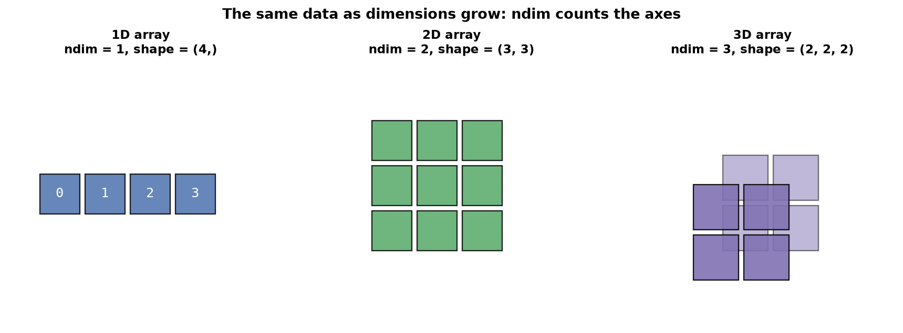
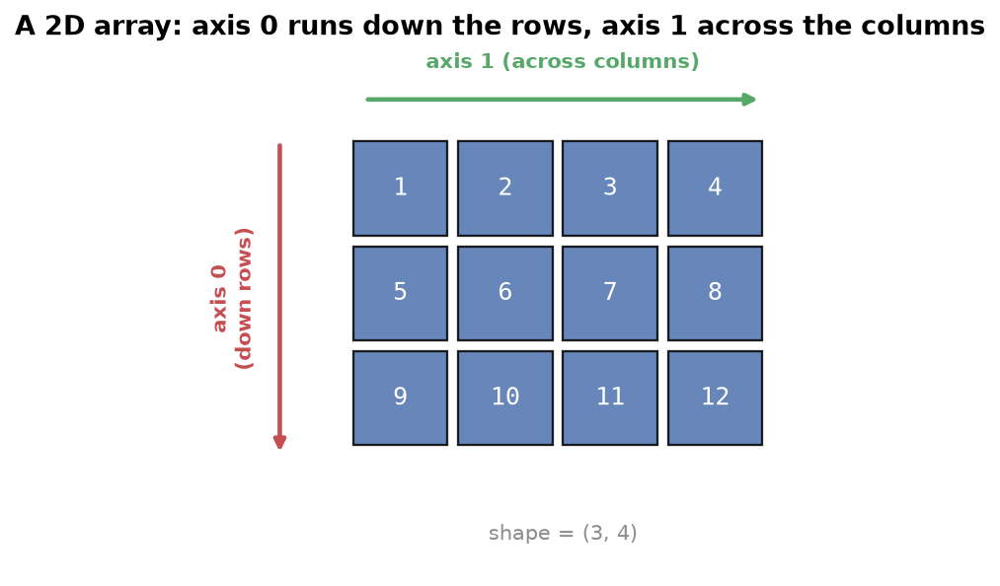
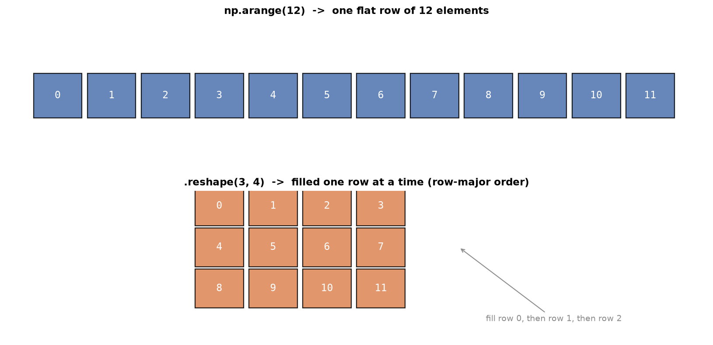

---
tags:
  - numpy
  - arrays
  - ndarray
  - scientific-computing
aliases:
  - NumPy Fundamentals
  - NumPy Arrays
  - ndarray
difficulty: beginner
runnable: true
prerequisites:
  - Lists
created: 2026-10-13
---

> [!info] Where this fits
> This builds on [[Lists]], whose array-versus-list contrast and indexing carry straight over. NumPy is the foundation of the scientific Python stack: pandas, scikit-learn, and the deep learning libraries all store their data as NumPy arrays. Once you can create, reshape, and operate on arrays, you continue to [[Advanced NumPy]].

**NumPy** is the fundamental package for numerical computing in Python. Its core is the `ndarray`, an n-dimensional array of values that all share one data type. A Python list can hold anything and grows on demand, which is convenient but slow. A NumPy array fixes the type and the size so the data sits in one compact block that the CPU can race through. This note covers what the `ndarray` is, how to create and inspect arrays, how to compute with them element by element, and how to index, reshape, stack, and split them.

---

## What NumPy is

A **NumPy array** (`ndarray`) is a grid of values of a single type, stored in one contiguous block of memory. Two properties set it apart from a Python list.

- **Homogeneous.** Every element has the same data type, so every element takes the same number of bytes. A list is heterogeneous and can mix types.
- **Fixed size.** The size is set when the array is created. Growing an array creates a new array and discards the old one, whereas a list grows in place.

These constraints are the source of NumPy's speed. Because the elements are the same size and packed together, NumPy runs tight, compiled loops over the whole block and applies one operation to every element at once. That style is called **vectorization**, and it replaces slow Python-level loops with fast array-level operations.

An array also has a number of dimensions. A 1D array is a vector, a 2D array is a matrix, and a 3D array is a stack of matrices. The number of dimensions is the array's **rank**, and NumPy calls each dimension an **axis**.



> [!note]
> NumPy ships many derived objects and routines (matrices, masked arrays, Fourier transforms, linear algebra, random sampling), but the `ndarray` is the object everything else is built on. Learn it first.

---

## Creating arrays

The import convention is universal: `import numpy as np`. The simplest constructor, `np.array`, turns a Python list into a 1D array.

```python
import numpy as np

a = np.array([1, 2, 3])
print(a)
```

```text
[1 2 3]
```

Nest lists to build higher dimensions. One level of nesting gives a 2D array (a matrix), two levels give a 3D array.

```python
import numpy as np

b = np.array([[1, 2, 3], [4, 5, 6]])
print(b)

c = np.array([[[1, 2], [3, 4]], [[5, 6], [7, 8]]])
print(c)
```

```text
[[1 2 3]
 [4 5 6]]
[[[1 2]
  [3 4]]

 [[5 6]
  [7 8]]]
```

Pass `dtype=` to force a type at creation. Here integers become floats.

```python
# cortex:norun
np.array([1, 2, 3], dtype=float)
# array([1., 2., 3.])
```

Typing out every element is impractical, so NumPy provides routines that generate arrays.

| Routine | What it makes |
| :--- | :--- |
| `np.arange(start, stop, step)` | evenly spaced values, like `range` but returning an array |
| `np.ones(shape)` | an array filled with `1.0` |
| `np.zeros(shape)` | an array filled with `0.0` |
| `np.random.random(shape)` | an array of random floats in `[0, 1)` |
| `np.linspace(start, stop, num)` | `num` values spaced evenly between `start` and `stop` inclusive |
| `np.identity(n)` | the `n` by `n` identity matrix |

`np.arange` takes a step, exactly like the built-in `range`.

```python
import numpy as np

np.arange(1, 11, 2)
```

```text
array([1, 3, 5, 7, 9])
```

Chain `.reshape` to fold a flat range into any shape whose sizes multiply to the element count. Here 16 elements become a 2 by 2 by 2 by 2 array.

```python
import numpy as np

np.arange(16).reshape(2, 2, 2, 2)
```

```text
array([[[[ 0,  1],
         [ 2,  3]],
        [[ 4,  5],
         [ 6,  7]]],
       [[[ 8,  9],
         [10, 11]],
        [[12, 13],
         [14, 15]]]])
```

`np.ones` and `np.zeros` take a shape tuple and are the usual way to pre-allocate an array you will fill later.

```python
import numpy as np

np.ones((3, 4))
```

```text
array([[1., 1., 1., 1.],
       [1., 1., 1., 1.],
       [1., 1., 1., 1.]])
```

```python
import numpy as np

np.zeros((3, 4))
```

```text
array([[0., 0., 0., 0.],
       [0., 0., 0., 0.],
       [0., 0., 0., 0.]])
```

`np.random.random` fills a shape with random floats between 0 and 1. Its output changes every run, so the values below are illustrative.

```python
# cortex:norun
np.random.random((3, 4))
# array([[0.85721156, 0.31248316, 0.08807828, 0.35230774],
#        [0.96813914, 0.44681708, 0.56396358, 0.53020065],
#        [0.03277116, 0.28543753, 0.09521082, 0.87967034]])
```

`np.linspace` differs from `np.arange` in what you fix. With `arange` you choose the step and NumPy decides how many values you get. With `linspace` you choose how many values you want and NumPy computes the spacing to fit them between the endpoints inclusive.

```python
import numpy as np

np.linspace(-10, 10, 10, dtype=int)
```

```text
array([-10,  -8,  -6,  -4,  -2,   1,   3,   5,   7,  10])
```

`np.identity` returns a square matrix with ones on the diagonal and zeros elsewhere.

```python
import numpy as np

np.identity(3)
```

```text
array([[1., 0., 0.],
       [0., 1., 0.],
       [0., 0., 1.]])
```

---

## Array attributes

Every array carries metadata you read through attributes, not function calls. The examples below use three arrays of different ranks.

```python
# cortex:norun
a1 = np.arange(10, dtype=np.int32)         # 1D, 10 ints
a2 = np.arange(12, dtype=float).reshape(3, 4)  # 2D, 3 by 4 floats
a3 = np.arange(8).reshape(2, 2, 2)         # 3D, 2 by 2 by 2
```

| Attribute | Returns | Example value |
| :--- | :--- | :--- |
| `ndim` | number of dimensions (axes) | `a3.ndim` is `3` |
| `shape` | size along each axis, as a tuple | `a3.shape` is `(2, 2, 2)` |
| `size` | total number of elements | `a2.size` is `12` |
| `itemsize` | bytes used by one element | `a3.itemsize` is `8` |
| `dtype` | the element data type | `a1.dtype` is `int32` |

`ndim` counts the axes, which equals the depth of nesting.

```python
# cortex:norun
a3.ndim
# 3
```

`shape` gives the length of every axis. The product of the shape equals `size`.

```python
# cortex:norun
a3.shape
# (2, 2, 2)
```

`itemsize` reports the bytes per element, which follows directly from the `dtype`. An `int64` element takes 8 bytes, an `int32` element takes 4.

```python
# cortex:norun
print(a1.dtype)   # int32
print(a2.dtype)   # float64
print(a3.dtype)   # int64
```

---

## Changing the data type

Casting an array to another type is useful when you want to shrink memory (store small integers as `int8`) or move between integers and floats. **`astype`** returns a new array with the requested `dtype`; it does not change the original in place.

```python
# cortex:norun
a3 = np.arange(8).reshape(2, 2, 2)
a3.astype(np.int32)
# array([[[0, 1],
#         [2, 3]],
#        [[4, 5],
#         [6, 7]]], dtype=int32)
```

> [!tip]
> Narrowing the `dtype` is the simplest way to cut an array's memory footprint. An array of values that never exceed 127 fits in `int8` and uses one eighth of the memory of the default `int64`.

---

## Array operations

Arithmetic and comparison operators work on whole arrays at once, element by element, with no loop. Two same-shaped arrays line up position by position.

```python
import numpy as np

a1 = np.arange(12).reshape(3, 4)
a2 = np.arange(12, 24).reshape(3, 4)
print(a1 + a2)
print(a1 * a2)
```

```text
[[12 14 16 18]
 [20 22 24 26]
 [28 30 32 34]]
[[  0  13  28  45]
 [ 64  85 108 133]
 [160 189 220 253]]
```

Comparison operators work the same way and return a boolean array of the same shape, one `True` or `False` per element. That boolean array is the basis of the filtering you will meet in [[Advanced NumPy]].

---

## Scalar and vector operations

NumPy distinguishes two cases, and both avoid an explicit loop.

- **Scalar operation:** one array and one plain number. The number is applied to every element.
- **Vector operation:** two arrays of the same shape. The operator is applied position by position.

A scalar arithmetic operation applies the number everywhere. Squaring an array squares each element.

```python
import numpy as np

a1 = np.arange(12).reshape(3, 4)
a1 ** 2
```

```text
array([[  0,   1,   4,   9],
       [ 16,  25,  36,  49],
       [ 64,  81, 100, 121]])
```

A scalar relational operation compares every element against the number and returns a boolean array.

```python
import numpy as np

a2 = np.arange(12, 24).reshape(3, 4)
a2 == 15
```

```text
array([[False, False, False,  True],
       [False, False, False, False],
       [False, False, False, False]])
```

A vector operation combines two arrays element by element. Here each element of `a1` is raised to the matching element of `a2`.

```python
import numpy as np

a1 = np.arange(12).reshape(3, 4)
a2 = np.arange(12, 24).reshape(3, 4)
a1 ** a2
```

```text
array([[                   0,                    1,                16384,
                    14348907],
       [          4294967296,         762939453125,      101559956668416,
           11398895185373143],
       [ 1152921504606846976, -1261475310744950487,  1864712049423024128,
         6839173302027254275]])
```

> [!warning]
> The wrapped and negative values in that last result are integer overflow. Raising large integers to large powers exceeds the range of a 64-bit integer, and NumPy wraps around rather than switching to arbitrary precision the way a plain Python `int` would. Watch the `dtype` when exponents grow.

---

## Array functions

NumPy provides reductions that collapse an array to a summary and element-wise functions that transform every value. The examples use a 3 by 3 array of random integers, so treat the exact numbers as illustrative; the shapes and behavior are what matter.

```python
# cortex:norun
a1 = np.random.random((3, 3))
a1 = np.round(a1 * 100)
a1
# array([[43., 28., 71.],
#        [27., 93., 36.],
#        [31., 18.,  7.]])
```

**Reductions** such as `np.sum`, `np.prod`, `np.max`, and `np.min` collapse the array. The `axis` argument chooses the direction of the collapse: `axis=0` reduces down the columns, `axis=1` reduces across the rows. With no `axis`, the whole array reduces to one number.



```python
# cortex:norun
np.prod(a1, axis=0)   # product down each column
# array([35991., 46872., 17892.])
```

**Statistical functions** `np.mean`, `np.median`, `np.std`, and `np.var` take the same `axis` argument. Here the variance is computed across each row.

```python
# cortex:norun
np.var(a1, axis=1)
# array([317.55555556, 854.        ,  96.22222222])
```

**Trigonometric functions** such as `np.sin` and `np.cos` apply element-wise and return an array of the same shape.

```python
# cortex:norun
np.sin(a1)
# array([[-0.83177474,  0.27090579,  0.95105465],
#        [ 0.95637593, -0.94828214, -0.99177885],
#        [-0.40403765, -0.75098725,  0.6569866 ]])
```

**Logarithm and exponential** functions `np.log` and `np.exp` also apply to every element.

```python
# cortex:norun
np.exp(a1)
# array([[4.72783947e+18, 1.44625706e+12, 6.83767123e+30],
#        [5.32048241e+11, 2.45124554e+40, 4.31123155e+15],
#        [2.90488497e+13, 6.56599691e+07, 1.09663316e+03]])
```

---

## Rounding functions

Three functions round floating-point arrays, each with a different rule.

- **`np.round`** rounds to the nearest integer (or to a given number of decimals).
- **`np.floor`** rounds down toward negative infinity.
- **`np.ceil`** rounds up toward positive infinity.

Because the input below is random, the exact numbers vary per run.

```python
# cortex:norun
np.ceil(np.random.random((2, 3)) * 100)
# array([[48.,  4.,  6.],
#        [ 3., 18., 82.]])
```

---

## The dot product

The **dot product** multiplies two matrices in the linear-algebra sense, not element by element. For `np.dot(A, B)` the arrays must be conformable: the number of columns of `A` must equal the number of rows of `B`. A `(3, 4)` array times a `(4, 3)` array yields a `(3, 3)` result.

```python
import numpy as np

a2 = np.arange(12).reshape(3, 4)
a3 = np.arange(12, 24).reshape(4, 3)
np.dot(a2, a3)
```

```text
array([[114, 120, 126],
       [378, 400, 422],
       [642, 680, 718]])
```

> [!warning]
> If the inner dimensions do not match, for example a `(3, 4)` array times a `(3, 4)` array, NumPy raises a `ValueError`. Check that the columns of the left operand equal the rows of the right operand before calling `np.dot`.

---

## Indexing and slicing

Indexing pulls out single elements; slicing pulls out ranges. Both extend the rules from [[Lists]] to multiple dimensions, with one index or slice per axis, separated by commas.

For a 1D array, indexing is identical to a list.

```python
# cortex:norun
a1 = np.arange(10)
a1[2]
# 2
```

For a 2D array, give a row index and a column index. `a2[1, 0]` reads row 1, column 0.

```python
# cortex:norun
a2 = np.arange(12).reshape(3, 4)
a2[1, 0]
# 4
```

For a 3D array, supply three indices, one per axis.

```python
# cortex:norun
a3 = np.arange(8).reshape(2, 2, 2)
a3[1, 0, 1]   # 5
a3[1, 1, 0]   # 6
```

**Slicing** uses `start:stop:step` on each axis, with `stop` excluded. A 1D slice with a step skips elements.

```python
# cortex:norun
a1 = np.arange(10)
a1[2:5:2]
# array([2, 4])
```

On a 2D array, the first slice selects rows and the second selects columns. A lone `:` means the whole axis.

```python
# cortex:norun
a2 = np.arange(12).reshape(3, 4)
a2[0:2, 1::2]   # array([[1, 3], [5, 7]])
a2[::2, 1::2]   # array([[ 1,  3], [ 9, 11]])
a2[1, ::3]      # array([4, 7])
a2[0, :]        # array([0, 1, 2, 3])   first row
a2[:, 2]        # array([ 2,  6, 10])   third column
a2[1:, 1:3]     # array([[ 5,  6], [ 9, 10]])
```

On a 3D array, slice each of the three axes. Mixing an integer and slices drops that axis from the result.

```python
# cortex:norun
a3 = np.arange(27).reshape(3, 3, 3)
a3[::2, 0, ::2]   # array([[ 0,  2], [18, 20]])
a3[2, 1:, 1:]     # array([[22, 23], [25, 26]])
a3[0, 1, :]       # array([3, 4, 5])
```

---

## Iterating

A plain `for` loop over an array iterates along **axis 0**, the outermost axis. Over a 1D array you get scalars; over a 2D array you get rows; over a 3D array you get 2D slices.

```python
import numpy as np

a2 = np.arange(12).reshape(3, 4)
for row in a2:
    print(row)
```

```text
[0 1 2 3]
[4 5 6 7]
[ 8  9 10 11]
```

To visit every element regardless of rank, use **`np.nditer`**, which flattens the iteration to one element at a time.

```python
import numpy as np

a3 = np.arange(8).reshape(2, 2, 2)
for x in np.nditer(a3):
    print(x)
```

```text
0
1
2
3
4
5
6
7
```

---

## Reshaping

Three operations rearrange an array without changing its data.

- **`reshape`** returns a new view with a different shape, as long as the element count stays the same.
- **Transpose** (`np.transpose` or the `.T` attribute) swaps the axes, turning rows into columns.
- **`ravel`** flattens any array back to 1D.



Transpose flips a matrix across its diagonal.

```python
import numpy as np

a2 = np.arange(12).reshape(3, 4)
a2.T
```

```text
array([[ 0,  4,  8],
       [ 1,  5,  9],
       [ 2,  6, 10],
       [ 3,  7, 11]])
```

`ravel` collapses any shape into a single 1D array, reading in row-major order.

```python
import numpy as np

a3 = np.arange(27).reshape(3, 3, 3)
a3.ravel()
```

```text
array([ 0,  1,  2,  3,  4,  5,  6,  7,  8,  9, 10, 11, 12, 13, 14, 15, 16,
       17, 18, 19, 20, 21, 22, 23, 24, 25, 26])
```

---

## Stacking and splitting

**Stacking** joins arrays into a larger one; **splitting** cuts one array into several. They are inverses.

- **`np.hstack`** stacks horizontally, placing arrays side by side (more columns).
- **`np.vstack`** stacks vertically, placing arrays top to bottom (more rows).
- **`np.hsplit`** splits horizontally into a given number of equal column-wise pieces.
- **`np.vsplit`** splits vertically into equal row-wise pieces.

Horizontal stacking widens the arrays.

```python
import numpy as np

a4 = np.arange(12).reshape(3, 4)
a5 = np.arange(12, 24).reshape(3, 4)
np.hstack((a4, a5))
```

```text
array([[ 0,  1,  2,  3, 12, 13, 14, 15],
       [ 4,  5,  6,  7, 16, 17, 18, 19],
       [ 8,  9, 10, 11, 20, 21, 22, 23]])
```

Vertical stacking deepens them.

```python
import numpy as np

a4 = np.arange(12).reshape(3, 4)
a5 = np.arange(12, 24).reshape(3, 4)
np.vstack((a4, a5))
```

```text
array([[ 0,  1,  2,  3],
       [ 4,  5,  6,  7],
       [ 8,  9, 10, 11],
       [12, 13, 14, 15],
       [16, 17, 18, 19],
       [20, 21, 22, 23]])
```

`np.hsplit` returns a list of arrays. The count must divide the number of columns evenly. A `(3, 4)` array split into 2 gives two `(3, 2)` arrays.

```python
import numpy as np

a4 = np.arange(12).reshape(3, 4)
np.hsplit(a4, 2)
```

```text
[array([[0, 1],
       [4, 5],
       [8, 9]]), array([[ 2,  3],
       [ 6,  7],
       [10, 11]])]
```

`np.vsplit` is the vertical counterpart, and the count must divide the number of rows. A `(4, 6)` array split into 2 gives two `(2, 6)` arrays.

```python
import numpy as np

a6 = np.arange(24).reshape(4, 6)
np.vsplit(a6, 2)
```

```text
[array([[ 0,  1,  2,  3,  4,  5],
       [ 6,  7,  8,  9, 10, 11]]), array([[12, 13, 14, 15, 16, 17],
       [18, 19, 20, 21, 22, 23]])]
```

> [!warning]
> Both split functions require an even division. Splitting a 4-column array into 3 pieces raises a `ValueError` because 4 is not divisible by 3. Choose a count that divides the relevant axis.

---

## Summary

1. A **NumPy array** (`ndarray`) is a homogeneous, fixed-size, contiguous grid of values; those constraints let NumPy vectorize operations and run far faster than Python loops.
2. Create arrays with `np.array` from nested lists, or generate them with `np.arange`, `np.ones`, `np.zeros`, `np.random.random`, `np.linspace`, and `np.identity`.
3. Inspect an array through its attributes: `ndim`, `shape`, `size`, `itemsize`, and `dtype`.
4. Change an array's type with `astype`, which returns a new array and is the simplest way to cut memory.
5. Operators act element-wise: a scalar is applied to every element, and two same-shaped arrays combine position by position, including relational operators that return boolean arrays.
6. Reductions (`sum`, `prod`, `max`, `min`, `mean`, `median`, `std`, `var`) take an `axis`: `axis=0` collapses columns, `axis=1` collapses rows. Element-wise functions include `sin`, `log`, and `exp`.
7. `np.round`, `np.floor`, and `np.ceil` round to the nearest, down, and up.
8. `np.dot` is the matrix dot product and needs conformable shapes: the columns of the left operand must equal the rows of the right.
9. Index and slice with one entry per axis, separated by commas, using `start:stop:step`; a plain `for` loop walks axis 0, and `np.nditer` visits every element.
10. Rearrange data with `reshape`, transpose (`.T`), and `ravel`; combine and cut arrays with `np.hstack`, `np.vstack`, `np.hsplit`, and `np.vsplit`.

---

> [!info] Continues to
> Next, [[Advanced NumPy]] builds on these basics with fancy and boolean indexing, broadcasting, vectorized mathematical formulas, and handling missing values.
