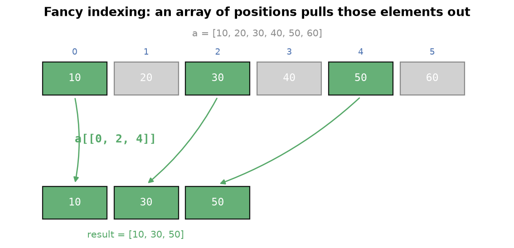
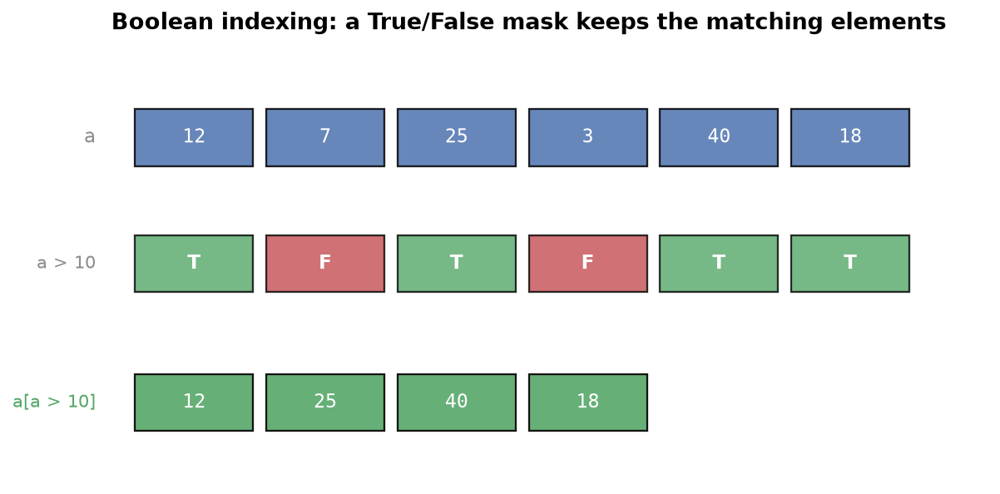
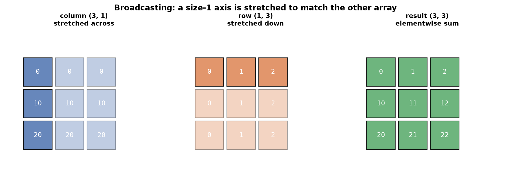

---
tags:
  - numpy
  - broadcasting
  - indexing
  - vectorization
aliases:
  - Advanced NumPy
  - NumPy Broadcasting
  - Fancy Indexing
difficulty: intermediate
runnable: true
prerequisites:
  - NumPy Fundamentals
created: 2026-10-13
---

> [!info] Where this fits
> This builds on [[NumPy Fundamentals]], where you learned to create, inspect, and operate on arrays. Here you move from "arrays exist" to why they are fast and how a practitioner indexes and broadcasts them: pulling arbitrary elements, filtering by condition, combining arrays of different shapes, and writing vectorized mathematical formulas. From here you continue to [[NumPy Tricks]].

The leap from a beginner to a fluent NumPy user is not more functions, it is a shift in how you think. You stop writing loops and start expressing an operation over a whole array at once. This note covers the three pillars of that style: fancy and boolean indexing to select data, broadcasting to combine arrays whose shapes differ, and vectorized formulas such as the sigmoid and mean squared error. It assumes the array creation, indexing, reshaping, and stacking from [[NumPy Fundamentals]].

---

## NumPy arrays versus Python lists

A NumPy array beats a Python list on three fronts: speed, memory, and convenience.

**Speed.** Summing two sequences of ten million numbers with a Python loop over lists is slow because the interpreter dereferences and type-checks every element. The same sum on two NumPy arrays is one vectorized expression, `a + b`, that runs a compiled loop over contiguous memory. The array version is tens of times faster. The benchmark below is machine-dependent, so the exact seconds vary, but the ratio is the point.

```python
# cortex:norun
import numpy as np
import time

# Python lists
a = [i for i in range(10000000)]
b = [i for i in range(10000000, 20000000)]
c = []
start = time.time()
for i in range(len(a)):
    c.append(a[i] + b[i])
print(time.time() - start)
# 3.2699835300445557

# NumPy arrays
a = np.arange(10000000)
b = np.arange(10000000, 20000000)
start = time.time()
c = a + b
print(time.time() - start)
# 0.06481003761291504
```

On that run the NumPy version was about 54 times faster. The gap widens as the arrays grow.

**Memory.** An array of ten million Python integers in a list costs about 81.5 MB, because each element is a full Python object with its own header. The same ten million values in a NumPy array with `dtype=np.int8` cost about 10 MB, since each element is a single byte in one packed block.

```python
# cortex:norun
import numpy as np
import sys

a = [i for i in range(10000000)]
print(sys.getsizeof(a))
# 81528048

a = np.arange(10000000, dtype=np.int8)
print(sys.getsizeof(a))
# 10000104
```

**Convenience.** Vectorization is also less code. Adding two arrays is `a + b`, with no loop, no index bookkeeping, and no accumulator list. Operations read like the mathematics they express, which is the convenience that makes NumPy the base of the scientific Python stack.

| | Python list | NumPy array |
| :--- | :--- | :--- |
| Element type | mixed | one shared `dtype` |
| Memory layout | scattered object references | one contiguous block |
| Elementwise sum | explicit loop | `a + b` |
| Speed on large data | slow (interpreted loop) | fast (compiled, vectorized) |

---

## Advanced indexing

Before the new techniques, recall the normal indexing and slicing from [[NumPy Fundamentals]]. On a 2D array you pass one index or slice per axis, separated by a comma: the first selects rows, the second selects columns.

```python
# cortex:norun
import numpy as np

a = np.arange(24).reshape(6, 4)
a[1, 2]       # 6, the element at row 1, column 2
a[1:3, 1:3]   # the 2 by 2 block from rows 1 to 2, columns 1 to 2
```

Advanced indexing goes beyond single elements and contiguous slices. The two forms below, fancy and boolean indexing, let you pull arbitrary elements and filter by condition.

---

## Fancy indexing

**Fancy indexing** means indexing with a list or array of indices instead of a single integer or a slice. It pulls out arbitrary rows or columns in any order, even with repeats, which a slice cannot do.

Pass a list of column indices after the row slice to select those columns. Here `[0, 2, 3]` keeps columns 0, 2, and 3 and drops column 1.

```python
import numpy as np

a = np.arange(24).reshape(6, 4)
a[:, [0, 2, 3]]
```

```text
array([[ 0,  2,  3],
       [ 4,  6,  7],
       [ 8, 10, 11],
       [12, 14, 15],
       [16, 18, 19],
       [20, 22, 23]])
```



The index list can reorder or repeat. `a[[2, 0, 2]]` returns row 2, then row 0, then row 2 again. This is how you reorder rows, build a sample with replacement, or gather specific records by position.

A basic slice and a fancy index also differ in what they hand back. A slice such as `a[1:3]` is a **view**: it shares memory with `a`, so writing into it changes `a`. Fancy indexing such as `a[[1, 2]]`, and boolean indexing too, returns a new **copy**, so edits to the result leave `a` untouched.

```python
import numpy as np

a = np.arange(6)
s = a[1:3]      # slice: a view
s[0] = 100
print(a)

b = np.arange(6)
f = b[[1, 2]]   # fancy index: a copy
f[0] = 100
print(b)
```

```text
[  0 100   2   3   4   5]
[0 1 2 3 4 5]
```

> [!warning]
> Editing a slice silently edits the original array. Call `.copy()` on the slice, as in `a[1:3].copy()`, when you need an independent array.

---

## Boolean indexing

**Boolean indexing** filters an array with a boolean mask: a same-shaped array of `True` and `False` values, usually produced by a comparison. Indexing with the mask returns a 1D array of the elements where the mask is `True`.

The mask comes from a relational operation, exactly the scalar comparison from [[NumPy Fundamentals]]. The examples use a fixed array so the outputs are reproducible.

```python
import numpy as np

a = np.array([[76, 98, 99, 39],
              [91, 46, 88, 23],
              [45,  6, 83,  1],
              [37, 43, 78, 85],
              [54, 73, 61, 53],
              [40, 93, 85, 77]])
# all values greater than 50
a[a > 50]
```

```text
array([76, 98, 99, 91, 88, 83, 78, 85, 54, 73, 61, 53, 93, 85, 77])
```



A condition on the remainder selects the even numbers.

```python
import numpy as np

a = np.array([[76, 98, 99, 39],
              [91, 46, 88, 23],
              [45,  6, 83,  1],
              [37, 43, 78, 85],
              [54, 73, 61, 53],
              [40, 93, 85, 77]])
# even numbers
a[a % 2 == 0]
```

```text
array([76, 98, 46, 88,  6, 78, 54, 40])
```

Combine conditions with the bitwise operators `&` (and), `|` (or), and `~` (not). Each condition must be wrapped in parentheses because `&` binds tighter than the comparison. Here the mask keeps values that are both greater than 50 and even.

```python
import numpy as np

a = np.array([[76, 98, 99, 39],
              [91, 46, 88, 23],
              [45,  6, 83,  1],
              [37, 43, 78, 85],
              [54, 73, 61, 53],
              [40, 93, 85, 77]])
# greater than 50 and even
a[(a > 50) & (a % 2 == 0)]
```

```text
array([76, 98, 88, 78, 54])
```

The `~` operator negates a mask. Here it keeps the values that are not divisible by 7.

```python
import numpy as np

a = np.array([[76, 98, 99, 39],
              [91, 46, 88, 23],
              [45,  6, 83,  1],
              [37, 43, 78, 85],
              [54, 73, 61, 53],
              [40, 93, 85, 77]])
# not divisible by 7
a[~(a % 7 == 0)]
```

```text
array([76, 99, 39, 46, 88, 23, 45,  6, 83,  1, 37, 43, 78, 85, 54, 73, 61,
       53, 40, 93, 85])
```

> [!warning]
> Use `&`, `|`, and `~`, not the Python keywords `and`, `or`, and `not`. The keywords try to evaluate the whole array as a single truth value and raise `ValueError: The truth value of an array with more than one element is ambiguous`. The bitwise operators work element by element, which is what a mask needs.

---

## Broadcasting

**Broadcasting** is how NumPy combines arrays of different shapes in an arithmetic operation. The smaller array is stretched across the larger one so the two line up, without copying data. It is what lets you add a row vector to every row of a matrix, or scale a matrix by a per-column factor, with no loop.

When the shapes already match, the operation is a plain elementwise combine.

```python
import numpy as np

a = np.arange(6).reshape(2, 3)
b = np.arange(6, 12).reshape(2, 3)
print(a + b)
```

```text
[[ 6  8 10]
 [12 14 16]]
```

When the shapes differ, broadcasting can still make them fit. A `(1, 3)` row added to a `(2, 3)` array is reused for every row of the larger array.

```python
import numpy as np

a = np.arange(6).reshape(2, 3)
b = np.arange(3).reshape(1, 3)
print(a + b)
```

```text
[[0 2 4]
 [3 5 7]]
```

The most striking case stretches both operands at once. A `(1, 3)` row and a `(3, 1)` column broadcast to a full `(3, 3)` grid, each contributing along one direction.

```python
import numpy as np

a = np.arange(3).reshape(1, 3)
b = np.arange(3).reshape(3, 1)
print(a + b)
```

```text
[[0 1 2]
 [1 2 3]
 [2 3 4]]
```



### Broadcasting rules

NumPy compares the shapes of the two arrays axis by axis, starting from the trailing (rightmost) axis, and applies two rules.

1. **Match the number of dimensions.** If one array has fewer dimensions, NumPy prepends axes of size 1 to its shape until both have the same number of axes. So a 1D `(3,)` array is treated as `(1, 3)` when combined with a 2D array.
2. **Match each axis.** For every axis, the sizes must be equal, or one of them must be 1. An axis of size 1 is stretched to match the other. If two axes differ and neither is 1, the shapes are incompatible and NumPy raises a `ValueError`.

A 1D `(3,)` array adds cleanly to a `(4, 3)` array: rule 1 pads it to `(1, 3)`, then rule 2 stretches the leading 1 to 4.

```python
import numpy as np

a = np.arange(12).reshape(4, 3)
b = np.arange(3)
print(a + b)
```

```text
[[ 0  2  4]
 [ 3  5  7]
 [ 6  8 10]
 [ 9 11 13]]
```

Broadcasting fails when a non-unit axis does not match. Each pairing below triggers a `ValueError`, so read them rather than run them.

```python
# cortex:norun
import numpy as np

# (3, 4) with (3,) -> padded to (1, 3); trailing 4 vs 3 mismatch
np.arange(12).reshape(3, 4) + np.arange(3)

# (3, 4) with (4, 3) -> trailing 4 vs 3 mismatch
np.arange(12).reshape(3, 4) + np.arange(12).reshape(4, 3)

# (4, 4) with (2, 2) -> 4 vs 2 on both axes, neither is 1
np.arange(16).reshape(4, 4) + np.arange(4).reshape(2, 2)
```

> [!tip]
> To predict a broadcast, write the two shapes right-aligned and scan each column. Every column must read "equal" or "one of them is 1". The first column that reads neither is where it fails.

---

## Working with mathematical formulas

Because NumPy functions are vectorized, a formula written once applies to a whole array. The elementwise functions such as `np.sin`, `np.exp`, and `np.log` are the building blocks.

```python
import numpy as np

a = np.arange(5)
np.sin(a)
```

```text
array([ 0.        ,  0.84147098,  0.90929743,  0.14112001, -0.7568025 ])
```

The **sigmoid** function maps any real number into the open interval from 0 to 1, which is why it turns a score into a probability. It is defined as

$$
\sigma(x) = \frac{1}{1 + e^{-x}}
$$

where $x$ is the input value (a real number) and $\sigma(x)$ is the output in the range from 0 to 1. The vectorized NumPy form applies it to every element of an array at once.

```python
import numpy as np

def sigmoid(x):
    return 1 / (1 + np.exp(-x))

sigmoid(np.array([-2, -1, 0, 1, 2]))
```

```text
array([0.11920292, 0.26894142, 0.5       , 0.73105858, 0.88079708])
```

The **mean squared error** measures how far predictions sit from the true values, averaged over all samples. It is defined as

$$
\text{MSE} = \frac{1}{n} \sum_{i=1}^{n} (y_i - \hat{y}_i)^2
$$

where $n$ is the number of samples, $y_i$ is the true value of sample $i$, and $\hat{y}_i$ is the predicted value of sample $i$. In NumPy the subtraction, squaring, and averaging are all vectorized, so the whole formula is one line.

```python
import numpy as np

def mse(actual, predicted):
    return np.mean((actual - predicted) ** 2)

actual = np.array([3, 5, 2, 8])
predicted = np.array([2, 5, 4, 7])
print(mse(actual, predicted))
```

```text
1.5
```

The **binary cross-entropy** loss scores probability predictions for a two-class problem, punishing a confident wrong answer heavily. It is defined as

$$
\text{BCE} = -\frac{1}{n} \sum_{i=1}^{n} \left[ y_i \log(\hat{y}_i) + (1 - y_i) \log(1 - \hat{y}_i) \right]
$$

where $n$ is the number of samples, $y_i$ is the true label (0 or 1) of sample $i$, and $\hat{y}_i$ is the predicted probability that sample $i$ belongs to class 1. The NumPy expression mirrors the formula term for term.

```python
import numpy as np

y_true = np.array([1, 0, 1, 1, 0])
y_pred = np.array([0.9, 0.1, 0.8, 0.7, 0.2])
bce = -np.mean(y_true * np.log(y_pred) + (1 - y_true) * np.log(1 - y_pred))
print(round(bce, 6))
```

```text
0.202737
```

---

## Working with missing values

Real data has gaps. NumPy marks a missing numeric value with **`np.nan`** (not a number), a special float. Any array that holds a `np.nan` becomes a float array, and arithmetic that touches a `np.nan` returns `np.nan`.

```python
import numpy as np

a = np.array([1, 2, 3, 4, np.nan, 6])
a
```

```text
array([ 1.,  2.,  3.,  4., nan,  6.])
```

You cannot test for `np.nan` with `==`, because `np.nan` does not equal anything, including itself. Use **`np.isnan`**, which returns a boolean mask marking the missing entries. Negate that mask with `~` to keep only the present values, which is boolean indexing again.

```python
import numpy as np

a = np.array([1, 2, 3, 4, np.nan, 6])
a[~np.isnan(a)]
```

```text
array([1., 2., 3., 4., 6.])
```

---

## Plotting graphs

NumPy pairs naturally with `matplotlib`: build the x values with `np.linspace`, compute the y values with a vectorized expression, and hand both to `plt.plot`. The fences below emit a figure rather than text, and in-browser figure capture is out of scope, so they are marked copy-only; run them in a notebook to see the curve.

A straight line, `y = x`, is the simplest case.

```python
# cortex:norun
import numpy as np
import matplotlib.pyplot as plt

x = np.linspace(-10, 10, 100)
y = x
plt.plot(x, y)
```

A parabola, `y = x` squared, bends upward on both sides of zero.

```python
# cortex:norun
import numpy as np
import matplotlib.pyplot as plt

x = np.linspace(-10, 10, 100)
y = x ** 2
plt.plot(x, y)
```

The sine curve, `y = sin(x)`, oscillates between -1 and 1.

```python
# cortex:norun
import numpy as np
import matplotlib.pyplot as plt

x = np.linspace(-10, 10, 100)
y = np.sin(x)
plt.plot(x, y)
```

Plotting `y = x * log(x)` is only defined for positive `x`. For the negative half of the range, `np.log` returns `np.nan` with a runtime warning, and matplotlib simply leaves that part of the curve blank.

```python
# cortex:norun
import numpy as np
import matplotlib.pyplot as plt

x = np.linspace(-10, 10, 100)
y = x * np.log(x)
plt.plot(x, y)
```

The sigmoid curve has the S shape that squashes any input into the range from 0 to 1.

```python
# cortex:norun
import numpy as np
import matplotlib.pyplot as plt

x = np.linspace(-10, 10, 100)
y = 1 / (1 + np.exp(-x))
plt.plot(x, y)
```

---

## Meshgrids

**`np.meshgrid`** turns two 1D coordinate arrays into a pair of 2D grids, one holding the x coordinate at every grid point and the other holding the y coordinate. It is how you evaluate a function of two variables over a rectangular grid, which plotting a surface or a contour requires.

```python
import numpy as np

x = np.arange(3)
y = np.arange(4)
xx, yy = np.meshgrid(x, y)
print(xx)
print(yy)
```

```text
[[0 1 2]
 [0 1 2]
 [0 1 2]
 [0 1 2]]
[[0 0 0]
 [1 1 1]
 [2 2 2]
 [3 3 3]]
```

Every position `(row, col)` in the grid now has its x coordinate in `xx` and its y coordinate in `yy`, so a vectorized expression such as `xx ** 2 + yy ** 2` evaluates the function at all points at once.

---

## Summary

1. A NumPy array beats a Python list on speed (vectorized compiled loops over contiguous memory), memory (one packed block with a chosen `dtype`), and convenience (operations read like the math).
2. **Fancy indexing** uses a list or array of indices to pull arbitrary rows or columns, in any order and with repeats, which a slice cannot do.
3. **Boolean indexing** filters with a same-shaped mask from a comparison; combine masks with `&`, `|`, and `~`, wrapping each condition in parentheses, and never with the keywords `and`, `or`, or `not`.
4. **Broadcasting** stretches arrays of different shapes to fit: compare shapes from the trailing axis, pad the shorter with leading size-1 axes, then stretch any size-1 axis; a mismatch where neither axis is 1 raises a `ValueError`.
5. Vectorized formulas apply to a whole array at once: the sigmoid is `1 / (1 + np.exp(-x))`, the mean squared error is `np.mean((actual - predicted) ** 2)`, and binary cross-entropy follows its formula term for term.
6. Mark missing values with `np.nan`, detect them with `np.isnan` (never `==`), and drop them with `a[~np.isnan(a)]`.
7. Plot with `matplotlib` by building x with `np.linspace` and y with a vectorized expression; `np.meshgrid` builds the coordinate grids for functions of two variables.

---

> [!info] Continues to
> Next, [[NumPy Tricks]] gathers the most useful array utilities: sorting, searching with `np.where`, set operations, percentiles, and the reshaping and comparison helpers you reach for every day.
