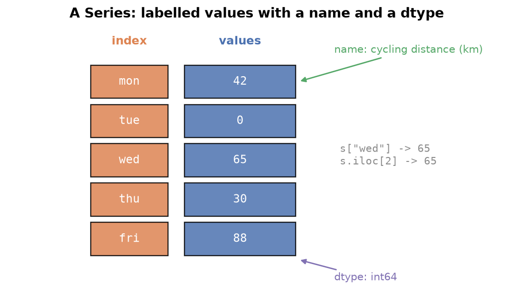

---
tags:
  - pandas
  - series
  - data-structures
  - indexing
aliases:
  - Pandas Series
  - pandas Series
  - Series
difficulty: beginner
runnable: true
prerequisites:
  - NumPy Tricks
created: 2026-10-13
---

> [!info] Where this fits
> This opens the pandas half of the track. [[NumPy Tricks]] finished the array toolkit; here you meet the first pandas object, the **Series**, which wraps a NumPy array with labels. From here you continue to [[Pandas DataFrame]].

NumPy gives you fast arrays but no names: every value is found by position. Real data has names attached, such as days, matches, and film titles, and a pandas Series carries those names with the numbers. This note covers what pandas is, how to build a Series, how to load one from a file, and every everyday operation on it: sorting, math, slicing, editing, filtering, plotting, and a set of handy methods for cleaning.

> [!info] Dataset
> - **Fictional daily new subscribers** (`cortex_data("subscribers")`): synthetic data generated for Cortex, not real records. License: [MIT](https://github.com/Ayaz-Mohammed-Khan/cortex/blob/main/LICENSE).
> - **V Kohli IPL runs per match, 2008 to 2022** (`cortex_data("kohli_ipl")`) from [IPL 2008 to 2022 All Match Dataset by Sahil Vora (Kaggle)](https://www.kaggle.com/datasets/vora1011/ipl-2008-to-2021-all-match-dataset). License: [ODbL 1.0](https://opendatacommons.org/licenses/odbl/1-0/). Derived: batsman_run summed per match for one batter.
> - **Fictional film catalogue** (`cortex_data("films")`): synthetic data generated for Cortex, not real records. License: [MIT](https://github.com/Ayaz-Mohammed-Khan/cortex/blob/main/LICENSE).
>
> Full credits and license terms: [dataset licenses (Markdown file)](/datasets/LICENSES.md).

The subscriber and film tables are generated and fictional, so results from them are not real findings. Cricket results describe the sample in the file.

---

## What is pandas?

**pandas** is an open-source Python library for analysing and manipulating data. It sits on top of NumPy and adds what tabular, real-world data needs: labelled rows and columns, readers for files such as CSV, tools to merge and reshape tables, and sensible handling of missing values. Almost every data analysis project loads and cleans its data in pandas before any modelling starts.

pandas has two main objects, much like Python has lists, tuples, and sets:

| Object | Shape | Think of it as |
| :--- | :--- | :--- |
| **Series** | one dimension | a single column of a table |
| **DataFrame** | two dimensions | a whole table, made of Series that share one index |

This note is about the Series. The DataFrame comes next, and it is easier once the Series is familiar, because each DataFrame column is a Series.

```python
# cortex:norun
import pandas as pd
import numpy as np
```

By convention pandas is imported as `pd` and NumPy as `np`. Every runnable block below imports what it needs, so each one works on its own.

---

## Introduction to the pandas Series

A **Series** is a one-dimensional labelled array that can hold any data type. Picture a table of lab results with columns for patient, glucose, cholesterol, and blood pressure. Each column on its own is a Series, and the row labels that run down the side are shared by all of them.

Compared with a NumPy array, a Series adds two things:

- **An index**: a label for every value, so you can ask for "Tuesday" instead of "position 1".
- **A name and a dtype**: the Series remembers what it is called and what type it stores.



A DataFrame is then several Series stacked side by side that agree on one index. That is why pandas pays off over raw NumPy: labels travel with the data, files load in one call, and tables can be merged, pivoted, and cleaned with built-in methods.

### Creating a Series from a list

Pass a list to `pd.Series`. pandas numbers the items from 0 and calls that default index a **RangeIndex**. A list of strings produces dtype `object`, and a list of integers produces `int64`.

```python
import pandas as pd

cities = pd.Series(["Oslo", "Lima", "Kyoto", "Cairo"])
print(cities)

rides = pd.Series([12, 7, 30, 18, 25])
print(rides)
```

```text
0     Oslo
1     Lima
2    Kyoto
3    Cairo
dtype: object
0    12
1     7
2    30
3    18
4    25
dtype: int64
```

### Custom index and name

The `index` argument replaces the default positions with labels of your choosing, and `name` labels the Series itself. The `name` belongs to the data, so it is separate from the Python variable that holds it.

```python
import pandas as pd

km = pd.Series(
    [42, 0, 65, 30, 88],
    index=["mon", "tue", "wed", "thu", "fri"],
    name="cycling distance (km)",
)
km
```

```text
mon    42
tue     0
wed    65
thu    30
fri    88
Name: cycling distance (km), dtype: int64
```

### Creating a Series from a dictionary

A dictionary maps naturally onto a Series: the keys become the index and the values become the data.

```python
import pandas as pd

units = {"jan": 310, "feb": 280, "mar": 295, "apr": 240}
bill = pd.Series(units, name="electricity units")
bill
```

```text
jan    310
feb    280
mar    295
apr    240
Name: electricity units, dtype: int64
```

---

## Series attributes

Attributes describe a Series without changing it. They are properties, so you write them without parentheses.

| Attribute | Meaning |
| :--- | :--- |
| `size` | number of items, missing values included |
| `dtype` | the data type of the values |
| `name` | the label of the Series, or `None` |
| `is_unique` | `True` when no value repeats |
| `index` | the index object (a `RangeIndex` for default positions) |
| `values` | the data as a NumPy `ndarray` |

```python
import pandas as pd

tickets = pd.Series([4021, 4022, 4023, 4021], name="ticket")
print(tickets.size)
print(tickets.dtype)
print(tickets.name)
print(tickets.is_unique)
print(tickets.index)
print(tickets.values)
```

```text
4
int64
ticket
False
RangeIndex(start=0, stop=4, step=1)
[4021 4022 4023 4021]
```

The repeated `4021` makes `is_unique` false. The `values` attribute is the bridge back to [[NumPy Fundamentals]]: you get a plain array whenever you need one.

---

## Loading a Series from a CSV file

A **CSV** (comma-separated values) file stores a table as plain text, one row per line. The function `pd.read_csv("file.csv")` always returns a DataFrame. To get a Series you either read a file that has one column and squeeze it, or choose one column as the index and keep the other.

Reading a real file path looks like this. Cells in the browser cannot see your disk, so this block is not runnable; the runnable blocks below use the shipped datasets through `cortex_data`.

```python
# cortex:norun
import pandas as pd

# one-column file: read it, then squeeze the lone column into a Series
s = pd.read_csv("subscribers.csv").squeeze("columns")

# two-column file: use one column as the index, keep the other as values
runs = pd.read_csv("kohli_ipl.csv", index_col="match_no").squeeze("columns")
```

> [!note] The old squeeze argument is gone
> Older material writes `pd.read_csv(..., squeeze=True)`. That argument was removed in pandas 2, so use `.squeeze("columns")` on the result instead.

In the runnable form, `cortex_data` loads a shipped file and accepts the same keyword arguments as `read_csv`.

```python
import pandas as pd

subs = cortex_data("subscribers").squeeze("columns")
subs
```

```text
0       38
1       38
2       30
3       40
4       34
      ... 
360    125
361     96
362    109
363    110
364    195
Name: new_subscribers, Length: 365, dtype: int64
```

The column header became the Series `name`, and pandas shows only the first and last five items with an ellipsis in between, because printing every row of a long Series would flood the screen. A two-column file works the same way with `index_col`.

```python
import pandas as pd

runs = cortex_data("kohli_ipl", index_col="match_no").squeeze("columns")
films = cortex_data("films", index_col="title")["lead"]
print(runs.head(3))
print(films.head(3))
```

```text
match_no
1     1
2    23
3    13
Name: runs, dtype: int64
title
The Rooftop of the Border        Fen Everly
The Borrowed Satellite       Vihaan Corvell
The Golden Shadow              Farah Bastow
Name: lead, dtype: object
```

---

## Series methods

A method is a function that belongs to the Series. Most return a new Series, so calls can be chained, as in `s.sort_values().head(3)`.

### Previewing with head, tail, and sample

`head(n)` shows the first `n` items and `tail(n)` the last `n`; both default to five. `sample(n)` draws random items. Random sampling matters when data is stored in some order, such as sorted by score, because the first rows alone would mislead you. Pass `random_state` to make a sample repeatable.

```python
import pandas as pd

runs = cortex_data("kohli_ipl", index_col="match_no").squeeze("columns")
print(runs.head(3))
print(runs.tail(2))
print(runs.sample(4, random_state=7))
```

```text
match_no
1     1
2    23
3    13
Name: runs, dtype: int64
match_no
214    25
215     7
Name: runs, dtype: int64
match_no
139     6
66      9
96     27
23     19
Name: runs, dtype: int64
```

### Counting with value_counts

`value_counts()` counts how often each distinct value appears and returns the counts as a Series, largest first. Ask it a question such as "which lead appears in the most films?".

```python
import pandas as pd

lead = cortex_data("films")["lead"]
lead.value_counts().head(5)
```

```text
lead
Zoya Ashcombe    25
Zain Quarry      25
Maren Selwyn     14
Juno Rookwood    13
Anika Belvane    11
Name: count, dtype: int64
```

### Sorting with sort_values and sort_index

`sort_values()` orders by the data and `sort_index()` orders by the labels. Both accept `ascending=False`. They return a new Series and leave the original alone.

```python
import pandas as pd

runs = cortex_data("kohli_ipl", index_col="match_no").squeeze("columns")
print(runs.sort_values(ascending=False).head(3))
print(runs.sort_index(ascending=False).head(3))
# the match with the lowest score, found by chaining three calls
runs.sort_values().head(1)
```

```text
match_no
128    113
126    109
123    108
Name: runs, dtype: int64
match_no
215     7
214    25
213    73
Name: runs, dtype: int64
match_no
12    0
Name: runs, dtype: int64
```

Both methods also accept `inplace=True`, which changes the original instead of returning a copy.

```python
# cortex:norun
s.sort_values(inplace=True)   # modifies s and returns None
```

> [!warning] Prefer returning a new Series
> With `inplace=True` the method returns `None`, so `s = s.sort_values(inplace=True)` leaves `s` empty of data. Assign the returned Series instead, which also keeps the original available.

---

## Series math methods

Statistical methods reduce a Series to a single number, and they skip missing values by default.

| Method | Returns |
| :--- | :--- |
| `count()` | number of non-missing items |
| `sum()`, `product()` | total and product |
| `mean()`, `median()` | the two centres |
| `mode()` | the most frequent value(s), as a Series |
| `std()`, `var()` | spread |
| `min()`, `max()` | extremes |
| `describe()` | a summary of count, mean, std, min, quartiles, and max |

```python
import pandas as pd

subs = cortex_data("subscribers").squeeze("columns")
print(subs.sum())
print(subs.mean(), subs.median())
print(subs.std())
print(subs.min(), subs.max())
subs.mode()
```

```text
34457
94.40273972602739 86.0
59.104717027415525
27 665
0    62
Name: new_subscribers, dtype: int64
```

`mode()` returns a Series because several values can tie for most frequent. The `0` on the left is only a position in that result, not a count.

`count()` differs from `size` when data is missing, because `count()` ignores `NaN` (not a number, pandas' marker for a missing value) and `size` does not. Likewise `product()` of data containing a `0` is `0`.

```python
import numpy as np
import pandas as pd

temps = pd.Series([21.5, np.nan, 23.0, 22.5])
print(temps.size, temps.count())
print(pd.Series([3, 4, 0, 5]).product())
```

```text
4 3
0
```

`describe()` packs the common statistics into one call.

```python
import pandas as pd

subs = cortex_data("subscribers").squeeze("columns")
subs.describe()
```

```text
count    365.000000
mean      94.402740
std       59.104717
min       27.000000
25%       60.000000
50%       86.000000
75%      118.000000
max      665.000000
Name: new_subscribers, dtype: float64
```

Read it in words: there are 365 days; the middle day gained about 86 new subscribers; the mean sits above the median and the maximum is far above the 75th percentile, which signals a few unusually strong days that pull the mean up.

---

## Indexing and slicing a Series

Indexing a Series works like a list, with a twist: an integer in square brackets is read as a **label** when the index is made of integers, and positional indexing is available through `.iloc`.

```python
import pandas as pd

x = pd.Series([11, 22, 33, 44, 55, 66, 77, 88])
print(x[2])
print(x[1:6])
print(x[-3:])
print(x[::3])
```

```text
33
1    22
2    33
3    44
4    55
5    66
dtype: int64
5    66
6    77
7    88
dtype: int64
0    11
3    44
6    77
dtype: int64
```

Slices are positional and the end is excluded, as in a list; a negative start counts from the end, and a third number sets the step. A list of labels is **fancy indexing** and returns those items in the order given.

```python
import pandas as pd

runs = cortex_data("kohli_ipl", index_col="match_no").squeeze("columns")
print(runs[[1, 50, 100]])

films = cortex_data("films", index_col="title")["lead"]
print(films["The Borrowed Satellite"])
```

```text
match_no
1       1
50     11
100    13
Name: runs, dtype: int64
Vihaan Corvell
```

With a string index, a label picks one item directly, as the last line shows.

### Why negative indexing sometimes fails

`x[-1]` works on a list, but on a Series with an integer index it looks for a *label* named `-1`, finds none, and raises a `KeyError`. On a string index pandas falls back to position, a behavior that is deprecated in pandas 2. The dependable form is `.iloc`, which is always positional.

```python
# cortex:norun
import pandas as pd

n = pd.Series([5, 6, 7], index=[10, 20, 30])
n[-1]          # KeyError: -1  (no label named -1)
n.iloc[-1]     # 7, always positional
```

---

## Editing a Series

A Series is mutable. Assigning to an existing label or position changes the value, assigning to a slice or a list of labels changes several at once, and assigning to a label that does not exist **adds** a new item without an error.

```python
import pandas as pd

mins = pd.Series([30, 45, 20, 60], index=["a", "b", "c", "d"])
mins["b"] = 50              # one label
mins["e"] = 15              # a new label is added
mins[["a", "c"]] = 0        # several labels at once
mins.iloc[1:3] = 99         # a positional slice
mins
```

```text
a     0
b    99
c    99
d    60
e    15
dtype: int64
```

---

## Series with Python functionalities

Python's built-in functions work on a Series, and the results show how a Series relates to ordinary Python types.

```python
import pandas as pd

subs = cortex_data("subscribers").squeeze("columns")
print(len(subs))
print(type(subs))
print(min(subs), max(subs))
print(sorted(subs)[:5])
```

```text
365
<class 'pandas.core.series.Series'>
27 665
[27, 27, 27, 28, 29]
```

`sorted()` returns a plain Python **list**, not a Series. Conversion helpers go both ways: `list(s)` gives the values, and `s.to_dict()` gives a label-to-value dictionary (`dict(s)` also works but keeps NumPy number types).

```python
import pandas as pd

fares = pd.Series([3.5, 4.0, 2.75], index=["bus", "tram", "ferry"])
print(list(fares))
print(fares.to_dict())
```

```text
[3.5, 4.0, 2.75]
{'bus': 3.5, 'tram': 4.0, 'ferry': 2.75}
```

**Membership** with `in` checks the *index*, not the values. To check values, test against `.values`. A `for` loop yields values; loop over `.index` for labels.

```python
import pandas as pd

lead = cortex_data("films", index_col="title")["lead"]
print("The Borrowed Satellite" in lead)
print("Fen Everly" in lead)
print("Fen Everly" in lead.values)
for title in lead.index[:2]:
    print(title)
```

```text
True
False
True
The Rooftop of the Border
The Borrowed Satellite
```

**Arithmetic** with a scalar applies to every item (broadcasting, as in [[Advanced NumPy]]), and a comparison returns a boolean Series. Two Series with the same index combine item by item, and `equals` checks whether two Series are identical.

```python
import pandas as pd

price = pd.Series([200, 350, 120], index=["pen", "bag", "book"])
print(price * 2)
print(price > 150)
print(price.equals(pd.Series([200, 350, 120], index=["pen", "bag", "book"])))
```

```text
pen     400
bag     700
book    240
dtype: int64
pen      True
bag      True
book    False
dtype: bool
True
```

---

## Boolean indexing on Series

Place a boolean Series inside the brackets to keep only the items where it is `True`, exactly as in [[Advanced NumPy]]. Counting the matches is a sum of the booleans, because `True` counts as 1.

```python
import pandas as pd

subs = cortex_data("subscribers").squeeze("columns")
slow = subs[subs < 50]
print(len(slow))
print((subs >= 200).sum())

runs = cortex_data("kohli_ipl", index_col="match_no").squeeze("columns")
first, second = runs.iloc[:107], runs.iloc[107:]
print((first >= 30).sum(), (second >= 30).sum())
print((runs < 10).mean().round(3))
```

```text
69
8
43 53
0.256
```

The last line uses a handy trick: the mean of a boolean Series is the share of `True` values. The two halves come from `iloc` slicing, so they compare an earlier and later stretch of the career in this sample.

```python
import pandas as pd

films = cortex_data("films")
leads = films["lead"].value_counts()
leads[leads >= 14]
```

```text
lead
Zoya Ashcombe    25
Zain Quarry      25
Maren Selwyn     14
Name: count, dtype: int64
```

---

## Plotting graphs on Series

`plot()` draws with matplotlib. With default settings a Series gives a line chart of value against index, and `kind="bar"` or `kind="pie"` suits counts.

```python
import matplotlib.pyplot as plt

subs = cortex_data("subscribers").squeeze("columns")
subs.plot(title="New subscribers per day")
plt.show()
```

```python
import matplotlib.pyplot as plt

films = cortex_data("films")
films["director"].value_counts().head(10).plot(kind="bar", title="Films per director")
plt.tight_layout()
plt.show()
```

```python
import matplotlib.pyplot as plt

films = cortex_data("films")
films["certificate"].value_counts().plot(kind="pie", title="Certificates")
plt.ylabel("")
plt.show()
```

---

## Important Series methods

A group of methods covers most of the cleaning a Series needs.

### Changing the dtype with astype

`astype` converts a Series to another dtype. A smaller integer type saves memory when the values fit its range: `int8` holds -128 to 127, while the default `int64` uses eight times as many bytes per item. `memory_usage` reports the cost.

```python
import pandas as pd

subs = cortex_data("subscribers").squeeze("columns")
small = subs.clip(upper=127).astype("int8")
print(subs.memory_usage(index=False), small.memory_usage(index=False))
print(small.dtype)
```

```text
2920 365
int8
```

`clip` is used first because `astype("int8")` would silently wrap values above 127.

### Range checks with between

`between(a, b)` returns a boolean mask for values inside the range, and both ends are **inclusive**.

```python
import pandas as pd

runs = cortex_data("kohli_ipl", index_col="match_no").squeeze("columns")
print(runs.between(20, 29).sum())
```

```text
26
```

### Capping values with clip

`clip(lower, upper)` pulls values outside the bounds back to the bounds, which tames outliers without removing rows. Percentiles make natural bounds.

```python
import pandas as pd

subs = cortex_data("subscribers").squeeze("columns")
low, high = subs.quantile(0.1), subs.quantile(0.9)
capped = subs.clip(low, high)
print(subs.max(), round(capped.max(), 1))
print(subs.min(), capped.min())
```

```text
665 149.6
27 41.0
```

### Repeated entries: drop_duplicates and duplicated

`duplicated()` marks repeats with `True` (the first occurrence is `False` by default), and `drop_duplicates()` removes them. The `keep` argument chooses which copy survives: `"first"`, `"last"`, or `False` to drop all copies.

```python
import pandas as pd

tickets = pd.Series([501, 502, 501, 503, 502, 501])
print(tickets.duplicated().sum())
print(tickets.drop_duplicates())
print(tickets.drop_duplicates(keep="last"))
```

```text
3
0    501
1    502
3    503
dtype: int64
3    503
4    502
5    501
dtype: int64
```

### Missing values in a Series

Missing data appears as `NaN`. `size` counts it and `count()` does not, so their difference is the number of gaps. `isnull().sum()` counts the gaps directly, `dropna()` removes them, and `fillna()` replaces them with a constant or a statistic.

```python
import numpy as np
import pandas as pd

hum = pd.Series([40.0, np.nan, 55.0, np.nan, 61.0])
print(hum.size - hum.count(), hum.isnull().sum())
print(hum.dropna())
print(hum.fillna(0))
print(hum.fillna(hum.mean()))
```

```text
2 2
0    40.0
2    55.0
4    61.0
dtype: float64
0    40.0
1     0.0
2    55.0
3     0.0
4    61.0
dtype: float64
0    40.0
1    52.0
2    55.0
3    52.0
4    61.0
dtype: float64
```

### Membership tests with isin

`isin(list)` checks each item against a list of allowed values. It replaces a chain of `==` tests joined by `|`, and reads better.

```python
import pandas as pd

runs = cortex_data("kohli_ipl", index_col="match_no").squeeze("columns")
chain = ((runs == 44) | (runs == 55) | (runs == 66)).sum()
print(chain, runs.isin([44, 55, 66]).sum())
```

```text
2 2
```

### Custom logic with apply

`apply(func)` calls a function on every item and returns a Series of results. A `lambda` is a small unnamed function written in one line. Use it when no built-in method does the job.

```python
import pandas as pd

lead = cortex_data("films")["lead"].head(4)
print(lead.apply(lambda n: n.split()[0][0] + ". " + n.split()[1]))

subs = cortex_data("subscribers").squeeze("columns")
mid = subs.median()
label = subs.apply(lambda v: "above median" if v > mid else "at or below")
label.value_counts()
```

```text
0     F. Everly
1    V. Corvell
2     F. Bastow
3      N. Ulloa
Name: lead, dtype: object
new_subscribers
at or below     186
above median    179
Name: count, dtype: int64
```

### Copies and views

Some operations return a **view** of the original data rather than an independent copy, so editing the result may change the original. When you need to edit safely, call `.copy()`, which always creates a separate object.

```python
import pandas as pd

subs = cortex_data("subscribers").squeeze("columns")
tail = subs.tail(3).copy()
tail.iloc[0] = -1
print(tail.iloc[0], subs.iloc[-3])
```

```text
-1 109
```

> [!tip] Make the intent explicit
> Whether a slice is a view or a copy can depend on internal details. Calling `.copy()` before an edit removes the doubt, and it is the habit that avoids pandas' chained-assignment warnings later.

---

## Summary

1. **pandas** is the labelled-data layer over NumPy; its two main objects are the **Series** (one column) and the **DataFrame** (a table of Series sharing an index).
2. A Series is built from a list, a dictionary, or a CSV column, and carries an **index**, a **name**, and a **dtype**.
3. Attributes such as `size`, `dtype`, `index`, `values`, and `is_unique` describe it; `read_csv` returns a DataFrame, so `.squeeze("columns")` or `index_col` turns it into a Series.
4. `head`, `tail`, `sample`, `value_counts`, `sort_values`, and `sort_index` explore it; `inplace=True` is risky because it returns `None`.
5. Math methods (`sum`, `mean`, `median`, `mode`, `std`, `describe`) skip missing values; `count()` differs from `size` for that reason.
6. Indexing is by label, slicing is positional, fancy indexing takes a list of labels, and `.iloc` is the reliable way to count from the end.
7. A Series is mutable: assigning to a new label adds an item.
8. Python built-ins work, `sorted` returns a list, and `in` checks the index.
9. Boolean masks filter, and `sum()` or `mean()` of a mask counts or shares matches.
10. `astype`, `between`, `clip`, `duplicated`, `drop_duplicates`, `isnull`, `dropna`, `fillna`, `isin`, and `apply` handle most cleaning; `.copy()` guards against shared data.

---

> [!info] Continues to
> Next is [[Pandas DataFrame]], where several Series share one index to form a table.
