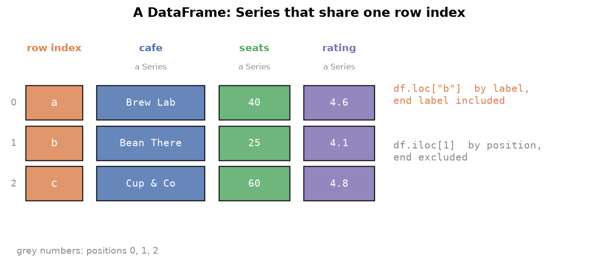

---
tags:
  - pandas
  - dataframe
  - selection
  - filtering
aliases:
  - Pandas DataFrame
  - DataFrame
  - pandas DataFrame
difficulty: beginner
runnable: true
prerequisites:
  - Pandas Series
created: 2026-10-13
---

> [!info] Where this fits
> This builds on [[Pandas Series]]: a DataFrame is a table whose columns are Series that share one index. It is the object you will use for nearly all real data work. From here you continue to [[DataFrame Methods]].

Most data arrives as a table: rows for records and columns for measurements. This note covers how to create a DataFrame, inspect it, do math across its rows and columns, select exactly the rows and columns you want, filter by conditions, and add or retype columns. The selection and filtering sections are the heart of everyday pandas work.

> [!info] Dataset
> - **Fictional film catalogue** (`cortex_data("films")`): synthetic data generated for Cortex, not real records. License: [MIT](https://github.com/Ayaz-Mohammed-Khan/cortex/blob/main/LICENSE).
> - **IPL matches 2008 to 2022** (`cortex_data("ipl_matches")`) from [IPL 2008 to 2022 All Match Dataset by Sahil Vora (Kaggle)](https://www.kaggle.com/datasets/vora1011/ipl-2008-to-2021-all-match-dataset). License: [ODbL 1.0](https://opendatacommons.org/licenses/odbl/1-0/). Shipped whole.
>
> Full credits and license terms: [dataset licenses (Markdown file)](/datasets/LICENSES.md).

The film catalogue is generated and fictional, so its results are not real findings. Cricket results describe the matches in the file.

---

## Introduction to pandas DataFrame

A **DataFrame** is a two-dimensional table with labelled rows and labelled columns. Each column is a [[Pandas Series]], every column shares the same row index, and different columns may hold different dtypes: text in one, integers in the next, floats in a third. That mix is the difference from a NumPy 2D array, which has one dtype throughout.

### Series and DataFrame objects

| | Series | DataFrame |
| :--- | :--- | :--- |
| Dimensions | 1 | 2 |
| Labels | one index | a row index and column labels |
| Dtype | one for the whole object | one per column |
| Select one column | not applicable | `df["col"]` returns a Series |



Thinking of a DataFrame as "a dictionary of Series with a shared index" explains most of its behavior. Pulling out one column gives a Series; pulling out several gives a smaller DataFrame.

---

## Creating DataFrames & read_csv()

### From lists and dictionaries

Build a DataFrame from a **list of lists**, one inner list per row, and name the columns with `columns`. Or build it from a **dictionary of lists**, where each key is a column name and each list is that column's data. The second form is usually easier to read.

```python
import pandas as pd

rows = [
    ["Brew Lab", 40, 4.6],
    ["Bean There", 25, 4.1],
    ["Cup & Co", 60, 4.8],
]
cafes = pd.DataFrame(rows, columns=["cafe", "seats", "rating"])
print(cafes)

orders = pd.DataFrame({
    "cafe": ["Brew Lab", "Bean There", "Cup & Co"],
    "monthly_orders": [5200, 3100, 6900],
})
orders
```

```text
         cafe  seats  rating
0    Brew Lab     40     4.6
1  Bean There     25     4.1
2    Cup & Co     60     4.8
         cafe  monthly_orders
0    Brew Lab            5200
1  Bean There            3100
2    Cup & Co            6900
```

`set_index` turns a column into the row index, so rows can then be found by name. By default it returns a new DataFrame.

```python
import pandas as pd

orders = pd.DataFrame({
    "cafe": ["Brew Lab", "Bean There", "Cup & Co"],
    "monthly_orders": [5200, 3100, 6900],
})
indexed = orders.set_index("cafe")
indexed
```

```text
            monthly_orders
cafe                      
Brew Lab              5200
Bean There            3100
Cup & Co              6900
```

### Loading data with read_csv()

`pd.read_csv(path)` reads a CSV file into a DataFrame. The arguments you meet most often:

| Argument | Purpose |
| :--- | :--- |
| `sep` | the delimiter, if it is not a comma (for example `"\t"` or `";"`) |
| `index_col` | which column to use as the row index |
| `usecols` | which columns to load, to save memory |
| `header` | the row that holds names, or `None` if there is no header row |
| `names` | column names to use when there is no header |

Cells in the browser cannot reach your files, so the file example is not runnable. Below it, `cortex_data` loads a shipped dataset and accepts the same arguments.

```python
# cortex:norun
import pandas as pd

films = pd.read_csv("films.csv", sep=",", index_col="title", usecols=["title", "year", "rating"])
```

---

## DataFrame attributes and methods

Attributes describe the table without changing it, and a few methods give a quick health check.

```python
import pandas as pd

films = cortex_data("films")
print(films.shape)
print(films.dtypes)
print(films.columns[:4])
print(films.index)
films.values[:2]
```

```text
(1000, 14)
title           object
year             int64
runtime_min      int64
certificate     object
genres          object
rating         float64
votes            int64
metascore      float64
gross_musd     float64
director        object
lead            object
co_lead         object
country         object
language        object
dtype: object
Index(['title', 'year', 'runtime_min', 'certificate'], dtype='object')
RangeIndex(start=0, stop=1000, step=1)
array([['The Rooftop of the Border', 2010, 97, 'UA', 'Drama', 6.0, 79008,
        45.0, nan, 'Bea Ambrel', 'Fen Everly', 'Amara Thornbury',
        'India', 'Hindi'],
       ['The Borrowed Satellite', 1990, 115, nan, 'Crime', 5.8, 6032,
        45.0, 2.84, 'Yara Ulloa', 'Vihaan Corvell', 'Yara Quarry',
        'India', 'Hindi']], dtype=object)
```

`shape` is `(rows, columns)`. `values` returns a NumPy array; because the columns mix text and numbers, it has dtype `object`.

`head`, `tail`, and `sample` preview rows, exactly as for a Series.

```python
import pandas as pd

films = cortex_data("films")
films[["title", "year", "rating"]].sample(3, random_state=1)
```

```text
                    title  year  rating
507    The Lost Satellite  1985     6.4
818   The Midnight Signal  2005     6.6
452  The Station of Seoul  2020     6.2
```

`info()` prints a compact report: the column names, how many values are non-null in each, the dtypes, and the memory used. It is the first thing to run on a new dataset.

```python
import pandas as pd

matches = cortex_data("ipl_matches")
matches[["ID", "Season", "Venue", "Margin", "method"]].info()
```

```text
<class 'pandas.core.frame.DataFrame'>
RangeIndex: 950 entries, 0 to 949
Data columns (total 5 columns):
 #   Column  Non-Null Count  Dtype  
---  ------  --------------  -----  
 0   ID      950 non-null    int64  
 1   Season  950 non-null    object 
 2   Venue   950 non-null    object 
 3   Margin  932 non-null    float64
 4   method  19 non-null     object 
dtypes: float64(1), int64(1), object(3)
memory usage: 37.2+ KB
```

`describe()` summarizes the numeric columns. `isnull().sum()` counts the missing values per column, and `duplicated().sum()` counts rows that repeat an earlier row.

```python
import pandas as pd

films = cortex_data("films")
print(films[["rating", "votes", "gross_musd"]].describe().round(2))
print(films.isnull().sum())
print(films.duplicated().sum())
```

```text
        rating       votes  gross_musd
count  1000.00     1000.00      821.00
mean      6.58   188551.32       86.58
std       0.92   358024.40      177.53
min       3.60     1027.00        0.13
25%       6.00     7806.50        3.30
50%       6.60    45026.00       15.31
75%       7.20    96841.25       54.96
max       9.40  2456726.00      900.00
title            0
year             0
runtime_min      0
certificate     37
genres           0
rating           0
votes            0
metascore      128
gross_musd     179
director         0
lead             0
co_lead          0
country          0
language         0
dtype: int64
0
```

`rename` changes labels using a dictionary of old name to new name. It returns a new DataFrame unless you pass `inplace=True`.

```python
import pandas as pd

t = pd.DataFrame({"nm": ["Ria", "Sol"], "scr": [71, 64]})
t.rename(columns={"nm": "name", "scr": "score"})
```

```text
  name  score
0  Ria     71
1  Sol     64
```

---

## DataFrame math methods

Reductions such as `sum`, `mean`, `min`, `max`, `std`, and `var` work on a DataFrame, and the `axis` argument chooses the direction. **Axis 0** runs down the rows, so it gives one result per column. **Axis 1** runs across the columns, so it gives one result per row.

```python
import pandas as pd

marks = pd.DataFrame(
    {"maths": [80, 62, 91], "physics": [74, 70, 85], "art": [60, 88, 72]},
    index=["Ana", "Ben", "Cy"],
)
print(marks.sum(axis=0))
print(marks.mean(axis=1))
print(marks.var().round(1))
```

```text
maths      233
physics    229
art        220
dtype: int64
Ana    71.333333
Ben    73.333333
Cy     82.666667
dtype: float64
maths      214.3
physics     60.3
art        197.3
dtype: float64
```

Column sums answer "how did each subject do in total" and row means answer "how did each student do on average". The default is `axis=0`.

---

## Selecting columns and rows

### Selecting columns

A single column name in square brackets returns a **Series**. A list of names returns a **DataFrame**, even if the list has one name.

```python
import pandas as pd

films = cortex_data("films")
lead = films["lead"]
pair = films[["title", "country"]]
print(type(lead).__name__, type(pair).__name__)
pair.head(3)
```

```text
Series DataFrame
                       title country
0  The Rooftop of the Border   India
1     The Borrowed Satellite   India
2          The Golden Shadow   India
```

### Selecting rows with iloc and loc

Two accessors select rows, and the difference between them is the most important distinction in pandas:

| Accessor | Selects by | Slice end |
| :--- | :--- | :--- |
| `iloc` | integer **position** | excluded, as in Python |
| `loc` | row **label** | **included** |

```python
import pandas as pd

films = cortex_data("films")
print(films.iloc[3][["title", "year"]].to_dict())
print(films.iloc[[0, 4, 5], :3])
```

```text
{'title': 'The Last Avenue', 'year': 2020}
                              title  year  runtime_min
0         The Rooftop of the Border  2010           97
4  A Voyage for the Restless Thread  2023           93
5          The Avenue of the Valley  1977          130
```

With `loc` you use labels. A small table indexed by name shows slicing with a step, and why the end label is included.

```python
import pandas as pd

team = pd.DataFrame(
    {"role": ["lead", "dev", "dev", "qa", "ops"], "years": [9, 4, 6, 3, 7]},
    index=["ada", "bo", "cal", "dee", "eli"],
)
print(team.loc["bo"])
print(team.loc["ada":"dee":2])
print(team.loc[["eli", "ada"]])
```

```text
role     dev
years      4
Name: bo, dtype: object
     role  years
ada  lead      9
cal   dev      6
     role  years
eli   ops      7
ada  lead      9
```

### Selecting rows and columns together

Pass a row selector, a comma, and a column selector. Both accessors accept slices and lists.

```python
import pandas as pd

films = cortex_data("films")
print(films.iloc[0:3, 0:3])
print(films.loc[10:12, "title":"runtime_min"])
```

```text
                       title  year  runtime_min
0  The Rooftop of the Border  2010           97
1     The Borrowed Satellite  1990          115
2          The Golden Shadow  1997          139
                      title  year  runtime_min
10           The Salt Ember  2018           85
11  The Garden of the Delta  2000          144
12         The Silent River  2012          114
```

The default row index is the integers 0, 1, 2, and so on, so here `loc[10:12]` uses labels that happen to equal positions, and its end label 12 is included.

---

## Filtering a DataFrame

**Filtering** keeps the rows that satisfy a condition. A comparison on a column produces a boolean Series, and putting that mask inside the brackets keeps the `True` rows. This is the boolean indexing from [[Advanced NumPy]], applied to a table.

The IPL match table has one row per match. Which matches were settled by the Duckworth-Lewis (D/L) rain rule? The `method` column holds `D/L` for those and is missing otherwise.

```python
import pandas as pd

m = cortex_data("ipl_matches")
dl = m[m["method"] == "D/L"]
print(dl.shape[0])
dl[["Season", "Team1", "Team2", "WinningTeam"]].head(4)
```

```text
19
    Season                  Team1                  Team2            WinningTeam
282   2018       Delhi Daredevils       Rajasthan Royals       Delhi Daredevils
296   2018  Kolkata Knight Riders        Kings XI Punjab        Kings XI Punjab
308   2018       Rajasthan Royals       Delhi Daredevils       Rajasthan Royals
316   2017    Sunrisers Hyderabad  Kolkata Knight Riders  Kolkata Knight Riders
```

`shape[0]` is the row count, a quick way to answer "how many".

```python
import pandas as pd

m = cortex_data("ipl_matches")
tied = m[m["WonBy"] == "SuperOver"]
print(tied.shape[0], "matches in the file were decided by a super over")
```

```text
14 matches in the file were decided by a super over
```

### Combining conditions with & and |

Use `&` for "and", `|` for "or", and `~` for "not", with **parentheses around each condition**. Python's `and` and `or` fail because they try to turn a whole Series into one `True` or `False`.

```python
import pandas as pd

m = cortex_data("ipl_matches")
playoffs = ["Final", "Qualifier 1", "Qualifier 2", "Eliminator"]
late = m[m["MatchNumber"].isin(playoffs) & (m["WonBy"] == "Wickets")]
print(late.shape[0], "playoff games were won by the chasing side")

at_venue = m[(m["Venue"] == "Eden Gardens") & (m["Season"] == "2015")]
at_venue[["Date", "WinningTeam", "Margin"]]
```

```text
22 playoff games were won by the chasing side
           Date                  WinningTeam  Margin
433  2015-05-24               Mumbai Indians    41.0
449  2015-05-09        Kolkata Knight Riders     1.0
452  2015-05-07        Kolkata Knight Riders    13.0
455  2015-05-04        Kolkata Knight Riders    35.0
463  2015-04-30        Kolkata Knight Riders     7.0
487  2015-04-11  Royal Challengers Bangalore     3.0
491  2015-04-08        Kolkata Knight Riders     7.0
```

```python
# cortex:norun
m[(m["Season"] == "2015") and (m["City"] == "Kolkata")]   # ValueError: truth value of a Series is ambiguous
```

Filtering also compares two columns row by row. This checks how often the team that won the toss and chose to field went on to win the match.

```python
import pandas as pd

m = cortex_data("ipl_matches")
chose_field = m[m["TossDecision"] == "field"]
won = chose_field["TossWinner"] == chose_field["WinningTeam"]
print(round(won.mean() * 100, 1), "percent of toss winners who fielded also won")
```

```text
55.1 percent of toss winners who fielded also won
```

Numeric thresholds work the same way, and checking the surviving row count tells you whether a filter is too strict.

```python
import pandas as pd

films = cortex_data("films")
top = films[(films["metascore"] > 80) & (films["votes"] > 50000)]
print(top.shape[0])
top[["title", "metascore", "votes"]].head(3)
```

```text
31
                         title  metascore    votes
11     The Garden of the Delta       86.0  1090555
32  The Carnival of the Desert       81.0  2124910
35           The Velvet Season       85.0    63215
```

A column of multi-valued text, such as `"Mystery, Musical"`, needs a text test. `str.contains` checks for a substring, and `na=False` treats missing values as no match.

```python
import pandas as pd

films = cortex_data("films")
comedies = films[films["genres"].str.contains("Comedy", na=False)]
print(comedies.shape[0])
```

```text
274
```

A reusable filter is a function. This one reports the head-to-head record between any two teams in the sample.

```python
import pandas as pd

m = cortex_data("ipl_matches")

def head_to_head(df, a, b):
    played = df[((df["Team1"] == a) & (df["Team2"] == b)) |
                ((df["Team1"] == b) & (df["Team2"] == a))]
    return played["WinningTeam"].value_counts()

head_to_head(m, "Mumbai Indians", "Kolkata Knight Riders")
```

```text
WinningTeam
Mumbai Indians           22
Kolkata Knight Riders     9
Name: count, dtype: int64
```

---

## Adding new columns

Assigning to a new column name adds it at the end. A single value is repeated down every row.

```python
import pandas as pd

films = cortex_data("films")
films["catalogue"] = "demo"
films[["title", "catalogue"]].head(2)
```

```text
                       title catalogue
0  The Rooftop of the Border      demo
1     The Borrowed Satellite      demo
```

A column can also be built from another one. Here the first genre comes from splitting the comma-separated `genres` text. If the source column had missing values, the function would fail, so drop or fill those first (here `genres` has none).

```python
import pandas as pd

films = cortex_data("films")
films = films.dropna(subset=["genres"])
films["main_genre"] = films["genres"].str.split(", ").apply(lambda parts: parts[0])
films[["title", "genres", "main_genre"]].head(4)
```

```text
                       title            genres main_genre
0  The Rooftop of the Border             Drama      Drama
1     The Borrowed Satellite             Crime      Crime
2          The Golden Shadow  Mystery, Musical    Mystery
3            The Last Avenue            Comedy     Comedy
```

### Placing a column with insert

`df.insert(position, name, values)` puts the new column at a chosen position, where plain assignment can only append. It changes the DataFrame in place and returns `None`.

```python
import pandas as pd

films = cortex_data("films")[["title", "year", "rating"]].head(3)
films.insert(1, "decade", films["year"] // 10 * 10)
films
```

```text
                       title  decade  year  rating
0  The Rooftop of the Border    2010  2010     6.0
1     The Borrowed Satellite    1990  1990     5.8
2          The Golden Shadow    1990  1997     7.0
```

---

## astype()

`astype` changes the dtype of a column. Smaller integer types and the **category** dtype save memory. A category column stores each distinct string once and keeps small integer codes for the rows, which is a large saving for text that repeats, such as venue and city names. `memory_usage(deep=True)` reports the real cost.

```python
import pandas as pd

m = cortex_data("ipl_matches")
before = m[["ID", "Venue", "City"]].memory_usage(deep=True)
slim = m[["ID", "Venue", "City"]].astype({"ID": "int32", "Venue": "category", "City": "category"})
after = slim.memory_usage(deep=True)
print(before.sum(), after.sum())
print(slim.dtypes)
```

```text
131062 13585
ID          int32
Venue    category
City     category
dtype: object
```

The dictionary form changes several columns in one call, mapping each column name to its new dtype.

---

## Summary

1. A **DataFrame** is a table of Series that share one row index; each column has its own dtype.
2. Build one from a list of lists with `columns`, or from a dictionary of lists, and use `set_index` to turn a column into the row labels.
3. `read_csv` loads files; `sep`, `index_col`, `usecols`, `header`, and `names` control the layout.
4. `shape`, `dtypes`, `columns`, `index`, `values`, `info`, `describe`, `isnull().sum()`, and `duplicated().sum()` inspect a table; `rename` relabels it.
5. `axis=0` reduces down the rows to give one result per column, and `axis=1` reduces across to give one result per row.
6. `df["a"]` returns a Series and `df[["a"]]` returns a DataFrame.
7. `iloc` selects by position with an excluded end; `loc` selects by label with an included end; both take a row selector and a column selector.
8. Filtering uses a boolean mask; combine conditions with `&`, `|`, and `~` in parentheses, and use `shape[0]` to count.
9. New columns come from assignment, from other columns, or from `insert` at a chosen position.
10. `astype` changes dtypes, and `category` shrinks repeated text.

---

> [!info] Continues to
> Next is [[DataFrame Methods]], the everyday methods for sorting, cleaning, and reshaping what you have just selected.
