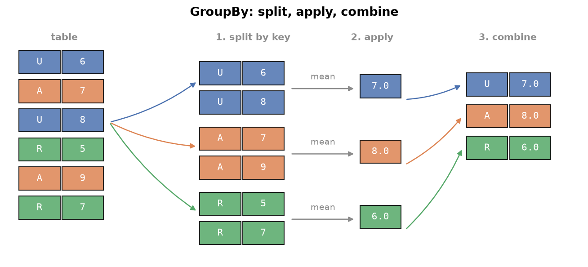

---
tags:
  - pandas
  - groupby
  - aggregation
  - split-apply-combine
aliases:
  - GroupBy
  - pandas groupby
difficulty: intermediate
runnable: true
prerequisites:
  - DataFrame Methods
created: 2026-10-13
---

> [!info] Where this fits
> This builds on [[DataFrame Methods]]. Counting and sorting answer questions about a whole table; **GroupBy** answers them one category at a time: the average rating per certificate, the runs per batter, the best film per decade. From here you continue to [[Merging & Joining]].

Most useful questions about data have the shape "for each X, what is Y". GroupBy is pandas' tool for that shape, and it is the same idea as `GROUP BY` in SQL. This note covers the GroupBy object, the built-in aggregations, its attributes and methods, `agg`, looping, the split-apply-combine strategy for custom logic, grouping on several columns, and a hands-on tour of ball-by-ball cricket data.

> [!info] Dataset
> - **Fictional film catalogue** (`cortex_data("films")`): synthetic data generated for Cortex, not real records. License: [MIT](https://github.com/Ayaz-Mohammed-Khan/cortex/blob/main/LICENSE).
> - **IPL ball-by-ball deliveries (sampled matches)** (`cortex_data("ipl_deliveries")`) and **IPL matches 2008 to 2022** (`cortex_data("ipl_matches")`) from [IPL 2008 to 2022 All Match Dataset by Sahil Vora (Kaggle)](https://www.kaggle.com/datasets/vora1011/ipl-2008-to-2021-all-match-dataset). License: [ODbL 1.0](https://opendatacommons.org/licenses/odbl/1-0/). Deliveries are trimmed: kept every delivery of every 12th match (by match ID) within each season. Matches are shipped whole.
>
> Full credits and license terms: [dataset licenses (Markdown file)](/datasets/LICENSES.md).

The film catalogue is generated and fictional, so its results are not real findings. Every cricket result describes the sampled matches in the file, so totals are smaller than real career figures.

---

## What is GroupBy?

**GroupBy** studies a table by groups. You choose a column that defines the groups (the key), pandas splits the rows by that key, you compute something for each group, and pandas stitches the results into one object. Group on a **categorical** column, one with a modest set of repeating labels such as certificate, country, or team. Grouping on a column where nearly every value is unique gives one group per row, which tells you nothing.

The strategy has three steps, called **split-apply-combine**:

1. **Split** the rows into one sub-table per key value.
2. **Apply** a function (a sum, a mean, a custom rule) to each sub-table.
3. **Combine** the per-group answers into a single result.



### The GroupBy object

`df.groupby("col")` does not compute anything yet. It returns a **GroupBy object**, a recipe that remembers the split. You then call an aggregation on it. Store the object in a variable when you want to ask several questions of the same grouping.

```python
import pandas as pd

films = cortex_data("films")
gb = films.groupby("certificate")
print(type(gb).__name__)
print(gb["rating"].mean().round(2))
```

```text
DataFrameGroupBy
certificate
A        6.58
PG-13    6.52
R        6.50
U        6.61
UA       6.56
Name: rating, dtype: float64
```

---

## Built-in aggregation functions

Once you have a GroupBy object, call `sum`, `min`, `max`, `mean`, `median`, `std`, or `count`. Each computes the statistic within every group. Text columns support `min` and `max` too, where the order is alphabetical.

```python
import pandas as pd

films = cortex_data("films")
by_cert = films.groupby("certificate")
print(by_cert["runtime_min"].median())
print(by_cert["title"].min())
```

```text
certificate
A        120.0
PG-13    122.5
R        122.0
U        122.5
UA       122.0
Name: runtime_min, dtype: float64
certificate
A           A Archive for the Glass Melody
PG-13    A Avenue for the Forgotten Riddle
R          A Avenue for the Golden Station
U           A Avenue for the Velvet Window
UA        A Archive for the Strange Shadow
Name: title, dtype: object
```

Select the column you want **before** aggregating. `gb["gross_musd"].sum()` computes one column, while `gb.sum(numeric_only=True)` computes every numeric column and throws most of the work away.

```python
import pandas as pd

films = cortex_data("films")
films.groupby("country")["gross_musd"].sum().sort_values(ascending=False).head(3)
```

```text
country
India             26736.03
United States     15830.59
United Kingdom     6288.05
Name: gross_musd, dtype: float64
```

The same pattern answers "which group has the highest average", and a second grouping key answers "which person has the largest total".

```python
import pandas as pd

films = cortex_data("films")
print(films.groupby("language")["rating"].mean().idxmax())
print(films.groupby("director")["votes"].sum().nlargest(3))
```

```text
Italian
director
Ishan Kavell    7000374
Tara Varga      6287934
Niko Yardley    5861842
Name: votes, dtype: int64
```

To rank leads by average metascore fairly, first keep only leads with enough films, because an average over one film is noise.

```python
import pandas as pd

films = cortex_data("films")
counts = films.groupby("lead")["title"].count()
busy = counts[counts >= 3].index
sub = films[films["lead"].isin(busy)]
sub.groupby("lead")["metascore"].mean().round(1).nlargest(3)
```

```text
lead
Aarav Selwyn     76.0
Rohan Whitlow    75.0
Vihaan Jessop    75.0
Name: metascore, dtype: float64
```

Counting per group has two forms. `groupby(...)["col"].count()` sorts by the **group label** and counts non-missing values. `value_counts()` sorts by the **count**, largest first.

```python
import pandas as pd

films = cortex_data("films")
print(films.groupby("certificate")["title"].count())
print(films["certificate"].value_counts())
```

```text
certificate
A        153
PG-13    138
R        131
U        232
UA       309
Name: title, dtype: int64
certificate
UA       309
U        232
A        153
PG-13    138
R        131
Name: count, dtype: int64
```

---

## GroupBy attributes and methods

A GroupBy object has attributes and methods of its own for inspecting the groups.

| Member | What it gives |
| :--- | :--- |
| `len(gb)` | the number of groups |
| `gb.size()` | rows per group, including missing values, sorted by label |
| `gb.ngroups` | the number of groups, as an attribute |
| `gb.groups` | a dictionary of group key to the row labels in that group |
| `gb.first()`, `gb.last()` | the first or last non-missing value of each column per group |
| `gb.nth(n)` | the row at position `n` (zero-based) within each group |
| `gb.get_group(key)` | the sub-table for one group |
| `gb.describe()` | a statistics table per group |
| `gb.nunique()` | distinct values per column per group |
| `gb.sample(n)` | random rows from each group |

```python
import pandas as pd

films = cortex_data("films")
gb = films.groupby("certificate")
print(len(gb), gb.ngroups)
print(gb.size())
print(gb["country"].nunique())
```

```text
5 5
certificate
A        153
PG-13    138
R        131
U        232
UA       309
dtype: int64
certificate
A        12
PG-13    12
R        12
U        12
UA       12
Name: country, dtype: int64
```

`first()` and `last()` skip missing values, while `nth(0)` returns the literal first row, missing values included. The difference matters for columns with gaps.

```python
import pandas as pd

films = cortex_data("films")
gb = films.groupby("certificate")
print(gb["metascore"].first().head(3))
print(gb.nth(0)[["certificate", "title", "metascore"]].head(3))
```

```text
certificate
A        58.0
PG-13    51.0
R        66.0
Name: metascore, dtype: float64
  certificate                      title  metascore
0          UA  The Rooftop of the Border       45.0
2           R          The Golden Shadow       66.0
3           U            The Last Avenue       47.0
```

`get_group` fetches one group and is faster than re-filtering the table when you ask for many groups. The `groups` attribute lists which row labels belong to each key.

```python
import pandas as pd

films = cortex_data("films")
gb = films.groupby("certificate")
pg = gb.get_group("PG-13")
print(pg.shape)
print(list(gb.groups["R"])[:5])
print(gb["rating"].describe().round(2).loc[["R"]])
```

```text
(138, 14)
[2, 20, 25, 36, 37]
             count  mean   std  min  25%  50%   75%  max
certificate                                             
R            131.0   6.5  0.86  4.5  6.0  6.5  7.05  9.0
```

`sample(n)` draws rows from each group. If any group has fewer than `n` rows, it raises a `ValueError` unless you pass `replace=True`, which allows the same row to be drawn twice.

```python
import pandas as pd

films = cortex_data("films")
films.groupby("certificate")[["title", "rating"]].sample(1, random_state=3)
```

```text
                     title  rating
294      The Broken Letter     7.7
662    The Painted Lantern     5.8
25    The Verdict of Kyoto     6.1
644  The Horizon of Lisbon     6.8
322      Distant Courtyard     7.4
```

---

## Aggregating with agg

`agg` (short for aggregate) lets you run several statistics, or different statistics for different columns, in one call.

- **A list of functions** runs all of them on the selected columns.
- **A dictionary** maps each column to its own function.
- **A dictionary of lists** gives each column its own set of functions.

```python
import pandas as pd

films = cortex_data("films")
gb = films.groupby("country")
print(gb["rating"].agg(["min", "mean", "max"]).round(2).head(3))
print(gb.agg({"votes": "sum", "runtime_min": "mean"}).round(0).head(3))
gb.agg({"rating": ["mean", "std"], "gross_musd": ["sum"]}).round(2).head(3)
```

```text
         min  mean  max
country                
Brazil   4.5  6.36  7.6
France   4.7  6.48  8.0
Germany  4.9  6.45  7.8
           votes  runtime_min
country                      
Brazil   2355497        119.0
France   7603491        117.0
Germany  5484957        125.0
        rating       gross_musd
          mean   std        sum
country                        
Brazil    6.36  0.78     338.92
France    6.48  0.81    3667.82
Germany   6.45  0.62    3077.54
```

---

## Looping over groups

A GroupBy object is iterable. Each step yields a pair: the group **name** (a string for one key) and the group's **sub-table** (a DataFrame). Looping is useful when each group needs a custom treatment that no aggregation expresses.

`max` returns the best value, not the row that holds it. To find the highest-rated film in each decade, loop and pick the best row of each group, then stack the picks with `pd.concat`.

```python
import pandas as pd

films = cortex_data("films")
films["decade"] = films["year"] // 10 * 10
picks = []
for decade, group in films.groupby("decade"):
    picks.append(group.loc[group["rating"].idxmax()])
best = pd.concat(picks, axis=1).T
print(type(decade).__name__, type(group).__name__)
best[["decade", "title", "rating"]].head(4)
```

```text
int DataFrame
    decade                    title rating
491   1970  The Satellite of Lisbon    8.3
372   1980         The Final Season    9.0
558   1990           Falling Season    8.8
691   2000      Midnight Lighthouse    8.7
```

`idxmax` returns the row label of the maximum, which is what `group.loc[...]` needs. Collecting rows in a list and calling `pd.concat` once is the current idiom; the old `DataFrame.append` method was removed in pandas 2.

```python
import pandas as pd

films = cortex_data("films")
films["decade"] = films["year"] // 10 * 10
idx = films.groupby("decade")["rating"].idxmax()
films.loc[idx, ["decade", "title", "rating"]].head(4)
```

```text
     decade                    title  rating
491    1970  The Satellite of Lisbon     8.3
372    1980         The Final Season     9.0
558    1990           Falling Season     8.8
691    2000      Midnight Lighthouse     8.7
```

The second form does the same job without a Python loop.

---

## Split, apply, combine

`apply(func)` is the general form of the strategy. pandas splits the table, calls `func` once for each group, and combines whatever the function returns. If the function returns one value per group, the result is a Series. If it returns a table, the pieces are stitched together.

```python
import pandas as pd

films = cortex_data("films")
films.groupby("certificate")[["runtime_min"]].apply(lambda g: g.min()).head(3)
```

```text
             runtime_min
certificate             
A                     78
PG-13                 78
R                     78
```

**Returning a scalar.** This counts, for each certificate, the titles with more than three words.

```python
import pandas as pd

films = cortex_data("films")

def long_titles(group):
    return (group["title"].str.split().str.len() > 3).sum()

films.groupby("certificate")[["title"]].apply(long_titles)
```

```text
certificate
A        58
PG-13    55
R        49
U        74
UA       92
dtype: int64
```

**Returning a table.** This ranks votes inside each decade, so a film is compared with its own era.

```python
import pandas as pd

films = cortex_data("films")
films["decade"] = films["year"] // 10 * 10

def add_rank(group):
    group = group.copy()
    group["decade_rank"] = group["votes"].rank(ascending=False)
    return group

ranked = films.groupby("decade")[["title", "votes"]].apply(add_rank)
ranked.sort_values("decade_rank").head(3)
```

```text
                       title    votes  decade_rank
decade                                            
1980   396  The Lucky Mirror  1716989          1.0
1970   327   The Lost Bridge   951830          1.0
2000   933        Iron River  1933298          1.0
```

> [!tip] The idiomatic route
> When a function returns one value per row, `transform` is cleaner than `apply`: it returns a Series aligned with the original rows. `films.groupby("decade")["votes"].rank(ascending=False)` ranks within each decade directly, with no helper function.

A classic use is **normalizing within groups**. Imagine judging runners within their own age category before comparing across categories: a good time for a veteran may be a poor one for a teenager. Min-max scaling does this by mapping each group's values onto the range from 0 to 1:

$$
x' = \frac{x - x_{\min}}{x_{\max} - x_{\min}}
$$

where $x$ is a value, and $x_{\min}$ and $x_{\max}$ are the smallest and largest values in the same group.

```python
import pandas as pd

films = cortex_data("films")
films["main_genre"] = films["genres"].str.split(", ").str[0]
scaled = films.groupby("main_genre")["runtime_min"].transform(
    lambda s: (s - s.min()) / (s.max() - s.min())
)
films["runtime_scaled"] = scaled.round(2)
films[["title", "main_genre", "runtime_min", "runtime_scaled"]].head(4)
```

```text
                       title main_genre  runtime_min  runtime_scaled
0  The Rooftop of the Border      Drama           97            0.20
1     The Borrowed Satellite      Crime          115            0.34
2          The Golden Shadow    Mystery          139            0.68
3            The Last Avenue     Comedy          146            0.74
```

---

## Grouping by several columns

Pass a list of columns to group by combinations. Each unique pair (or triple) forms a group. The result carries a **MultiIndex**, a row index with more than one level, covered in [[MultiIndex Objects]].

```python
import pandas as pd

films = cortex_data("films")
pairs = films.groupby(["director", "lead"])
print(pairs.size().sort_values(ascending=False).head(3))
top = pairs.size().idxmax()
pairs.get_group(top)[["title", "year", "rating"]]
```

```text
director        lead         
Yara Thornbury  Zain Quarry      3
Ishan Kavell    Farah Delmont    2
Dalia Harlan    Ilya Northam     2
dtype: int64
                title  year  rating
95        Salt Market  2022     4.9
386    Strange Season  2009     6.6
464  Electric Verdict  2023     6.2
```

`reset_index()` flattens the result back into ordinary columns, and `agg` with a list gives several statistics at once.

```python
import pandas as pd

films = cortex_data("films")
out = films.groupby(["country", "certificate"])["rating"].agg(["count", "mean"]).round(2)
print(out.head(4))
out.reset_index().sort_values("count", ascending=False).head(3)
```

```text
                     count  mean
country certificate             
Brazil  A                6  6.47
        PG-13            6  6.67
        R                2  6.90
        U                4  6.20
          country certificate  count  mean
19          India          UA    119  6.61
18          India           U     84  6.69
59  United States          UA     61  6.59
```

---

## Hands-on with the IPL dataset

Ball-by-ball data has one row per delivery: the match (`ID`), the innings, the over (counted from 0) and ball, the batter, the bowler, the runs, and the wicket kind when one fell. It is a good test for GroupBy because every question is "for each batter, bowler, or match". Remember that the file holds a **sample** of matches, so the answers describe the sample.

```python
import pandas as pd

d = cortex_data("ipl_deliveries")
print(d.shape)
d[["ID", "innings", "overs", "batter", "bowler", "batsman_run", "kind"]].head(3)
```

```text
(19502, 17)
        ID  innings  overs        batter    bowler  batsman_run kind
0  1312199        1      0       V Kohli  TA Boult            0  NaN
1  1312199        1      0       V Kohli  TA Boult            1  NaN
2  1312199        1      0  F du Plessis  TA Boult            1  NaN
```

**Bowling economy.** Runs conceded per over, for bowlers who bowled at least 60 deliveries. The `total_run` column includes extras, and the delivery count includes wides and no balls, so this is an approximation.

```python
import pandas as pd

d = cortex_data("ipl_deliveries")
g = d.groupby("bowler")
stats = g.agg(runs=("total_run", "sum"), balls=("total_run", "size"))
stats = stats[stats["balls"] >= 60]
stats["economy"] = (stats["runs"] / stats["balls"] * 6).round(2)
stats.sort_values("economy").head(4)
```

```text
             runs  balls  economy
bowler                           
DW Steyn      102    119     5.14
R Sharma       66     73     5.42
J Botha        59     64     5.53
Rashid Khan   115    120     5.75
```

**Dismissals by kind.** Missing values in `kind` mean no wicket fell, so drop them first.

```python
import pandas as pd

d = cortex_data("ipl_deliveries")
d.dropna(subset=["kind"]).groupby("kind").size().sort_values(ascending=False)
```

```text
kind
caught               583
bowled               178
run out               84
lbw                   58
caught and bowled     41
stumped               29
hit wicket             2
retired hurt           2
dtype: int64
```

**Dot deliveries faced.** Filter to deliveries with no runs off the bat, then count per batter.

```python
import pandas as pd

d = cortex_data("ipl_deliveries")
dots = d[d["batsman_run"] == 0]
dots.groupby("batter").size().nlargest(3)
```

```text
batter
BB McCullum    218
V Kohli        184
MS Dhoni       173
dtype: int64
```

**Death-over strike rate.** The last five overs are overs 15 to 19 in this file's zero-based numbering. Strike rate is runs per 100 balls.

```python
import pandas as pd

d = cortex_data("ipl_deliveries")
late = d[d["overs"] >= 15]
g = late.groupby("batter").agg(runs=("batsman_run", "sum"), balls=("batsman_run", "size"))
g = g[g["balls"] >= 40]
(g["runs"] / g["balls"] * 100).round(1).nlargest(3)
```

```text
batter
AB de Villiers    243.2
BB McCullum       215.0
DJ Bravo          199.1
dtype: float64
```

**One batter by season.** `Season` lives in the match table, so merge it in on the match `ID` first ([[Merging & Joining]] covers `merge` fully).

```python
import pandas as pd

d = cortex_data("ipl_deliveries")
m = cortex_data("ipl_matches")[["ID", "Season"]]
dhoni = d[d["batter"] == "MS Dhoni"].merge(m, on="ID")
dhoni.groupby("Season")["batsman_run"].sum()
```

```text
Season
2007/08     43
2009        76
2009/10     31
2011        51
2012       124
2013        39
2014        40
2015        73
2016        30
2017        66
2018         5
2019        58
2020/21     68
2021        12
2022        52
Name: batsman_run, dtype: int64
```

**One batter against each opponent.** The deliveries file records the batting team but not the bowling team. After merging in the two team columns, the bowling team is whichever of the two is not batting.

```python
import numpy as np
import pandas as pd

d = cortex_data("ipl_deliveries")
m = cortex_data("ipl_matches")[["ID", "Team1", "Team2"]]
x = d[d["batter"] == "SK Raina"].merge(m, on="ID")
x["bowling_team"] = np.where(x["BattingTeam"] == x["Team1"], x["Team2"], x["Team1"])
x.groupby("bowling_team")["batsman_run"].sum().sort_values(ascending=False).head(4)
```

```text
bowling_team
Mumbai Indians                 198
Kolkata Knight Riders          144
Royal Challengers Bangalore    102
Rising Pune Supergiant          35
Name: batsman_run, dtype: int64
```

**A reusable function.** This returns a bowler's best wicket haul in a single match. Run outs and retirements are not credited to the bowler, so they are excluded.

```python
import pandas as pd

d = cortex_data("ipl_deliveries")
credited = d[d["kind"].isin(["bowled", "caught", "caught and bowled", "lbw", "stumped", "hit wicket"])]

def best_figures(bowler):
    mine = credited[credited["bowler"] == bowler]
    return mine.groupby("ID").size().max()

print(best_figures("R Ashwin"), best_figures("RA Jadeja"))
```

```text
3 3
```

> [!warning] Check your data before trusting a total
> A total that looks right can still be inflated or deflated by how the file records special cases, such as extra deliveries in a tie-breaking over or rows for wides. Compare one result against a number you can verify independently before you build on it.

---

## Summary

1. **GroupBy** splits rows by a categorical key, applies a function to each group, and combines the results; the `groupby` call itself only builds the recipe.
2. Built-in aggregations (`sum`, `mean`, `min`, `max`, `median`, `std`, `count`) run per group; select the column first for speed.
3. `max` gives a value, not the row; use `idxmax` or a loop to get the row.
4. `groupby(...)["c"].count()` sorts by label, while `value_counts()` sorts by count; `size()` counts rows including missing values.
5. `len(gb)` and `ngroups` count groups; `groups`, `get_group`, `first`, `last`, `nth`, `describe`, `nunique`, and `sample` inspect them.
6. `agg` takes a list, a dictionary, or a dictionary of lists to compute several statistics.
7. Iterating a GroupBy yields `(name, sub-table)` pairs; collect picks in a list and call `pd.concat`.
8. `apply` implements split-apply-combine with custom functions; `transform` is the idiomatic form when the result has one value per row.
9. Grouping by several columns gives a MultiIndex result, flattened by `reset_index()`.
10. Ball-by-ball questions follow the same pattern with filters and merges; always say that results describe the sample and sanity-check a total.

---

> [!info] Continues to
> Next is [[Merging & Joining]], which combines tables, such as adding the season to every delivery.
