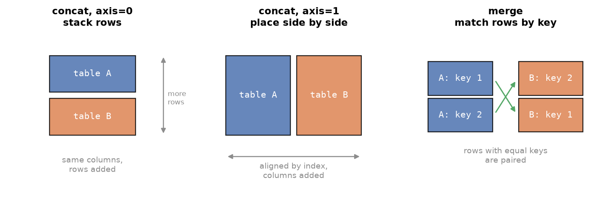
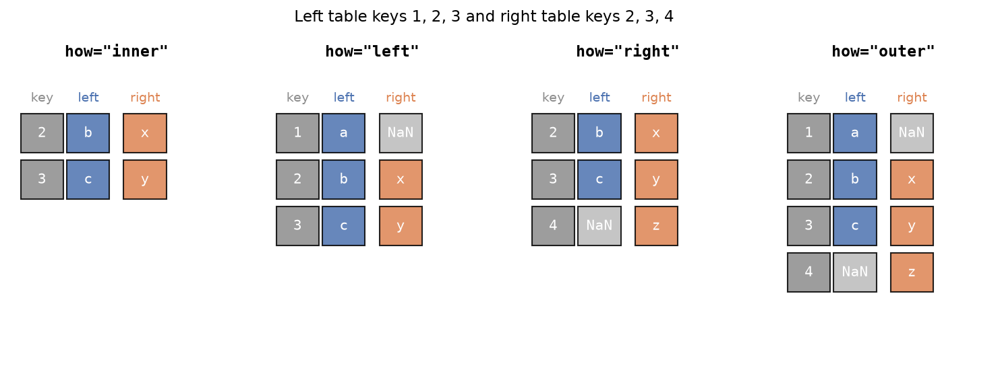

---
tags:
  - pandas
  - merge
  - join
  - concat
aliases:
  - Merging & Joining
  - pandas merge
  - Joins in pandas
difficulty: intermediate
runnable: true
prerequisites:
  - GroupBy
created: 2026-10-13
---

> [!info] Where this fits
> This builds on [[GroupBy]]. Real data is spread over several related tables, and answering a question often means putting two of them side by side. This note covers stacking tables with `concat` and matching them by key with `merge` and `join`. From here you continue to [[MultiIndex Objects]].

An online school keeps one table of students, one of courses, and a registration log for each month. No single table can say which student paid for which course. You need to combine them, and pandas offers three tools: `concat` glues tables together, `merge` matches rows by a shared column, and `join` matches rows by the index. This note teaches all three, then uses them to answer ten questions about registrations and two about cricket.

> [!info] Dataset
> - **Fictional student roster** (`cortex_data("students")`), **Fictional course catalogue** (`cortex_data("courses")`), **Fictional course registrations, month 1** (`cortex_data("reg_month1")`), and **Fictional course registrations, month 2** (`cortex_data("reg_month2")`): synthetic data generated for Cortex, not real records. License: [MIT](https://github.com/Ayaz-Mohammed-Khan/cortex/blob/main/LICENSE).
> - **IPL matches 2008 to 2022** (`cortex_data("ipl_matches")`) and **IPL ball-by-ball deliveries (sampled matches)** (`cortex_data("ipl_deliveries")`) from [IPL 2008 to 2022 All Match Dataset by Sahil Vora (Kaggle)](https://www.kaggle.com/datasets/vora1011/ipl-2008-to-2021-all-match-dataset). License: [ODbL 1.0](https://opendatacommons.org/licenses/odbl/1-0/). Deliveries are trimmed: kept every delivery of every 12th match (by match ID) within each season. Matches are shipped whole.
>
> Full credits and license terms: [dataset licenses (Markdown file)](/datasets/LICENSES.md).

The school tables are generated and fictional, so their results are not real findings. They are built so that some ids in month two do not exist in the student or course tables, which makes the join types behave differently. Cricket results describe the sampled matches in the file.

---

## Merging, joining, and concatenating

Real datasets are rarely one file. Databases split information into related tables so that each fact is stored once: a student's name lives in the students table, and the registration log refers to the student by id. Analysis then needs the pieces back together.

| Operation | Combines | Matches by | Use it when |
| :--- | :--- | :--- | :--- |
| `pd.concat` | tables with the same kind of rows or columns | position and labels | stacking monthly logs, or placing tables side by side |
| `merge` | tables that describe the same things | values in key columns | adding a student's name to a registration |
| `join` | tables that share an index | the index | the keys are already the index |

The four school tables relate like this:

- **students**: `student_id`, `name`, and `partner`, the id of a study partner.
- **courses**: `course_id`, `course_name`, and `price`.
- **reg_month1** and **reg_month2**: `student_id` and `course_id`, one row per registration.

```python
import pandas as pd

students = cortex_data("students")
courses = cortex_data("courses")
m1 = cortex_data("reg_month1")
m2 = cortex_data("reg_month2")
print(students.shape, courses.shape, m1.shape, m2.shape)
students.head(3)
```

```text
(25, 3) (12, 3) (25, 2) (28, 2)
   student_id           name  partner
0           1  Nadia Lowmere        3
1           2    Uma Delmont       25
2           3   Nadia Tamsin        2
```

---

## Pandas concat method

`pd.concat([a, b, ...])` glues a list of tables together. The `axis` argument chooses the direction.



### Stacking vertically

The default, `axis=0`, stacks the rows of each table below the previous one. Each table keeps its original index, so the result repeats index values unless you pass `ignore_index=True`, which renumbers the rows from 0.

```python
import pandas as pd

m1 = cortex_data("reg_month1")
m2 = cortex_data("reg_month2")
stacked = pd.concat([m1, m2])
print(stacked.index[:3].tolist(), stacked.index[-3:].tolist())
fresh = pd.concat([m1, m2], ignore_index=True)
print(fresh.shape)
fresh.tail(3)
```

```text
[0, 1, 2] [25, 26, 27]
(53, 2)
    student_id  course_id
50          18          6
51          27          9
52           5          1
```

> [!note] DataFrame.append is gone
> Older code stacks tables with `a.append(b)`. That method was removed in pandas 2, so use `pd.concat([a, b])`.

```python
# cortex:norun
both = m1.append(m2)   # AttributeError in pandas 2: use pd.concat([m1, m2])
```

### Labelling the sources with keys

The `keys` argument tags each input table, which builds a **MultiIndex** (an index with two levels) whose outer level says where each row came from. Retrieve rows with `loc` and a tuple of labels, because `iloc` takes positions, not labels.

```python
import pandas as pd

m1 = cortex_data("reg_month1")
m2 = cortex_data("reg_month2")
tagged = pd.concat([m1, m2], keys=["first", "second"])
print(tagged.loc[("second", 3)])
tagged.loc["first"].head(2)
```

```text
student_id     6
course_id     12
Name: (second, 3), dtype: int64
   student_id  course_id
0          23          2
1           7          1
```

### Stacking side by side

With `axis=1`, `concat` aligns by index and places columns next to each other. Tables of different lengths leave `NaN` where one side has no row, and the column names do not need to match.

```python
import pandas as pd

m1 = cortex_data("reg_month1")
m2 = cortex_data("reg_month2")
side = pd.concat([m1, m2], axis=1)
print(side.shape)
side.tail(4)
```

```text
(28, 4)
    student_id  course_id  student_id  course_id
24        14.0        9.0          25         10
25         NaN        NaN          18          6
26         NaN        NaN          27          9
27         NaN        NaN           5          1
```

---

## merge method

`concat` matches by position. **`merge`** matches by value: for each row in the left table it looks for rows in the right table with the same value in a shared column (the **key**), exactly like a `JOIN` in SQL. Think of a clerk who takes each registration slip and looks the student id up in the student list to copy the name across.



The `how` argument chooses which rows survive when a key has no match on the other side:

| `how` | Keeps |
| :--- | :--- |
| `"inner"` (default) | only keys present in both tables |
| `"left"` | every row of the left table, with `NaN` where the right has no match |
| `"right"` | every row of the right table, with `NaN` where the left has no match |
| `"outer"` | every row of both tables |

### Inner join

An inner join drops registrations whose student id is not in the roster. Month two has ids 26 to 28, which do not exist in `students`.

```python
import pandas as pd

students = cortex_data("students")
m2 = cortex_data("reg_month2")
inner = m2.merge(students, how="inner", on="student_id")
print(m2.shape[0], inner.shape[0])
inner.head(3)
```

```text
28 25
   student_id  course_id         name  partner
0          16          7   Fen Calder       10
1           5          4   Ada Pellar       18
2          19          6  Elif Okonta       14
```

The equivalent function form is `pd.merge(m2, students, on="student_id")`; both mean the same.

### Left join

A left join keeps every row of the left table. Registrations for unknown students stay, with missing names.

```python
import pandas as pd

students = cortex_data("students")
m2 = cortex_data("reg_month2")
left = m2.merge(students, how="left", on="student_id")
print(left.shape[0], left["name"].isnull().sum())
left[left["name"].isnull()]
```

```text
28 3
    student_id  course_id name  partner
15          28          2  NaN      NaN
21          26          4  NaN      NaN
26          27          9  NaN      NaN
```

### Right join

A right join keeps every row of the right table. Here every student appears, and students with no month-two registration get `NaN` in the course column.

```python
import pandas as pd

students = cortex_data("students")
m2 = cortex_data("reg_month2")
right = m2.merge(students, how="right", on="student_id")
print(right.shape[0], right["course_id"].isnull().sum())
```

```text
35 10
```

Left and right are mirror images, so swapping the table order and the word turns one into the other.

```python
import pandas as pd

students = cortex_data("students")
m2 = cortex_data("reg_month2")
a = m2.merge(students, how="right", on="student_id")
b = students.merge(m2, how="left", on="student_id")
print(a.shape == b.shape)
```

```text
True
```

### Outer join

An outer join keeps everything from both sides, so it shows unmatched rows from either table.

```python
import pandas as pd

students = cortex_data("students")
m2 = cortex_data("reg_month2")
outer = m2.merge(students, how="outer", on="student_id")
print(outer.shape[0])
print(outer[outer["name"].isnull() | outer["course_id"].isnull()].shape[0])
```

```text
38
13
```

> [!warning] Duplicate keys multiply rows
> If a key appears twice on the left and three times on the right, the merge produces six rows for it, one per pairing. A registration table with repeated student ids is exactly that case. Check row counts before and after a merge to catch surprises.

### Self join

A **self join** merges a table with itself. The roster stores each student's `partner` as an id. To show the partner's name, match `partner` on the left to `student_id` on the right. When the two keys have different names use `left_on` and `right_on`, and when the tables share other column names use `suffixes` to tell them apart.

```python
import pandas as pd

students = cortex_data("students")
pairs = students.merge(students, left_on="partner", right_on="student_id",
                       suffixes=("", "_partner"))
pairs[["name", "name_partner"]].head(4)
```

```text
            name  name_partner
0  Nadia Lowmere  Nadia Tamsin
1    Uma Delmont    Gita Varga
2   Nadia Tamsin   Uma Delmont
3   Farah Zeller  Quinn Larkin
```

---

## join method

`DataFrame.join` is a shorthand for merging on the **index**. Set the key as the index on the right table, and call `left.join(right, on="key")`, or set both indexes and call `left.join(right)`. The default is a left join. If the tables share column names, pass `lsuffix` and `rsuffix`.

```python
import pandas as pd

students = cortex_data("students")
courses = cortex_data("courses").set_index("course_id")
m1 = cortex_data("reg_month1")
named = m1.join(courses, on="course_id")
print(named.shape)
named.head(3)
```

```text
(25, 4)
   student_id  course_id    course_name  price
0          23          2  Data Cleaning   2499
1           7          1  Python Basics   1199
2          16         11  Text Analysis   1999
```

```python
import pandas as pd

a = pd.DataFrame({"score": [70, 80]}, index=["x", "y"])
b = pd.DataFrame({"score": [1, 2]}, index=["y", "z"])
a.join(b, lsuffix="_a", rsuffix="_b", how="outer")
```

```text
   score_a  score_b
x     70.0      NaN
y     80.0      1.0
z      NaN      2.0
```

---

## Practical implementations

Each question below starts by loading the tables it needs, so it runs alone.

### Course registrations

**1. What is the total revenue?** Stack the months, attach each course's price, and sum.

```python
import pandas as pd

courses = cortex_data("courses")
regs = pd.concat([cortex_data("reg_month1"), cortex_data("reg_month2")], ignore_index=True)
sold = regs.merge(courses, on="course_id")
print(len(regs), len(sold))
print(sold["price"].sum())
```

```text
53 52
150848
```

The merge drops registrations for course 13, which is not in the catalogue, so only priced sales count.

**2. How does revenue split by month?** Tag the months with `keys`, then bring the tag out of the index with `reset_index`.

```python
import pandas as pd

courses = cortex_data("courses")
both = pd.concat([cortex_data("reg_month1"), cortex_data("reg_month2")], keys=["m1", "m2"])
flat = both.reset_index(level=0).rename(columns={"level_0": "month"})
flat.merge(courses, on="course_id").groupby("month")["price"].sum()
```

```text
month
m1    65775
m2    85073
Name: price, dtype: int64
```

**3. Print a readable registration table.** Chain two merges, one for names and one for course titles.

```python
import pandas as pd

students = cortex_data("students")[["student_id", "name"]]
courses = cortex_data("courses")[["course_id", "course_name"]]
m1 = cortex_data("reg_month1")
m1.merge(students, on="student_id").merge(courses, on="course_id")[["name", "course_name"]].head(4)
```

```text
           name    course_name
0  Dalia Zamora  Data Cleaning
1  Maren Zamora  Python Basics
2    Fen Calder  Text Analysis
3    Gita Varga  Data Cleaning
```

**4. Which courses earn the most?** Plot revenue per course as a bar chart.

```python
import matplotlib.pyplot as plt
import pandas as pd

courses = cortex_data("courses")
regs = pd.concat([cortex_data("reg_month1"), cortex_data("reg_month2")], ignore_index=True)
rev = regs.merge(courses, on="course_id").groupby("course_name")["price"].sum()
rev.sort_values().plot(kind="barh", title="Revenue per course")
plt.tight_layout()
plt.show()
```

**5. Which students registered in both months?** NumPy's `intersect1d` returns the ids common to two arrays, and `isin` uses them as a filter.

```python
import numpy as np
import pandas as pd

students = cortex_data("students")
m1, m2 = cortex_data("reg_month1"), cortex_data("reg_month2")
both = np.intersect1d(m1["student_id"], m2["student_id"])
students[students["student_id"].isin(both)]["name"].tolist()
```

```text
['Nadia Lowmere', 'Arlo Galloway', 'Elio Northam', 'Fen Calder', 'Mira Zeller', 'Elif Okonta', 'Quinn Larkin', 'Kavya Ashcombe', 'Idris Thornbury', 'Dalia Zamora', 'Gita Varga']
```

**6. Which courses had no sign-ups in the first month?** `setdiff1d(a, b)` returns the values of `a` that are missing from `b`, a set difference.

```python
import numpy as np
import pandas as pd

courses = cortex_data("courses")
m1 = cortex_data("reg_month1")
unsold = np.setdiff1d(courses["course_id"], m1["course_id"])
courses[courses["course_id"].isin(unsold)]
```

```text
   course_id           course_name  price
6          7  Machine Learning 101   3999
7          8   Deep Learning Intro   3999
```

**7. Which students registered in only one month?** Take the difference in both directions and combine them.

```python
import numpy as np
import pandas as pd

m1, m2 = cortex_data("reg_month1"), cortex_data("reg_month2")
only_first = np.setdiff1d(m1["student_id"], m2["student_id"])
only_second = np.setdiff1d(m2["student_id"], m1["student_id"])
print(len(only_first), len(only_second))
print(np.union1d(only_first, only_second))
```

```text
5 7
[ 2  3  5  6  7 11 13 14 24 26 27 28]
```

**8. What share of students never registered?** Compare the roster with the ids that appear in either log.

```python
import numpy as np
import pandas as pd

students = cortex_data("students")
regs = pd.concat([cortex_data("reg_month1"), cortex_data("reg_month2")])
absent = np.setdiff1d(students["student_id"], regs["student_id"])
print(round(len(absent) / len(students) * 100, 1), "percent never registered")
```

```text
20.0 percent never registered
```

**9. Which courses are most popular?** Group by id and name together. Counting only names would merge two different courses that happen to share a name, so keep the id in the key.

```python
import pandas as pd

courses = cortex_data("courses")
regs = pd.concat([cortex_data("reg_month1"), cortex_data("reg_month2")])
top = regs.merge(courses, on="course_id").groupby(["course_id", "course_name"]).size()
top.sort_values(ascending=False).head(3)
```

```text
course_id  course_name       
1          Python Basics         7
2          Data Cleaning         7
10         Time Series Basics    6
dtype: int64
```

**10. Who spent the most?** Merge in student names and prices, then add up price per student.

```python
import pandas as pd

students = cortex_data("students")[["student_id", "name"]]
courses = cortex_data("courses")[["course_id", "price"]]
regs = pd.concat([cortex_data("reg_month1"), cortex_data("reg_month2")])
spend = regs.merge(courses, on="course_id").merge(students, on="student_id")
spend.groupby(["student_id", "name"])["price"].sum().nlargest(3)
```

```text
student_id  name          
19          Elif Okonta       15695
21          Kavya Ashcombe    12997
16          Fen Calder        10997
Name: price, dtype: int64
```

A final question uses the self join: **do both partners in a pair register?** Mark students who registered, then look up each student's partner in that set.

```python
import pandas as pd

students = cortex_data("students")
regs = pd.concat([cortex_data("reg_month1"), cortex_data("reg_month2")])
active = set(regs["student_id"])
students["active"] = students["student_id"].isin(active)
students["partner_active"] = students["partner"].isin(active)
both = students["active"] & students["partner_active"]
print(both.sum(), "students and their partners both registered")
```

```text
17 students and their partners both registered
```

### Cricket match questions

The match table has one row per match and the deliveries table has one row per ball. Both have an `ID`, so `on="ID"` links them. The deliveries file holds only a sample of matches, so the join type changes the row count a lot.

```python
import pandas as pd

m = cortex_data("ipl_matches")[["ID", "Season", "Venue"]]
d = cortex_data("ipl_deliveries")
matches_in_sample = d[["ID"]].drop_duplicates()
print(m.merge(matches_in_sample, on="ID", how="inner").shape[0])
print(m.merge(matches_in_sample, on="ID", how="left").shape[0])
```

```text
83
950
```

The inner join keeps only matches that have deliveries; the left join keeps all matches. The gap between the two numbers is the number of matches with no sampled deliveries.

**Extras per match by venue.** Sum the extras within each match, attach the venue, and average over matches. A venue with a single sampled match is not reliable, so keep venues with at least two.

```python
import pandas as pd

m = cortex_data("ipl_matches")[["ID", "Venue"]]
d = cortex_data("ipl_deliveries")
per_match = d.groupby("ID")["extras_run"].sum().rename("extras").reset_index()
joined = per_match.merge(m, on="ID")
by_venue = joined.groupby("Venue")["extras"].agg(["mean", "count"])
by_venue[by_venue["count"] >= 2].sort_values("mean", ascending=False).round(1).head(3)
```

```text
                                 mean  count
Venue                                       
M Chinnaswamy Stadium            22.5      4
Dr DY Patil Sports Academy       20.0      4
MA Chidambaram Stadium, Chepauk  18.1     10
```

**Best bowler of each season.** Count wickets credited to bowlers per season, sort so the biggest haul comes first, and keep the first row for each season with `drop_duplicates`.

```python
import pandas as pd

d = cortex_data("ipl_deliveries")
m = cortex_data("ipl_matches")[["ID", "Season"]]
credited = d[d["kind"].isin(["bowled", "caught", "caught and bowled", "lbw", "stumped", "hit wicket"])]
w = credited.merge(m, on="ID").groupby(["Season", "bowler"]).size().rename("wickets").reset_index()
best = w.sort_values("wickets", ascending=False).drop_duplicates(subset=["Season"], keep="first")
best.sort_values("Season").head(5)
```

```text
      Season        bowler  wickets
1    2007/08    AB Agarkar        3
35      2009      I Sharma        4
71   2009/10      RP Singh        4
107     2011      R Sharma        5
129     2012  DE Bollinger        5
```

---

## Summary

1. Related tables are combined with `concat` (by position), `merge` (by key values), or `join` (by index).
2. `pd.concat` with `axis=0` stacks rows, `ignore_index=True` renumbers them, and `DataFrame.append` no longer exists.
3. `keys=[...]` labels each source with a MultiIndex level, retrieved with `loc` and a tuple; `axis=1` places tables side by side and fills `NaN` where lengths differ.
4. `merge` matches rows on a key; `how` selects inner, left, right, or outer, and each keeps a different set of unmatched rows.
5. Left and right joins are mirror images that differ only in table order.
6. A self join merges a table with itself using `left_on`, `right_on`, and `suffixes`.
7. `join` merges on the index, defaulting to a left join, with `lsuffix` and `rsuffix` for clashing names.
8. Duplicate keys multiply rows, so compare row counts before and after.
9. `np.intersect1d` and `np.setdiff1d` answer "in both" and "in one but not the other".
10. Group by an id together with a name when names might repeat, and prefer an inner join when you need only matched rows.

---

> [!info] Continues to
> Next is [[MultiIndex Objects]], where the hierarchical indexes that `keys` and multi-column `groupby` produce become a topic of their own.
