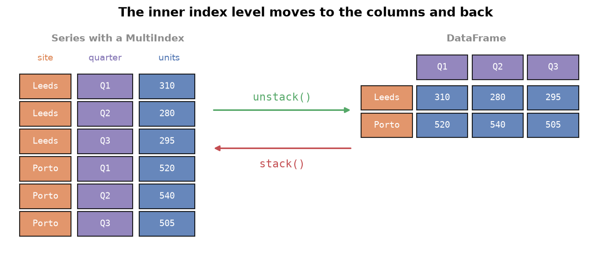
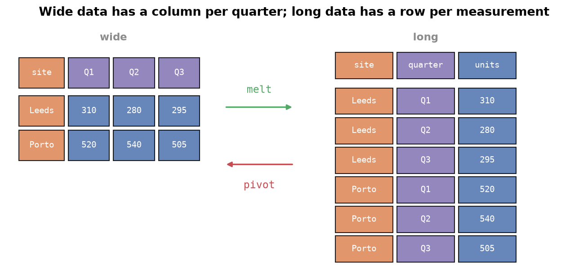

---
tags:
  - pandas
  - multiindex
  - reshaping
  - melt
aliases:
  - MultiIndex Objects
  - Hierarchical indexing
difficulty: intermediate
runnable: true
prerequisites:
  - Merging & Joining
created: 2026-10-13
---

> [!info] Where this fits
> This builds on [[Merging & Joining]], where `concat(keys=...)` and multi-column `groupby` produced indexes with two levels. Here you learn that structure properly: the **MultiIndex**, the stack and unstack operations that move a level between rows and columns, and the reshaping tool `melt`. From here you continue to [[String & Datetime Ops]].

A Series needs one key to fetch a value, and a DataFrame needs two: a row and a column. What if your data needs three keys, such as warehouse, quarter, and year? You could keep adding tables, or you could let the index itself carry several levels. A MultiIndex does exactly that, so higher-dimensional data fits inside the familiar one- and two-dimensional objects.

> [!info] Dataset
> - **COVID-19 confirmed cases by country (weekly)** (`cortex_data("covid_confirmed")`) and **COVID-19 deaths by country (weekly)** (`cortex_data("covid_deaths")`) from [COVID-19 Data Repository by the Center for Systems Science and Engineering (CSSE) at Johns Hopkins University](https://github.com/CSSEGISandData/COVID-19). License: [CC BY 4.0](https://creativecommons.org/licenses/by/4.0/). Trimmed: kept the 4 identifier columns and every 7th date column from 1/22/20 (one date per week).
>
> Full credits and license terms: [dataset licenses (Markdown file)](/datasets/LICENSES.md).

Every other example builds a small table inline: a made-up chain of warehouses with quarterly units and returns.

---

## About MultiIndex objects

Suppose a warehouse chain tracks units shipped. One key, the quarter, is enough for a single warehouse, so a **Series** (one dimension) works. Adding the warehouse as a second key makes it a table, so a **DataFrame** (two dimensions) fits. A third key, the year, has no home in either.

A first idea is to use tuples as the index labels. That looks hierarchical but is not: pandas treats each tuple as one opaque label, so asking for just the first part finds nothing.

```python
# cortex:norun
import pandas as pd

s = pd.Series([310, 280, 295, 240],
              index=[("Leeds", "Q1"), ("Leeds", "Q2"), ("Porto", "Q1"), ("Porto", "Q2")])
s["Leeds"]    # KeyError: 'Leeds'  (a tuple label is one whole label)
```

A **MultiIndex** is the real structure: an index with several **levels**, where each level can be searched on its own.

### Building a MultiIndex

Two constructors cover most cases.

- `pd.MultiIndex.from_tuples(list_of_tuples)` builds the index from an explicit list of label pairs.
- `pd.MultiIndex.from_product([a, b])` builds every combination of the lists, a **Cartesian product**. It is the right tool when the data covers each combination.

The `levels` attribute lists the distinct labels at each level.

```python
import pandas as pd

explicit = pd.MultiIndex.from_tuples([("Leeds", "Q1"), ("Leeds", "Q2"), ("Porto", "Q1")])
grid = pd.MultiIndex.from_product([["Leeds", "Porto", "Turin"], ["Q1", "Q2", "Q3", "Q4"]])
print(explicit.levels)
print(len(grid))
grid[:5]
```

```text
[['Leeds', 'Porto'], ['Q1', 'Q2']]
12
MultiIndex([('Leeds', 'Q1'),
            ('Leeds', 'Q2'),
            ('Leeds', 'Q3'),
            ('Leeds', 'Q4'),
            ('Porto', 'Q1')],
           )
```

### A MultiIndex Series

Give a Series a MultiIndex and the data becomes a two-level tree: warehouses at the top, quarters beneath. A single label selects a whole branch, and a tuple of labels picks one leaf.

```python
import pandas as pd

idx = pd.MultiIndex.from_product([["Leeds", "Porto", "Turin"], ["Q1", "Q2", "Q3", "Q4"]])
units = pd.Series([310, 280, 295, 240, 520, 540, 505, 610, 150, 170, 160, 190], index=idx)
print(units["Porto"])
print(units[("Turin", "Q3")])
units.loc[:, "Q4"]
```

```text
Q1    520
Q2    540
Q3    505
Q4    610
dtype: int64
160
Leeds    240
Porto    610
Turin    190
dtype: int64
```

The last line selects across the outer level by passing a slice for it, which returns the Q4 value for every warehouse.

---

## Why use MultiIndex objects

A MultiIndex lets one- and two-dimensional objects carry data with more dimensions. A Series with a two-level index stores what would be a table, and a DataFrame with a MultiIndex on both axes stores four dimensions. You keep every pandas tool (selecting, sorting, aggregating) while the structure is richer than the shape suggests.

| Object | Plain index | With MultiIndex |
| :--- | :--- | :--- |
| Series | 1 dimension | 2 or more dimensions |
| DataFrame, rows only | 2 dimensions | 3 or more dimensions |
| DataFrame, rows and columns | 2 dimensions | 4 or more dimensions |

---

## Stacking and unstacking

**`unstack()`** moves the innermost index level into the columns, turning a MultiIndex Series into a DataFrame. **`stack()`** does the reverse, pushing column labels back into the index. They are inverse operations, so you can switch between a tall layout and a wide one.



```python
import pandas as pd

idx = pd.MultiIndex.from_product([["Leeds", "Porto", "Turin"], ["Q1", "Q2", "Q3", "Q4"]])
units = pd.Series([310, 280, 295, 240, 520, 540, 505, 610, 150, 170, 160, 190], index=idx)
wide = units.unstack()
print(wide)
print(wide.stack(future_stack=True).equals(units))
```

```text
        Q1   Q2   Q3   Q4
Leeds  310  280  295  240
Porto  520  540  505  610
Turin  150  170  160  190
True
```

By default the **innermost** level moves. Pass `level=0` to move the outer level instead, which swaps what the rows and columns represent.

```python
import pandas as pd

idx = pd.MultiIndex.from_product([["Leeds", "Porto", "Turin"], ["Q1", "Q2", "Q3", "Q4"]])
units = pd.Series([310, 280, 295, 240, 520, 540, 505, 610, 150, 170, 160, 190], index=idx)
units.unstack(level=0)
```

```text
    Leeds  Porto  Turin
Q1    310    520    150
Q2    280    540    170
Q3    295    505    160
Q4    240    610    190
```

Stacking repeatedly folds every column level into the index until a Series remains. The `future_stack=True` argument selects the current implementation of `stack`, which will be the only one in future pandas versions.

```python
import pandas as pd

cols = pd.MultiIndex.from_product([["units", "returns"], ["2022", "2023"]])
t = pd.DataFrame([[310, 330, 12, 9], [520, 560, 20, 25]], index=["Leeds", "Porto"], columns=cols)
once = t.stack(future_stack=True)
twice = once.stack(future_stack=True)
print(type(once).__name__, type(twice).__name__)
print(twice.index.nlevels)
```

```text
DataFrame Series
3
```

---

## MultiIndex DataFrames

A DataFrame can carry a MultiIndex on its **rows**, its **columns**, or **both**. Rows and columns are the same kind of object in pandas, an index, so whatever works for one works for the other. This frame has warehouses and quarters on the rows, and a metric and a year on the columns, which is four dimensions in a two-dimensional table.

```python
import numpy as np
import pandas as pd

rows = pd.MultiIndex.from_product([["Leeds", "Porto", "Turin"], ["Q1", "Q2", "Q3", "Q4"]],
                                  names=["site", "quarter"])
cols = pd.MultiIndex.from_product([["units", "returns"], ["2022", "2023"]],
                                  names=["metric", "year"])
rng = np.random.default_rng(5)
data = np.hstack([rng.integers(200, 600, size=(12, 2)), rng.integers(5, 40, size=(12, 2))])
df = pd.DataFrame(data, index=rows, columns=cols)
df.head(5)
```

```text
metric        units      returns     
year           2022 2023    2022 2023
site  quarter                        
Leeds Q1        468  522      14   20
      Q2        209  523      14   39
      Q3        387  406      11   36
      Q4        452  314      32   34
Porto Q1        591  221       9   18
```

Selecting a single column of a MultiIndex row frame returns a MultiIndex Series, because the rows keep their two levels.

### Working with a MultiIndex DataFrame

The usual inspection tools work, and the column names appear as composite labels in `info`.

```python
import numpy as np
import pandas as pd

rows = pd.MultiIndex.from_product([["Leeds", "Porto", "Turin"], ["Q1", "Q2", "Q3", "Q4"]],
                                  names=["site", "quarter"])
cols = pd.MultiIndex.from_product([["units", "returns"], ["2022", "2023"]],
                                  names=["metric", "year"])
rng = np.random.default_rng(5)
data = np.hstack([rng.integers(200, 600, size=(12, 2)), rng.integers(5, 40, size=(12, 2))])
df = pd.DataFrame(data, index=rows, columns=cols)
print(df.shape)
print(df.duplicated().sum(), df.isnull().sum().sum())
df.info()
```

```text
(12, 4)
0 0
<class 'pandas.core.frame.DataFrame'>
MultiIndex: 12 entries, ('Leeds', 'Q1') to ('Turin', 'Q4')
Data columns (total 4 columns):
 #   Column           Non-Null Count  Dtype
---  ------           --------------  -----
 0   (units, 2022)    12 non-null     int64
 1   (units, 2023)    12 non-null     int64
 2   (returns, 2022)  12 non-null     int64
 3   (returns, 2023)  12 non-null     int64
dtypes: int64(4)
memory usage: 837.0+ bytes
```

Row selection with `loc` uses a tuple for a full label, or a slice of tuples for a range. `iloc` still selects by position.

```python
import numpy as np
import pandas as pd

rows = pd.MultiIndex.from_product([["Leeds", "Porto", "Turin"], ["Q1", "Q2", "Q3", "Q4"]],
                                  names=["site", "quarter"])
cols = pd.MultiIndex.from_product([["units", "returns"], ["2022", "2023"]],
                                  names=["metric", "year"])
rng = np.random.default_rng(5)
data = np.hstack([rng.integers(200, 600, size=(12, 2)), rng.integers(5, 40, size=(12, 2))])
df = pd.DataFrame(data, index=rows, columns=cols)
print(df.loc[("Porto", "Q2")])
print(df.loc[("Leeds", "Q3"):("Porto", "Q1")])
df.iloc[0:6:2]
```

```text
metric   year
units    2022    311
         2023    353
returns  2022     26
         2023     22
Name: (Porto, Q2), dtype: int64
metric        units      returns     
year           2022 2023    2022 2023
site  quarter                        
Leeds Q3        387  406      11   36
      Q4        452  314      32   34
Porto Q1        591  221       9   18
metric        units      returns     
year           2022 2023    2022 2023
site  quarter                        
Leeds Q1        468  522      14   20
      Q3        387  406      11   36
Porto Q1        591  221       9   18
```

Columns work the same way: name the outer label first, then the inner one, or pick by position.

```python
import numpy as np
import pandas as pd

rows = pd.MultiIndex.from_product([["Leeds", "Porto", "Turin"], ["Q1", "Q2", "Q3", "Q4"]],
                                  names=["site", "quarter"])
cols = pd.MultiIndex.from_product([["units", "returns"], ["2022", "2023"]],
                                  names=["metric", "year"])
rng = np.random.default_rng(5)
data = np.hstack([rng.integers(200, 600, size=(12, 2)), rng.integers(5, 40, size=(12, 2))])
df = pd.DataFrame(data, index=rows, columns=cols)
print(df["returns"].head(2))
print(df["returns"]["2023"].head(2))
df.iloc[[0, 4], [1, 2]]
```

```text
year           2022  2023
site  quarter            
Leeds Q1         14    20
      Q2         14    39
site   quarter
Leeds  Q1         20
       Q2         39
Name: 2023, dtype: int64
metric        units returns
year           2023    2022
site  quarter              
Leeds Q1        522      14
Porto Q1        221       9
```

### Sorting a MultiIndex

`sort_index` orders rows by the index. Pass `ascending=False` to reverse every level, a list such as `[False, True]` to choose per level, or `level=` to sort by a single level.

```python
import numpy as np
import pandas as pd

rows = pd.MultiIndex.from_product([["Leeds", "Porto"], ["Q1", "Q2", "Q3"]], names=["site", "quarter"])
df = pd.DataFrame({"units": [310, 280, 295, 520, 540, 505]}, index=rows)
print(df.sort_index(ascending=False))
print(df.sort_index(ascending=[False, True]))
df.sort_index(level="quarter")
```

```text
               units
site  quarter       
Porto Q3         505
      Q2         540
      Q1         520
Leeds Q3         295
      Q2         280
      Q1         310
               units
site  quarter       
Porto Q1         520
      Q2         540
      Q3         505
Leeds Q1         310
      Q2         280
      Q3         295
               units
site  quarter       
Leeds Q1         310
Porto Q1         520
Leeds Q2         280
Porto Q2         540
Leeds Q3         295
Porto Q3         505
```

---

## Transposing DataFrames

`transpose()` (or the shorthand `.T`) swaps rows and columns. Because both axes are indexes, a MultiIndex on the rows becomes a MultiIndex on the columns.

```python
import pandas as pd

rows = pd.MultiIndex.from_product([["Leeds", "Porto"], ["Q1", "Q2"]], names=["site", "quarter"])
df = pd.DataFrame({"units": [310, 280, 520, 540], "returns": [12, 9, 20, 25]}, index=rows)
print(df.shape, df.T.shape)
df.T
```

```text
(4, 2) (2, 4)
site    Leeds      Porto     
quarter    Q1   Q2    Q1   Q2
units     310  280   520  540
returns    12    9    20   25
```

---

## swaplevel

`swaplevel()` exchanges two levels of a MultiIndex. It works on the rows by default, and `axis=1` swaps the column levels. Follow it with `sort_index` to group the new outer level together.

```python
import pandas as pd

cols = pd.MultiIndex.from_product([["units", "returns"], ["2022", "2023"]])
t = pd.DataFrame([[310, 330, 12, 9], [520, 560, 20, 25]], index=["Leeds", "Porto"], columns=cols)
swapped = t.swaplevel(axis=1).sort_index(axis=1)
print(swapped.columns.tolist())
swapped
```

```text
[('2022', 'returns'), ('2022', 'units'), ('2023', 'returns'), ('2023', 'units')]
         2022          2023      
      returns units returns units
Leeds      12   310       9   330
Porto      20   520      25   560
```

---

## Long vs wide data

The same information can be laid out two ways.

| Layout | Shape | Each row is |
| :--- | :--- | :--- |
| **Wide** | few rows, many columns | one entity, with one column per measurement or date |
| **Long** | many rows, few columns | one measurement, with a column naming what was measured |

A table of three sites with one column per quarter is wide. The same facts as nine rows of site, quarter, and units is long.



Both layouts are useful. Wide data suits reading and spreadsheets, and time series files often arrive wide with one column per date. Long data suits analysis, plotting, and databases: filtering, grouping, and merging all expect one value per row. Converting between them is a routine part of data cleaning.

---

## pandas melt

`melt` turns wide data into long data. Its pieces:

- **`id_vars`**: the identifier columns that stay as they are.
- **`var_name`**: the name of the new column that holds the old column labels (`variable` by default).
- **`value_name`**: the name of the new column that holds the values (`value` by default).

```python
import pandas as pd

wide = pd.DataFrame({"site": ["Leeds", "Porto", "Turin"],
                     "Q1": [310, 520, 150], "Q2": [280, 540, 170], "Q3": [295, 505, 160]})
print(wide.melt())
long = wide.melt(id_vars="site", var_name="quarter", value_name="units")
long
```

```text
   variable  value
0      site  Leeds
1      site  Porto
2      site  Turin
3        Q1    310
4        Q1    520
5        Q1    150
6        Q2    280
7        Q2    540
8        Q2    170
9        Q3    295
10       Q3    505
11       Q3    160
    site quarter  units
0  Leeds      Q1    310
1  Porto      Q1    520
2  Turin      Q1    150
3  Leeds      Q2    280
4  Porto      Q2    540
5  Turin      Q2    170
6  Leeds      Q3    295
7  Porto      Q3    505
8  Turin      Q3    160
```

Without `id_vars`, every column is melted, including the identifiers, which is rarely what you want. **`pivot`** is the inverse: it turns long data back into wide data by choosing which column becomes the index, which becomes the columns, and which supplies the values. (`pivot_table`, covered in [[String & Datetime Ops]], also aggregates repeated entries.)

```python
import pandas as pd

long = pd.DataFrame({"site": ["Leeds", "Leeds", "Porto", "Porto"],
                     "quarter": ["Q1", "Q2", "Q1", "Q2"],
                     "units": [310, 280, 520, 540]})
long.pivot(index="site", columns="quarter", values="units")
```

```text
quarter   Q1   Q2
site             
Leeds    310  280
Porto    520  540
```

### Reshaping real case counts

The COVID files are wide: four identifier columns (province, country, latitude, longitude), then one column per date. Each file measures one thing, so to compare cases with deaths you melt both into long form and merge them on all five keys.

```python
import pandas as pd

conf = cortex_data("covid_confirmed")
deaths = cortex_data("covid_deaths")
ids = ["Province/State", "Country/Region", "Lat", "Long"]
c = conf.melt(id_vars=ids, var_name="date", value_name="cases")
d = deaths.melt(id_vars=ids, var_name="date", value_name="deaths")
both = c.merge(d, on=ids + ["date"])
print(conf.shape, c.shape, both.shape)
both.head(3)
```

```text
(289, 168) (47396, 6) (47396, 7)
  Province/State Country/Region       Lat       Long     date  cases  deaths
0            NaN    Afghanistan  33.93911  67.709953  1/22/20      0       0
1            NaN        Albania  41.15330  20.168300  1/22/20      0       0
2            NaN        Algeria  28.03390   1.659600  1/22/20      0       0
```

Now ask a question of the combined table: how many deaths were recorded per hundred confirmed cases in three countries on the last sampled date? Country totals add up their provinces first.

```python
import pandas as pd

conf = cortex_data("covid_confirmed")
deaths = cortex_data("covid_deaths")
ids = ["Province/State", "Country/Region", "Lat", "Long"]
both = conf.melt(id_vars=ids, var_name="date", value_name="cases").merge(
    deaths.melt(id_vars=ids, var_name="date", value_name="deaths"), on=ids + ["date"])
last = both[both["date"] == "3/8/23"]
by_country = last.groupby("Country/Region")[["cases", "deaths"]].sum()
pick = by_country.loc[["Brazil", "India", "Japan"]]
(pick["deaths"] / pick["cases"] * 100).round(2)
```

```text
Country/Region
Brazil    1.89
India     1.19
Japan     0.22
dtype: float64
```

Countries reported as several provinces, such as Canada, can also be inspected one province at a time.

```python
import pandas as pd

deaths = cortex_data("covid_deaths")
canada = deaths[deaths["Country/Region"] == "Canada"]
canada.set_index("Province/State")["3/8/23"].sort_values(ascending=False).head(4)
```

```text
Province/State
Quebec              18153
Ontario             16186
Alberta              5622
British Columbia     5218
Name: 3/8/23, dtype: int64
```

---

## Summary

1. A MultiIndex is an index with several levels, so Series and DataFrames can carry three or more dimensions.
2. Tuples as labels are not hierarchical; build a real MultiIndex with `from_tuples` or `from_product` (the Cartesian product) and inspect it with `levels`.
3. In a MultiIndex Series, one label selects a branch and a tuple selects a leaf.
4. `unstack` moves the innermost level (or `level=`) to the columns, `stack` reverses it, and stacking every level leaves a Series.
5. Rows and columns are the same kind of object, so either axis can hold a MultiIndex, and both together give four dimensions.
6. `loc` takes tuples and tuple slices for rows; columns select outer then inner labels; `iloc` selects by position.
7. `sort_index` accepts `ascending`, a list of flags, and `level=`.
8. `transpose` swaps the axes, and `swaplevel` exchanges two index levels (`axis=1` for columns).
9. Wide data has one column per measurement; long data has one row per measurement.
10. `melt` (`id_vars`, `var_name`, `value_name`) makes data long and `pivot` makes it wide; melting several files lets you merge them on all identifying keys.

---

> [!info] Continues to
> Next is [[String & Datetime Ops]], which introduces `pivot_table`, vectorized text methods, and dates.
