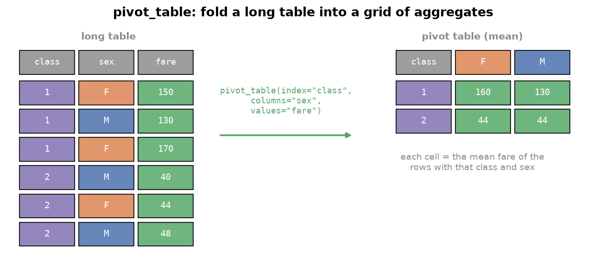

---
tags:
  - pandas
  - pivot-table
  - string-methods
  - datetime
aliases:
  - String & Datetime Ops
  - pandas str accessor
  - pandas datetime
difficulty: intermediate
runnable: true
prerequisites:
  - MultiIndex Objects
created: 2026-10-13
---

> [!info] Where this fits
> This builds on [[MultiIndex Objects]], whose `unstack` underlies the pivot table you meet first. It then covers the two kinds of data that need special tools: text, handled through the `.str` accessor, and dates, handled through Timestamps and the `.dt` accessor. From here you continue to [[Pandas Case Studies]].

Numbers are only part of real data. Names, tickets, and notes are text, and logs and ledgers are full of dates. Looping over them in plain Python is slow and breaks on missing values. pandas offers **vectorized** versions: methods that work on a whole column at once, skip gaps safely, and run fast. This note starts with the pivot table, a compact way to summarize two categories at once, then teaches the string methods and the datetime tools.

> [!info] Dataset
> - **Fictional ship passenger list (SS Meridian)** (`cortex_data("voyage_passengers")`): synthetic data generated for Cortex, not real records. License: [MIT](https://github.com/Ayaz-Mohammed-Khan/cortex/blob/main/LICENSE).
> - **Personal expense and income records** (`cortex_data("expenses")`) from [My expenses data by Tharun (Kaggle)](https://www.kaggle.com/datasets/tharunprabu/my-expenses-data). License: [CC0 1.0](https://creativecommons.org/publicdomain/zero/1.0/). Shipped whole.
>
> Full credits and license terms: [dataset licenses (Markdown file)](/datasets/LICENSES.md).

The passenger list is generated and fictional, so its results are not real findings. The expense records are one person's real ledger, so treat results as describing that ledger only.

---

## Pivot table

A **pivot table** summarizes data in two dimensions: one categorical column becomes the rows, another becomes the columns, and each cell holds an aggregate of a third column. Spreadsheet users know it from Excel. In pandas it is the same job as a `groupby` on two keys followed by `unstack`.



First the long way. This asks for the survival rate by travel class and sex on the fictional liner, where `survived` is 1 or 0 so its mean is a rate.

```python
import pandas as pd

v = cortex_data("voyage_passengers")
v.groupby(["cabin_class", "sex"])["survived"].mean().unstack().round(2)
```

```text
sex          female  male
cabin_class              
1              0.97  0.40
2              0.84  0.23
3              0.50  0.19
```

`pivot_table` does the same in one call. The default aggregate is the **mean**.

```python
import pandas as pd

v = cortex_data("voyage_passengers")
v.pivot_table(index="cabin_class", columns="sex", values="survived").round(2)
```

```text
sex          female  male
cabin_class              
1              0.97  0.40
2              0.84  0.23
3              0.50  0.19
```

### Aggregation functions

`aggfunc` chooses the aggregate: `"sum"`, `"count"`, `"std"`, `"median"`, or any other function name. If you omit `values`, pandas aggregates every remaining column, so pass a frame that holds only the keys and numeric columns, then select one result afterwards.

```python
import pandas as pd

v = cortex_data("voyage_passengers")
print(v.pivot_table(index="cabin_class", columns="embarked", values="fare", aggfunc="median").round(1))
print(v.pivot_table(index="cabin_class", columns="sex", values="passenger_id", aggfunc="count"))
nums = v[["cabin_class", "sex", "age", "fare"]]
nums.pivot_table(index="cabin_class", columns="sex")["fare"].round(1)
```

```text
embarked         C      Q      S
cabin_class                     
1            160.8  138.3  155.6
2             46.9   39.6   37.0
3             22.6   21.3   24.0
sex          female  male
cabin_class              
1                69   131
2                75   124
3               148   353
sex          female   male
cabin_class               
1             154.8  150.0
2              41.3   41.2
3              23.2   23.8
```

A dictionary for `aggfunc` applies a different function to each value column, and lists of columns for `index` or `columns` build multi-level tables.

```python
import pandas as pd

v = cortex_data("voyage_passengers")
t = v.pivot_table(index=["cabin_class", "sex"], columns="embarked",
                  aggfunc={"fare": "mean", "survived": "sum"})
t.round(1)
```

```text
                     fare               survived       
embarked                C      Q      S        C  Q   S
cabin_class sex                                        
1           female  196.1  132.2  143.6       16  6  45
            male    127.3  145.8  155.0        8  2  42
2           female   44.3   46.4   39.3       13  9  40
            male     44.4   39.6   40.2        6  4  18
3           female   24.4   24.4   22.6       18  6  49
            male     22.5   23.6   24.1       13  5  50
```

### Margins and fill values

`margins=True` adds an `All` row and column holding the overall aggregate. `fill_value` replaces empty cells (combinations with no data) with a number of your choice.

```python
import pandas as pd

v = cortex_data("voyage_passengers")
v.pivot_table(index="cabin_class", columns="sex", values="fare", aggfunc="mean", margins=True).round(1)
```

```text
sex          female   male    All
cabin_class                      
1             154.8  150.0  151.6
2              41.3   41.2   41.3
3              23.2   23.8   23.6
All            58.9   54.6   56.0
```

### Plotting a pivot table

A pivot table plots directly, with one bar group per row and one bar per column. This example uses the expense ledger. It first converts the text dates to real dates and pulls out the weekday, both explained later in this note, then sums spending and income per weekday.

```python
import matplotlib.pyplot as plt
import pandas as pd

e = cortex_data("expenses")
e["when"] = pd.to_datetime(e["Date"], format="%m/%d/%Y %H:%M")
e["weekday"] = e["when"].dt.day_name()
order = ["Monday", "Tuesday", "Wednesday", "Thursday", "Friday", "Saturday", "Sunday"]
t = e.pivot_table(index="weekday", columns="Income/Expense", values="INR",
                  aggfunc="sum", fill_value=0).reindex(order)
print(t)
t.plot(kind="bar", title="Money by weekday")
plt.tight_layout()
plt.show()
```

> [!note] Mangled duplicate headers
> The ledger file has two columns called `Note` and two called `Account`. When pandas reads a CSV with repeated header names it renames the later ones `Note.1` and `Account.1`, so every column name stays unique.

---

## Vectorized string operations

A **vectorized** operation applies to every element of an array at once, like NumPy's `a * 4`. The text equivalent in pandas is the `.str` accessor on a Series. Plain Python needs a loop or a list comprehension, which is slower and fails on missing values.

```python
# cortex:norun
import pandas as pd

names = pd.Series(["ana", None, "ben"])
[n.upper() for n in names]   # AttributeError: 'NoneType' object has no attribute 'upper'
```

The `.str` methods skip missing values and return `NaN` for them, so a column with gaps still works.

```python
import pandas as pd

names = pd.Series(["ana", None, "ben"])
names.str.upper()
```

```text
0     ANA
1    None
2     BEN
dtype: object
```

---

## Common string functions

### Changing case and measuring length

`lower`, `upper`, `capitalize`, and `title` change case. `str.len()` counts characters, which makes "find the shortest or longest" a sort or a filter.

```python
import pandas as pd

v = cortex_data("voyage_passengers")
n = v["name"]
print(n.str.upper().head(2).tolist())
print(n.str.title().head(2).tolist())
shortest = v.loc[n.str.len().idxmin(), "name"]
longest_ticket = v.loc[v["ticket"].str.len().idxmax(), "ticket"]
print(shortest)
print(longest_ticket)
```

```text
['MALLORY, MR. LIONEL', 'YEOMAN, MISS. ROSALIND FLORENCE']
['Mallory, Mr. Lionel', 'Yeoman, Miss. Rosalind Florence']
Carrow, Mr. Hugo
SOTON/O.Q. 22025
```

### Stripping, splitting, and extracting parts

`strip()` removes whitespace from both ends, which is the first step in cleaning text. `split(sep)` breaks each string into a list, and `.str.get(i)` or `.str[i]` picks one piece. Names here look like `Family, Title. Given names`.

```python
import pandas as pd

messy = pd.Series(["  ok  ", "x   "])
print(messy.str.strip().tolist())

v = cortex_data("voyage_passengers")
v["name"].str.split(",").str.get(0).head(3)
```

```text
['ok', 'x']
0      Mallory
1       Yeoman
2    Lindqvist
Name: name, dtype: object
```

With `n=1` the split happens at the first separator only, and `expand=True` returns the pieces as separate columns. Split off the family name, then split the rest at the first full stop to isolate the title. Strip before splitting so no stray space remains.

```python
import pandas as pd

v = cortex_data("voyage_passengers")
rest = v["name"].str.split(",", n=1, expand=True)[1].str.strip()
parts = rest.str.split(".", n=1, expand=True)
v["title"] = parts[0]
v["title"].value_counts()
```

```text
title
Mr          488
Miss        149
Mrs         136
Master       97
Dr           10
Capt          4
Col           4
Rev           4
Ms            3
Major         3
Countess      2
Name: count, dtype: int64
```

### Replacing text

`str.replace(old, new)` swaps substrings. Pass `regex=False` for plain text, because the default changed across pandas versions. Merge the rare military titles into one label so the counts are meaningful.

```python
import pandas as pd

t = pd.Series(["Capt", "Col", "Major", "Mr", "Mrs"])
for rare in ["Capt", "Col", "Major"]:
    t = t.str.replace(rare, "Officer", regex=False)
t.tolist()
```

```text
['Officer', 'Officer', 'Officer', 'Mr', 'Mrs']
```

### Filtering with string tests and regular expressions

`startswith` and `endswith` test the edges of a string. `isdigit` and `isalpha` test its characters. `contains` tests for a substring, and `case=False` ignores letter case.

```python
import pandas as pd

v = cortex_data("voyage_passengers")
print(v["name"].str.startswith("Mal").sum(), v["name"].str.endswith("Rosalind").sum())
print(v["ticket"].str.isdigit().sum(), "tickets are pure numbers")
print(v["name"].str.contains("lionel", case=False).sum())
```

```text
15 9
611 tickets are pure numbers
30
```

`contains` also accepts a **regular expression** (regex), a pattern language for text. A few building blocks cover most uses:

| Pattern | Meaning |
| :--- | :--- |
| `^` and `$` | the start and end of the string |
| `[abc]` | any one of the listed characters |
| `[^abc]` | any one character that is not listed |
| `.` | any single character |
| `.+` | one or more of any characters |
| `\(` | a literal parenthesis |

For example, family names that start and end with a consonant. The negated class `[^aeiou]` matches any character that is not a vowel.

```python
import pandas as pd

v = cortex_data("voyage_passengers")
fam = v["name"].str.split(",").str.get(0)
hits = fam.str.contains(r"^[^aeiou].*[^aeiou]$", case=False)
print(hits.sum(), len(fam))
fam[hits].head(3).tolist()
```

```text
625 900
['Mallory', 'Yeoman', 'Lindqvist']
```

`str.extract` pulls the part of the text that matches a pattern in parentheses (a **capture group**). It finds maiden names written in brackets and the letter prefix of a ticket.

```python
import pandas as pd

v = cortex_data("voyage_passengers")
maiden = v["name"].str.extract(r"\((.+)\)")[0]
print(maiden.notnull().sum())
print(maiden.dropna().head(2).tolist())
prefix = v["ticket"].str.extract(r"^([A-Za-z./]+)")[0].rename("prefix")
prefix.value_counts().head(3)
```

```text
14
['Ida Dunmore', 'Harriet Lockhart']
prefix
A/       45
W./C.    40
PC       39
Name: count, dtype: int64
```

### Slicing strings

Square brackets on `.str` slice each string like a Python string. `str[0]` is the first character, `str[:4]` the first four, and `str[::-1]` reverses. A cabin code starts with its deck letter.

```python
import pandas as pd

v = cortex_data("voyage_passengers")
decks = v["cabin"].str[0]
print(decks.value_counts().head(4))
print(v["ticket"].str[::-1].head(2).tolist())
```

```text
cabin
E    43
A    38
D    35
C    34
Name: count, dtype: int64
['070931', '354121']
```

---

## Pandas datetime

Dates deserve their own types because "03/04" means different days in different countries, months have unequal lengths, and arithmetic across them is error-prone.

### The Timestamp object

A **Timestamp** is one moment in time. `pd.Timestamp` parses many text formats, including a year alone, a written date, and a date with a time and AM or PM. Its attributes expose the pieces.

```python
import pandas as pd

for text in ["2024-03-09", "9 March 2024", "2024", "March 9, 2024 4:30 PM"]:
    print(pd.Timestamp(text))
ts = pd.Timestamp("2024-03-09 16:30:45")
print(ts.year, ts.month, ts.day, ts.hour, ts.minute, ts.second)
```

```text
2024-03-09 00:00:00
2024-03-09 00:00:00
2024-01-01 00:00:00
2024-03-09 16:30:00
2024 3 9 16 30 45
```

A string pandas cannot interpret raises an error, shown below, and Python's `datetime` converts directly.

```python
# cortex:norun
import pandas as pd

pd.Timestamp("the ninth of March")   # DateParseError (a ValueError): unknown datetime string format
```

```python
import datetime
import pandas as pd

print(pd.Timestamp(datetime.datetime(2024, 3, 9, 8, 15)))
print(pd.Timestamp("2024-03-09") - pd.Timestamp("2024-03-01"))
```

```text
2024-03-09 08:15:00
8 days 00:00:00
```

Subtracting two Timestamps produces a **Timedelta**, a length of time, which [[Pandas Case Studies]] uses in depth.

### Why pandas has its own date types

Three types hold dates in Python's ecosystem, and each has a job:

| Type | Strength | Weakness |
| :--- | :--- | :--- |
| Python `datetime` | easy to read and build | slow when you handle millions of dates |
| NumPy `datetime64` | stored as 64-bit integers, vectorized | limited convenience methods |
| pandas `Timestamp` | combines both and adds rich methods | built on `datetime64` with nanosecond precision |

NumPy's version makes date arithmetic vectorized: add an `arange` to a date to get a run of days.

```python
import numpy as np

start = np.datetime64("2024-03-01")
print(start + np.arange(5))
```

```text
['2024-03-01' '2024-03-02' '2024-03-03' '2024-03-04' '2024-03-05']
```

### The DatetimeIndex object

A collection of Timestamps is a **DatetimeIndex**. Build one from strings, from `datetime` objects, or from Timestamps, and use it as the index of a Series so every value has a date.

```python
import pandas as pd

idx = pd.DatetimeIndex(["2024-03-01", "2024-03-05", "2024-03-09"])
s = pd.Series([4, 9, 7], index=idx)
print(idx)
s
```

```text
DatetimeIndex(['2024-03-01', '2024-03-05', '2024-03-09'], dtype='datetime64[ns]', freq=None)
2024-03-01    4
2024-03-05    9
2024-03-09    7
dtype: int64
```

### Generating dates with date_range

`pd.date_range` builds a regular run of dates from a start, an end or a count (`periods`), and a frequency (`freq`).

| `freq` | Gives |
| :--- | :--- |
| `"D"` | every calendar day (the default) |
| `"3D"` | every third day |
| `"B"` | business days (Monday to Friday) |
| `"W"` | Sundays, weekly |
| `"W-THU"` | Thursdays, weekly |
| `"6h"` | every six hours |
| `"ME"` and `"MS"` | month end and month start |
| `"YE"` and `"YS"` | year end and year start |

```python
import pandas as pd

print(pd.date_range("2024-03-01", periods=4, freq="3D"))
print(pd.date_range("2024-03-01", "2024-03-12", freq="B"))
print(pd.date_range("2024-03-01", periods=3, freq="W-THU"))
print(pd.date_range("2024-01-01", periods=3, freq="ME"))
print(pd.date_range("2024-01-01", periods=3, freq="YS"))
```

```text
DatetimeIndex(['2024-03-01', '2024-03-04', '2024-03-07', '2024-03-10'], dtype='datetime64[ns]', freq='3D')
DatetimeIndex(['2024-03-01', '2024-03-04', '2024-03-05', '2024-03-06',
               '2024-03-07', '2024-03-08', '2024-03-11', '2024-03-12'],
              dtype='datetime64[ns]', freq='B')
DatetimeIndex(['2024-03-07', '2024-03-14', '2024-03-21'], dtype='datetime64[ns]', freq='W-THU')
DatetimeIndex(['2024-01-31', '2024-02-29', '2024-03-31'], dtype='datetime64[ns]', freq='ME')
DatetimeIndex(['2024-01-01', '2025-01-01', '2026-01-01'], dtype='datetime64[ns]', freq='YS-JAN')
```

> [!note] Renamed frequency codes
> Older material uses `"M"` for month end, `"A"` for year end, and `"H"` for hours. Current pandas spells them `"ME"`, `"YE"`, and `"h"`.

### Converting columns with to_datetime

`pd.to_datetime` turns a column of text into datetimes. If some values are unreadable, `errors="coerce"` turns them into `NaT` (not a time, the missing marker for dates) instead of raising an error. Once converted, the `.dt` accessor works.

```python
import pandas as pd

raw = pd.Series(["2024-03-09", "2024-03-10", "not a date"])
dates = pd.to_datetime(raw, errors="coerce")
print(dates)
dates.dt.day_name()
```

```text
0   2024-03-09
1   2024-03-10
2          NaT
dtype: datetime64[ns]
0    Saturday
1      Sunday
2         NaN
dtype: object
```

On the expense ledger, the `Date` column is text until converted. The `format` argument tells pandas how to read it, which avoids guessing and is faster.

```python
import pandas as pd

e = cortex_data("expenses")
print(e["Date"].dtype)
e["when"] = pd.to_datetime(e["Date"], format="%m/%d/%Y %H:%M")
print(e["when"].dtype)
print(e["when"].min(), e["when"].max())
```

```text
object
datetime64[ns]
2021-11-21 13:30:00 2022-03-02 10:11:00
```

### The dt accessor

The `.dt` accessor exposes the parts of a datetime column, much as `.str` does for text: `year`, `month`, `day`, `month_name()`, `day_name()`, `is_month_end`, `is_quarter_start`, and `is_quarter_end`.

```python
import pandas as pd

e = cortex_data("expenses")
when = pd.to_datetime(e["Date"], format="%m/%d/%Y %H:%M")
parts = pd.DataFrame({"year": when.dt.year, "month": when.dt.month_name(),
                      "day": when.dt.day_name(), "month_end": when.dt.is_month_end})
parts.head(3)
```

```text
   year  month        day  month_end
0  2022  March  Wednesday      False
1  2022  March  Wednesday      False
2  2022  March    Tuesday      False
```

### Analysing spending over time

With real dates you can chart a time axis directly, and group by any part of the date. This line chart plots the expense amounts in time order.

```python
import matplotlib.pyplot as plt
import pandas as pd

e = cortex_data("expenses")
e["when"] = pd.to_datetime(e["Date"], format="%m/%d/%Y %H:%M")
spend = e[e["Income/Expense"] == "Expense"].sort_values("when")
plt.plot(spend["when"], spend["INR"])
plt.title("Expense amounts over time")
plt.xticks(rotation=45)
plt.tight_layout()
plt.show()
```

Grouping by a date part answers calendar questions: how much income arrived each month, and which entries fall on the last day of a month.

```python
import pandas as pd

e = cortex_data("expenses")
e["when"] = pd.to_datetime(e["Date"], format="%m/%d/%Y %H:%M")
income = e[e["Income/Expense"] == "Income"]
print(income.groupby(income["when"].dt.month_name())["INR"].sum())
e[e["when"].dt.is_month_end][["when", "Category", "INR"]].head(3)
```

```text
when
December    12310.0
February    18200.0
January     19641.0
March         600.0
November     4003.0
Name: INR, dtype: float64
                  when        Category     INR
7  2022-02-28 11:56:00            Food  339.15
8  2022-02-28 11:45:00           Other  200.00
61 2022-01-31 08:44:00  Transportation   50.00
```

---

## Summary

1. A **pivot table** puts one category on the rows, another on the columns, and an aggregate of a third column in each cell; it equals `groupby` on two keys plus `unstack`.
2. `pivot_table` takes `index`, `columns`, `values`, and `aggfunc` (default mean, or a dictionary per column), plus `margins=True` for totals and `fill_value` for empty cells; the result plots directly.
3. Vectorized string methods live on `.str`, skip missing values, and are faster than Python loops.
4. Change case with `lower`, `upper`, `title`, and measure with `len`; clean with `strip`; break apart with `split` (`n`, `expand`) and `get`.
5. `replace` should be given `regex=False` for plain text; `startswith`, `endswith`, `isdigit`, `isalpha`, and `contains(case=False)` filter.
6. Regular expressions use anchors, character classes, and `.+`, and `str.extract` returns capture groups; `str[...]` slices each string.
7. A **Timestamp** is one moment, and subtracting two gives a Timedelta; `datetime64` makes date arithmetic vectorized.
8. A **DatetimeIndex** holds many Timestamps, and `date_range` builds regular runs with `freq` codes such as `"D"`, `"B"`, `"W-THU"`, `"ME"`, and `"YS"`.
9. `to_datetime` converts text to dates; `errors="coerce"` yields `NaT`, and `format` speeds and clarifies parsing.
10. The `.dt` accessor extracts year, month, names, and boundary flags for grouping and filtering by calendar.

---

> [!info] Continues to
> Next is [[Pandas Case Studies]], where time series, text cleaning, and a funding table are worked end to end.
