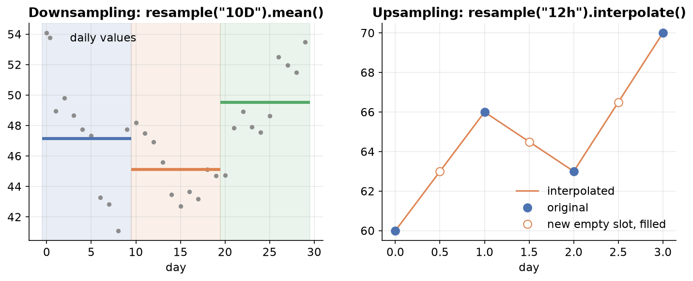
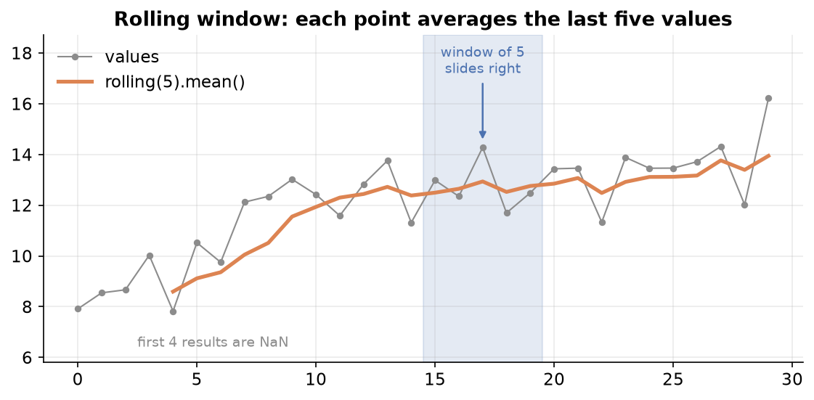

---
tags:
  - pandas
  - time-series
  - text-cleaning
  - case-study
aliases:
  - Pandas Case Studies
  - Time series in pandas
difficulty: intermediate
runnable: true
prerequisites:
  - String & Datetime Ops
created: 2026-10-13
---

> [!info] Where this fits
> This closes the pandas track by putting [[String & Datetime Ops]] to work on three projects: a time series, a pile of messy text, and a small funding table. It assumes everything before it, including `groupby` from [[GroupBy]] and merging from [[Merging & Joining]].

A case study is where separate tools become a workflow. The first project follows a stock-price time series from raw dates to rolling averages. The second cleans free text the way a sentiment-analysis project would before any model sees it. The third cleans a messy funding table, and the last section sketches how results reach a dashboard.

> [!info] Dataset
> - **Fictional daily stock prices (ticker CRTX)** (`cortex_data("stock_prices")`), **Fictional daily new subscribers** (`cortex_data("subscribers")`), **Fictional order and delivery dates** (`cortex_data("order_deliveries")`), and **Fictional login log** (`cortex_data("logins")`): synthetic data generated for Cortex, not real records. License: [MIT](https://github.com/Ayaz-Mohammed-Khan/cortex/blob/main/LICENSE).
>
> Full credits and license terms: [dataset licenses (Markdown file)](/datasets/LICENSES.md).

All four tables are generated and fictional, and the review and funding rows are written inline, so no result here is a real finding. The stock has a made-up 2-for-1 split on 2020-07-15.

---

## Time series analysis case study

### Durations with Timedelta

Subtracting two Timestamps gives a **Timedelta**, a length of time. You can also build one directly with `pd.Timedelta(days=, hours=, minutes=)` and add it to a Timestamp or a whole `date_range`. A column of Timedeltas has a `.dt.days` attribute.

```python
import pandas as pd

gap = pd.Timestamp("2024-05-20 18:30") - pd.Timestamp("2024-05-17 09:00")
print(gap, gap.days)
step = pd.Timedelta(days=2, hours=6)
print(pd.Timestamp("2024-05-01") + step)
print(pd.date_range("2024-05-01", periods=3) + pd.Timedelta(hours=12))
```

```text
3 days 09:30:00 3
2024-05-03 06:00:00
DatetimeIndex(['2024-05-01 12:00:00', '2024-05-02 12:00:00',
               '2024-05-03 12:00:00'],
              dtype='datetime64[ns]', freq='D')
```

The order table stores dates as `M/D/YY` text. Convert both columns, subtract, and ask how many orders arrived within 30 days.

```python
import pandas as pd

o = cortex_data("order_deliveries")
for c in ["order_date", "delivery_date"]:
    o[c] = pd.to_datetime(o[c], format="%m/%d/%y")
o["days"] = (o["delivery_date"] - o["order_date"]).dt.days
print(round((o["days"] <= 30).mean() * 100, 1), "percent delivered within 30 days")
print(o["days"].median(), o["days"].max())
```

```text
62.4 percent delivered within 30 days
13.0 397
```

### What a time series is

A **time series** is a set of values recorded in time order, usually at regular intervals. The order matters: yesterday influences today, so shuffling the rows destroys the information. Examples:

- **Financial**: daily stock prices and exchange rates.
- **Natural**: temperature, rainfall, and river levels.
- **Event**: website visits per hour and logins per day.
- **Medical**: heart-rate readings and daily case counts.

Analysis describes what happened and why (trends, seasons, spikes). **Forecasting** predicts what comes next. This note covers analysis tools, which forecasting builds on.

### Datetime and time series in pandas

A time series in pandas is a Series or DataFrame with a **DatetimeIndex**. Read the file with `parse_dates` and `index_col` and the dates arrive ready to use.

```python
import pandas as pd

px = cortex_data("stock_prices", parse_dates=["Date"], index_col="Date")
print(px.index.dtype)
print(px.shape)
px.head(3)
```

```text
datetime64[ns]
(2607, 6)
             Open   High    Low  Close  Adj Close   Volume
Date                                                      
2014-01-02  77.06  79.88  76.34  79.32      39.66  1636992
2014-01-03  78.92  80.55  78.85  80.14      40.07  1360800
2014-01-06  80.16  80.54  78.73  79.08      39.54  1767136
```

Two series with different sources can be joined on their dates. This pairs the stock's volume with a fictional channel's daily new subscribers, after giving the subscriber counts a date index for 2023.

```python
import pandas as pd

px = cortex_data("stock_prices", parse_dates=["Date"], index_col="Date")
subs = cortex_data("subscribers").squeeze("columns")
subs.index = pd.date_range("2023-01-01", periods=len(subs))
both = px[["Volume"]].join(subs.rename("new_subs"), how="inner")
print(both.shape)
both.head(3)
```

```text
(260, 2)
             Volume  new_subs
2023-01-02  3607136        38
2023-01-03  4462848        30
2023-01-04  2172160        40
```

### Selecting by date

With a DatetimeIndex, a date string works as a label: one day, a whole month, or a whole year. Slices include both ends and accept a step.

```python
import pandas as pd

px = cortex_data("stock_prices", parse_dates=["Date"], index_col="Date")
print(px.loc["2021-03-15", "Close"])
print(px.loc["2021-03", "Close"].shape[0])
print(px.loc["2021", "Volume"].sum())
px.loc["2021-03-01":"2021-03-12":2, ["Close"]]
```

```text
59.54
23
838141738
            Close
Date             
2021-03-01  62.46
2021-03-03  62.93
2021-03-05  62.76
2021-03-09  59.93
2021-03-11  60.11
```

The index also exposes date parts, which you can attach as new columns for grouping.

```python
import pandas as pd

px = cortex_data("stock_prices", parse_dates=["Date"], index_col="Date")
px["month"] = px.index.month_name()
px["weekday"] = px.index.day_name()
px["quarter"] = px.index.quarter
px[["Close", "month", "weekday", "quarter"]].head(3)
```

```text
            Close    month   weekday  quarter
Date                                         
2014-01-02  79.32  January  Thursday        1
2014-01-03  80.14  January    Friday        1
2014-01-06  79.08  January    Monday        1
```

To find the same calendar date in every year, build the dates with `pd.DateOffset(years=1)` and keep the ones present in the data. A fixed `Timedelta` cannot do this because years have unequal lengths. Non-trading days simply drop out.

```python
import pandas as pd

px = cortex_data("stock_prices", parse_dates=["Date"], index_col="Date")
anchors = [pd.Timestamp("2016-09-15") + pd.DateOffset(years=k) for k in range(8)]
same_day = px[px.index.isin(anchors)]
same_day[["Close"]]
```

```text
             Close
Date              
2016-09-15   88.96
2017-09-15   92.26
2020-09-15   63.71
2021-09-15   63.89
2022-09-15   87.73
2023-09-15  118.36
```

### Plotting and seasonal trends

`plot()` on a time series puts the dates on the x-axis. `subplots=True` draws one panel per column, and `layout`, `sharex`, `figsize`, and `title` tidy the figure.

```python
import matplotlib.pyplot as plt
import pandas as pd

px = cortex_data("stock_prices", parse_dates=["Date"], index_col="Date")
px[["Open", "High", "Low", "Close", "Volume"]].loc["2019"].plot(
    subplots=True, layout=(3, 2), sharex=True, figsize=(10, 7), title="CRTX in 2019")
plt.tight_layout()
plt.show()
```

Grouping by a date part shows **seasonal** patterns, which repeat on a calendar cycle. Average volume by weekday follows.

```python
import matplotlib.pyplot as plt
import pandas as pd

px = cortex_data("stock_prices", parse_dates=["Date"], index_col="Date")
order = ["Monday", "Tuesday", "Wednesday", "Thursday", "Friday"]
by_day = px.groupby(px.index.day_name())["Volume"].mean().reindex(order)
print(by_day.round(0))
by_day.plot(kind="bar", title="Mean volume by weekday")
plt.tight_layout()
plt.show()
```

```text
Date
Monday       2469881.0
Tuesday      2236449.0
Wednesday    2148787.0
Thursday     2083647.0
Friday       1952887.0
Name: Volume, dtype: float64
```

### Changing frequency with asfreq

The index has a **frequency** when its steps are regular. Daily trading data skips weekends, so its frequency is unset. `asfreq` forces a frequency: `"B"` gives business days, and finer steps create empty slots that you fill with `ffill` or `bfill`.

```python
import pandas as pd

px = cortex_data("stock_prices", parse_dates=["Date"], index_col="Date")
close = px["Close"].loc["2021-03-01":"2021-03-09"]
print(close.index.freq)
print(close.asfreq("B"))
close.asfreq("D").ffill()
```

```text
None
Date
2021-03-01    62.46
2021-03-02    62.88
2021-03-03    62.93
2021-03-04    63.47
2021-03-05    62.76
2021-03-08    63.92
2021-03-09    59.93
Freq: B, Name: Close, dtype: float64
Date
2021-03-01    62.46
2021-03-02    62.88
2021-03-03    62.93
2021-03-04    63.47
2021-03-05    62.76
2021-03-06    62.76
2021-03-07    62.76
2021-03-08    63.92
2021-03-09    59.93
Freq: D, Name: Close, dtype: float64
```

### Resampling

**Resampling** changes the frequency of a series while aggregating, like a `groupby` over time windows.

- **Downsampling** goes to a coarser frequency (days to months), so you must choose an aggregate: `sum`, `mean`, `max`, and so on.
- **Upsampling** goes to a finer frequency (days to hours), which creates empty slots that you fill or interpolate.



```python
import pandas as pd

px = cortex_data("stock_prices", parse_dates=["Date"], index_col="Date")
monthly = px["Volume"].resample("ME").sum()
quarterly = px["Close"].resample("QE").mean().round(2)
print(monthly.tail(3))
quarterly.tail(3)
```

```text
Date
2023-10-31    75946017
2023-11-30    70667251
2023-12-31    66723239
Freq: ME, Name: Volume, dtype: int64
Date
2023-06-30     96.44
2023-09-30    110.48
2023-12-31     99.76
Freq: QE-DEC, Name: Close, dtype: float64
```

For upsampling, `interpolate` fills the new slots by drawing a line between known points. `method="time"` weights by the actual time gaps.

```python
import pandas as pd

px = cortex_data("stock_prices", parse_dates=["Date"], index_col="Date")
close = px["Close"].loc["2021-03-01":"2021-03-04"]
close.resample("12h").interpolate(method="time").round(2)
```

```text
Date
2021-03-01 00:00:00    62.46
2021-03-01 12:00:00    62.67
2021-03-02 00:00:00    62.88
2021-03-02 12:00:00    62.90
2021-03-03 00:00:00    62.93
2021-03-03 12:00:00    63.20
2021-03-04 00:00:00    63.47
Freq: 12h, Name: Close, dtype: float64
```

### Rolling windows and smoothing

A **rolling window** slides along the series and computes a statistic over the last `n` values, which smooths noise. `rolling(20).mean()` is a 20-day moving average, and the first 19 results are `NaN` because the window is not full. `ewm` (exponentially weighted) gives more weight to recent values.



```python
import matplotlib.pyplot as plt
import pandas as pd

px = cortex_data("stock_prices", parse_dates=["Date"], index_col="Date")
c = px["Close"].loc["2022"]
frame = pd.DataFrame({"Close": c,
                      "rolling 20": c.rolling(20).mean(),
                      "ewm 20": c.ewm(span=20).mean()})
print(frame.dropna().head(2).round(2))
frame.plot(title="Close with moving averages", figsize=(8, 4))
plt.tight_layout()
plt.show()
```

```text
            Close  rolling 20  ewm 20
Date                                 
2022-01-28  70.11       74.57   74.07
2022-01-31  71.24       74.48   73.77
```

### Shifting values

`shift(1)` moves values down one step so each row can see the previous one, and `shift(-1)` moves them up to see the next. The difference between a value and its shifted copy is the daily change, and `pct_change()` gives the same as a fraction.

```python
import pandas as pd

px = cortex_data("stock_prices", parse_dates=["Date"], index_col="Date")
c = px["Close"].loc["2021-03-01":"2021-03-05"]
out = pd.DataFrame({"Close": c, "previous": c.shift(1), "change": c - c.shift(1),
                    "pct": c.pct_change().round(4)})
out
```

```text
            Close  previous  change     pct
Date                                       
2021-03-01  62.46       NaN     NaN     NaN
2021-03-02  62.88     62.46    0.42  0.0067
2021-03-03  62.93     62.88    0.05  0.0008
2021-03-04  63.47     62.93    0.54  0.0086
2021-03-05  62.76     63.47   -0.71 -0.0112
```

The login log has no header row, so pass `header=None` and name the columns with `names`. This finds one user's average time between logins and the busiest weekday.

```python
import pandas as pd

lg = cortex_data("logins", header=None, names=["row", "user", "stamp"], parse_dates=["stamp"])
u = lg[lg["user"] == 2102].sort_values("stamp").copy()
u["gap"] = u["stamp"] - u["stamp"].shift(1)
print(u["gap"].mean().round("min"))
print(lg["stamp"].dt.day_name().value_counts().head(2))
```

```text
0 days 10:53:00
stamp
Tuesday    446
Friday     434
Name: count, dtype: int64
```

> [!warning] Edit a copy of a slice
> Assigning a new column to a filtered table can trigger a `SettingWithCopyWarning` because pandas cannot tell whether you meant to change the original. Calling `.copy()` first, as above, states your intent and silences it.

Prices make the effect of the split visible: `Close` halves on 2020-07-15 while `Adj Close` is adjusted to stay continuous.

```python
import pandas as pd

px = cortex_data("stock_prices", parse_dates=["Date"], index_col="Date")
px.loc["2020-07-13":"2020-07-16", ["Close", "Adj Close"]]
```

```text
             Close  Adj Close
Date                         
2020-07-13  148.26      74.13
2020-07-14  146.24      73.12
2020-07-15   72.75      72.75
2020-07-16   68.97      68.97
```

---

## Working with textual data

Many datasets are text: reviews, tweets, emails, support tickets. A common goal is **sentiment analysis**, deciding whether a review is positive or negative, which is a classification problem used to monitor products and brands. Models need numbers, so a text project first turns messy strings into clean features.

### The text project workflow

1. **Gather** the data and inspect it.
2. **Clean** it: remove noise such as tags, links, and stray symbols.
3. **Preprocess**: normalize the text into units a model can use.
4. **Explore** with simple counts and plots.
5. **Create features** from the text.
6. **Vectorize** the text into numbers (bag of words, TF-IDF, or word embeddings such as word2vec).
7. **Model** and **evaluate**.
8. **Deploy** and **monitor**.

An analyst typically owns steps 1 to 5. The reviews below are eight short fictional ones written for this note.

### Cleaning text

Start by checking `info` and the number of duplicates, then lower-case and strip whitespace.

```python
import pandas as pd

reviews = pd.DataFrame({"text": [
    "  GREAT phone!! <br>Loved it, battery lasts for days. http://shop.example/p/1  ",
    "<p>Screen cracked after a week :(</p>   ",
    "Can't complain. Works fine, www.example.org has the specs",
    "  GREAT phone!! <br>Loved it, battery lasts for days. http://shop.example/p/1  ",
    "Doesn't charge... returned it!!!",
    "Okay for the price, I'd buy again.",
    "<b>Terrible</b> support, they won't reply",
    "Fast delivery & nice packaging!",
]})
print(reviews["text"].duplicated().sum())
reviews = reviews.drop_duplicates().copy()
reviews["text"] = reviews["text"].str.lower().str.strip()
reviews["text"].head(3).tolist()
```

```text
1
['great phone!! <br>loved it, battery lasts for days. http://shop.example/p/1', '<p>screen cracked after a week :(</p>', "can't complain. works fine, www.example.org has the specs"]
```

**HTML tags** are removed with a regex. The pattern `<.*?>` matches an opening angle bracket, then as few characters as possible (`.*?`, the lazy form), then a closing bracket, so each tag is removed separately instead of the whole span between the first and last bracket.

**URLs** match `https?://\S+|www\.\S+`: `http` with an optional `s`, then non-space characters, or `www.` followed by non-space characters. `str.contains` finds the rows that have one.

```python
import pandas as pd

s = pd.Series(["<b>Terrible</b> support", "see http://a.example/x now", "visit www.example.org today"])
no_tags = s.str.replace(r"<.*?>", "", regex=True)
has_url = s.str.contains(r"https?://\S+|www\.\S+")
no_urls = no_tags.str.replace(r"https?://\S+|www\.\S+", "", regex=True).str.strip()
print(no_tags.tolist())
print(has_url.tolist())
print(no_urls.tolist())
```

```text
['Terrible support', 'see http://a.example/x now', 'visit www.example.org today']
[False, True, True]
['Terrible support', 'see  now', 'visit  today']
```

**Contractions** such as "can't" are expanded with a dictionary and a small function, so "cannot" and "can" are not treated as unrelated words.

```python
import pandas as pd

contractions = {"can't": "cannot", "doesn't": "does not", "won't": "will not", "i'd": "i would"}

def expand(text):
    return " ".join(contractions.get(word, word) for word in text.split())

s = pd.Series(["can't complain", "doesn't charge", "i'd buy again"])
s.apply(expand).tolist()
```

```text
['cannot complain', 'does not charge', 'i would buy again']
```

**Punctuation** is removed with `string.punctuation` and `str.translate`, which maps each listed character to nothing. A regex such as `[^a-z0-9\s]` removes any other special character.

```python
import string
import pandas as pd

table = str.maketrans("", "", string.punctuation)
s = pd.Series(["great phone!!", "returned it!!!...", "fast & nice"])
print(s.apply(lambda t: t.translate(table)).tolist())
print(s.str.replace(r"[^a-z0-9\s]", "", regex=True).tolist())
```

```text
['great phone', 'returned it', 'fast  nice']
['great phone', 'returned it', 'fast  nice']
```

Spelling correction usually uses a library such as TextBlob, which is not available in the browser runtime, so this block is not runnable.

```python
# cortex:norun
from textblob import TextBlob

TextBlob("the batery is grate").correct()   # corrected spelling
```

Putting the steps in one pass:

```python
import re
import string
import pandas as pd

reviews = pd.Series([
    "  GREAT phone!! <br>Loved it, battery lasts for days. http://shop.example/p/1  ",
    "<p>Screen cracked after a week :(</p>   ",
    "Doesn't charge... returned it!!!",
])
contractions = {"doesn't": "does not", "can't": "cannot"}
table = str.maketrans("", "", string.punctuation)

def clean(t):
    t = t.lower().strip()
    t = re.sub(r"<.*?>", " ", t)
    t = re.sub(r"https?://\S+|www\.\S+", "", t)
    t = " ".join(contractions.get(w, w) for w in t.split())
    return t.translate(table).strip()

reviews.apply(clean).tolist()
```

```text
['great phone loved it battery lasts for days', 'screen cracked after a week', 'does not charge returned it']
```

### Preprocessing text

**Tokenization** splits text into units, usually words (and sometimes sentences). Libraries such as NLTK offer `word_tokenize`, but they need data downloads, so that call is not runnable here. A plain `split` is a good stand-in for clean text.

```python
# cortex:norun
from nltk.tokenize import word_tokenize

word_tokenize("battery lasts for days")
```

**Stop words** are very common words (the, is, for) that add little meaning. Removing them means checking each word against a list. A Python `set` makes each check fast, whereas searching a list scans it every time, which is slow when repeated for every word of every review.

```python
import pandas as pd

stop = {"the", "is", "for", "it", "a", "and", "of", "after", "they", "at"}
reviews = pd.Series(["the battery lasts for days", "screen cracked after a week", "they will not reply"])
tokens = reviews.str.split()
tokens.apply(lambda ws: [w for w in ws if w not in stop]).tolist()
```

```text
[['battery', 'lasts', 'days'], ['screen', 'cracked', 'week'], ['will', 'not', 'reply']]
```

**Stemming** chops words down to a root by rules (so "charging" and "charged" may both become "charg"), and the result may not be a real word. **Lemmatization** uses a dictionary to return a true base form ("better" becomes "good"). Stemming is faster and cruder; lemmatization is slower and cleaner. Both come from libraries such as NLTK.

```python
# cortex:norun
from nltk.stem import PorterStemmer

PorterStemmer().stem("charging")   # "charg"
```

### Simple features from text

Even without a model, counts make useful features: the number of characters and the number of words in each review. A scatter plot of the two shows whether longer reviews have more words in a steady ratio.

```python
import matplotlib.pyplot as plt
import pandas as pd

reviews = pd.DataFrame({
    "text": ["great phone loved it", "screen cracked after a week", "okay for the price would buy again",
             "terrible support they will not reply", "fast delivery nice packaging", "does not charge returned it"],
    "positive": [1, 0, 1, 0, 1, 0],
})
reviews["chars"] = reviews["text"].str.len()
reviews["words"] = reviews["text"].str.split().str.len()
colors = reviews["positive"].map({1: "tab:green", 0: "tab:red"})
plt.scatter(reviews["chars"], reviews["words"], c=colors)
plt.xlabel("characters")
plt.ylabel("words")
plt.title("Length features by sentiment")
plt.show()
reviews[["chars", "words"]].describe().loc[["mean", "max"]]
```

```text
          chars     words
mean  28.666667  5.166667
max   36.000000  7.000000
```

Plotting libraries such as seaborn offer a `hue` argument to color points by a column, but seaborn is not available in the browser runtime. High-dimensional text vectors are often reduced to two dimensions with PCA (principal component analysis) before plotting; that step belongs to a machine-learning workflow.

```python
# cortex:norun
import seaborn as sns

sns.scatterplot(data=reviews, x="chars", y="words", hue="positive")
```

---

## Indian startup funding dataset

A funding table is a typical business case: amounts typed by hand, cities spelled several ways, and dates in mixed formats. The twelve rows below are made up for this note. The job is to clean them, then ask which sectors and cities attract the most money.

```python
import pandas as pd

raw = pd.DataFrame({
    "startup": ["Alpha", "Brix", "Cobalt", "Dune", "Ember", "Flux", "Gale", "Haze", "Iris", "Jolt", "Kite", "Lumen"],
    "city": ["Bengaluru", "Bangalore", "Mumbai", "Delhi", "New Delhi", "Pune", "Mumbai", "Bengaluru", "Chennai", "Pune", "Delhi", "Bengaluru"],
    "sector": ["Fintech", "Fintech", "Health", "Edtech", "Edtech", "Health", "Fintech", "Edtech", "Health", "Fintech", "Edtech", "Health"],
    "amount": ["1,200,000", "300,000", "2,500,000", "undisclosed", "450,000", "900,000", "1,500,000", "250,000", "700,000", "undisclosed", "600,000", "3,000,000"],
    "date": ["2019-03-04", "2019-07-19", "2020-01-15", "2020-02-02", "2020-11-30", "2021-04-18", "2021-06-25", "2021-09-09", "2022-02-14", "2022-05-30", "2022-08-01", "2022-12-12"],
})
clean = raw.copy()
clean["city"] = clean["city"].replace({"Bangalore": "Bengaluru", "New Delhi": "Delhi"})
clean["amount"] = pd.to_numeric(clean["amount"].str.replace(",", "", regex=False), errors="coerce")
clean["date"] = pd.to_datetime(clean["date"])
clean["year"] = clean["date"].dt.year
print(clean["amount"].isnull().sum(), "amounts were undisclosed")
clean.head(4)
```

```text
2 amounts were undisclosed
  startup       city   sector     amount       date  year
0   Alpha  Bengaluru  Fintech  1200000.0 2019-03-04  2019
1    Brix  Bengaluru  Fintech   300000.0 2019-07-19  2019
2  Cobalt     Mumbai   Health  2500000.0 2020-01-15  2020
3    Dune      Delhi   Edtech        NaN 2020-02-02  2020
```

Each fix targets a real problem: `replace` merges spellings of the same city, `str.replace` strips commas so the text becomes numeric, `errors="coerce"` turns "undisclosed" into `NaN` rather than failing, and `to_datetime` gives real dates. Now the questions.

```python
import matplotlib.pyplot as plt
import pandas as pd

clean = pd.DataFrame({
    "startup": list("ABCDEFGHIJKL"),
    "city": ["Bengaluru", "Bengaluru", "Mumbai", "Delhi", "Delhi", "Pune", "Mumbai", "Bengaluru", "Chennai", "Pune", "Delhi", "Bengaluru"],
    "sector": ["Fintech", "Fintech", "Health", "Edtech", "Edtech", "Health", "Fintech", "Edtech", "Health", "Fintech", "Edtech", "Health"],
    "amount": [1200000, 300000, 2500000, None, 450000, 900000, 1500000, 250000, 700000, None, 600000, 3000000],
    "year": [2019, 2019, 2020, 2020, 2020, 2021, 2021, 2021, 2022, 2022, 2022, 2022],
})
print(clean.groupby("sector")["amount"].sum().sort_values(ascending=False))
print(clean.nlargest(3, "amount")[["startup", "city", "amount"]])
print(clean.groupby("year").size())
clean.groupby("city")["amount"].sum().sort_values().plot(kind="barh", title="Funding by city")
plt.tight_layout()
plt.show()
```

```text
sector
Health     7100000.0
Fintech    3000000.0
Edtech     1300000.0
Name: amount, dtype: float64
   startup       city     amount
11       L  Bengaluru  3000000.0
2        C     Mumbai  2500000.0
6        G     Mumbai  1500000.0
year
2019    2
2020    3
2021    3
2022    4
dtype: int64
```

---

## Displaying results on a dashboard

A **dashboard** is a page that shows live charts and numbers from a dataset, with controls such as a dropdown. Python tools such as Streamlit turn a script that computes a table or chart into such a page, so the cleaning and grouping above become the engine behind it. Dashboards run as a web app on a server, so this sketch is not runnable in the browser.

```python
# cortex:norun
import pandas as pd
import streamlit as st

df = pd.read_csv("funding_clean.csv")
sector = st.selectbox("Sector", sorted(df["sector"].unique()))
view = df[df["sector"] == sector]
st.metric("Total funding", int(view["amount"].sum()))
st.bar_chart(view.groupby("city")["amount"].sum())
```

---

## Summary

1. Subtracting Timestamps yields a **Timedelta**; `.dt.days` turns a column of them into numbers.
2. A **time series** is ordered data over time; `parse_dates` with `index_col` loads it with a DatetimeIndex.
3. A date string selects a day, month, or year with `loc`, slices include both ends, and `pd.DateOffset` finds the same date in other years.
4. Grouping by date parts reveals seasonal patterns, and `plot(subplots=True)` charts several columns at once.
5. `asfreq` sets a regular frequency and fills new slots; `resample` aggregates down or fills and interpolates up.
6. `rolling(n)` smooths with a moving window, `ewm` weights recent values more, and `shift` and `pct_change` measure change.
7. Edit a `.copy()` of a slice to avoid `SettingWithCopyWarning`.
8. A text project moves from gathering and cleaning through preprocessing, features, vectorizing, modelling, and monitoring.
9. Cleaning uses lower-casing, `strip`, regexes for HTML and URLs, a dictionary for contractions, and `translate` for punctuation.
10. Preprocessing tokenizes, removes stop words with a set for fast lookups, and stems or lemmatizes; simple features include character and word counts.
11. Messy business tables are cleaned by merging spellings, coercing amounts, and parsing dates before grouping.
12. A dashboard wraps the same grouping code in an interactive page.

---

> [!info] Continues to
> This completes the pandas track. Next in the roadmap is [[EDA & Visualization]], where cleaned tables are explored and charted.
