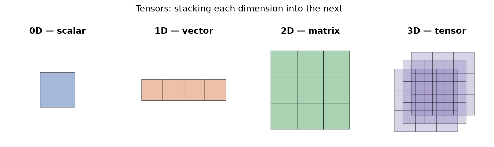

---
tags:
  - linear-algebra
  - tensors
  - data-representation
  - deep-learning
aliases:
  - Tensors
  - N-dimensional arrays
difficulty: beginner
created: 2026-10-24
---

> [!info] Where this fits
> This note opens the linear-algebra toolkit that machine learning is built on. A tensor is the data structure every later topic sits inside, so it comes before [[Vectors]], [[Matrices - Computation|Matrices: Computation]], and [[Matrices - Intuition|Matrices: Intuition]], and it is what you feed into models like [[Introduction to Linear Regression|Linear Regression]]. There is nothing to learn first; this is where the chain starts.

Before a model can learn anything, the data has to be arranged as numbers in a fixed shape. That shape is a **tensor**. Libraries such as scikit-learn and the deep-learning library TensorFlow (named after this very idea) store everything as tensors, so any machine-learning or deep-learning problem means working with them. This note builds the concept from a single number up to a batch of videos, and defines the three properties, rank, axes, and shape, that describe any tensor.

---

## What are tensors?

A dataset is useless to an algorithm until it is a block of numbers the algorithm can index. The question is how to hold those numbers so that one number, one row, a whole table, or a stack of tables all fit the same mental model.

A **tensor** is a container for numbers. That is the whole definition: a data structure whose job is to store numbers in a regular arrangement. It can hold characters or strings, but in practice it almost always holds numbers.

You have already used tensors under other names. A single number is a tensor, a list of numbers is a tensor, and a grid of numbers is a tensor. Mathematicians and computer scientists coined the general word **tensor** so that the same language covers every dimension, instead of switching terms each time a dimension is added.

> [!note] Tensor and n-dimensional array are the same thing
> If you come from a programming background, a tensor is an **n-dimensional array** (an `ndarray` in NumPy). An array is one-dimensional, an array of arrays is two-dimensional, and so on. The machine-learning community borrowed the maths word "tensor" for exactly this object, so whenever you see an `ndarray`, read it as a tensor.

In NumPy you build a tensor with `np.array`, and you read how many dimensions it has from the `ndim` attribute. That one attribute is the practical way to tell a scalar from a vector from a matrix, as the next sections show.

---

## 0D, 1D and 2D tensors

The lowest dimensions have their own familiar names. The pattern to notice is that **each dimension is built by stacking several copies of the dimension below it**.

- A **scalar** is a single number, such as `5`. It is a **0D tensor**: it has no dimensions, so its `ndim` is `0`.
- A **vector** is a list of numbers, such as `[1, 2, 3, 4]`. It is a **1D tensor**: it has one dimension, so its `ndim` is `1`. Stacking several scalars in a line gives a vector.
- A **matrix** is a grid of numbers arranged in rows and columns. It is a **2D tensor**: its `ndim` is `2`. Stacking several vectors gives a matrix.



```python
import numpy as np

scalar = np.array(7)
vector = np.array([1, 2, 3, 4])
matrix = np.array([[1, 2, 3], [4, 5, 6], [7, 8, 9]])

print(scalar.ndim, vector.ndim, matrix.ndim)
```

```text
0 1 2
```

The output confirms the rule: `ndim` reports the tensor's dimension directly, so a scalar reads `0`, a vector reads `1`, and a matrix reads `2`.

---

## ND tensors

Once the pattern is clear, higher dimensions need no new idea, only more stacking.

A **3D tensor** is a stack of matrices. Picture several matrices of the same size laid one behind another to form a cuboid; the three directions are the row axis, the column axis, and a new depth axis. An **ND tensor** is a stack of (N minus 1) dimensional tensors, so a 4D tensor is a stack of 3D tensors, a 5D tensor is a stack of 4D tensors, and so on.

So climbing one dimension always means the same move: take several copies of the current object and line them up along a new direction. This is why there is no ceiling on dimensionality, and why a single word covers all of it.

---

## Rank, axes and shape

Three properties fully describe any tensor. They sound similar but answer different questions, so define each carefully.

- **Rank** is the number of dimensions of the tensor. It equals `ndim`. A matrix has rank `2`.
- **Axes** are the directions along which the tensor extends. The number of axes equals the rank, so a rank-3 tensor has three axes.
- **Shape** is the count of items along each axis, written as a tuple. It says how many items sit in each direction.

Take a 3D tensor made of three matrices, each with 2 rows and 4 columns. Its shape is `(3, 2, 4)`: three along the first axis, two along the second, four along the third. The total number of stored numbers is the product of the shape, so $3 \times 2 \times 4 = 24$ items.

```python
import numpy as np

t = np.array([[[1, 2, 3, 4], [5, 6, 7, 8]],
              [[1, 2, 3, 4], [5, 6, 7, 8]],
              [[1, 2, 3, 4], [5, 6, 7, 8]]])

print(t.ndim, t.shape, t.size)
```

```text
3 (3, 2, 4) 24
```

> [!warning] A tensor's dimension is not a vector's dimension
> This is the single most confused point. A **1D tensor** is a vector; the number of components it holds is the **vector's** dimension, a separate idea. A placement record with CGPA, IQ, and state encoded as one number is a 3-component vector, so it is a 3-dimensional vector, but it is still a **1D tensor** because it has only one axis. If the input had 50 columns, it would be a 50-dimensional vector living in a 50-dimensional coordinate space, yet it would remain a 1D tensor. Always separate "how many axes the tensor has" from "how many numbers the vector holds".

---

## Examples of 1D to 5D tensors

The dimensionality you meet in practice depends on the kind of data. Each row below pairs a dimensionality with a concrete machine-learning example and its shape, so you can recognise the structure when you see it.

| Tensor | Real data | Shape pattern | What each axis means |
| :--- | :--- | :--- | :--- |
| 1D | One data row, a feature vector | `(features,)` | the feature values for a single sample |
| 2D | A tabular dataset | `(samples, features)` | each row is a sample, each column a feature |
| 3D | NLP text or time series | `(sentences, words, vector)` or `(days, quantities)` stacked | a stack of 2D blocks |
| 4D | A batch of color images | `(batch, channels, height, width)` | each image is a 3D tensor of color channels |
| 5D | A batch of videos | `(videos, frames, height, width, channels)` | each video is a 4D tensor of frames |

A running example makes the 1D and 2D cases concrete. Suppose a student placement dataset holds CGPA, IQ, and home state (encoded as a number) per student. One student's inputs, for instance `[8.1, 91, 0]`, form a **1D tensor** (a 3-component feature vector). Stack 10,000 such students and you have a **2D tensor** of shape `(10000, 3)`, the input table often written $D$ in machine learning. The placed-or-not column across all students is itself a 1D tensor of 10,000 values.

- **3D, text:** in the bag-of-words method, each word becomes a vector, each sentence becomes a matrix of word-vectors (a 2D tensor), and a collection of sentences becomes a 3D tensor. Three sentences of two word-vectors each, where each vector has 4 components, give shape `(3, 2, 4)`, that is rank 3 with 24 items.
- **3D, time series:** data collected at a fixed interval, such as a stock's two daily prices over 365 days, is a 2D tensor of shape `(365, 2)`. Ten years of it stack into a 3D tensor of shape `(10, 365, 2)`, with the extra axis acting as a time axis.
- **4D, images:** a digital image is a grid of pixels, and a color image stacks three such grids (red, green, and blue channels), making each image a 3D tensor like `(3, 1200, 800)`. Models process images in **batches**, so a batch of images is a 4D tensor.
- **5D, video:** a video is a fast sequence of images (frames), so one video is a 4D tensor, and a batch of videos is a 5D tensor. The raw numbers grow enormous, which is why video is stored in compressed codec formats such as MP4 rather than as raw tensors.

---

## Summary

1. A **tensor** is a container for numbers, the core data structure of libraries like scikit-learn and TensorFlow, and the same object as an n-dimensional array (`ndim` reports its dimension).
2. A **scalar** is a 0D tensor, a **vector** is a 1D tensor, and a **matrix** is a 2D tensor; each dimension is built by stacking copies of the one below.
3. An **ND tensor** is a stack of (N minus 1) dimensional tensors, so higher dimensions need no new idea, only more stacking.
4. **Rank** is the number of dimensions, **axes** are the directions (their count equals the rank), and **shape** is the count of items along each axis; the number of stored items is the product of the shape.
5. A tensor's dimension (its number of axes) is not the same as a vector's dimension (its number of components): a 50-feature row is a 50-dimensional vector but still a 1D tensor.
6. Common shapes run from 1D feature vectors and 2D tables through 3D text or time series, 4D image batches, and 5D video batches.

---

> [!info] Continues to
> With data now stored as tensors, the next note studies the 1D case in depth: what a vector is, the operations machine learning runs on it, and where each one shows up, in [[Vectors]].
