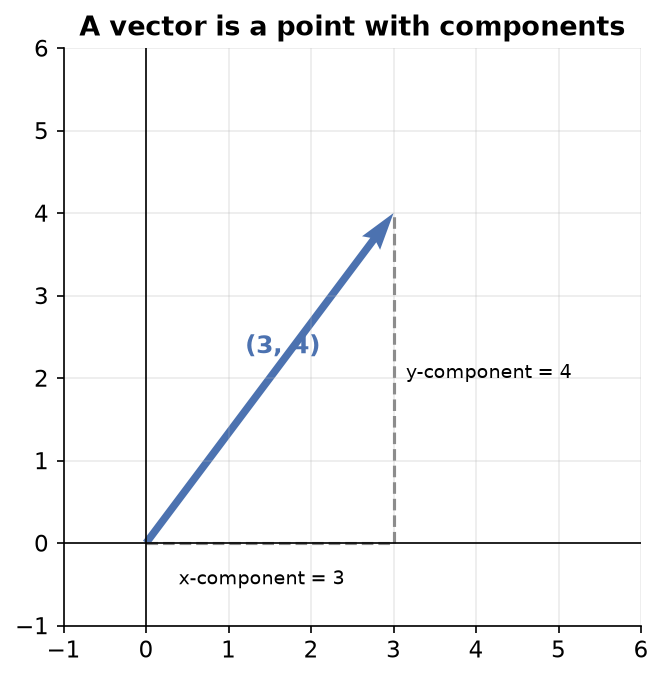
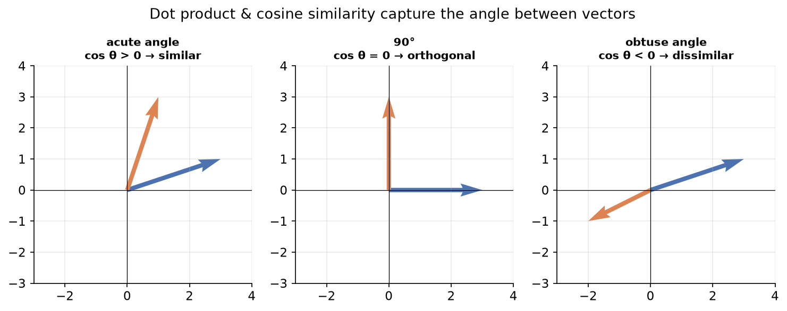
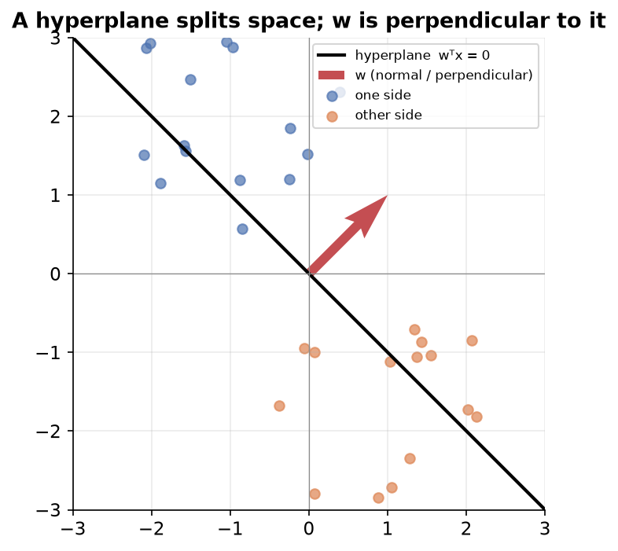

---
tags:
  - linear-algebra
  - vectors
  - dot-product
  - euclidean-distance
  - hyperplane
aliases:
  - Vectors
  - Feature vectors
difficulty: intermediate
prerequisites:
  - Tensors
created: 2026-10-24
---

> [!info] Where this fits
> This note builds directly on [[Tensors]], since a vector is a 1D tensor. It introduces the linear-algebra operations that machine learning leans on hardest, and it sets up [[Matrices - Computation|Matrices: Computation]], where many of these operations get packed into matrices. The dot product and hyperplane ideas here reappear whenever a model such as [[Introduction to Linear Regression|Linear Regression]] or a classifier draws a boundary through data.

Linear algebra is the branch of mathematics that lets machine learning work in many dimensions at once and represent any kind of data as numbers. Vectors are its first and most-used object. This note starts from what a vector is, works through the operations run on vectors (distance, shifting, scaling, addition, the dot product, and the angle between vectors), and ends by deriving the equation of a hyperplane, the boundary a classifier uses to separate data.

---

## What is linear algebra?

**Linear algebra** is the branch of mathematics that studies linear systems: sets of equations built from linear functions of variables. Its objects are **scalars** (plain numbers such as `2` or `-6`), **vectors** (a 1D collection of numbers), **matrices** (a 2D collection), and **tensors** (collections in higher dimensions).

Two reasons make it essential for machine learning.

- **It generalizes to higher dimensions.** A relationship you can draw as a line in 2D becomes a plane in 3D and a **hyperplane** in higher dimensions, with the same equations carrying over. Humans cannot picture beyond 3D, but linear algebra works in any number of dimensions, and real datasets are often very high-dimensional.
- **It represents any data as numbers.** Tabular, text, image, and video data can all be expressed with these objects, which is what lets a single algorithm accept such varied inputs. Linear algebra also maps well onto how CPUs and GPUs compute, which is why deep learning uses GPUs so heavily.

---

## What are vectors?

Start from 2D coordinate geometry. A point at coordinates $(3, 4)$ is reached by moving 3 units along the x axis and 4 units along the y axis. That point can be treated as a **vector** $A = (3, 4)$.

A **vector** is a point in a coordinate system, written as an ordered set of numbers. Each number is a **component** of the vector, the individual unit along one axis. In $A = (3, 4)$, the value `3` is the x component and `4` is the y component.



The **dimension** of a vector is its number of components, which is also the coordinate space it lives in. A vector with two components is 2-dimensional, a vector with three components is 3-dimensional, and a vector with $n$ components is $n$-dimensional. In machine learning a vector is written in square brackets as comma-separated components:

$$
A = [x_1, x_2, x_3, \ldots, x_n]
$$

where each $x_i$ is one component and $n$ is the dimension of the vector.

---

## Vector example in machine learning

The payoff of vectors is the **feature vector**: every data row's input features become one vector, so an algorithm can read it.

Take the Iris dataset of 150 flowers, with columns sepal length, sepal width, petal length, petal width, and species. The first four are **input features** and species is the **target** to predict. One flower, say `[5.2, 2.1, 7.2, 9.1]`, becomes a 4-dimensional feature vector; the whole dataset is 150 such vectors. Feeding this vector to a model returns a predicted species.

Models need numbers, so categorical columns are **encoded** first. In the Titanic dataset the `sex` column becomes `0` for male and `1` for female, and a port column with three values becomes `0`, `1`, and `2`. A passenger with age 17, fare 52, male, class 1, and port 2 becomes the feature vector `[17, 52, 0, 1, 2]`, a point in 5-dimensional space.

---

## Row and column vectors

The same vector can be written two ways, and the layout matters when vectors are multiplied.

- A **row vector** lays the components out across a single row, with shape $1 \times n$.
- A **column vector** stacks the components down a single column, with shape $n \times 1$.

By default, a vector is assumed to be a **column vector** unless stated otherwise. A single Iris flower's feature vector is a row vector of shape $1 \times 4$; stacking many such flowers produces a table whose columns can be read as column vectors. Machine-learning formulas switch between the two forms depending on need, which is why the transpose notation in the dot-product section appears.

---

## Distance from origin

Many algorithms need the length of a vector, that is, how far its point sits from the origin.

In 2D the vector $(a, b)$ reaches its point by going $a$ across and $b$ up, so by the Pythagoras theorem its distance from the origin is $\sqrt{a^2 + b^2}$. This generalizes: the distance from the origin, also called the **magnitude** or **norm**, is the square root of the sum of the squared components.

$$
\lVert v \rVert = \sqrt{v_1^2 + v_2^2 + \cdots + v_n^2}
$$

where $v_1, v_2, \ldots, v_n$ are the components of the vector $v$. In NumPy this is the `norm` function, and it works for a vector of any dimension without extra effort.

---

## Euclidean distance

To compare two data points you need the distance between them, not just their distances from the origin.

The **Euclidean distance** between two vectors is the norm of their component-wise difference: subtract the vectors component by component, square each difference, sum the squares, and take the square root. For two 3D vectors $(x_1, y_1, z_1)$ and $(x_2, y_2, z_2)$:

$$
d = \sqrt{(x_2 - x_1)^2 + (y_2 - y_1)^2 + (z_2 - z_1)^2}
$$

where each term is the squared difference along one axis. The same pattern extends to any dimension by adding one squared-difference term per component.

> [!example] k-nearest-neighbors uses Euclidean distance
> The k-nearest-neighbors algorithm classifies a new point by measuring its Euclidean distance to every known point, finding the nearest ones, and copying their label. If a new Iris flower's feature vector sits closest to flowers labelled setosa, it is classified as setosa. In code, subtract the two vectors component-wise and pass the difference to the `norm` function.

---

## Scalar addition and subtraction (shifting)

A **scalar** operation combines a single number with every component of a vector.

**Scalar addition** adds one number to each component; **scalar subtraction** subtracts one from each. Adding the scalar `5` to the vector $(2, 2)$ gives $(7, 7)$. Because every component changes by the same amount, the whole vector moves, so this operation is called **shifting**.

> [!note] Mean centering is shifting
> A common preprocessing step called **mean centering** subtracts each axis's mean from every data point, so the data recenters on the origin. The scatter keeps its shape but shifts so its average sits at zero. Mean centering can improve a model's performance, and it is exactly scalar subtraction applied per axis.

---

## Scalar multiplication and division (scaling)

**Scalar multiplication** multiplies every component by one number, and **scalar division** divides every component by one number. Multiplying $(2, 3)$ by `3` gives $(6, 9)$.

Because every component grows or shrinks by the same factor, this stretches or shrinks the vector, so it is called **scaling**. The contrast with the previous operation is clean: adding a scalar **shifts** a vector (moves it), while multiplying by a scalar **scales** it (stretches or shrinks it).

---

## Vector addition and subtraction

Two vectors of the same dimension add and subtract **component-wise**: add or subtract matching components to get a new vector of the same dimension. Adding $(1, 2)$ and $(3, 1)$ gives $(4, 3)$.

Geometrically, vector addition is tip-to-tail: place the start of the second vector at the tip of the first, and the sum runs from the first start to the second tip. The same picture is the diagonal of the parallelogram the two vectors span.

---

## Dot product

The **dot product** of two vectors of the same dimension multiplies their components pairwise and sums the results, giving a single scalar:

$$
A \cdot B = a_1 b_1 + a_2 b_2 + \cdots + a_n b_n
$$

where $a_i$ and $b_i$ are the matching components of $A$ and $B$. The result is one number, not a vector.



The dot product is also **matrix multiplication** of a row vector by a column vector. Writing $A$ as a $1 \times n$ row and $B$ as an $n \times 1$ column, their product is $1 \times 1$, a scalar. Since a vector is a column by default, $A$ must be transposed to a row first, which is why the dot product is often written $A^T B$, where $A^T$ is the transpose of $A$.

Two laws hold:

- **Commutative:** $A \cdot B = B \cdot A$.
- **Distributive:** $A \cdot (B + C) = A \cdot B + A \cdot C$.

```python
import numpy as np

a = np.array([1, 2, 3])
b = np.array([4, 5, 6])

print(np.dot(a, b))
```

```text
32
```

The dot product underlies three uses: computing **projections** of one vector onto another, setting up **cosine similarity** (next section), and performing **matrix multiplication**, which depends entirely on it. Deep learning runs on matrix multiplication, so it relies on the dot product throughout.

---

## Angle between two vectors

The dot product has a second, geometric form that connects it to the angle between the vectors:

$$
A \cdot B = \lVert A \rVert \, \lVert B \rVert \cos\theta
$$

where $\lVert A \rVert$ and $\lVert B \rVert$ are the magnitudes and $\theta$ is the angle between $A$ and $B$. This form lets you recover the angle from the components, and it exposes an important special case.

**When the dot product of two non-zero vectors is zero, the angle is 90 degrees**, so the vectors are **orthogonal**. Orthogonal vectors share no common features, a property that algorithms such as support vector machines rely on.

Rearranging the geometric form gives **cosine similarity**, a measure of how alike two vectors are:

$$
\cos\theta = \frac{A \cdot B}{\lVert A \rVert \, \lVert B \rVert}
$$

Its value runs from $-1$ to $1$. A value near $1$ means the angle is near 0 degrees, so the vectors point the same way and are very similar even if their magnitudes differ; a value of $0$ means they are orthogonal and share nothing; a value of $-1$ means they point in opposite directions.

> [!example] A movie recommender by angle
> Represent each movie's summary as a vector (the bag-of-words method counts how often each vocabulary word appears). To recommend movies like a chosen one, compute the cosine similarity between the chosen movie's vector and every other, and return the movies whose vectors make the smallest angle. Many simple recommender systems work exactly this way, on top of the dot product.

---

## Equation of a hyperplane

Classifiers such as logistic regression and support vector machines separate data with a boundary. In 2D that boundary is a line, in 3D a plane, and in higher dimensions a **hyperplane**. Since real data is high-dimensional, you need the hyperplane's equation.

Build up from the line. In 2D a line is $y = mx + b$, where $m$ is the slope and $b$ is the intercept. Its general form is $Ax + By + C = 0$. Renaming the axes to $x_1$ and $x_2$ and the coefficients to weights gives a form that scales to any dimension:

$$
w_1 x_1 + w_2 x_2 + w_0 = 0
$$

where $w_1$ and $w_2$ are weights on the components and $w_0$ is the intercept term. In 3D a plane adds one more term, $w_1 x_1 + w_2 x_2 + w_3 x_3 + w_0 = 0$, and in $n$ dimensions:

$$
w_1 x_1 + w_2 x_2 + \cdots + w_n x_n + w_0 = 0
$$

Because each sum of weight times component is a dot product, the whole equation compresses using the weight vector $w$ and the point vector $x$. Writing $w$ as a column and transposing it to a row, the hyperplane is:

$$
w^T x + w_0 = 0
$$

where $w^T x$ is the dot product of the weights with the point. If the hyperplane passes through the origin, the intercept $w_0$ drops to zero, leaving the compact form $w^T x = 0$.

**The weight vector $w$ is perpendicular (normal) to the hyperplane.** For any point $x$ on a hyperplane through the origin, $w^T x = 0$, which in geometric form is $\lVert w \rVert \lVert x \rVert \cos\theta = 0$. Since the vectors are non-zero, $\cos\theta = 0$, so $\theta = 90$ degrees: $w$ meets every vector on the hyperplane at a right angle.



---

## Summary

1. **Linear algebra** studies linear systems and their objects (scalars, vectors, matrices, tensors); it matters to machine learning because it generalizes to high dimensions and represents any data as numbers.
2. A **vector** is a point in a coordinate system, an ordered set of **components**; its **dimension** is the number of components, which is the space it lives in.
3. A **feature vector** turns one data row's input features into a vector, with categorical columns encoded as numbers first.
4. A vector can be a **row** ($1 \times n$) or a **column** ($n \times 1$); columns are the default.
5. **Distance from origin** is the square root of the sum of squared components; **Euclidean distance** applies that to the component-wise difference of two vectors and drives k-nearest-neighbors.
6. **Scalar addition or subtraction shifts** a vector (mean centering is a use), and **scalar multiplication or division scales** it.
7. **Vector addition and subtraction** act component-wise, with a tip-to-tail geometric picture.
8. The **dot product** sums the pairwise products of components into a scalar; it equals the matrix product $A^T B$, obeys the commutative and distributive laws, and powers projections, cosine similarity, and matrix multiplication.
9. The dot product's geometric form $A \cdot B = \lVert A \rVert \lVert B \rVert \cos\theta$ gives the **angle between vectors**: a zero dot product means orthogonal vectors, and **cosine similarity** rescales it to a similarity measure from $-1$ to $1$.
10. A **hyperplane** generalizes a line and a plane; its equation $w^T x + w_0 = 0$ reduces to $w^T x = 0$ through the origin, and the weight vector $w$ is always perpendicular (normal) to it.

---

> [!info] Continues to
> Vectors stack into grids, and the operations here get packed into one object. The next note covers how to compute with that object, in [[Matrices - Computation|Matrices: Computation]].
