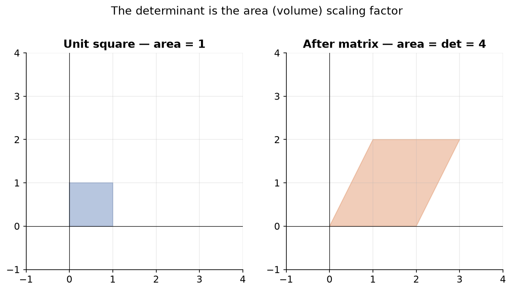

---
tags:
  - linear-algebra
  - matrices
  - determinant
  - matrix-inverse
  - linear-systems
aliases:
  - Matrices: Computation
  - Matrices - Computation
  - Matrix operations
difficulty: intermediate
prerequisites:
  - Vectors
created: 2026-10-24
---

> [!info] Where this fits
> This note continues from [[Vectors]], since a matrix is a 2D tensor, a grid built from vectors. It covers how to compute with matrices: the operations, the determinant, the inverse, and solving a linear system. Its companion [[Matrices - Intuition|Matrices: Intuition]] takes these same operations and shows what they mean geometrically. Think of this note as the how-to-compute half and the next as the what-it-means half; both feed into models such as [[Introduction to Linear Regression|Linear Regression]].

A **matrix** is a rectangular arrangement of numbers in rows and columns, a 2D tensor and a general-purpose tool used across engineering, graphics, physics, and machine learning. This note builds the mechanics from first principles: the types of matrices, equality, scalar and arithmetic operations, the transpose, the determinant with its minors and cofactors, the adjoint, the inverse, and finally solving a system of linear equations with the inverse as the payoff.

---

## What are matrices?

A **matrix** is a set of numbers, symbols, or expressions arranged in rows and columns. It is the 2D case of a tensor, so a NumPy 2D array is a matrix.

The **order** of a matrix (also called its shape) is its number of rows times its number of columns, written rows by columns. A matrix with 2 rows and 3 columns has order $2 \times 3$. In NumPy the `shape` of a 2D array gives exactly this order.

Matrices are a mathematical tool, not a natural object, built because the same structure serves many fields: computer graphics and animation move points by **linear transformations** stored as matrices, and optimization methods like gradient descent use them too. This note's goal is the mechanics; the geometric meaning comes in the companion note.

---

## Types of matrices

Several special matrices come up often enough to name. The **diagonal** of a square matrix is the set of entries where the row index equals the column index.

| Type | Definition |
| :--- | :--- |
| Row matrix | a single row, any number of columns (also a row vector) |
| Column matrix | a single column, any number of rows (also a column vector) |
| Square matrix | number of rows equals number of columns |
| Diagonal matrix | a square matrix whose off-diagonal entries are all zero |
| Scalar matrix | a diagonal matrix whose diagonal entries are all equal |
| Identity matrix | a scalar matrix whose diagonal entries are all 1 |
| Zero matrix | every entry is zero |

A **square matrix** is the most important type here, since only square matrices can have a determinant or an inverse. A diagonal entry sits where row index $i$ equals column index $j$; any entry where $i$ does not equal $j$ is off-diagonal.

---

## Matrix equality

Two matrices $A$ and $B$ are **equal** when both criteria hold:

- **Same order:** if $A$ is $2 \times 2$, then $B$ must also be $2 \times 2$.
- **Equal corresponding entries:** every entry $A_{ij}$ equals $B_{ij}$ at the same position.

If the orders differ, the matrices cannot be compared and are unequal. If the orders match, you check position by position; a single mismatched entry makes them unequal.

---

## Scalar operations

A **scalar operation** multiplies every entry of a matrix by one number. Multiplying matrix $A$ by the scalar `2` doubles every entry.

One useful property is that a scalar distributes over a sum of matrices:

$$
k(A + B) = kA + kB
$$

where $k$ is the scalar and $A$ and $B$ are matrices of the same order. This rule helps when rearranging the matrix equations that appear in deriving algorithms.

---

## Addition, subtraction, and multiplication

**Addition and subtraction** require the two matrices to have the **same order** and act **entry-wise**: add or subtract matching entries to get a result of the same order.

Two named matrices arise from addition:

- The **additive identity** is the **zero matrix**: adding it to $A$ returns $A$.
- The **additive inverse** of $A$ is its negation $-A$: adding it to $A$ returns the zero matrix.

Subtraction is addition with the additive inverse, so it follows the same rules.

### Matrix multiplication

Multiplication is less obvious than addition. It is defined only when the **inner dimensions match**: the number of columns of the first matrix must equal the number of rows of the second. Multiplying an $m \times n$ matrix by an $n \times p$ matrix is allowed and produces an $m \times p$ result; the outer dimensions give the result's order.

Each entry of the result is the **dot product of a row of the first matrix with a column of the second**. This is why the inner dimensions must match: a dot product needs the two vectors to have the same number of components.

Three properties matter:

- **Not commutative:** $AB$ is generally not equal to $BA$, so order matters. Even when both products are defined, the results usually differ.
- **Associative and distributive:** $(AB)C = A(BC)$, and $A(B + C) = AB + AC$.
- **Identity:** multiplying by the identity matrix $I$ leaves a matrix unchanged, $AI = IA = A$.

> [!tip] Matrix multiplication is nested loops of dot products
> Computing $AB$ is like running nested loops: for each row of $A$ and each column of $B$, take their dot product and place it at the matching position in the result. You never do this by hand at scale; NumPy's `@` operator or `np.dot` does it.

---

## Transpose of a matrix

The **transpose** of a matrix turns its rows into columns and its columns into rows. The transpose of $A$ is written $A^T$. An $m \times n$ matrix becomes $n \times m$ after transposing.

Three rules hold, where $A$ and $B$ are matrices:

$$
(A^T)^T = A, \qquad (A + B)^T = A^T + B^T, \qquad (AB)^T = B^T A^T
$$

Note the order reversal in the product rule: transposing a product flips the factors.

> [!note] Symmetric and skew-symmetric matrices
> A **symmetric** matrix equals its own transpose, $A^T = A$. A **skew-symmetric** matrix equals the negative of its transpose, $A^T = -A$, so every entry reverses sign. These are named special cases; they are not needed below but appear elsewhere in linear algebra.

---

## Determinant

The **determinant** is a single scalar computed from a **square matrix only**. It carries important information: a zero determinant means the matrix is **singular** and cannot be inverted, and the determinant also appears when solving linear systems.



Computing it by size:

- **1 by 1:** the determinant is the single entry itself.
- **2 by 2:** for entries $a$, $b$ (top row) and $c$, $d$ (bottom row), the determinant is the cross-product difference.

$$
\det \begin{bmatrix} a & b \\ c & d \end{bmatrix} = ad - bc
$$

- **3 by 3:** expand along any one row or column using cofactors (defined next), summing each entry times its cofactor.

For example, the determinant of the matrix with top row $-2$, $5$ and bottom row $-6$, $7$ is $(-2)(7) - (5)(-6) = -14 + 30 = 16$. If the determinant comes out to zero, the matrix is singular and has no inverse.

---

## Minor and cofactor

Determinants of larger matrices are built from smaller ones through minors and cofactors.

The **minor** $M_{ij}$ of an entry is the determinant of the smaller matrix left after deleting row $i$ and column $j$. For a 3 by 3 matrix, the minor $M_{11}$ is the 2 by 2 determinant remaining once the first row and first column are removed.

The **cofactor** $A_{ij}$ attaches a sign to the minor:

$$
A_{ij} = (-1)^{i+j} M_{ij}
$$

where $i$ is the row index, $j$ is the column index, and $M_{ij}$ is the minor. The factor $(-1)^{i+j}$ is $+1$ when $i + j$ is even and $-1$ when it is odd, giving the familiar checkerboard of signs.

> [!note] Cofactor expansion gives the determinant
> Summing the entries of any one row or column, each multiplied by its own cofactor, yields the determinant. You may expand along whichever row or column is easiest, and the answer is the same.

---

## Adjoint

The **adjoint** of a matrix (also called the adjugate, or classical adjoint) is formed by replacing each entry with its cofactor and then transposing the resulting matrix of cofactors.

So the procedure is: compute the cofactor of every entry to build the cofactor matrix, then transpose it. The adjoint is the final ingredient needed to compute an inverse.

---

## Inverse of a matrix

Division is not defined for matrices, so the **inverse** stands in for it, the way multiplying by a reciprocal replaces division for numbers. The inverse of $A$ is written $A^{-1}$, and it satisfies:

$$
A A^{-1} = I
$$

where $I$ is the identity matrix. The inverse is computed from the determinant and the adjoint:

$$
A^{-1} = \frac{1}{\det(A)} \, \text{adj}(A)
$$

where $\det(A)$ is the determinant and $\text{adj}(A)$ is the adjoint of $A$.

An inverse exists only when two conditions hold: the matrix is **square**, and it is **non-singular** (its determinant is non-zero). The determinant sits in the denominator, so a zero determinant would require dividing by zero, which is why singular matrices have no inverse. Non-square matrices have no ordinary inverse at all (an advanced Moore-Penrose pseudo-inverse exists but is rarely needed here).

One product rule is worth remembering, where $A$ and $B$ are invertible:

$$
(AB)^{-1} = B^{-1} A^{-1}
$$

```python
import numpy as np

A = np.array([[1, 1], [4, 3]])
print(np.linalg.det(A))
print(np.linalg.inv(A))
```

```text
-1.0
[[-3.  1.]
 [ 4. -1.]]
```

The non-zero determinant confirms $A$ is non-singular, so `np.linalg.inv` returns its inverse.

---

## Solving systems of linear equations

The inverse turns a system of linear equations into one matrix computation. Take the system:

$$
\begin{aligned}
x + y &= 5 \\
4x + 3y &= 15
\end{aligned}
$$

Collect the coefficients into a matrix $A$, the unknowns into a vector $x$, and the right-hand sides into a vector $b$, so the whole system is $A x = b$. Multiplying both sides by $A^{-1}$ and using $A^{-1} A = I$ gives the solution directly:

$$
A x = b \quad\Rightarrow\quad A^{-1} A x = A^{-1} b \quad\Rightarrow\quad x = A^{-1} b
$$

where $A$ holds the coefficients, $b$ holds the constants, and $x$ holds the unknowns. Compute $A^{-1}$, multiply it by $b$, and read off the values.

```python
import numpy as np

A = np.array([[1, 3, 4], [6, 4, 1], [2, 2, 2]])
b = np.array([5, 16, 11])
x = np.dot(np.linalg.inv(A), b)
print(x)
```

```text
[2. 3. 1.]
```

The same method scales to any number of equations and unknowns: as long as $A$ is square and non-singular, $x = A^{-1} b$ solves a 3-variable system, a 10-variable system, or larger, with no change to the formula.

---

## Summary

1. A **matrix** is a rectangular grid of numbers (a 2D tensor); its **order** is rows by columns, matching a NumPy 2D array's `shape`.
2. Named types include row, column, **square**, diagonal, scalar, identity, and zero matrices; the **diagonal** holds entries where the row index equals the column index.
3. Two matrices are **equal** when they share the same order and every corresponding entry matches.
4. **Scalar operations** multiply every entry by a number and distribute over sums; **addition and subtraction** need equal order and act entry-wise, with the zero matrix as additive identity and $-A$ as additive inverse.
5. **Matrix multiplication** needs the inner dimensions to match, gives an outer-dimension result, computes each entry as a row-by-column dot product, and is associative and distributive but **not commutative**; the identity leaves a matrix unchanged.
6. The **transpose** swaps rows and columns, with $(A^T)^T = A$ and $(AB)^T = B^T A^T$.
7. The **determinant** is a scalar from a square matrix ($ad - bc$ for 2 by 2, cofactor expansion for larger); a zero determinant marks a **singular**, non-invertible matrix.
8. The **minor** $M_{ij}$ is the determinant after deleting row $i$ and column $j$; the **cofactor** $A_{ij} = (-1)^{i+j} M_{ij}$ adds a sign, and cofactor expansion along any row or column gives the determinant.
9. The **adjoint** is the transpose of the cofactor matrix, and the **inverse** is $A^{-1} = \frac{1}{\det(A)} \text{adj}(A)$, existing only for square, non-singular matrices, with $A A^{-1} = I$.
10. A linear system written $A x = b$ is solved by $x = A^{-1} b$, which scales to any number of equations.

---

> [!info] Continues to
> You can now compute with matrices, but the operations still look mechanical. The next note gives them geometric meaning, reading a matrix as a transformation of space, in [[Matrices - Intuition|Matrices: Intuition]].
