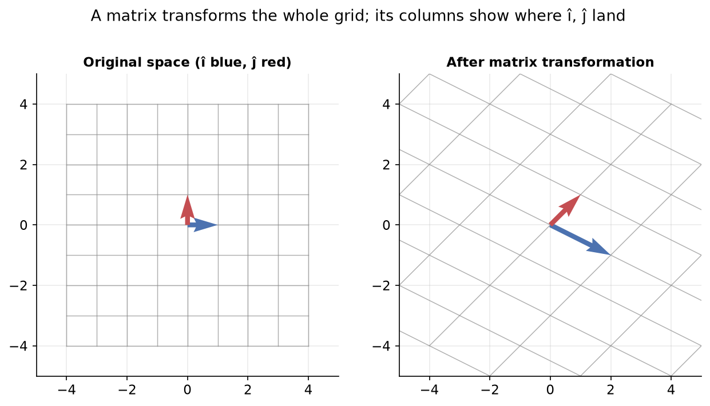
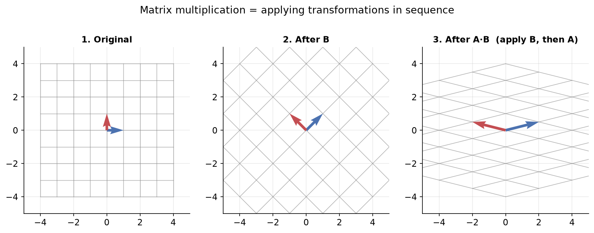

---
tags:
  - linear-algebra
  - matrices
  - linear-transformations
  - basis-vectors
  - determinant
aliases:
  - Matrices: Intuition
  - Matrices - Intuition
  - Linear transformations
difficulty: advanced
prerequisites:
  - Matrices - Computation
created: 2026-10-24
---

> [!info] Where this fits
> This note is the geometric companion to [[Matrices - Computation|Matrices: Computation]]. It takes the same operations you learned to compute (multiplication, the determinant, the inverse) and shows what they do to space. That picture closes the linear-algebra chain started in [[Tensors]] and [[Vectors]], and it underpins later topics like eigen decomposition and PCA. The payoff feeds straight into the machine-learning path, starting with [[Introduction to Linear Regression|Linear Regression]].

The computation note showed how to multiply matrices, take determinants, and find inverses. This note explains **why** those rules are what they are, by reading a matrix as a **linear transformation** of space. Once you see a matrix as something that moves a grid, matrix multiplication becomes composing two moves, the determinant becomes an area scaling factor, and the inverse becomes the move that undoes another. The running picture is a 2D coordinate grid with its basis vectors, transformed by example matrices.

---

## Basis vectors

Any vector can be built from a small fixed set of reference vectors.

In 2D the two **unit basis vectors** are **i-hat**, pointing one unit along the x axis, and **j-hat**, pointing one unit along the y axis. They have two defining features: each has **magnitude 1** (distance 1 from the origin), and they are **independent** (neither can be made from the other).

Every 2D vector is a **linear combination** of these two: scale i-hat and j-hat by numbers, then add the results. The vector $(2, 3)$ is $2\,\hat{i} + 3\,\hat{j}$, meaning go 2 units along x and 3 units along y. A **linear combination** is exactly this: multiply each basis vector by a scalar and add.

The idea extends: 3D adds a third basis vector **k-hat** along the z axis, and $n$ dimensions have $n$ basis vectors, one per axis.

---

## Linear transformations

Feed a vector into a matrix and you get another vector out. Read that way, **a matrix is a linear transformation**: a rule that takes every vector in space to a new vector.

Applying a matrix moves the whole coordinate grid at once, with two things always staying true: the **origin does not move**, and **grid lines stay straight and evenly spaced**. The grid may stretch, shrink, or rotate, but it never curves or tears.

The key to reading a matrix is this: **the columns of the matrix are where the basis vectors land**. The first column is the new position of i-hat, and the second column is the new position of j-hat. Since every vector is a linear combination of i-hat and j-hat, knowing where those two land tells you where every vector lands.

> [!example] Doubling along both axes
> The matrix with first column $(2, 0)$ and second column $(0, 2)$ sends i-hat to $(2, 0)$ and j-hat to $(0, 2)$. Every vector doubles in length, so the whole grid stretches to twice its size while the origin stays put.

---

## Linear transformation in 3D

The same idea works in 3D, with three basis vectors instead of two. A 3 by 3 matrix is a transformation of 3D space, and **each column is where one basis vector lands**: the first column is the new i-hat, the second the new j-hat, and the third the new k-hat.

To find where i-hat goes, multiply the matrix by $(1, 0, 0)$, which simply reads off the first column; j-hat comes from $(0, 1, 0)$, the second column, and k-hat from $(0, 0, 1)$, the third. As in 2D, the **origin stays fixed** and grid lines stay straight; the 3D grid is stretched, rotated, or sheared as a whole.

---

## Matrix multiplication as composition

Why does the product $AB$ mean what it means? Because **it composes two transformations**: apply $B$ first, then $A$.

Start with the grid, apply transformation $B$ to reach an intermediate grid, then apply transformation $A$ to that. The single matrix $AB$ applied directly lands you in exactly the same final grid. So multiplying two matrices is the same as doing one transformation after another.

The order reads **right to left**: in $AB$, the rightmost matrix $B$ acts first. This matches how a vector multiplies on the right, $ABx$, where $x$ meets $B$ first. Matrix multiplication is also **associative**, $(AB)C = A(BC)$, because applying three transformations in sequence gives the same final grid no matter how you group the intermediate steps.

---

## Test of the commutative law

The geometric view explains why matrix multiplication is **not commutative**.

Applying $A$ then $B$ moves the grid through one pair of intermediate states; applying $B$ then $A$ moves it through a different pair, and the two usually end in different final grids. Swapping the order swaps which transformation acts first, so $AB$ and $BA$ generally differ. This is the visual reason behind the computation note's rule that order matters.

> [!note] When the order happens not to matter
> Some special pairs do commute, for example a pure scaling and a pure rotation about the same center, where the end grid is the same either way. These are exceptions; in general the order changes the result.

---

## Determinant and inverse

The determinant and the inverse both have clean geometric meanings once a matrix is a transformation.

The **determinant is the area scaling factor** in 2D (or the volume scaling factor in 3D): it is the transformed area divided by the original area. Start with the unit square spanned by i-hat and j-hat, which has area 1; after a transformation the determinant tells you how many times larger or smaller that area became. A determinant of 2 means areas double; a determinant of 37 means they grow 37 times.

Two special values carry extra meaning:

- **Negative determinant:** the transformation **flipped** space, reversing its orientation. The grid was turned over, so i-hat and j-hat swap their left-right relationship, like flipping a sheet of paper. The area scale is still the absolute value; the sign records the flip.
- **Zero determinant:** the transformation **collapses space to a lower dimension**, squishing a 2D plane onto a line (or a 3D space onto a plane). Any area drops to zero, which is why the determinant is zero. A matrix that does this is **singular**, and that is the geometric reason a singular matrix has no inverse.

The **inverse is the transformation that undoes the original**, returning the grid to its starting state. Applying $A$ and then $A^{-1}$ brings every vector back where it began, which is the geometric meaning of $A A^{-1} = I$: the identity leaves space untouched. This also explains solving $A x = b$. There, $b$ is where some unknown vector $x$ landed after transformation $A$; applying $A^{-1}$ reverses the transformation, carrying $b$ back to the original $x$, which is why $x = A^{-1} b$ recovers the answer.

---

## Transformation for non-square matrices

A non-square matrix changes the number of dimensions, so it maps between spaces of different sizes.

- A **tall** matrix (more rows than columns) **embeds a lower-dimensional space into a higher one**. A 3 by 2 matrix takes a 2D sheet and places it inside 3D space, so the flat sheet now hangs in a room.
- A **wide** matrix (more columns than rows) **projects a higher-dimensional space down to a lower one**. A 2 by 3 matrix takes all of 3D space and brings it onto a 2D plane, collapsing the depth.

So the shape of a matrix tells you the dimension change: tall lifts up a dimension, wide flattens down a dimension.

---

## Why only square matrices have inverses

The determinant as an area or volume scaling factor is defined only for **square** matrices, because only a square matrix keeps the dimension the same. A non-square matrix changes the dimension, so there is no meaningful area-scale to speak of.

More importantly, a dimension change cannot be undone. A tall matrix embeds a lower space into a higher one, so the output vectors do not fill the higher space; there is no inverse that could pull every point of the higher space back. A wide matrix throws away a dimension, losing information. Either way the map is not reversible, so non-square matrices have no inverse.

---

## Why inverses need non-singular matrices

Even a square matrix fails to have an inverse when its determinant is zero, and the geometric reason is **information loss**.

A square matrix with a zero determinant collapses space to a lower dimension, as above: a 2D plane is squished onto a line. When that happens, **many different input vectors land on the same output point**, because a whole direction has been flattened away. Given only an output point on the line, you cannot tell which of the many inputs produced it.

Since the mapping is no longer one-to-one, it cannot be reversed, so no inverse exists. An inverse exists only when the determinant is non-zero (**non-singular**), because only then is space preserved without collapse and every output traces back to a single input.

---

## Summary

1. The **basis vectors** i-hat and j-hat are independent unit vectors along the axes; every vector is a **linear combination** of them, and $n$ dimensions have $n$ basis vectors.
2. A matrix is a **linear transformation** of space: it moves the whole grid while keeping the origin fixed and grid lines straight, and **its columns are where the basis vectors land**.
3. In **3D** the same holds with three basis vectors; each column of a 3 by 3 matrix is the landing spot of i-hat, j-hat, or k-hat.
4. **Matrix multiplication is composition**: $AB$ means apply $B$ first, then $A$ (right to left), and it is associative because the order of grouping intermediate steps does not change the final grid.
5. Multiplication is **not commutative** because swapping which transformation acts first generally gives a different final grid.
6. The **determinant** is the area (2D) or volume (3D) scaling factor; a **negative** determinant flips orientation, and a **zero** determinant collapses space to a lower dimension, marking a singular, non-invertible matrix.
7. The **inverse** is the transformation that undoes the original, which is why $A A^{-1} = I$ and why $x = A^{-1} b$ recovers the original vector in a linear system.
8. **Non-square** matrices change dimension: tall matrices embed a lower space into a higher one, wide matrices project a higher space onto a lower one.
9. Only **square** matrices have inverses, because a dimension change cannot be reversed.
10. Inverses need **non-singular** matrices, because a zero determinant collapses space and maps many inputs to one output, destroying the one-to-one mapping an inverse needs.

---

> [!info] Continues to
> With the full linear-algebra toolkit in place, the next step applies it to a first learning algorithm, fitting a line to data, in [[Introduction to Linear Regression]]. The eigen-based topics (eigen decomposition, PCA) build on this same transformation picture later.
