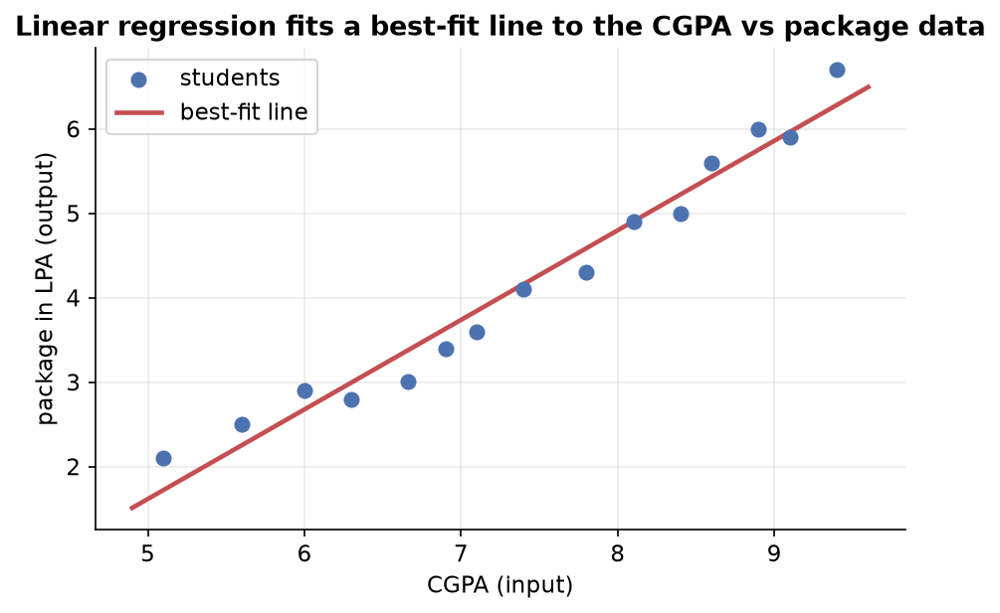

---
tags:
  - regression
  - linear-regression
  - supervised-learning
  - machine-learning
aliases:
  - Introduction to Linear Regression
  - Linear Regression
difficulty: intermediate
created: 2026-10-23
---

> [!info] Where this fits
> This is the first note on [[Regression Analysis|regression]], the branch of supervised learning that predicts a number. Everything here rests on the supervised, regression, and classification ideas from the machine learning landscape, and it opens the path to [[Simple Linear Regression]], [[Multiple Linear Regression]], and later the regularization family.

Linear regression is the first real algorithm most people meet in machine learning, and for good reason. It takes a table of examples and fits a straight line through them, so that a new input can be turned into a predicted number. This note explains the problem it solves, what the algorithm actually is, the three forms it takes, and where it sits among the other algorithms you will learn.

---

## From a problem to a line

Suppose you have data on final-year students who were placed from your college. Each row holds a student's cumulative grade point average (CGPA) and the salary package they received, measured in lakhs per annum.

| CGPA | Package (LPA) |
| :--- | :--- |
| 6.66 | 3.01 |
| 7.10 | 3.60 |
| 8.90 | 6.00 |
| 6.30 | 2.80 |

You want a model that takes a student's CGPA and predicts their package. CGPA is the **input**, the quantity you measure. Package is the **output**, the quantity you want to predict, and it depends on the input. Because the output is a continuous number, this is a **regression** problem rather than a classification one.

If you plot the points with CGPA on the horizontal axis and package on the vertical axis, they trend upward together but do not fall on a single straight line. The data is close to linear without being perfectly linear.



The scatter is not a perfect line because **real-world data is shaped by real-world factors you cannot measure**. One student may earn more than their CGPA suggests because their interview went well, or they joined a company that pays more. Another may earn less for reasons you have no number for. These unmeasurable influences are called **stochastic errors**, the random, unexplained part of the output. They are what keeps the points off a clean line.

> [!tip] Why a line is still a reasonable model
> A perfect model would pass through every point, which is impossible when stochastic errors scatter the data. The next best thing is a single straight line that sits as close as possible to all the points at once, making the smallest total error. That line is called the **best-fit line**, and finding it is the whole job of linear regression.

---

## What linear regression is

**Linear regression is a supervised learning algorithm that models the output as a straight-line function of the input.** You give it labelled examples, each with an input and a known output, and it learns the one line that best describes the relationship between them.

A straight line is captured by the familiar equation:

$$
y = m x + b
$$

where:

- $y$ is the predicted output, here the package.
- $x$ is the input, here the CGPA.
- $m$ is the **slope**, how steeply the package rises as CGPA rises.
- $b$ is the **y-intercept**, the value of $y$ where the line crosses the vertical axis.

Learning the model means finding the two numbers $m$ and $b$ that place the line best among the points. Once you know them, prediction is immediate: feed in any CGPA as $x$, compute $m x + b$, and read off the predicted package. A student who visits a website, types in their CGPA, and sees an estimated package is reading a value straight off this line.

> [!example] Why the model matters
> Without a model, asked to guess the package for a 7.5 CGPA, you could only name a vague range. A weak student and a strong one would get the same guess. The fitted line gives each CGPA its own grounded prediction, learned from the pattern in the data rather than invented.

---

## Types of linear regression

Linear regression is not one algorithm but a small family. Which member you use depends on how many inputs you have and whether the relationship is straight or curved.

| Type | Inputs | Relationship | Example |
| :--- | :--- | :--- | :--- |
| Simple linear regression | One input column | Straight line | Predict package from CGPA alone |
| Multiple linear regression | Two or more input columns | Flat plane or hyperplane | Predict package from CGPA, gender, class 12 marks, and project count |
| Polynomial linear regression | One or more inputs | Curved | Predict an output when the data bends rather than runs straight |

The three build on one shared idea, fitting a best line or surface, and differ only in shape and dimension:

```text
                    LINEAR REGRESSION
                   /        |         \
             simple     multiple    polynomial
          (one input)  (many inputs) (curved fit)
                   \        |         /
                    \       |        /
                   REGULARIZATION
            (tames models that overfit)
```

- **Simple linear regression** has exactly one input column and one output column, so it fits a line in two dimensions. Predicting package from CGPA alone is the classic case, and it is where the running example starts.
- **Multiple linear regression** has more than one input. Add gender, class 12 marks, and number of projects alongside CGPA, and you are predicting one package from four inputs. The fit is no longer a line in a plane but a flat surface in higher dimensions.
- **Polynomial linear regression** is used when the data is not straight. A line cannot follow a curve, so the model is extended to bend and track data that rises then levels off, or curves in any shape.

> [!info] Regularization comes next
> Beyond these three sits **regularization**, a set of techniques that adjust a linear model so it generalizes better instead of memorizing the training data. It is covered in later notes on [[Ridge Regression]], [[Lasso Regression]], and [[ElasticNet Regression]].

---

## Where linear regression sits among algorithms

Linear regression is a **supervised** algorithm, meaning it learns from data that carries both inputs and known outputs. Supervised learning splits by the kind of output it predicts:

- **Regression** predicts a continuous number, such as a salary, a house price, or tomorrow's temperature. Linear regression lives here.
- **Classification** predicts a category, such as spam or not spam, placed or not placed.

The single question that places a problem is: what does the output column hold? A number means regression, a category means classification. Predicting the package from CGPA is regression because the package is a number, which is exactly why linear regression fits it.

> [!note] A deliberate starting point
> Linear regression earns its place as the first algorithm because its machinery, learning parameters from labelled data to minimize error, is the same machinery that drives far more complex models. Understanding it well makes everything after it easier to read.

---

## Summary

1. Linear regression solves a **regression** problem: given labelled examples with an input and a continuous output, predict the output for a new input.
2. The running example predicts a student's salary package from their CGPA, where CGPA is the input and package is the continuous output.
3. Real data is only roughly linear because **stochastic errors**, unmeasurable real-world factors, scatter the points off any single line.
4. The model is the line $y = m x + b$; learning means finding the slope $m$ and intercept $b$ that give the **best-fit line**, the line that makes the smallest total error.
5. The family has three members: **simple** (one input), **multiple** (many inputs), and **polynomial** (curved data), with **regularization** extending them further.
6. Linear regression is supervised and regression, told apart from classification by whether the output column is a number or a category.

---

> [!info] Continues to
> The next note develops the geometry and the method for finding $m$ and $b$ in [[Simple Linear Regression]].
