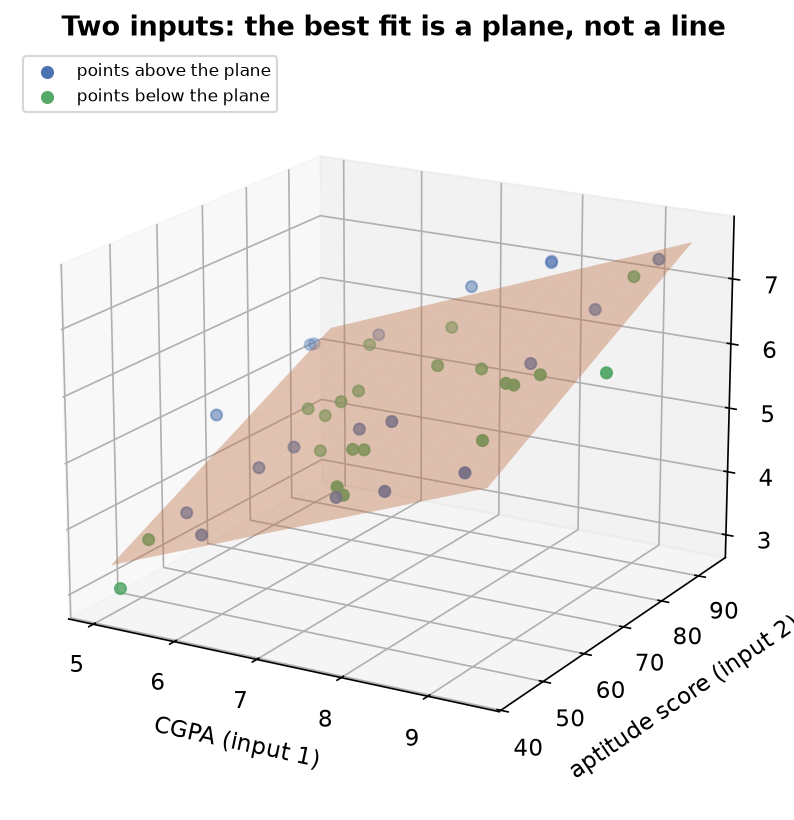

---
tags:
  - regression
  - linear-regression
  - multiple-linear-regression
  - hyperplane
  - coefficients
aliases:
  - Multiple Linear Regression
  - MLR
difficulty: intermediate
created: 2026-10-23
---

> [!info] Where this fits
> This note extends [[Simple Linear Regression]] from one input to many. You already know how to fit the best line $y = mx + b$ to a single input; here the same least-squares idea fits a flat surface through data with several inputs. The method, the error function, and the way you find the coefficients all carry straight over, so the only new ideas are the extra inputs, the matrix bookkeeping that handles them, and the geometry of a surface in more than two dimensions. It sets up [[Regression Metrics]], where you score how well the fitted model predicts.

Multiple linear regression (MLR) is linear regression with more than one input column. Real problems rarely depend on a single factor, so this is the form you reach for most often. This note starts from the one-input line, extends the equation to many inputs with a coefficient on each, shows what the fitted surface looks like as the number of inputs grows, writes the whole thing compactly in matrix form, and ends with the error function that is minimized to find the coefficients.

---

## From one feature to many

Simple linear regression predicts a package from a single input, a student's cumulative grade point average (CGPA). In practice a package depends on more than one thing: CGPA, an aptitude score, years of internship experience, and so on. Dropping those extra columns throws away information that helps the prediction.

**Multiple linear regression uses several input columns at once to predict a single continuous output.** The output stays one number per row; what changes is that each row now carries several inputs instead of one.

| Setting | Inputs | What is fitted |
| :--- | :--- | :--- |
| Simple linear regression | one, for example CGPA | a line |
| Multiple linear regression | two or more, for example CGPA and aptitude | a plane or higher surface |

The goal is unchanged: find the model that sits as close as possible to all the data points at once. Only the number of inputs it must account for has grown.

---

## The equation of multiple linear regression

With one input the line was $y = mx + b$. Rename the slope $m$ to $\beta_1$ and the intercept $b$ to $\beta_0$, and that same line reads $y = \beta_0 + \beta_1 x_1$. Written this way it extends cleanly: give every input its own coefficient and add the terms up.

**The multiple linear regression model predicts the output as a weighted sum of the inputs plus an intercept:**

$$
\hat{y} = \beta_0 + \beta_1 x_1 + \beta_2 x_2 + \dots + \beta_n x_n
$$

where:

- $\hat{y}$ is the predicted output, read as "y-hat".
- $n$ is the number of input columns.
- $x_1, x_2, \dots, x_n$ are the inputs for one row, so $x_1$ might be CGPA and $x_2$ an aptitude score.
- $\beta_1, \beta_2, \dots, \beta_n$ are the **coefficients**, one weight per input. Each coefficient is how much the predicted output changes for a one-unit rise in its input, with the other inputs held fixed.
- $\beta_0$ is the **intercept**, the predicted output when every input is zero.

**Fitting the model means finding the one set of coefficients $\beta_0, \beta_1, \dots, \beta_n$ that makes the predictions sit as close as possible to the actual outputs.** The simple-regression slope and intercept were just the two-coefficient case of this.

> [!note] The coefficients are weights
> Think of each coefficient as the weight the model gives its input. A large positive coefficient means that input pushes the prediction up strongly; a coefficient near zero means that input barely matters. Reading the coefficients is how you see which inputs drive the output.

---

## Geometry: line, plane, hyperplane

The equation gains one term per input, and the shape it describes gains one dimension per input. Seeing this geometry makes the higher-dimensional case concrete instead of abstract.

- **One input (two dimensions).** The data has one input axis and one output axis. The model $y = \beta_0 + \beta_1 x_1$ is a **line** through the scatter, exactly the simple-regression case.
- **Two inputs (three dimensions).** The data has two input axes and one output axis. The model $\hat{y} = \beta_0 + \beta_1 x_1 + \beta_2 x_2$ is a flat **plane** tilted through the cloud of points.
- **Three or more inputs (four or more dimensions).** The surface is still flat but now lives in a space you cannot draw. A flat surface in more than three dimensions is called a **hyperplane**, which is the general name for the model that MLR fits.

The figure shows the two-input case: CGPA and an aptitude score on the two horizontal axes, package on the vertical axis, and the fitted plane tilted through the data. Points sit a little above or below the plane, the three-dimensional version of the residuals from simple regression.

> [!tip] Why "linear" still holds with many inputs
> The model is called linear because it is a straight-sided surface: no input is squared, multiplied by another, or bent. A line, a plane, and a hyperplane are all flat, so every one of them is a linear model. Adding inputs raises the dimension but never curves the surface.

---

## Mathematical formulation

Writing out $\beta_0 + \beta_1 x_1 + \dots + \beta_n x_n$ for every row gets unwieldy fast. Linear algebra packs the whole dataset and all the coefficients into a compact matrix equation, which is how libraries carry out the fit.

Stack the inputs for all rows into a **design matrix** $X$. Each row of $X$ holds one data point's inputs, and a leading **column of ones** is added so the intercept $\beta_0$ gets multiplied by one and comes along in the same product:

$$
X =
\begin{bmatrix}
1 & x_{11} & x_{12} & \cdots & x_{1n} \\
1 & x_{21} & x_{22} & \cdots & x_{2n} \\
\vdots & \vdots & \vdots & & \vdots \\
1 & x_{m1} & x_{m2} & \cdots & x_{mn}
\end{bmatrix}
\qquad
\beta =
\begin{bmatrix}
\beta_0 \\ \beta_1 \\ \vdots \\ \beta_n
\end{bmatrix}
$$

where $m$ is the number of rows and $n$ is the number of input columns. With the outputs collected into a column vector $y$, the whole set of predictions is the single product $X\beta$, and the model is:

$$
\hat{y} = X\beta
$$

The coefficients that minimize the squared error have a **closed-form solution**, a direct formula you compute in one shot, called the **normal equations**:

$$
\beta = (X^{\top} X)^{-1} X^{\top} y
$$

where $X^{\top}$ is the transpose of the design matrix (its rows and columns swapped) and $(X^{\top} X)^{-1}$ is the inverse of the square matrix $X^{\top} X$. In words: multiply the design matrix by its own transpose, invert the result, and multiply by the transpose of $X$ times the outputs. The product returns every coefficient at once, the intercept and all the input weights together. This is the many-input generalization of the slope and intercept formulas from simple regression.

> [!note] The column of ones carries the intercept
> Without the leading column of ones, the product $X\beta$ would have no constant term and the fitted surface would be forced through the origin. The ones column lets $\beta_0$ act as a free intercept, exactly as $b$ did for the single line.

---

## Error function and minimizing it

A fitted surface needs the same measure of wrongness as the fitted line. For each row the model predicts an output, the data holds the actual output, and the gap between them is that row's residual.

**The error function of multiple linear regression is the sum of squared residuals, identical in form to the simple-regression case:**

$$
E = \sum_{i=1}^{m} (y_i - \hat{y}_i)^2
$$

where $m$ is the number of rows, $y_i$ is the actual output of row $i$, and $\hat{y}_i$ is the model's prediction for that row. Squaring keeps every term positive so residuals above and below the surface cannot cancel, and it penalizes large misses more heavily, the same reasons as before.

**The best-fit surface is the set of coefficients that makes $E$ as small as possible.** Minimizing it is the same calculus as the one-input case, now with one partial derivative per coefficient set to zero, and solving that system of equations is exactly what the normal equations above deliver in one step.

> [!warning] When the direct formula gets expensive
> The normal equations are exact, but they require inverting $X^{\top} X$, a matrix whose size grows with the number of inputs. With very many inputs that inversion becomes slow and numerically fragile. In that regime an iterative method that nudges the coefficients downhill toward the minimum, rather than solving for them directly, becomes the practical choice. The direct formula still defines the answer; the iterative method just reaches it more cheaply at scale.

---

## Summary

1. **Multiple linear regression** predicts one continuous output from several input columns, extending simple linear regression from one input to many.
2. The model is a weighted sum $\hat{y} = \beta_0 + \beta_1 x_1 + \dots + \beta_n x_n$, where each **coefficient** $\beta_i$ is the weight on its input and $\beta_0$ is the intercept, the prediction when all inputs are zero.
3. Geometrically the fit is a **line** with one input, a **plane** with two inputs, and a **hyperplane** with three or more; all three are flat, which is why the model stays linear.
4. In matrix form the model is $\hat{y} = X\beta$, where the **design matrix** $X$ holds all the rows and a leading **column of ones** carries the intercept.
5. The coefficients have a closed-form solution, the **normal equations** $\beta = (X^{\top} X)^{-1} X^{\top} y$, which returns every coefficient at once.
6. The **error function** is the sum of squared residuals $E = \sum (y_i - \hat{y}_i)^2$, minimized the same way as in simple regression; an iterative method replaces the direct formula when the number of inputs is very large.

---

> [!info] Continues to
> With a model fitted, the next question is how well it predicts. That is scored with the metrics in [[Regression Metrics]].
