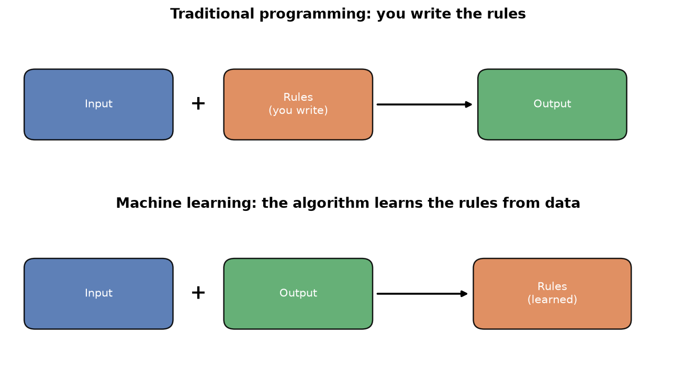
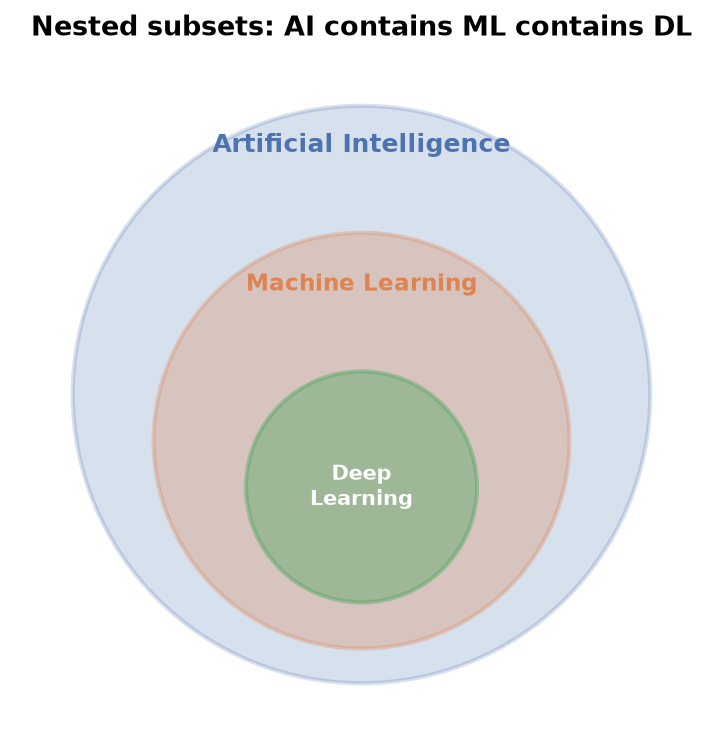
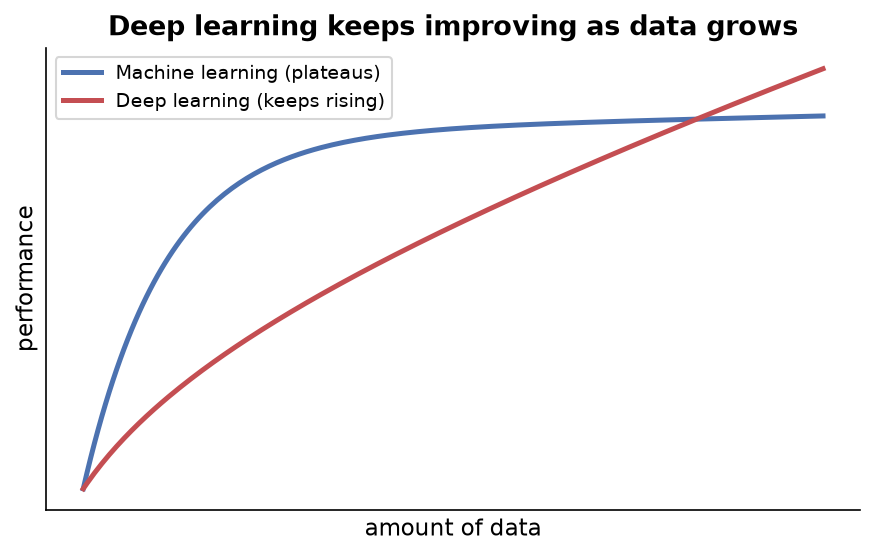
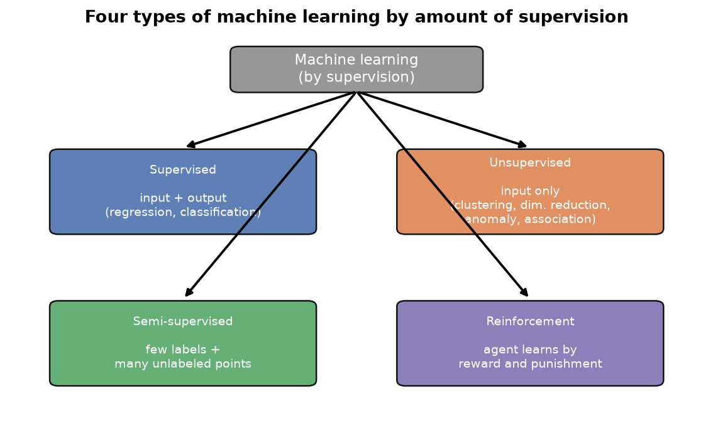
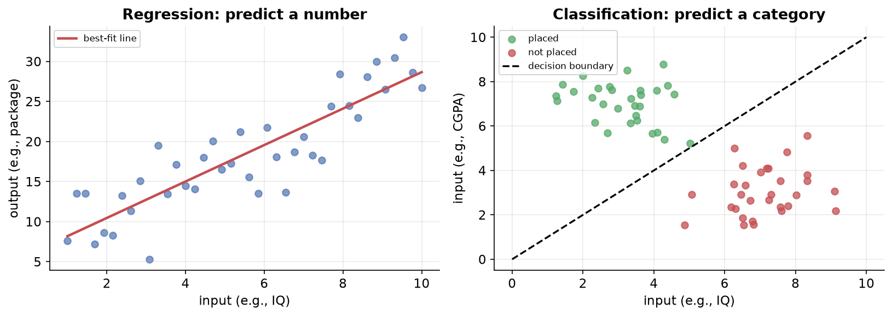
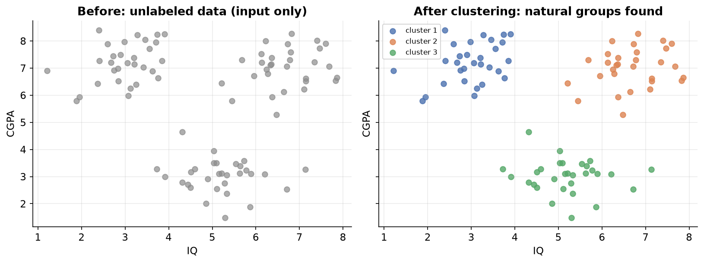
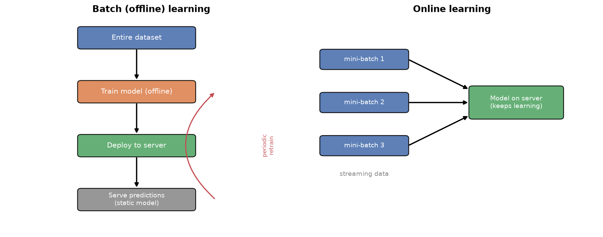
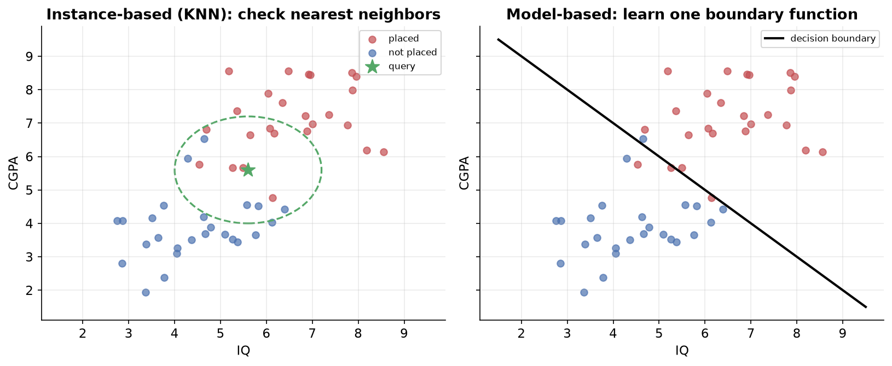
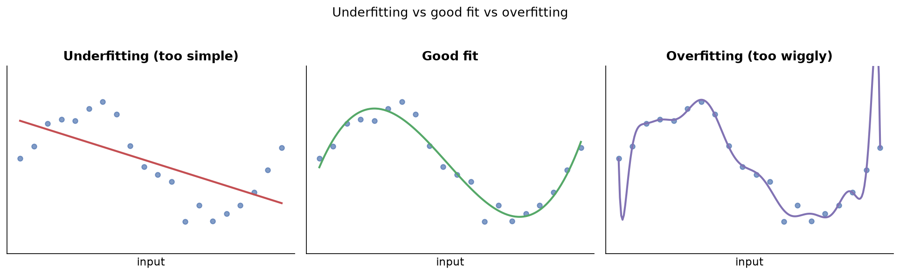
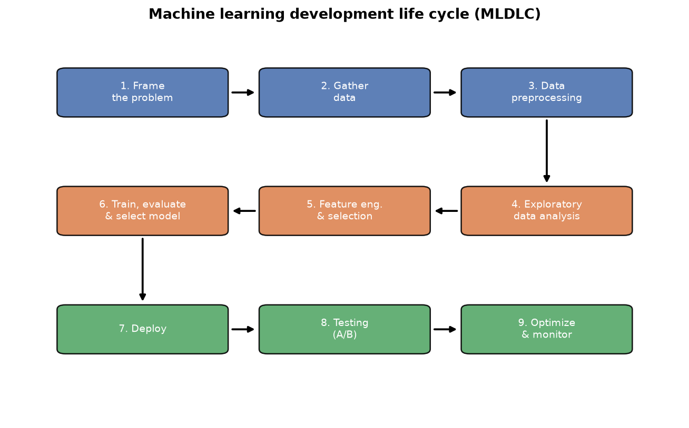

---
tags:
  - machine-learning
  - ai
  - data-science
  - fundamentals
aliases:
  - Machine Learning Fundamentals
  - ML Basics
difficulty: beginner
created: 2026-08-12
---

> [!info] Where this fits
> This is the entry point to machine learning. It frames what learning from data means and the kinds of problems it solves, then everything after builds on it, starting with [[Introduction to Linear Regression|Linear Regression]], the first concrete algorithm you will meet.

Machine learning turns the usual logic of programming around: instead of writing the rules yourself, you show the computer examples and let it find the rules. This note covers what machine learning is, how it relates to artificial intelligence and deep learning, the four ways to supervise it, how models are trained in production, how they learn, the practical challenges you will hit, and the end-to-end life cycle of a project.

---

## What is machine learning?

Machine learning is a branch of computer science where you use statistical and mathematical techniques to find patterns in data. In short, it is the technique of learning the patterns hidden inside data.

The core idea is a reversal of how we normally write software.

- In traditional programming, you write the logic (the rules) yourself. You feed input to that logic, and it produces output.
- In machine learning, you feed both the input and the output (the data), and the algorithm figures out the logic (the rules or patterns) on its own.



Once the algorithm learns the patterns, you give it new, unseen input and it produces the output.

> [!example]
> To add two numbers with traditional code, you write the addition logic. With machine learning, you provide a table of number pairs and their sums. The algorithm trains on that data, recognizes that the pattern is addition, and can then add new numbers you give it.

### Why machine learning beats rule-based programming

Consider building a spam email filter as a traditional program. You would write a long list of `if-else` rules: if the word "discount" appears more than three times, if "sale" appears, if there are too many images, and so on.

The problem is that the world changes. Suppose advertisers learn that using the word "huge" more than three times triggers your spam rule. They stop using it, and your program can no longer catch their new emails. You must go back and rewrite your logic by hand every time the situation changes.

Machine learning removes this burden. Because the model learns from data, when the data changes, the learned logic updates automatically. You write one algorithm, and it adapts.

> [!example]
> Some problems are impossible to hand-code because the number of cases is unlimited. To detect whether an image contains a dog, you cannot write rules for every breed, size, color, and ear shape. Instead, you show the system thousands of labeled images, and it learns to recognize dogs the same way a child learns from being shown examples.

### Data mining

Data analysis is the process of finding patterns and hidden information in data by plotting graphs and exploring it. Sometimes the useful information is buried so deep that graphs alone cannot reveal it.

Data mining is the practice of applying a machine learning algorithm to data to surface these deeply hidden patterns. You build a prediction model, then inspect which patterns it learned, and those patterns become insights about your data.

> [!example]
> To learn which keywords make an email spam, you train a spam classifier and then examine the patterns it picked up. The model reveals that certain words, appearing at certain frequencies, strongly signal spam. That discovered insight is the result of data mining.

---

## A short history of machine learning

The theory and mathematics behind machine learning existed for 40 to 50 years, but the field stayed in the background until recently. Two problems held it back.

- **Data**: gathering and labeling data used to be slow and tedious.
- **Hardware**: machines powerful enough to run algorithms on large data did not exist.

After 2010, the rise of the internet and smartphones solved both problems.

- We now generate enormous amounts of data every day. As a rough sense of scale, humanity created as much digital data in a single recent year as it had in all prior history up to a few years before.
- Hardware became cheap and powerful. A modern phone carries more memory and compute than research machines once had.

With good data, good hardware, and good algorithms all available at once, machine learning finally took off, and its growth is still accelerating.

### The economics of machine learning salaries

High salaries in a field follow basic supply and demand. When Java was new, few people knew it but many companies needed it, so salaries rose. As more people learned Java, salaries normalized.

The same cycle applies to machine learning. Today, few graduates know it well, so companies compete for the small talent pool and pay a premium. Over the next several years, as more people learn it, salaries will normalize.

> [!note]
> The advantage of learning machine learning now is timing. We are on the rising part of the curve, so those who learn it well today can benefit from the current momentum before the field saturates.

---

## AI vs ML vs DL

A common beginner question is how artificial intelligence, machine learning, and deep learning relate. The usual picture shows three nested circles.



AI is the largest set, machine learning is a subset of AI, and deep learning is a subset of machine learning.

### Artificial intelligence

Artificial intelligence is the idea of putting intelligence into machines. Human intelligence is complex and made of many parts: pattern recognition, creativity, imagination, and emotional intelligence.

Building a general intelligence that behaves exactly like a human is very hard. So the AI we pursue today focuses on the one part we can measure and quantify: **pattern recognition**. Creativity and emotion are hard to quantify, since we do not know the "correct" answer for them, so most AI you see today is pattern recognition.

### Symbolic AI and expert systems

From the 1950s, researchers began building intelligent systems. The first major wave was **symbolic AI**, where you build a large knowledge system using `if-else` conditions, writing a rule for every situation.

Symbolic AI led to **expert systems**. A chess program you played against as a child was an expert system: knowledge was extracted from a human expert and converted into code.

An expert system has two parts.

- A **knowledge base**, taken from human experts.
- An **inference engine**, a program that makes decisions using that knowledge base.

In the 1980s, people believed expert systems were the future of AI. Then they discovered the flaw.

> [!warning]
> Expert systems only work on closed, specific problems with clear logic, such as chess. They fail on fuzzy-logic problems where rules cannot be written cleanly, like detecting a dog in an image or recognizing speech. You cannot write `if-else` rules for every possible dog.

### Machine learning as the solution

Machine learning solved the fuzzy-logic problem. The key difference from symbolic AI is that machine learning never uses explicit, rule-based programming. Instead of writing logic for every case, you provide data with inputs and outputs, and the system generates the patterns itself.

For the dog-detection problem, you do not write rules. You provide many labeled photographs of different breeds, and the system automatically finds the underlying representation of the data. This is what "learning" means. Give it enough photos, and it can classify new images.

> [!note]
> Machine learning is inspired by statistics and uses statistical and mathematical tools, but it is not purely statistics. It uses limited mathematics and is highly practical and engineering-based.

### Deep learning

Deep learning is a recent class of machine learning algorithms that became prominent after 2012. First and foremost, deep learning is machine learning; the process flow is identical: provide data, train the algorithm, reduce error during training, and predict on new data.

What differs is the algorithms. Deep learning algorithms are inspired by the neurons in our biology. Its smallest unit, the **perceptron**, is based on the biological neuron.

> [!warning]
> Deep learning is inspired by biology, but it does not work exactly like the human brain. It is a mathematical model. The biological connection is only an inspiration, not a literal equivalence.

### Why deep learning is needed

Deep learning shines where plain machine learning struggles, for two main reasons.

**1. Automatic feature extraction.** In machine learning, you must hand-craft the features (the input columns). To classify dogs versus cats, you would have to specify features like pointed ears or a curly tail. In deep learning, the system creates and detects these features automatically from raw input.

> [!example]
> To predict placement from a resume, machine learning needs you to hand-create features like number of certifications, percentage, and backlogs. Deep learning takes the raw text and builds those features itself. Each added layer digs deeper: for digit recognition, an early layer finds edges, the next assembles pieces, and the final layer identifies the digit.

**2. Performance keeps improving with data.** A machine learning model's accuracy improves with data up to a point, then plateaus. A deep learning model keeps improving as you add more data.



### When to still use machine learning

Deep learning is powerful, like a sword, but you would not use a sword where a needle is needed. On small data, machine learning gives better results, and about 90 percent of the world's data is small data. Banks, insurance companies, and sports analytics firms often do not have huge data, so machine learning remains very useful there.

### Summary of the hierarchy

- The broadest goal is **AI**, making machines intelligent.
- One way to build AI is **machine learning**, learning rules from data.
- A way to solve very complex machine learning problems is **deep learning**.

Today both machine learning and deep learning are the right path to building AIs.

---

## Types of machine learning by supervision

Machine learning can be categorized several ways. The first is by the **amount of supervision** an algorithm needs during training. On this basis there are four categories.

- Supervised learning
- Unsupervised learning
- Semi-supervised learning
- Reinforcement learning



### Supervised machine learning

In supervised learning, your data has both **input** and **output**. The algorithm's job is to learn the relationship between them, so that for a new input it can predict the output.

> [!example]
> You have data for 5000 students with three columns: IQ, CGPA, and whether placement happened. IQ and CGPA are the input columns; placement is the output column, since it depends on the other two. The algorithm learns the input-to-output relationship, so for a new student (say CGPA 7.3, IQ 73) it can predict whether placement will happen.

Most machine learning you do in practice is supervised. Supervised learning splits into two types based on the output column's data type.

Recall the two broad data types:

- **Numerical** data: age, weight, CGPA, IQ.
- **Categorical** data: gender, nationality, phone brand.

**Regression**: the output column is numerical.

> [!example]
> Input is IQ and CGPA; output is the salary package in lakhs. Because the target is a number, this is a regression problem.

**Classification**: the output column is categorical.

> [!example]
> Input is IQ and CGPA; output is whether placement happened (yes or no). Because the target is a category, this is a classification problem.

The rule is simple: if input and output both exist, it is supervised. Then look at the output column: a number means regression, a category means classification.

| Task | Output type | Example |
| :--- | :--- | :--- |
| Regression | numerical | predict house price, count dogs in an image |
| Classification | categorical | spam or not spam, will it rain today |



### Unsupervised machine learning

Unsupervised learning is the opposite of supervised: you have **only input, no output**. Since there is no target, you cannot do prediction. Instead you do one of four things.

- Clustering
- Dimensionality reduction
- Anomaly detection
- Association rule learning

#### Clustering

Clustering groups similar data points together.

> [!example]
> With only IQ and CGPA columns, plot the students on a 2D graph. A clustering algorithm detects natural groups: high IQ and high CGPA, high IQ and low CGPA, high CGPA and low IQ. You can then label and process each group.



Clustering is powerful because it can group high-dimensional data that you cannot see with the naked eye. **Hierarchical clustering** even creates groups within groups. It is used heavily in industry, for example to segment customers on an e-commerce site.

#### Dimensionality reduction

"Dimension" here means a column, specifically an input column. Sometimes you have hundreds or thousands of input columns, which causes two problems: algorithms run slowly, and beyond a point extra columns add no improvement.

Dimensionality reduction removes or combines unneeded columns.

> [!example]
> A house data set has "number of rooms" and "number of washrooms." A dimensionality reduction algorithm can combine these related columns into a single new column, "square feet area." Creating a new column from existing ones is called **feature extraction**, and PCA is a common algorithm for this.

Dimensionality reduction also enables **visualization**. You cannot plot data with 500 or 1000 dimensions, so you reduce it to two or three dimensions and plot it while preserving the relationships.

> [!example]
> The MNIST data set holds 28 by 28 pixel images of handwritten digits, which becomes 784 columns (784-dimensional space). A technique called t-SNE reduces this to three dimensions so you can visualize how the digits relate, with each digit shown in a different color.

#### Anomaly detection

Anomaly detection finds points that do not fit the rest, then flags or removes them. Uses include detecting manufacturing defects, fraudulent credit card transactions, and suspicious loan applications.

> [!example]
> A model is trained on many normal points. A new point that looks like the others is accepted. A new point far away from the rest is flagged as an anomaly.

#### Association rule learning

Association rule learning finds relationships between items, often by mining transaction data.

> [!example]
> A supermarket generates bills from a year of shopping and finds patterns. If 80 of 100 bills included milk, and 60 of those also included eggs, there is a strong association, so the store places milk and eggs together. Walmart famously found that customers buying baby diapers often bought beer too, so placing them together increased sales.

### Semi-supervised machine learning

Semi-supervised learning is partly supervised and partly unsupervised. It exists because **labels are expensive**. A human must label each data point (is there a dog in this image?), which costs time and money. Input data is easy to gather, for example by scraping images, but labeling them is the hard part.

The idea: label only one or two points, and let the system label the rest automatically.

> [!example]
> Google Photos clusters faces automatically (unsupervised). It asks you to name one photo of a person; you say "father," and it labels all other photos of that person. You provided one label, and the machine did the rest.

### Reinforcement learning

In reinforcement learning, you provide no data at all. The algorithm, called an **agent**, starts from scratch and improves gradually by trial and error, the way humans learn a new environment.

The pieces are:

- An **agent** that lives in an **environment** (a self-driving car on roads, a chess bot in a chess game).
- A **policy**, the agent's rule book for what to do.
- **Rewards** for good actions and **punishments** for bad ones.

The agent observes, acts using its policy, and receives a reward or punishment. It updates its policy accordingly and repeats, aiming to maximize rewards and minimize punishments over time.

> [!example]
> Training a dog works the same way: give a treat for good behavior and a scolding for bad, and its behavior reinforces over time. A self-driving car has no prior data and learns to drive by gradually improving on the road.

> [!note]
> A famous example is DeepMind's AlphaGo, which beat the world champion of the board game Go, considered far more complex than chess, winning four of five games in 2016. This brought major attention to reinforcement learning.

> [!tip]
> As a beginner, memorize this categorization. Whenever you face a problem, you should immediately know which of these four types it belongs to.

---

## Types of machine learning by training in production

The second way to categorize machine learning is by **how the model is trained**, especially in production. First, what is production?

> [!note]
> Production is the server environment where your code runs for real customers. The environment on your own machine, where you write the code, is the development environment.

On this basis there are two types.

- Batch learning (also called offline learning)
- Online learning

### Batch learning (offline learning)

Batch learning is the conventional approach: you train the model using the **entire data set at once**. There is no incremental training in small pieces.

Because real-world data is large, and training it on a server would be costly and slow, batch learning is done offline. A data scientist trains the model on their own machine, then deploys the trained model onto a server. The flow is:

```text
Data ---> Model ---> Test ---> Deploy to server ---> Serve predictions
```

> [!example]
> A Netflix recommendation engine is trained offline on all current movies, then deployed to the server. When users arrive, it suggests movies.

The problem is that the deployed model is **static**. Once trained, it learns nothing new, but the business keeps evolving. Netflix adds movies every week, so a static recommendation engine cannot recommend them. A spam classifier left untouched for a year becomes obsolete as spammers invent new techniques.

The fix is **periodic retraining**: pull the model down, merge new data with old data, retrain, test, and redeploy. This whole cycle repeats on a schedule (every 24 hours, weekly, or monthly), depending on how much data there is.

#### Disadvantages of batch learning

- **Large data**: if data grows very large, your existing tools may not be able to process the entire chunk at once, and your code breaks.
- **Hardware limitation**: if the model runs somewhere with no connectivity (a defense app in a remote area, software on a satellite or a drone), you cannot pull it down and retrain frequently.
- **Availability**: with a 24-hour retraining cycle, sudden events cannot be reflected in time. A news feed would take a full day to react to a breaking story, and by then the story may no longer matter.

Because of these issues, batch learning is used mainly where the concept does not change quickly, and a different approach, online learning, is used where it does.

### Online learning

Online learning is done **incrementally**. You feed the model small chunks of data in sequence, called **mini batches**. After each batch, the model improves. Because the batches are small, you can train directly on the server, and the model keeps learning on the go.

```text
Initial data ---> train model ---> deploy to server
   new mini batch ---> train on server ---> model improves
   new mini batch ---> train on server ---> model improves   (continuous)
```

> [!example]
> When a company says its product improves the more you use it, it is likely using online learning. Chatbots like Google Now, Alexa, and Siri, and recommendation feeds on video platforms, adjust dynamically as you interact with them.

#### When to use online learning

- **Concept drift**: when the nature of a problem changes fast over time, such as a stock exchange or an e-commerce platform with changing seasons and preferences.
- **Cost**: at large scale, online learning is cheaper because you work with small chunks.
- **Speed**: training on small batches is fast, giving a faster overall system.

#### The learning rate

The learning rate decides how quickly the model adapts to new data versus how much it retains from old data. Set it too high and the model forgets old knowledge too fast; set it too low and it learns too slowly. Choosing the right learning rate for your business case is the hardest part of online learning, and a wrong value makes the model misbehave.

#### Out-of-core learning

Out-of-core learning uses the online-learning technique to handle a data set too big to fit in memory.

> [!example]
> If your data is 50 GB but you have only 8 GB of RAM, you cannot load it at once. You split it into small data sets and feed them to the model one by one, then evaluate and deploy. The technique is online learning, but it is done offline because the data set is huge. Its proper name is out-of-core learning.

#### Problems with online learning

- **Tricky**: learning on the fly on a live server, while handling the learning rate and incoming data speed, is difficult. Tools are still new and lack enterprise-grade reliability.
- **Risky**: because behavior changes with incoming data, bad or malicious data (a spammer, a hacked server) can quickly bias the model. You must build active monitoring, possibly with an anomaly detector, and be able to take the model offline or roll back to a previous state.

#### How to implement online learning

- Some scikit-learn algorithms support it. For example, `SGDRegressor` (stochastic gradient descent) does the same job as linear regression but works incrementally. Such algorithms offer a `partial_fit` method, so you can train on a little data, then continue from that point with more data.
- Dedicated libraries exist, such as **River** (a Python library for online machine learning on streaming data) and **Vowpal Wabbit** (also useful in reinforcement learning).

> [!note]
> scikit-learn is designed mainly for batch learning, so using it for online learning is a little awkward. For dedicated online learning, River is a good choice.

### Batch vs online learning



| Aspect | Batch learning | Online learning |
| :--- | :--- | :--- |
| Complexity | lower, train offline then deploy | higher, train and predict on the server |
| Computation on server | none | continuous |
| Ease in production | easier to implement | harder to implement |
| Concept drift | best when concept is stable | best when concept drifts |
| Tools | scikit-learn, TensorFlow, PyTorch | River, Vowpal Wabbit (newer, fewer) |

> [!example]
> An image classifier can use batch learning, because a dog will still be a dog in 10 years, so no concept is drifting. A stock or e-commerce system prefers online learning, because the concept changes fast.

---

## Instance-based vs model-based learning

The third way to categorize machine learning is by **how the model learns**. Just as humans either memorize or understand concepts, algorithms fall into two forms.

- **Instance-based learning**: the model memorizes the data.
- **Model-based learning**: the model extracts the underlying pattern or principle.

### Instance-based learning

An instance-based algorithm does not learn anything during training. It stores the data as-is and waits. When a new query arrives, it answers on the spot using **similarity**, usually measured by distance to nearby points (the neighbors).

> [!example]
> With IQ and CGPA plotted and placement labeled (red for placed, blue for not), a new query point arrives. The algorithm finds the nearest three points; if two of them are red, it predicts "placed," because most close neighbors were placed. This is the logic of the KNN algorithm.

The key trait: there is no concept of training. The algorithm sits quietly with the data until a new point arrives, then reacts. It must always keep the training data.

### Model-based learning

A model-based algorithm studies the data and draws a mathematical function, for example a decision boundary, that captures the behavior. Once it has this function, it no longer needs the training data.

> [!example]
> The model learns a boundary curve from the placement data. Any new point on one side is predicted "placed," and on the other side "not placed." You do not need the original points, only the learned decision function.



Most machine learning algorithms are model-based (linear regression, logistic regression, decision trees). Only a few are instance-based (KNN, RBF networks, kernel functions).

### Key differences

| Aspect | Model-based | Instance-based |
| :--- | :--- | :--- |
| What is produced | a model (a set of parameters, an equation) | nothing; data is stored as-is |
| Training | generalizes a rule before scoring | no generalization until a query arrives |
| Prediction | uses the learned model | compares directly to stored training data |
| Training data | can be discarded after training | must always be kept |
| Storage | small, just an equation | heavy, the whole data set |

> [!note]
> Instance-based learning is also called **lazy learning**, because the model does nothing during training and sits quietly with the data. Data preprocessing (removing outliers, encoding categories, converting strings to numbers) is required for both types.

---

## Challenges in machine learning

Ten practical challenges you will face when working on machine learning projects.

**1. Data collection.** Machine learning needs data. In courses you get ready-made CSV files, but in a real company you must fetch data from an API or through web scraping, which is difficult and error-prone.

**2. Insufficient or unlabeled data.** The amount of data often matters more than the algorithm.

> [!example]
> A better algorithm A with 100 rows can be beaten by a weaker algorithm B with 10 lakh rows. This is called the **unreasonable effectiveness of data**: with huge data, the algorithm matters less. But most of us have small or medium data, so the algorithm still matters. Labeling data (marking each image as cat or dog) is separately tedious and expensive.

**3. Non-representative data.** If your collected data tells only half the story, your conclusions will be wrong.

> [!example]
> Surveying only Indians about who will win a cricket World Cup gives a biased result, because respondents favor India. Sampling from only one place, rather than all participating countries, gives poor representation.

- **Sampling noise**: the sample is too small or skewed to represent the problem.
- **Sampling bias**: even with a large sample, the sampling method is flawed (for example, foreign respondents who are still Indian fans), so representation is wrong. Every group must get an equal chance.

**4. Poor quality data.** Outliers, missing values, abrupt values, and inconsistent formats all hurt results. Cleaning data can consume around 60 to 70 percent of a project's time, because a model is only as good as its data. The phrase is **garbage in, garbage out**.

**5. Irrelevant features.** Features are columns. Columns that do not contribute add noise.

> [!example]
> To predict who will attend a marathon, age, weight, and height relate to fitness, but location says little about fitness and should be dropped. Sometimes you combine features instead, like turning weight and height into BMI; this is **feature engineering**.

**6. Overfitting.** The model sticks too closely to the training data and fails on new data.

> [!example]
> Paying 1200 rupees for a movie ticket in one city and concluding that everything in that city is expensive is overfitting. The model fits the training points too tightly (a wiggly curve through every point) and generalizes poorly.

**7. Underfitting.** The model is too simple and captures too little.

> [!example]
> Drawing a single straight line through clearly curved data is underfitting. The model does poorly on both training and new data because it did not learn enough.



**8. Software integration.** A machine learning model rarely stands alone; it lives inside a software product. Integrating it across platforms (Windows, Android, Linux, servers) is challenging, and machine learning is not yet fully portable everywhere.

**9. Deployment and offline learning.** Deploying models costs money and is difficult. With batch learning, updating a deployed model means pulling it down, retraining, and redeploying, which is hard. Real-time production work still needs improvement across the industry.

**10. Cost.** Many hidden costs appear only when a model goes to a real server at scale, and companies may not allow all of them.

> [!tip]
> After learning to build models, take one extra step: convert a model into a proper software product and deploy it to a server for real users. Experiencing the end-to-end build and run is the biggest practical challenge, and a dedicated field called **MLOps** (machine learning operations) has emerged to handle deployment, scaling, and monitoring, much like DevOps does for software.

---

## Machine learning development life cycle (MLDLC)

Just as software engineering has a software development life cycle (SDLC), machine learning has the **machine learning development life cycle (MLDLC)**: a set of guidelines that take you from an idea to a deployed product. Beginners often stop after training a model and checking accuracy, but real work requires building end-to-end.

The nine steps are below.



### 1. Framing the problem

Before building, decide what you are solving. Frame the problem correctly, decide whether the model runs in batch or online mode, what algorithms might help, and how data will arrive. Getting this wrong wastes money midway.

### 2. Gathering data

Without data there is no machine learning. Data may come as ready CSV files, from an API (fetched with code, often as JSON, then converted to your preferred format), through **web scraping**, or from a database. Because you cannot run models directly on a live production database, data is often moved into a **data warehouse** using an ETL (extract, transform, load) process.

### 3. Data preprocessing

Data from external sources is usually unclean: missing values, outliers, inconsistent formats, incompatible types. Preprocessing converts the data into a clean format your algorithm can consume.

### 4. Exploratory data analysis (EDA)

Here you analyze the data to understand the relationship between input and output before building anything. You visualize, run univariate, bivariate, and multivariate analysis, handle outliers, and balance an imbalanced data set (for example, when one class has far more examples than another). Time spent understanding the data here makes every later step easier.

> [!tip]
> The idea is like sharpening the axe before cutting a tree: the better you understand the data now, the less effort every later decision takes.

### 5. Feature engineering and selection

**Feature engineering** transforms input features or creates new, more intelligent ones to make analysis easier. **Feature selection** removes unhelpful columns when you have too many features, because too many features do not always help and can slow things down.

### 6. Model training, evaluation, and selection

Bring in algorithms from different families (neural networks, ensemble methods, linear methods, kernel methods), train each on your data, and collect their results.

- **Evaluation**: score each model using performance metrics to judge how well it works.
- **Selection**: pick the best model, then improve it with **hyperparameter tuning**. **Ensemble learning** can combine multiple algorithms into a single powerful model.

### 7. Deployment

Wrap the trained model as a binary served through an API. A front-end sends input to the API, the model predicts, and the prediction returns (often as JSON) to the user.

### 8. Testing

Roll the model out carefully, often to a set of loyal customers first, and use **A/B testing** to decide whether the new model performs well. If it works, proceed to a full rollout; if not, fix it.

### 9. Optimize

After going live, set up automation: back up the model, load balance across servers when traffic is high, and monitor for **model decay**, where performance degrades as data evolves over time. If performance drops, roll back, retrain, and redeploy.

> [!note]
> These nine steps exist because one person cannot do everything at a large company. Different stages map to different job roles, which is where data engineers, data analysts, data scientists, and machine learning engineers come in.

---

## Data science job roles

The MLDLC stages give rise to four common job roles. Each owns a piece of the overall process.

### Data engineer

The data engineer manages data flow. A key task is turning the live website database into a form the analytics team can safely use.

> [!note]
> **OLTP** (online transaction processing) is the live website database. **OLAP** (online analytical processing) is the analytics-friendly copy. In simple terms, OLTP is the database and OLAP is the **data warehouse**. Running analytics directly on the live database is risky, so the data engineer builds the warehouse from it.

Responsibilities include gathering data from multiple sources (company database, external APIs, scraped websites) into the right format, building and maintaining data pipelines, and keeping everything running. Required skills: strong software and backend and database knowledge, big-data tools (Apache Spark, Hadoop, Kafka, Hive), and pipeline tools (Apache Airflow). Data engineers are scarce and well paid.

### Data analyst

The data analyst runs analysis on data and tells its story to people, answering questions like why a product failed or why profit dropped.

Responsibilities include cleaning and organizing raw data, analyzing it for insights, and presenting findings. Required skills: statistics, a programming language (Python or R), analytical thinking (common sense applied to data), **business acumen** (understanding the domain, whether medical, banking, or sports), strong communication, data mining and cleaning, data visualization, **data storytelling** (presenting insights as an engaging narrative), and SQL.

> [!note]
> A **business analyst** is a similar role but more management-focused (often MBA-oriented), using tools like Tableau, while a data analyst is more engineering-focused, using Python and needing Excel less than a business analyst does.

### Data scientist

The data scientist is the full-stack role who understands the whole pipeline. Where an analyst explains what happened and why, a data scientist builds something for the future, such as a recommendation engine to increase sales.

Required skills: strong mathematics and analytical skills, good communication (to talk with both analysts and deployment engineers), and knowledge of machine learning algorithms. In a startup a data scientist may do everything, while in a large company the role is more defined: build the best-performing model from the analyst's reports, which others then deploy.

> [!tip]
> Since you are learning machine learning end to end, becoming a data scientist is a natural end goal, because this is the central role that ties everything together.

### Machine learning engineer

The machine learning engineer bridges the gap between the data science team and the software or web team, whose areas of expertise do not overlap.

Responsibilities include deploying models to a production-ready environment, scaling and optimizing them, deciding retraining frequency, backing up models, and monitoring and maintaining deployed models. Required skills: mathematics, at least one programming language, knowledge of distributed systems, model evaluation, machine learning algorithms, and software engineering and system design.

### Comparing the roles

| Skill | Data analyst | Data scientist | ML engineer |
| :--- | :--- | :--- | :--- |
| Analytical skills | high | high | medium to high |
| Business acumen | high | medium | low to medium |
| Data storytelling | high | not needed | not needed |
| Communication | medium | high | high |
| Software and DSA | low to medium | medium | high |

> [!tip]
> A quick way to choose: become a **data scientist** if you want the central role; **data engineer** if you enjoy heavy engineering and data plumbing; **data analyst** if you want to work with data without deep mathematics; and **machine learning engineer** if you lean toward deployment and systems. To learn what any role requires, read real job postings and build exactly those skills.

---

## Case study: framing a problem (Netflix churn)

Framing the problem is the first MLDLC step, and it deserves a worked example. Imagine you are a data scientist at Netflix, and leadership wants to increase revenue.

### Turn a business problem into a mathematical one

Revenue can grow three ways: acquire new customers, charge existing customers more, or retain customers who are about to leave. New customers are hard to get, and charging more is unfair, so retention is the opening.

This points to **churn rate**: of all active users in a period, the fraction who leave the platform.

> [!note]
> Companies do not shrink to zero from churn, because new customers keep arriving, usually faster than churn. It is like birth rate versus death rate; as long as the birth rate is higher, the population grows.

So a vague business goal ("increase revenue") becomes a concrete, measurable target.

> [!example]
> The framed target: reduce the churn rate from 4 percent to 3.75 percent. Retaining that fraction of subscribers means more people paying monthly, which raises revenue. When you leave the meeting, your instinct as a good data scientist is this conversion from a business problem to a mathematical one.

### See the big picture and pick the problem type

Churn drops if you retain customers who are about to leave, which means identifying who will leave and then acting (for example, offering a discount).

- A first framing looks like **classification**: for each customer, predict leave or stay (yes or no).
- But giving everyone the same discount is costly. Better to know **how likely** each customer is to leave, and size the discount to that probability.
- Predicting a probability (a number) makes this a **regression** problem, whose output is the percent chance each customer leaves, used to set each person's discount.

> [!note]
> This shows how framing evolves: the same business problem shifts from classification to regression once you decide you need a probability rather than a yes or no answer.

### Check prior work, data, and metrics

Look for existing work in the same direction to draw inspiration and avoid starting from scratch. Then decide what data you need and which columns matter, for example each user's watch time in the month and their search history.

Define success **metrics** early to act as your north star. For instance, compare churn among users who found what they searched for versus those who did not, or check whether the customers you predicted would leave did leave.

### Online vs batch, and geography

Because user behavior is volatile, online learning may fit best; but if the incoming data pipeline cannot support live training, batch learning with weekly retraining is the fallback. You must also check whether one global model works everywhere, or whether models should differ by geography, since factors that work for one country may not transfer to another.

> [!tip]
> Large companies have high inertia, so starting work in the wrong direction is costly to reverse. Frame the problem carefully before writing any code. Learning to think this way, not just how to train a model, is what turns a machine learning practitioner into a good data scientist.

---

## Summary

1. Machine learning reverses traditional programming: instead of writing the rules, you give the algorithm inputs and outputs, and it learns the rules, so the logic updates automatically when the data changes.
2. Artificial intelligence (AI) is the broad goal of intelligent machines, machine learning is the subset that learns rules from data, and deep learning is the subset of machine learning whose algorithms are inspired by biological neurons and that extract features automatically.
3. By amount of supervision there are four types: supervised (input and output, split into regression for numerical targets and classification for categorical), unsupervised (input only, for clustering, dimensionality reduction, anomaly detection, and association rules), semi-supervised (a few labels propagated to many), and reinforcement learning (an agent learning by reward and punishment).
4. By how training happens there are two modes: batch (offline) learning trains once on the full data set and redeploys on a schedule, while online learning trains incrementally on mini batches and suits concept drift, large scale, and speed.
5. By how the model learns there are two forms: instance-based learning memorizes the data and answers new queries by similarity, while model-based learning extracts a function and can discard the training data.
6. The practical challenges include data collection, insufficient or unlabeled data, non-representative data, poor quality data, irrelevant features, overfitting, underfitting, software integration, deployment, and cost.
7. The machine learning development life cycle (MLDLC) runs from framing the problem through gathering data, preprocessing, exploratory data analysis, feature engineering and selection, model training and selection, deployment, testing, and ongoing optimization.

---

> [!info] Continues to
> With the landscape in place, the next step is your first concrete algorithm: [[Introduction to Linear Regression|Linear Regression]], a model-based, supervised method that fits a line to predict a numerical target.
