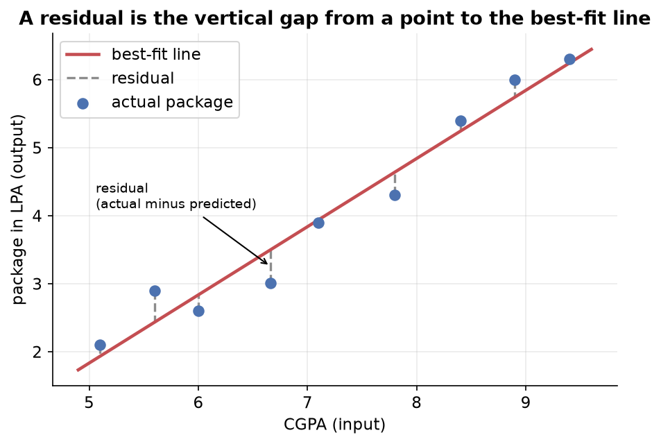

---
tags:
  - regression
  - linear-regression
  - simple-linear-regression
  - ordinary-least-squares
  - residuals
aliases:
  - Simple Linear Regression
  - SLR
difficulty: intermediate
prerequisites:
  - Introduction to Linear Regression
created: 2026-10-23
---

> [!info] Where this fits
> This note turns the idea from [[Introduction to Linear Regression]] into a method. You already know linear regression fits a best-fit line $y = mx + b$; here you learn what makes one line better than another, how to measure its error, and how to compute the exact slope and intercept that minimize that error. It sets up [[Multiple Linear Regression]], where the same reasoning extends to many inputs.

Simple linear regression is the one-input case: a single input column and a single output column, fitted with one straight line. This note builds the method from first principles. It starts with the line itself, defines the error a line makes through residuals, turns that error into a function to minimize, and then derives the closed-form formulas for the slope and intercept that make the error as small as possible.

---

## The best-fit line

Recall the running example: each student has a cumulative grade point average (CGPA) as the input and a salary package as the output, and the points trend upward without lying on a perfect line. Linear regression fits the single line that sits as close as possible to all of them at once.

A straight line is described by two numbers:

$$
y = mx + b
$$

where:

- $x$ is the input (CGPA) and $y$ is the predicted output (package).
- $m$ is the **slope**, how much the predicted package rises for each one-point rise in CGPA. It controls how steeply the line tilts.
- $b$ is the **y-intercept**, the value of $y$ where the line crosses the vertical axis, which is the prediction when $x$ is zero.

**The best-fit line is the single line, out of all possible lines, that comes closest to every data point.** Fitting the model means finding the one pair $(m, b)$ that achieves this. Every other choice of slope and intercept gives a line that sits worse against the data.

> [!tip] Two ways to move a line
> There are exactly two ways to change a line in two dimensions: change its slope $m$ to rotate it, or change its intercept $b$ to slide it up or down. Every candidate line is just some combination of those two moves, so finding the best line means searching over $m$ and $b$.

---

## Residuals and the error function

To say one line is better than another, you need to measure how wrong a line is. Look at a single student. The data gives their actual package, but the line predicts a package from their CGPA. The two rarely match, and the vertical gap between them is the line's error for that student.

**A residual is the vertical distance from a data point to the line, that is, the actual output minus the predicted output.** It is measured straight up or down, not at an angle, because the input is fixed and only the output is being predicted.

Write the actual output of the $i$-th point as $y_i$ and the line's prediction as $\hat{y}_i$, read as "y-hat", the standard notation for a predicted value. The residual for that point is:

$$
d_i = y_i - \hat{y}_i
$$

A point above the line gives a positive residual, and a point below gives a negative one. To score the whole line you want one number for the total error, so you combine the residuals across all $n$ points. Adding them raw does not work: positive and negative residuals cancel, so a line that is badly wrong on both sides could score zero. The fix is to **square each residual before summing**, which makes every term positive and cannot cancel.

**The error function, also called the loss function, is the sum of squared residuals:**

$$
E = \sum_{i=1}^{n} (y_i - \hat{y}_i)^2
$$

where $n$ is the number of data points, $y_i$ is the actual output of point $i$, and $\hat{y}_i$ is the predicted output of point $i$. This one number measures how badly a given line fits: a smaller $E$ means a line closer to the data. The best-fit line is the one that makes $E$ as small as possible.

> [!warning] Why square instead of taking absolute values
> Squaring is not the only way to remove signs; you could sum the absolute values $\lvert d_i \rvert$ instead. Squaring is preferred for two reasons. First, it **penalizes large errors more heavily**, since a residual twice as big contributes four times as much, which pushes the line to avoid big misses. Second, the squared function is **smooth and differentiable everywhere**, whereas the absolute value has a sharp corner at zero that cannot be differentiated. The derivation below relies on differentiating the error, so a smooth function is what makes the closed-form solution possible.

The slope and intercept are hidden inside the error. Because $\hat{y}_i = m x_i + b$, the error function written in full is:

$$
E = \sum_{i=1}^{n} (y_i - m x_i - b)^2
$$

Here $x_i$ and $y_i$ are fixed by the data and cannot change. Only $m$ and $b$ are free. **The error is a function of $m$ and $b$**, and the whole task is to choose the pair that minimizes it.

---

## How to find m and b

There are two routes to the minimizing $(m, b)$. A **closed-form solution** is a direct formula you plug numbers into, the way the quadratic formula solves a quadratic equation in one step. A **non-closed-form solution** reaches the answer by repeated approximation instead. Simple linear regression has a closed-form solution called **ordinary least squares (OLS)**, and that is what this section derives. The iterative route, gradient descent, becomes the better choice only in very high dimensions where the direct formula gets expensive, and it is covered later.

The error $E$ depends on two variables, so its minimum is where it is flat in both directions at once. From calculus, a smooth function is at a minimum where its slope is zero. With two variables you take the **partial derivative** with respect to each one, the rate of change in that one direction while the other is held fixed, and set both to zero:

$$
\frac{\partial E}{\partial m} = 0
\qquad\text{and}\qquad
\frac{\partial E}{\partial b} = 0
$$

Solving these two equations gives the two unknowns $m$ and $b$.

### Solving for the intercept

Start with the derivative with respect to $b$, applying the chain rule to each squared term:

$$
\begin{aligned}
\frac{\partial E}{\partial b}
  &= \sum_{i=1}^{n} 2 (y_i - m x_i - b)(-1) = 0 \\
  &\Rightarrow \sum_{i=1}^{n} (y_i - m x_i - b) = 0 \\
  &\Rightarrow \sum_{i=1}^{n} y_i - m \sum_{i=1}^{n} x_i - n b = 0
\end{aligned}
$$

The last step uses the fact that summing the constant $b$ over $n$ points gives $n b$. Dividing through by $n$ turns the sums into means, where $\bar{y}$ is the mean of the outputs and $\bar{x}$ is the mean of the inputs:

$$
\bar{y} - m \bar{x} - b = 0
\qquad\Rightarrow\qquad
b = \bar{y} - m \bar{x}
$$

This says the best-fit line always passes through the point of averages $(\bar{x}, \bar{y})$. Once the slope is known, the intercept follows at once.

### Solving for the slope

Substitute $b = \bar{y} - m \bar{x}$ back into the error, then take the derivative with respect to $m$ and set it to zero:

$$
\begin{aligned}
\frac{\partial E}{\partial m}
  &= \sum_{i=1}^{n} 2 \big(y_i - m x_i - \bar{y} + m \bar{x}\big)(-x_i + \bar{x}) = 0 \\
  &\Rightarrow \sum_{i=1}^{n} \big[(y_i - \bar{y}) - m(x_i - \bar{x})\big](x_i - \bar{x}) = 0 \\
  &\Rightarrow \sum_{i=1}^{n} (x_i - \bar{x})(y_i - \bar{y}) = m \sum_{i=1}^{n} (x_i - \bar{x})^2
\end{aligned}
$$

Rearranging for $m$ gives the ordinary least squares slope:

$$
m = \frac{\displaystyle\sum_{i=1}^{n} (x_i - \bar{x})(y_i - \bar{y})}{\displaystyle\sum_{i=1}^{n} (x_i - \bar{x})^2}
$$

where $x_i$ and $y_i$ are the input and output of point $i$, and $\bar{x}$ and $\bar{y}$ are their means. The numerator measures how the two variables vary together, and the denominator measures how the input varies on its own.

**The two formulas together are the whole of simple linear regression.** Compute $m$ from the formula above, then $b = \bar{y} - m\bar{x}$, and the best-fit line is fixed. These are exactly the formulas a standard library uses internally when it fits a simple linear model.

---

## A worked example

Take a tiny dataset of three points so the arithmetic stays visible, with input $x$ and output $y$:

| $x$ | $y$ |
| :--- | :--- |
| 1 | 2 |
| 2 | 3 |
| 3 | 5 |

First find the means, then the deviations each point makes from its mean, and assemble the slope:

$$
\begin{aligned}
\bar{x} &= \frac{1 + 2 + 3}{3} = 2, \qquad \bar{y} = \frac{2 + 3 + 5}{3} = \frac{10}{3} \approx 3.33 \\[4pt]
\sum (x_i - \bar{x})(y_i - \bar{y})
  &= (1-2)(2-3.33) + (2-2)(3-3.33) + (3-2)(5-3.33) \\
  &= (-1)(-1.33) + 0 + (1)(1.67) = 1.33 + 1.67 = 3 \\[4pt]
\sum (x_i - \bar{x})^2
  &= (1-2)^2 + (2-2)^2 + (3-2)^2 = 1 + 0 + 1 = 2 \\[4pt]
m &= \frac{3}{2} = 1.5 \\[4pt]
b &= \bar{y} - m\bar{x} = 3.33 - (1.5)(2) = 3.33 - 3 = 0.33
\end{aligned}
$$

The best-fit line is $y = 1.5x + 0.33$. To check it, predict the output at $x = 2$: $\hat{y} = 1.5(2) + 0.33 = 3.33$, close to the actual value of $3$, with the small gap being the residual the line could not remove. Feeding in any new input now returns a prediction straight from the line.

> [!example] Reading the slope and intercept
> The slope $1.5$ says the output rises by $1.5$ for every one-unit rise in the input. The intercept $0.33$ is the predicted output when the input is zero. On the placement data the fitted line came out near $y = 0.55x + 0.89$, so each extra CGPA point was worth about $0.55$ lakhs of package.

---

## Summary

1. Simple linear regression fits one straight line $y = mx + b$ to data with a single input and a single output, where $m$ is the slope and $b$ is the intercept.
2. A **residual** is the vertical distance from a point to the line, the actual output $y_i$ minus the predicted output $\hat{y}_i$.
3. The **error function** is the sum of squared residuals, $E = \sum (y_i - \hat{y}_i)^2$; squaring stops positive and negative residuals from cancelling, penalizes large errors, and keeps the function differentiable.
4. The best-fit line is the pair $(m, b)$ that minimizes $E$, found by setting both partial derivatives to zero.
5. The closed-form **ordinary least squares** solution is $m = \frac{\sum (x_i - \bar{x})(y_i - \bar{y})}{\sum (x_i - \bar{x})^2}$ and $b = \bar{y} - m\bar{x}$, so the line always passes through the point of averages.
6. These formulas compute the exact answer directly, which is why they suit the one-input case; an iterative method is reserved for very high dimensions.

---

> [!info] Continues to
> The next note extends the line to a plane and a hyperplane when there is more than one input, in [[Multiple Linear Regression]].
