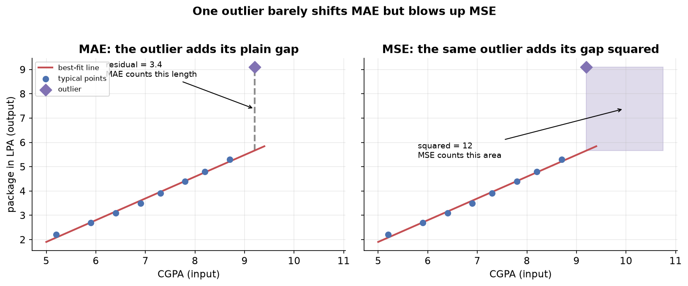
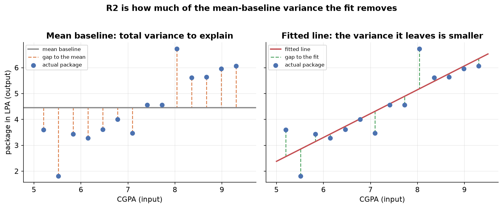

---
tags:
  - regression
  - linear-regression
  - regression-metrics
  - r-squared
  - model-evaluation
aliases:
  - Regression Metrics
  - R2 Score
  - Adjusted R2
difficulty: intermediate
prerequisites:
  - Multiple Linear Regression
created: 2026-10-23
---

> [!info] Where this fits
> You can now fit a line, a plane, or a hyperplane with [[Multiple Linear Regression]]. The next question is whether the fit is any good. This note defines the standard scores for a regression model: mean absolute error, mean squared error, root mean squared error, the R2 score, and the adjusted R2 score. Each one turns the residuals you already know into a single number you can report and compare.

A fitted model is not the end of the job. You still need to say how close its predictions land to the real outputs, in a number you can quote to someone else and track as you improve the model. This note builds five such metrics from the same raw material, the residual, and shows what each one rewards, what units it carries, and when it misleads.

---

## Why we need metrics

Fitting finds the model that sits as close as possible to the data, but "as close as possible" is not a score you can report. Two models can both be best-fits for their own setups, and you still have to decide which predicts better, or whether either is good enough to trust.

**A regression metric collapses all the residuals into one number that measures how far the predictions sit from the actual outputs.** A residual is the gap between an actual output and the model's prediction for that row:

$$
e_i = y_i - \hat{y}_i
$$

where $y_i$ is the actual output of row $i$ and $\hat{y}_i$ is the model's prediction for it. Every metric below is a different way of summarizing these residuals across all rows.

> [!note] One target, two uses
> Some of these numbers double as a loss function, the quantity the fitting process drives down, and some serve only to report quality after the fact. The difference comes down to whether the metric is smooth enough to optimize, which is called out for each one.

---

## Mean absolute error (MAE)

Start with the most direct question: on average, how far off is a prediction? Take each residual, drop its sign so overshoots and undershoots both count as error, and average.

**Mean absolute error is the average of the absolute residuals:**

$$
\text{MAE} = \frac{1}{n} \sum_{i=1}^{n} \lvert y_i - \hat{y}_i \rvert
$$

where $n$ is the number of rows, $y_i$ is the actual output, and $\hat{y}_i$ is the prediction. The absolute value is what stops positive and negative residuals from cancelling.

MAE has two properties worth holding onto:

- **Same units as the target.** If the output is a package in lakhs per annum (LPA), then MAE is in LPA too. A MAE of 1.5 reads directly as "the model is off by about 1.5 LPA on average", which makes it easy to explain.
- **Robust to outliers.** A single wildly wrong point adds only its own distance to the sum, so one bad row cannot dominate the score.

> [!warning] MAE is awkward to optimize
> The absolute value has a sharp corner at zero, so its graph is not differentiable there. Optimization methods that rely on a smooth slope cannot be applied to it directly, which is the main reason a squared metric is often preferred as the quantity to minimize.

---

## Mean squared error (MSE)

Replace the absolute value with a square. Squaring also removes the sign, but it changes the character of the score: large misses are punished far more than small ones.

**Mean squared error is the average of the squared residuals:**

$$
\text{MSE} = \frac{1}{n} \sum_{i=1}^{n} (y_i - \hat{y}_i)^2
$$

with the same symbols as before. Nothing changed except that each residual is squared rather than taken in absolute value.

The square drives the two defining traits of MSE:

- **Differentiable everywhere.** The squared function is smooth, with no corner, so it has a well-defined slope at every point. This is why MSE, not MAE, is the standard loss function that fitting minimizes.
- **Squared units, so harder to read.** If the target is in LPA, MSE is in LPA squared. A value of 0.12 LPA squared has no direct real-world meaning; you would have to take its square root before it means anything.

> [!warning] MSE overreacts to outliers
> Because each residual is squared, a point far from the line contributes its distance squared. A residual of 3 adds 9, a residual of 6 adds 36. One extreme outlier can therefore swamp the score, so MSE is not robust to outliers. That sensitivity is useful when large errors truly matter more, and harmful when the outlier is just noise.

---

## Root mean squared error (RMSE)

MSE optimizes well but reports in squared units. Taking its square root fixes the reporting problem while keeping the smooth shape.

**Root mean squared error is the square root of the mean squared error:**

$$
\text{RMSE} = \sqrt{\frac{1}{n} \sum_{i=1}^{n} (y_i - \hat{y}_i)^2}
$$

The root undoes the squaring of the units, so RMSE lands back in the target's units, LPA in the running example. A reader can interpret it the way they interpret MAE, as a typical error in the original scale.

RMSE keeps the useful parts of MSE and inherits one drawback:

- **Same units as the target**, so it is easy to communicate, like MAE.
- **Differentiable**, since it is a smooth function of MSE, so it can still be used in optimization.
- **Not robust to outliers**, because the squaring inside still inflates large residuals before the root is taken. The root shrinks the final number but does not undo the extra weight the outlier already received.

> [!tip] Compute all three, then choose
> MAE, MSE, and RMSE do not always agree on which model is better, and as a beginner it is hard to know in advance which one fits the situation. A safe habit is to compute all three on a problem, then reason about the trade-off: reach for MAE when outliers are noise you want to shrug off, and for MSE or RMSE when large errors are genuinely the ones that hurt.

---

## R2 score

The error metrics answer "how far off are we" but not "how far off compared to what". A MAE of 1.5 LPA could be excellent or terrible depending on the data. The R2 score fixes this by comparing the model against the dumbest reasonable predictor.

Imagine you had no input columns at all, only the past packages. The best guess you could make for any new student is the **mean** of the packages you have seen. That flat mean line is the baseline. R2 asks how much better the fitted model does than that baseline.

**The R2 score, also called the coefficient of determination, is one minus the ratio of the model's squared error to the baseline's squared error:**

$$
R^2 = 1 - \frac{\sum_{i=1}^{n} (y_i - \hat{y}_i)^2}{\sum_{i=1}^{n} (y_i - \bar{y})^2}
$$

where $\hat{y}_i$ is the model's prediction, $\bar{y}$ is the mean of the actual outputs, and the two sums are:

- the **sum of squared residuals** (the numerator), how much error the fitted model leaves, and
- the **total sum of squares** (the denominator), how much error the mean baseline leaves.

The ratio is the fraction of the baseline error the model still has left. Subtracting it from one gives the fraction of error the model removed, which is why R2 is read as the **proportion of variance in the output that the inputs explain**. An R2 of 0.80 means the inputs account for 80 percent of the variation in the output, and the remaining 20 percent comes from factors the model does not capture.

How to read the value:

| R2 value | Meaning |
| :--- | :--- |
| 1 | The model's residuals are all zero; it fits perfectly. |
| Close to 1 | The model explains most of the variation; a strong fit. |
| 0 | The model is no better than guessing the mean every time. |
| Negative | The model is worse than the mean baseline. |

> [!note] How R2 reaches 0 and goes negative
> R2 is zero when the fitted model's squared error equals the baseline's, so the ratio is one and one minus one is zero. It turns negative when the fitted model's squared error is larger than the baseline's, meaning the line predicts worse than simply always guessing the mean. That happens when you force a straight line through data that is strongly non-linear, and it is a signal that the model is a poor choice, not just a weak one.

---

## Adjusted R2 score

R2 has one flaw that matters the moment you work with multiple inputs: **adding any input column, even a useless one, can never lower R2.** More columns give the fit more freedom, so the squared residuals can only stay the same or shrink, which means R2 only rises or holds.

That is fine when the new column is relevant, like adding an aptitude score that genuinely relates to the package. It is a problem when the new column is irrelevant, like the temperature on the day of the interview. R2 may still tick up or hold steady, falsely suggesting the junk column helped. A metric that rewards adding noise cannot be trusted to compare models with different numbers of inputs.

**The adjusted R2 score corrects R2 by penalizing the number of input columns, so an irrelevant column makes it fall:**

$$
R^2_{\text{adj}} = 1 - \frac{(1 - R^2)(n - 1)}{n - k - 1}
$$

where $R^2$ is the ordinary R2 score, $n$ is the number of rows, and $k$ is the number of input columns. With one input $k = 1$, with CGPA and an aptitude score $k = 2$, and so on.

The formula works through the $k$ in the denominator:

- **Add an irrelevant column.** $k$ rises, so the denominator $n - k - 1$ shrinks, which inflates the fraction. Meanwhile $R^2$ barely moves because the column is useless. The inflated fraction, subtracted from one, pulls adjusted R2 **down**.
- **Add a relevant column.** $k$ still rises, but $R^2$ jumps because the column truly explains variance. The jump in $R^2$ shrinks the $(1 - R^2)$ term faster than the smaller denominator inflates the fraction, so adjusted R2 goes **up**.

So adjusted R2 rewards columns that earn their place and punishes those that do not. In practice you report both: if adjusted R2 sits well below R2, some of your inputs are not pulling their weight.

> [!tip] Use adjusted R2 to compare models of different sizes
> Whenever you add or drop features, compare adjusted R2 rather than R2. R2 alone will always prefer the model with more columns, so it cannot tell you whether the extra columns are worth keeping. Adjusted R2 can.

---

## Choosing a metric

Each metric summarizes the residuals differently, so they suit different jobs. This table gathers the trade-offs in one place.

| Metric | What it measures | Units | Sensitivity to outliers |
| :--- | :--- | :--- | :--- |
| MAE | Average size of the error | Same as the target | Low, robust |
| MSE | Average squared error, usable as a loss | Target squared | High, overreacts |
| RMSE | Typical error, back in target units | Same as the target | High, overreacts |
| R2 | Fraction of variance the inputs explain | None, a ratio | Inherited through its squared terms |
| Adjusted R2 | R2 penalized for extra input columns | None, a ratio | Inherited through R2 |

---

## Summary

1. Every regression metric summarizes the **residuals** $y_i - \hat{y}_i$ into a single score you can report and compare.
2. **MAE** averages the absolute residuals: same units as the target, robust to outliers, but not differentiable at zero so awkward to optimize.
3. **MSE** averages the squared residuals: differentiable so usable as a loss, but in squared units and sensitive to outliers because squaring inflates large errors.
4. **RMSE** is the square root of MSE: back in the target's units and still differentiable, but it keeps MSE's sensitivity to outliers.
5. **R2** compares the model to a mean baseline, $R^2 = 1 - \frac{\text{SSR}}{\text{SST}}$: it reads as the fraction of variance explained, scores 0 when the model only matches the mean, and goes negative when the model does worse than the mean.
6. **Adjusted R2** penalizes R2 by the number of input columns $k$, so it falls when an irrelevant column is added and rises only when a column genuinely helps, which makes it the metric to compare models of different sizes.

---

> [!info] Continues to
> Fitting these models rests on minimizing an error function, which is a problem of finding a minimum. The tools for that are the subject of [[Optimization]].
