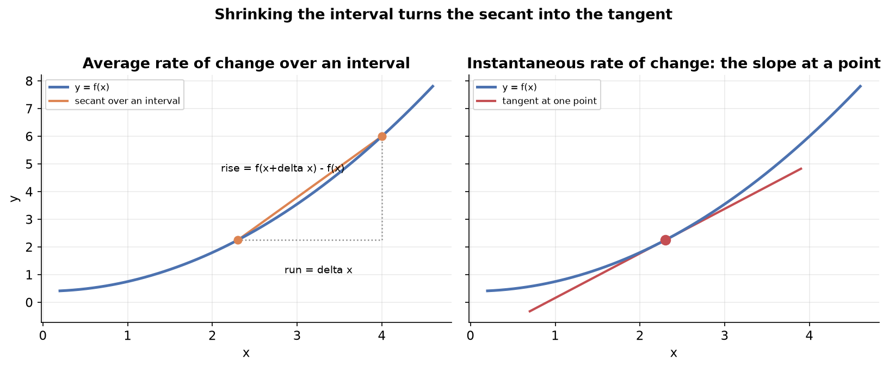
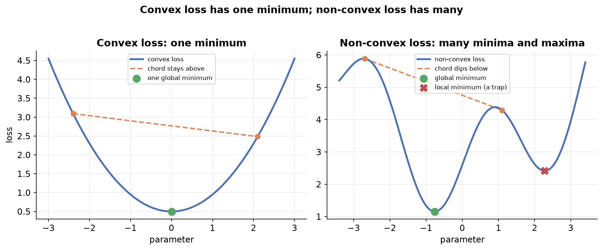
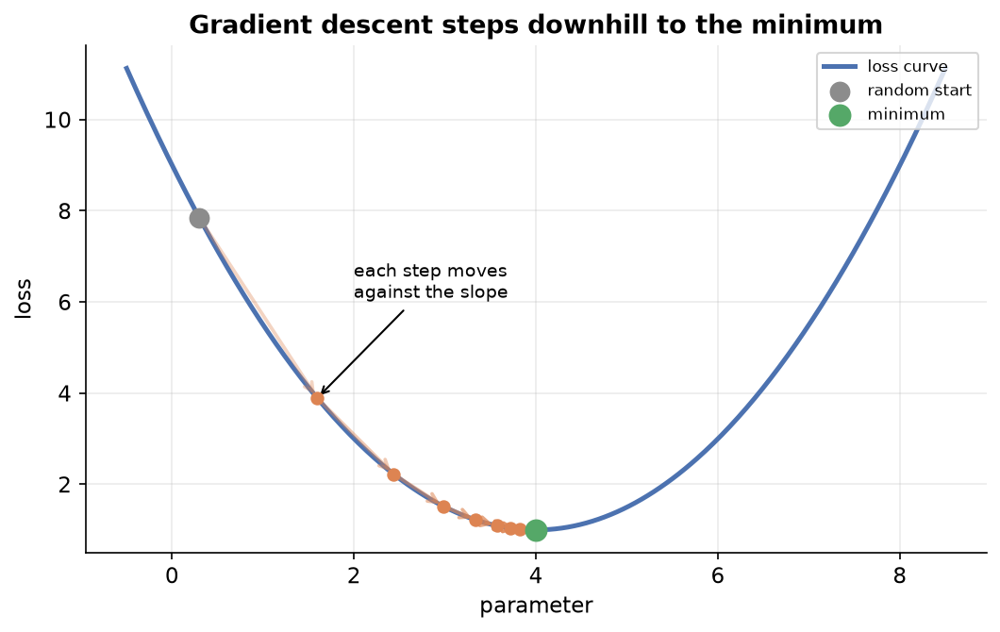

---
tags:
  - regression
  - optimization
  - loss-functions
  - calculus
  - gradient-descent
aliases:
  - Optimization
  - Loss Functions
  - Optimization Theory
difficulty: advanced
prerequisites:
  - Multiple Linear Regression
created: 2026-10-23
---

> [!info] Where this fits
> You can fit a model with [[Introduction to Linear Regression|Linear Regression]] and score it with [[Regression Metrics]]. This note answers the question underneath both: how does fitting actually find the best parameters? The answer is optimization, the branch of mathematics that minimizes a loss, and the calculus it rests on. Everything here sets up the algorithm that does the work.

Fitting a model means choosing the parameter values that make its predictions as close as possible to the data. That phrase hides a precise mathematical problem: build a function that measures how wrong the model is, then find the parameters that make that function as small as possible. This note builds that idea from first principles. It starts with what a function is, reframes a machine learning model as a function, defines the loss you minimize, and introduces gradient descent as the general tool for the minimization. Along the way it teaches the slice of calculus that gradient descent needs, so the mechanics are never a black box.

---

## Functions as input-to-output rules

Before anything else, be precise about the word function, because the whole topic rests on it. A **function** is a rule that takes an input and returns an output, with one firm guarantee: the same input always produces the same output.

You write it as $y = f(x)$, read as "y is a function of x", where $x$ is the input and $y$ is the output. The symbol $f$ stands for the rule itself. If the rule is $f(x) = x^2 + 2x$, then feeding in $x = 2$ gives $f(2) = 4 + 4 = 8$. Feed in different inputs and you trace out a whole graph of input-output pairs.

This is the same idea you met in school, and it is also what a function does in code: given arguments, it returns a value by a fixed rule. Hold on to the guarantee, because it is exactly what lets a model behave predictably.

---

## Multivariable functions

A function need not take a single input. A **multivariable function** depends on two or more inputs at once.

Write $z = f(x, y)$ when the output $z$ depends on both $x$ and $y$. For example $f(x, y) = x^2 + y^2$ takes a pair of inputs and returns one number. The same guarantee holds: one combination of inputs always gives one output.

The number of inputs sets the shape of the graph:

- **One input** gives a 2D graph, a curve in the plane.
- **Two inputs** give a 3D graph, a surface.
- **$n$ inputs** give a graph in $n + 1$ dimensions, which you can no longer draw but can still reason about.

There is no limit on the number of inputs $x_1, x_2, \ldots, x_n$. This matters because real models take many inputs, so their functions live in high dimensions.

---

## Parameters in a function

Inputs are not the only things a function depends on. A **parameter** is a constant built into the rule that shapes the function's behavior, separate from the input you feed in.

Take $f(x) = a x^2$. Here $x$ is the input, but $a$ is a parameter. Plot $y = x^2$ and $y = 5x^2$ side by side: both are parabolas, but the second is far steeper. Push $a$ higher still and the parabola grows sharper. The input has not changed; the parameter has reshaped the rule.

> [!example]
> The quadratic $a x^2 + b x + c$ has one input $x$ and three parameters $a$, $b$, and $c$. Changing $a$, $b$, or $c$ moves and reshapes the curve without touching any input. A parameter is a knob on the function: turn it and the behavior changes.

Keep this split clear. The input is what you give the function at use time; the parameters are the settings that define which function it is. Fitting a model is the act of turning those knobs to the right values.

---

## A machine learning model is a mathematical function

Here is the reframing that drives everything. **A machine learning model is a mathematical function**: it takes the input columns and returns a prediction of the output column.

Suppose you have data with CGPA and IQ as inputs and placement package as the output. A model that predicts the package from CGPA and IQ is a function with two inputs and one output. Building the model means finding a function that maps each input pair to the correct output.

For linear regression with two inputs, that function has a fixed form:

$$
\hat{y} = \beta_0 + \beta_1 x_1 + \beta_2 x_2
$$

where $x_1$ is CGPA, $x_2$ is IQ, $\hat{y}$ is the predicted package, and $\beta_0$, $\beta_1$, $\beta_2$ are the parameters. Once you commit to linear regression, the form of the function is settled. The only thing left to find is the right values of $\beta_0$, $\beta_1$, and $\beta_2$. That is why functions and parameters came first: the entire fitting problem reduces to choosing parameter values.

> [!note] The prediction is approximate, not exact
> A model rarely reproduces every output exactly, and it does not need to. Treating the model as a function is a working assumption that makes the next steps precise, not a claim that the fit is perfect.

---

## Parametric and non-parametric models

Models split into two families by how they treat the data, and the split decides whether optimization even applies.

A **parametric model** makes an assumption about the shape of the data and works with a fixed number of parameters. Linear regression is the clearest case: it assumes the data is linearly distributed, so it can be modeled by a line, a plane, or a hyperplane, and it carries a fixed set of parameters. Add or remove rows of data and the number of parameters does not change.

A **non-parametric model** makes no such assumption about the data's shape and does not fix its parameter count in advance. A decision tree is an example: hand it any data and it adapts its structure to fit.

| Property | Parametric model | Non-parametric model |
| :--- | :--- | :--- |
| Assumption about the data | Assumes a shape, e.g. linear | Makes no shape assumption |
| Number of parameters | Fixed, independent of row count | Grows or adapts with the data |
| Examples | Linear regression, neural networks | Decision trees, k-nearest neighbors |

> [!example]
> A neural network is parametric. Its parameters are the weights, and the architecture fixes how many there are. Feed it more rows and the weight count stays the same, exactly as the three betas of linear regression stay three regardless of how many students you add.

This note is about parametric models. They are where optimization lives, because fitting them means searching a fixed set of parameters for the values that predict best. Non-parametric models are tuned differently, which is a separate topic.

---

## The loss function

Start fitting with the obvious plan: guess parameter values and see how the model does. Pick random values for $\beta_0$, $\beta_1$, $\beta_2$, predict $\hat{y}$ for every row, and compare each prediction against the actual output $y$. Early guesses predict badly, so you need a single number that says how badly.

A **loss function**, also called a cost function or objective function, is a function that measures how far the model's predictions sit from the actual target values.

A first attempt might sum the raw gaps $y - \hat{y}$ across all rows, but positive and negative gaps cancel. A loss that fixes this, and the one linear regression uses, is the mean squared error:

$$
L(\beta_0, \beta_1, \beta_2) = \frac{1}{n} \sum_{i=1}^{n} (y_i - \hat{y}_i)^2
$$

where $n$ is the number of rows, $y_i$ is the actual output of row $i$, and $\hat{y}_i$ is the model's prediction for it. Read the notation on the left carefully: the loss is written as a function of the parameters, because for a fixed data set the loss depends only on the parameter values you chose.

This is the central definition of the whole topic:

> [!note] What optimization is
> The goal of training a parametric model is to find the parameter values that make the loss function as small as possible. Minimizing the loss is optimization. The loss is the guiding force: minimize it, and the parameters that achieve the minimum are the best fit.

So the problem is now sharp. You have a loss $L(\beta_0, \beta_1, \beta_2)$, and you want the parameter values for which it is smallest.

---

## How to select a good loss function

A natural question follows: why not use one loss for everything? Why do mean squared error, mean absolute error, Huber loss, log loss, and others all exist? Because no single loss fits every situation. The right loss depends on the problem and on what you need from the number.

Several factors drive the choice:

- **The kind of problem.** A regression problem, where the output is a number, needs a different loss from a classification problem, where the output is a class. The two measure error in fundamentally different ways.
- **Interpretability.** Sometimes you want the loss itself to read in meaningful units, so you can understand the error at a glance.
- **Differentiability.** This one is decisive for optimization. The loss must be smooth enough to optimize, and some otherwise reasonable losses are not.

The differentiability point deserves care, because it links straight to the calculus ahead.

> [!warning] A loss with a corner cannot be optimized smoothly
> Consider a loss built on the absolute value, whose graph has a sharp corner at zero. That corner is not differentiable: the function has no well-defined slope there. Since optimization follows the slope of the loss, a loss with a corner breaks the method. This is why a squared loss, smooth everywhere, is usually preferred as the quantity to minimize.

Whatever loss you choose, its job never changes. It guides you toward the right parameter values. Minimize it, and you have fit the model.

---

## Instantaneous rate of change: the heart of the derivative

To minimize a loss by following its slope, you need the derivative, and the derivative rests on one subtle idea worth getting exactly right. **Differentiation** is the process of finding the derivative of a function, and the **derivative** is the instantaneous rate of change of the output with respect to the input.

The word instantaneous is doing real work. A plain rate of change is measured over an interval. Take two points, $x$ and $x + \Delta x$, where $\Delta x$ is the gap between them. The rate of change over that interval is:

$$
\frac{f(x + \Delta x) - f(x)}{\Delta x}
$$

which reads as "how much the output changed, divided by how much the input changed". That is an average across the whole interval, not the rate at a single point.

> [!example]
> A car's distance is a function of time. Over the interval from 0 to 4 seconds it covers 16 meters, so its average speed is 4 meters per second. But what is the car's speed at exactly 4 seconds, the number on the speedometer? Average speed over an interval cannot answer that, just as a photograph of a moving car cannot tell you how fast it is going. The question is about a single instant.

The derivative solves this by shrinking the interval. Let $\Delta x$ become so small it tends toward zero, and the interval collapses to a single point:

$$
\frac{df}{dx} = \lim_{\Delta x \to 0} \frac{f(x + \Delta x) - f(x)}{\Delta x}
$$

Now the rate of change is measured at one point, not across a span. That is the instantaneous rate of change, and it is what differentiation computes.

---

## The derivative as a slope

Shrinking the interval has a clean geometric meaning, and it is the reason "take the derivative" and "find the slope" are used interchangeably.

Draw a curve and pick two points on it, $x$ and $x + \Delta x$. The line through those two points is a secant, and its steepness is the average rate of change over the interval. Now slide the second point toward the first by shrinking $\Delta x$. The secant pivots, and as $\Delta x$ reaches zero the two points merge: the secant becomes a tangent line touching the curve at a single point.

So $\dfrac{df}{dx}$ at a point is the slope of the tangent there. This unlocks the use that matters for optimization: finding minima and maxima.

**At a minimum or a maximum, the tangent is flat, so the slope is zero.** These flat-slope points are called **critical points**. If you can write the slope as a function and set it to zero, you can solve for the inputs where the curve turns, the candidate minima and maxima.

> [!example]
> For $f(x) = x^2 + 2x$, the derivative is $\dfrac{df}{dx} = 2x + 2$. Setting it to zero gives $x = -1$, the input where the slope is flat, which is the minimum of this upward parabola.

---

## Computing a derivative from first principles

The rules you may have memorized come straight from the limit definition. Working one case by hand shows the rules are not arbitrary.

Take $f(x) = x^2$ and apply the definition:

$$
\begin{aligned}
\frac{df}{dx} &= \lim_{\Delta x \to 0} \frac{(x + \Delta x)^2 - x^2}{\Delta x} \\
&= \lim_{\Delta x \to 0} \frac{x^2 + 2x\,\Delta x + (\Delta x)^2 - x^2}{\Delta x} \\
&= \lim_{\Delta x \to 0} \frac{2x\,\Delta x + (\Delta x)^2}{\Delta x} \\
&= \lim_{\Delta x \to 0} \left( 2x + \Delta x \right) = 2x
\end{aligned}
$$

The $x^2$ terms cancel, every surviving term carries a $\Delta x$ that divides out, and sending $\Delta x$ to zero drops the last term. The result, $2x$, is the power rule in action. A handful of rules cover almost everything you meet.

| Rule | Function | Derivative |
| :--- | :--- | :--- |
| Constant | $f(x) = c$ | $0$ |
| Power | $f(x) = x^n$ | $n x^{n-1}$ |
| Sum | $f(x) = g(x) + h(x)$ | $g'(x) + h'(x)$ |
| Product | $f(x) = g(x)\,h(x)$ | $g'(x)\,h(x) + g(x)\,h'(x)$ |
| Quotient | $f(x) = \dfrac{g(x)}{h(x)}$ | $\dfrac{g'(x)\,h(x) - g(x)\,h'(x)}{h(x)^2}$ |
| Chain | $f(x) = g(h(x))$ | $g'(h(x)) \cdot h'(x)$ |

> [!tip] The chain rule is the engine of deep learning
> The chain rule handles a function inside a function, $g(h(x))$: differentiate the outer with respect to the inner, then multiply by the derivative of the inner. For $\sin(x^2)$ the derivative is $\cos(x^2) \cdot 2x$. Deep learning's backpropagation is the chain rule applied across many stacked layers, so this one rule carries a large share of the field.

---

## Derivatives as sensitivity

There is an intuition for the derivative that pays off in machine learning, worth keeping alongside the slope picture.

Think of $y = f(x)$ as two connected knobs. Turning the input knob $x$ by a small amount turns the output knob $y$ by some amount, and $\dfrac{dy}{dx}$ measures that linkage: how much the output moves, and in which direction, for a small nudge of the input. A derivative of $-2$ means a small increase in $x$ pushes $y$ down twice as fast.

This is exactly how a derivative guides fitting. When you differentiate the loss with respect to a parameter, you learn how a small nudge to that parameter changes the loss, and in which direction. If nudging the parameter up lowers the loss, keep going that way; if it raises the loss, go the other way. The derivative tells you which way is downhill.

---

## Higher-order derivatives

You can differentiate a derivative. The result is a **higher-order derivative**, and the second derivative in particular has a clear meaning and a clear use.

The first derivative is the rate of change of the function; the second derivative is the rate of change of the slope.

> [!example]
> For a moving car, the first derivative of distance with respect to time is velocity, and the second derivative is acceleration, the rate at which velocity itself is changing.

The second derivative distinguishes a minimum from a maximum. At a critical point the slope is zero, which alone does not say which kind of turning point it is. Check the second derivative:

- **Second derivative positive:** the curve bends upward, so the critical point is a **minimum**.
- **Second derivative negative:** the curve bends downward, so the critical point is a **maximum**.

> [!note] Second-order methods exist but gradient descent is first-order
> Some optimization methods use second derivatives, collected into a Hessian matrix, as in Newton's method. Gradient descent, the method this track relies on, uses only the first derivative. Keep the two straight: gradient descent is strictly a first-order method.

---

## Partial differentiation

A loss depends on many parameters, so its graph is a surface or higher, and a single slope will not do. **Partial differentiation** finds the slope along one input direction at a time, holding the others constant.

For $z = f(x, y)$ there are two partial derivatives. To get $\dfrac{\partial z}{\partial x}$, differentiate treating $y$ as a constant; to get $\dfrac{\partial z}{\partial y}$, differentiate treating $x$ as a constant. Each one is the slope of the surface in its own direction.

> [!example]
> For $z = x^2 + y^2$, the partial with respect to $x$ is $\dfrac{\partial z}{\partial x} = 2x$, since $y^2$ is constant. The partial with respect to $y$ is $\dfrac{\partial z}{\partial y} = 2y$. At the point $(1, 2)$ the slope in the $x$ direction is 2 and in the $y$ direction is 4.

Collect the partial derivatives, one per parameter, and you have the **gradient**: the full set of slopes that describe how the loss changes in every direction at once. The gradient is what gradient descent follows when a model has more than one parameter.

---

## Matrix differentiation

When a model has many parameters, writing each partial derivative separately is unwieldy, so the derivatives are expressed compactly with matrices and vectors. **Matrix differentiation** is differentiation where the quantities are matrices and vectors rather than single numbers.

The rules mirror the scalar ones. For a constant matrix $A$ and a vector $x$, differentiating the product $Ax$ with respect to $x$ gives $A^T$, the matrix counterpart of the scalar rule that $\dfrac{d}{dx}(cx) = c$. For a symmetric matrix $A$, differentiating the quadratic form $x^T A x$ with respect to $x$ gives $2Ax$.

> [!note] You use this without deriving it by hand
> These results are standard, and in practice tools compute them for you. The point here is only that the gradient of a loss over many parameters can be written and handled cleanly in matrix form, which is how the from-scratch implementations express the update. You saw one such expression in the closed-form solution for the regression coefficients.

---

## Convex and non-convex loss functions

The slope-to-zero trick, setting the derivative to zero and solving, sounds like it should fit any model directly. Whether it works depends entirely on the shape of the loss, which is captured by one property.

A **convex function** has a shape where a straight line segment joining any two points on its graph never dips below the graph between them. A **non-convex function** has at least one pair of points whose connecting segment cuts below the curve. The chord test is the quick way to see which you have.

The shape decides how many minima the loss has:

- **A convex loss has exactly one minimum**, the global minimum. Setting the slope to zero lands on it, because there is nowhere else to land.
- **A non-convex loss can have many local minima and maxima.** Setting the slope to zero might land on a local minimum, a maximum, or a flat spot, none of which need be the true global minimum.

> [!tip] Why the slope-to-zero trick worked for linear regression
> The mean squared error loss for linear regression is convex, so solving for a zero slope, the closed-form approach, is valid and lands on the one true minimum. The moment a loss is non-convex, as with neural networks whose activation functions break convexity, that guarantee is gone and you need a different method.

---

## Gradient descent as optimization

Convexity exposes the limits of solving directly, and several other problems finish the case against it.

- **Non-convexity.** A non-convex loss has multiple critical points, so setting the slope to zero can return a local minimum or a maximum rather than the global minimum.
- **Complexity.** For complex losses, as in deep learning with stacked activation functions, no clean closed-form solution for a zero slope may exist.
- **Scalability.** The closed-form regression solution requires inverting $X^T X$. For very large or high-dimensional data that inversion is prohibitively expensive, sometimes effectively impossible.
- **Online learning.** When fresh data streams in continuously, a once-and-done closed-form fit cannot keep absorbing new rows, so a method that updates incrementally is needed.

**Gradient descent** sidesteps all of these. It is an iterative optimization method that starts from a random guess and repeatedly steps in the direction that lowers the loss, following the slope downhill until it reaches a minimum.

The update rule, for a single parameter $\beta_0$, is:

$$
\beta_0^{\text{new}} = \beta_0^{\text{old}} - \eta \, \frac{\partial L}{\partial \beta_0}
$$

where $\eta$ is the **learning rate**, a small positive number, and $\dfrac{\partial L}{\partial \beta_0}$ is the slope of the loss with respect to $\beta_0$. The minus sign is the whole idea: subtracting the slope moves against it, which is always downhill.

- If the slope is negative, subtracting it increases $\beta_0$, stepping to the right toward the minimum.
- If the slope is positive, subtracting it decreases $\beta_0$, stepping to the left toward the minimum.

Either way the step heads downhill, so gradient descent reaches the minimum without ever needing the slope-to-zero equation.

> [!note] The learning rate controls step size
> Without $\eta$ the steps can be large and overshoot, bouncing across the minimum. The learning rate scales each step down, a typical value being around $0.01$, so the parameter settles smoothly rather than leaping past the target. One full pass of the update over the data is called an epoch, and gradient descent repeats for many epochs until it converges.

With more than one parameter, the single slope becomes the gradient, the vector of partial derivatives, and the update subtracts a learning-rate-scaled step along it. The move is against the combined direction of all the slopes at once.

---

## Problems faced in optimization

Gradient descent is powerful but not trouble-free. Several difficulties recur, and naming them now makes them recognizable later.

- **Local minima.** On a non-convex loss, gradient descent can settle into a local minimum and stop, never reaching the lower global minimum, because every nearby step leads uphill.
- **Saddle points.** At a saddle point the slope is close to zero even though it is not a minimum. The update then barely moves, since a near-zero slope times the learning rate is a near-zero step, and progress stalls.
- **Vanishing gradients.** Where the slope is very small, the steps shrink toward nothing and the parameter crawls, taking a long time to move anywhere useful.
- **Exploding gradients.** Where the slope is very large, the steps become huge, overshooting wildly and jumping around without settling on the minimum.
- **Computational cost.** For models with enormous parameter counts, modern networks reach into the billions, computing a derivative for every parameter on every step is expensive, though still far cheaper than inverting a giant matrix.
- **Constraints.** Some problems require minimizing the loss subject to a condition the solution must satisfy. This is constrained optimization, handled by specialized techniques beyond plain gradient descent.

> [!warning] Convexity is the dividing line
> Most of these troubles trace back to non-convexity. On a convex loss there is one minimum and gradient descent heads straight for it. On a non-convex loss the method can stall, get trapped, or wander, which is why the shape of the loss is the first thing to understand about any optimization problem.

---

## Summary

1. A **function** is a rule mapping inputs to outputs where the same input always gives the same output; a **multivariable function** takes several inputs, and its graph gains a dimension per input.
2. A **parameter** is a constant that shapes a function's behavior, distinct from the input; fitting a model is choosing parameter values.
3. A machine learning model is a **mathematical function** from input columns to a predicted output, and for a parametric model like linear regression only the parameter values remain to be found.
4. **Parametric models** assume a data shape and fix their parameter count, so optimization applies to them; **non-parametric models** do neither and are tuned differently.
5. A **loss function** collapses the prediction errors into one number, and training means finding the parameters that minimize it, which is what **optimization** is.
6. The right loss depends on the problem, on interpretability, and above all on **differentiability**, since a loss with a corner cannot be optimized by following its slope.
7. The **derivative** is the instantaneous rate of change, computed by shrinking an interval to a point, and it equals the slope of the tangent, which is zero at minima and maxima.
8. Derivative rules, the constant, power, sum, product, quotient, and chain rules, follow from the limit definition; the **chain rule** underlies backpropagation.
9. **Partial differentiation** gives the slope along one parameter at a time, and the full set of partials is the **gradient**; **second derivatives** tell a minimum from a maximum, and **matrix differentiation** writes many-parameter gradients compactly.
10. A **convex loss** has one global minimum reachable by setting the slope to zero; a **non-convex loss** has many critical points, so that trick fails.
11. **Gradient descent** starts from a random guess and steps against the slope by a learning-rate-scaled amount, converging on a minimum while avoiding the cost, scalability, and non-convexity problems of solving directly.
12. Optimization faces **local minima, saddle points, vanishing and exploding gradients, computational cost, and constraints**, most of which stem from non-convexity.

---

> [!info] Continues to
> You now have the theory: a loss to minimize, the calculus to measure its slope, and the idea of stepping downhill. The next note turns that idea into a working algorithm in [[Gradient Descent]].
