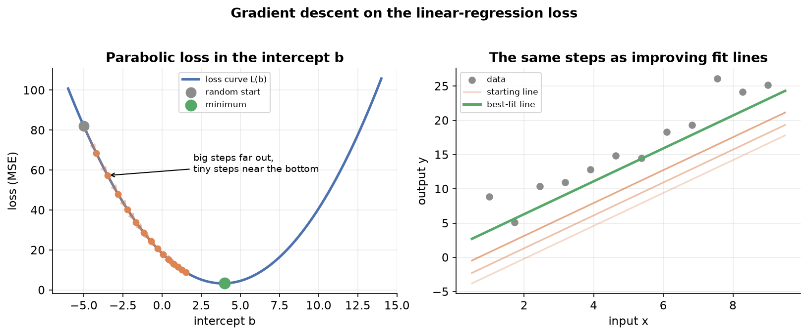
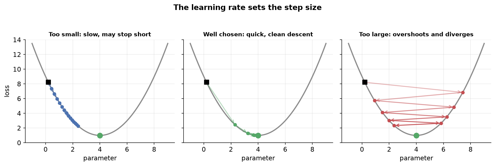
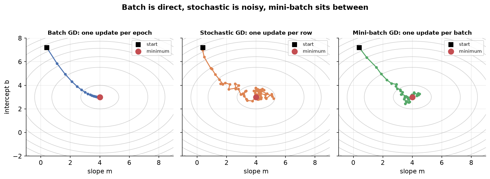

---
tags:
  - regression
  - optimization
  - gradient-descent
  - learning-rate
  - machine-learning
aliases:
  - Gradient Descent
  - Batch Gradient Descent
  - Stochastic Gradient Descent
  - Mini-batch Gradient Descent
difficulty: advanced
prerequisites:
  - Optimization
created: 2026-10-23
---

> [!info] Where this fits
> [[Optimization]] set up the problem: fitting a model means minimizing a loss, and the slope of that loss points the way downhill. This note turns that idea into a working algorithm. Gradient descent is the engine behind fitting a linear regression, and the same engine reappears in logistic regression, neural networks, and most of modern machine learning.

Fitting a model by solving for the parameters directly works for small problems, but it breaks down when the data has many columns, because the direct formula needs to invert a large matrix. Gradient descent avoids that cost. It starts from a guess and walks downhill on the loss, one small step at a time, until it reaches the bottom. This note builds the algorithm from first principles on the linear regression loss, writes it from scratch, studies what the learning rate and the data do to it, and then covers the three variants you will actually use: batch, stochastic, and mini-batch.

---

## What gradient descent is

Imagine standing somewhere on a hillside in thick fog. You cannot see the valley floor, but you can feel which way the ground slopes under your feet. To get down, you take a step in the steepest downhill direction, feel the slope again, and repeat. That is gradient descent.

**Gradient descent is an iterative optimization algorithm that finds a local minimum of a differentiable function by repeatedly stepping in the direction opposite to its slope.** The only thing it needs is that the function be differentiable, so a slope exists at every point.

Two facts make it central to machine learning:

- **It is general.** Give it any differentiable loss and it returns the parameters that minimize that loss. It does not care whether the loss comes from linear regression, logistic regression, or a deep network.
- **It scales.** Unlike the direct matrix formula, it never inverts a matrix, so it stays practical when the data has hundreds or thousands of columns.

> [!note] Gradient is just a slope with more than one input
> When the loss depends on one parameter, its slope is called the **derivative**. When it depends on several parameters at once, the collection of slopes (one per parameter) is called the **gradient**. The algorithm is named after the gradient because real models have many parameters.

---

## Intuition and mathematical formulation

Work on the linear regression loss, because it gives the cleanest picture. Recall from [[Regression Metrics]] that the loss is the sum of squared residuals:

$$
L = \sum_{i=1}^{n} (y_i - \hat{y}_i)^2 = \sum_{i=1}^{n} (y_i - m x_i - b)^2
$$

where $y_i$ is the actual output, $\hat{y}_i = m x_i + b$ is the prediction, $m$ is the slope of the line, and $b$ is the intercept. To keep the picture in two dimensions, fix $m$ at its known best value and let only the intercept $b$ vary. Then $L$ is a function of $b$ alone, and because $b$ enters squared, the graph of $L$ against $b$ is a **parabola**: a bowl with a single lowest point.



The goal is the value of $b$ at the bottom of the bowl, where the loss is smallest. Gradient descent reaches it like this:

1. **Start at a random $b$.** Anywhere on the bowl will do.
2. **Measure the slope there.** Differentiate the loss and plug in the current $b$.
3. **Step against the slope.** Move $b$ a little in the downhill direction.
4. **Repeat** until the steps become tiny.

The update rule captures steps 3 and 4 in one line:

$$
b_{\text{new}} = b_{\text{old}} - \eta \cdot \frac{\partial L}{\partial b}
$$

where $\eta$ (eta) is the **learning rate**, a small positive number that scales the step, and $\frac{\partial L}{\partial b}$ is the slope of the loss at the current $b$.

The minus sign does the steering automatically, which is the clever part:

- If the slope is **negative** (the bowl falls to the right), subtracting a negative number **increases** $b$, moving right toward the bottom.
- If the slope is **positive** (the bowl falls to the left), subtracting a positive number **decreases** $b$, moving left toward the bottom.

Either way, the step heads downhill. The size of each step is the learning rate times the slope, a quantity called the **step size**. Because the slope is steep far from the bottom and shallow near it, the steps are naturally large at first and shrink as $b$ approaches the minimum, so the algorithm slows down right where it needs precision.

> [!tip] When to stop
> Run the update inside a loop. Each pass is one **epoch**. Stop when the change $b_{\text{new}} - b_{\text{old}}$ becomes smaller than a tiny threshold, which means the slope has flattened and further steps gain almost nothing. In practice you often just fix the number of epochs in advance, say 100 or 1000, and read a plot of loss against epoch to confirm it has levelled off.

---

## Code from scratch

Writing the loop makes the algorithm concrete. For the single-parameter case with the slope $m$ fixed, the derivative of the loss with respect to $b$ works out to:

$$
\frac{\partial L}{\partial b} = -2 \sum_{i=1}^{n} (y_i - m x_i - b)
$$

The class below starts the intercept at zero and updates it once per epoch:

```python
import numpy as np

class GDRegressor:
    def __init__(self, learning_rate, epochs):
        self.m = 78.35          # slope, fixed for this example
        self.b = 0              # intercept, the parameter we learn
        self.lr = learning_rate
        self.epochs = epochs

    def fit(self, X, y):
        for _ in range(self.epochs):
            slope = -2 * np.sum(y - self.m * X.ravel() - self.b)
            self.b = self.b - self.lr * slope   # the update rule
        return self

    def predict(self, X):
        return self.m * X.ravel() + self.b
```

Each epoch computes the slope over the whole dataset, then takes a single step. Started from $b = 0$ and run for enough epochs, `self.b` climbs to the true intercept that the direct formula would give.

> [!note] Learning all the parameters at once
> The example fixes $m$ to keep the picture two-dimensional, but real fitting learns every parameter together. With both $m$ and $b$ free, the loss becomes a bowl-shaped surface over two axes, and the slope at any point splits into two **partial derivatives**, one per parameter: $\frac{\partial L}{\partial m}$ and $\frac{\partial L}{\partial b}$. Each parameter gets its own copy of the update rule. The idea is identical; there are simply more slopes to follow.

---

## Effect of the learning rate

The learning rate $\eta$ is the single most important knob, because it sets how far each step moves. Three regimes matter.



| Learning rate | What happens | Consequence |
| :--- | :--- | :--- |
| Too small | Steps are tiny, so $b$ crawls toward the minimum | Needs many epochs; may run out of epochs before arriving |
| Well chosen | A few decisive steps land on the minimum | Fast, stable convergence |
| Too large | Steps overshoot the bottom and bounce side to side | Zig-zags, and if large enough, climbs away and never converges |

There is no universal best value. You try a few, plot the loss against epoch for each, and keep the one that drops fastest without becoming unstable. A rate that is slightly too small is safe but slow; a rate that is too large can diverge entirely and return meaningless numbers.

> [!warning] Too large is worse than too small
> A tiny learning rate only wastes time, and more epochs eventually fix it. A learning rate that is too large can make the loss grow each step until the parameters blow up to huge or infinite values, so the algorithm never reaches the minimum at all. When in doubt, start small.

---

## Effect of the loss function

Nothing in the update rule mentions linear regression. The step needs only the slope of the loss, and the slope comes from differentiating whatever loss you chose.

- For **linear regression**, the loss is the squared error above, and its derivative is the formula already used.
- For **logistic regression**, the loss is a different function called log loss, with a different derivative, but it is still differentiable, so the same update rule applies.
- For a **neural network**, the loss is more elaborate again, yet gradient descent drives the fitting in exactly the same way.

The takeaway is that gradient descent is independent of the model. As long as the loss is differentiable, you can plug its derivative into the update rule and the algorithm works unchanged. This is why one optimization method powers so many different models.

> [!warning] The shape of the loss decides whether you find the best answer
> [[Optimization]] distinguished **convex** losses, which have a single global minimum, from **non-convex** losses, which have several local minima. Gradient descent only guarantees a local minimum, the bottom of whatever valley it started in. On a non-convex loss it can settle into a local minimum and miss the global one, so the starting point matters. The linear regression squared-error loss is convex, a single clean bowl, so gradient descent always reaches the one true minimum regardless of where it starts. The trouble with local minima shows up later, in deep learning.

---

## Effect of the data

The scale of the input columns changes how the loss surface looks, and that changes how quickly gradient descent converges.

- When the input columns are on **similar scales**, the loss surface is a round bowl. Its contour lines are near-circular, and the downhill direction points almost straight at the minimum, so descent is fast and direct.
- When the columns are on **very different scales**, the bowl is stretched into a long, narrow valley. The downhill direction no longer points at the minimum, so the path has to zig-zag across the valley, which takes many more steps.

The practical rule follows: **scale the input columns to a common range before fitting a model with gradient descent.** Scaling reshapes the stretched valley back into a round bowl and lets the algorithm converge quickly. Skipping it does not change the final answer on a convex loss, but it can make the algorithm much slower to get there.

---

## Batch gradient descent

The version written above is **batch gradient descent**, the plainest form.

**Batch gradient descent computes the slope using the entire dataset, then takes one update per epoch.** If the data has 300 rows, it looks at all 300 rows, averages their contribution to the slope, and only then adjusts the parameters once.

For data with many columns, the slope becomes a gradient with one partial derivative per coefficient. The general partial derivative for the coefficient of column $j$ is:

$$
\frac{\partial L}{\partial \beta_j} = -\frac{2}{n} \sum_{i=1}^{n} (y_i - \hat{y}_i) \, x_{ij}
$$

where $n$ is the number of rows, $y_i - \hat{y}_i$ is the residual of row $i$, and $x_{ij}$ is the value of column $j$ in row $i$. Reading it plainly: to update one coefficient, take every row's residual, weight each by that row's value in the matching column, sum, and scale. The intercept $\beta_0$ uses the same formula with its column of values set to one.

This whole set of coefficient derivatives can be computed in a single matrix operation rather than a loop. Each epoch runs that operation once and takes one step.

### Problems with batch gradient descent

Batch gradient descent is clean but struggles as data grows, for two reasons.

- **Heavy computation.** Every epoch differentiates across all rows for every coefficient. With $10^5$ rows, $100$ columns, and $1000$ epochs, that is on the order of $10^{10}$ derivative evaluations, which makes the algorithm slow.
- **Memory limits.** The one-shot matrix operation needs the whole dataset loaded into memory at once. If the data does not fit, the operation fails with an out-of-memory error, so very large datasets cannot be handled this way at all.

Because of these limits, batch gradient descent suits small datasets. It is rarely the first choice in practice, which motivates the next two variants.

---

## Stochastic gradient descent

The fix is to update far more often, using one row at a time instead of all of them.

**Stochastic gradient descent (SGD) updates the parameters once for every single row, so one epoch over $n$ rows produces $n$ updates.** The word stochastic means random: each step picks a row at random, computes the slope from that one row, and immediately updates. With one row, the summation in the derivative disappears entirely.

```python
idx = np.random.randint(0, X_train.shape[0])   # pick a random row
y_hat = np.dot(X_train[idx], self.coef_) + self.intercept_
# update using just this one row's residual, then repeat
```

SGD improves on batch gradient descent on both fronts:

- **Faster convergence.** Many small updates per epoch reach a good answer in far fewer epochs, often five to ten rather than fifty.
- **Tiny memory footprint.** Only one row sits in memory at a time, so even a dataset larger than memory is no problem, and the algorithm never fails on modest hardware.

The randomness has a cost and a hidden benefit:

- **Cost: the path is noisy.** Because each step trusts a single row, progress is not steady. Some steps briefly make the fit worse, so the path wanders instead of heading straight down, and running SGD twice on the same data gives slightly different answers. The final solution is close to optimal but not exactly the best.
- **Benefit: the noise can escape traps.** On a non-convex loss, the random jumps can bounce the algorithm out of a shallow local minimum and on toward the global one, something smooth batch descent cannot do.

> [!tip] Learning schedules tame the noise
> Near the minimum, a fixed learning rate keeps SGD fluctuating instead of settling. A **learning schedule** fixes this by shrinking the learning rate as training proceeds: large steps early for speed, tiny steps late for precision. A common schedule is $\eta(t) = \frac{t_0}{t + t_1}$, where $t$ counts the updates and $t_0$ and $t_1$ are constants. The rate starts high and decays, so the final fluctuation around the minimum gets smaller and smaller. Learning schedules matter more in deep learning than in linear regression, but the idea is worth knowing.

> [!example] When to reach for stochastic gradient descent
> Two situations call for SGD. First, **big data**: when the dataset has many rows and columns, SGD converges faster and sidesteps the memory wall that stops batch descent. Second, a **non-convex loss**: the randomness helps the algorithm slip past local minima toward the global one. For small, convex problems, batch descent is fine, but SGD is the common default elsewhere.

---

## Mini-batch gradient descent

Stochastic descent is fast but very noisy; batch descent is smooth but slow and memory-hungry. Mini-batch sits between them.

**Mini-batch gradient descent splits the data into small groups of rows called batches and takes one update per batch.** If 1000 rows are split into batches of 100, each epoch has 10 batches and so 10 updates: look at a batch, update, look at the next batch, update, and so on.

The batch size is a knob that recovers the other two methods as special cases:

| Batch size | Updates per epoch | Equivalent to |
| :--- | :--- | :--- |
| All $n$ rows | 1 | Batch gradient descent |
| 1 row | $n$ | Stochastic gradient descent |
| A small group, say 32 or 64 | number of batches | Mini-batch gradient descent |

So mini-batch is the general form, and tuning the batch size slides its behaviour anywhere between the two extremes.



Mini-batch takes the best of both worlds: less noise than pure stochastic because each step averages over a batch, yet far cheaper than batch because it never loads all the rows at once. Its path is neither perfectly straight nor wildly random; it heads down with mild wobble. Like stochastic descent, it keeps fluctuating near the minimum, so a learning schedule helps there too. Mini-batch is the default in deep learning; for linear regression, plain stochastic descent is usually enough.

---

## Summary

1. **Gradient descent** is an iterative algorithm that minimizes a differentiable loss by repeatedly stepping against its slope: $b_{\text{new}} = b_{\text{old}} - \eta \cdot \frac{\partial L}{\partial b}$. The minus sign steers each step downhill automatically.
2. On the **linear regression loss** with the slope fixed, the loss is a parabola in the intercept, and descent walks from a random start to the bottom, with steps that shrink as the slope flattens.
3. The **learning rate** $\eta$ sets the step size: too small crawls, well chosen converges fast, and too large overshoots and can diverge.
4. Gradient descent is **independent of the model**: any differentiable loss, from linear to logistic to neural networks, plugs its derivative into the same update rule.
5. The **data** matters through scale: columns on similar scales give a round loss bowl and fast descent, so scaling the inputs speeds convergence.
6. **Batch gradient descent** uses all rows for one update per epoch; it is clean but slow and memory-bound, so it suits small data.
7. **Stochastic gradient descent** updates once per row, giving fast convergence and a tiny memory footprint at the cost of a noisy path, with learning schedules to settle the noise.
8. **Mini-batch gradient descent** updates once per batch of rows, the general form that sits between batch and stochastic and is the deep-learning default.

---

> [!info] Continues to
> You can now fit a model and know exactly how the fitting works. The next step is to judge whether a fitted regression is trustworthy: which coefficients matter, how confident you can be in them, and whether the model as a whole is significant. That inferential view is the subject of [[Regression Analysis]].
