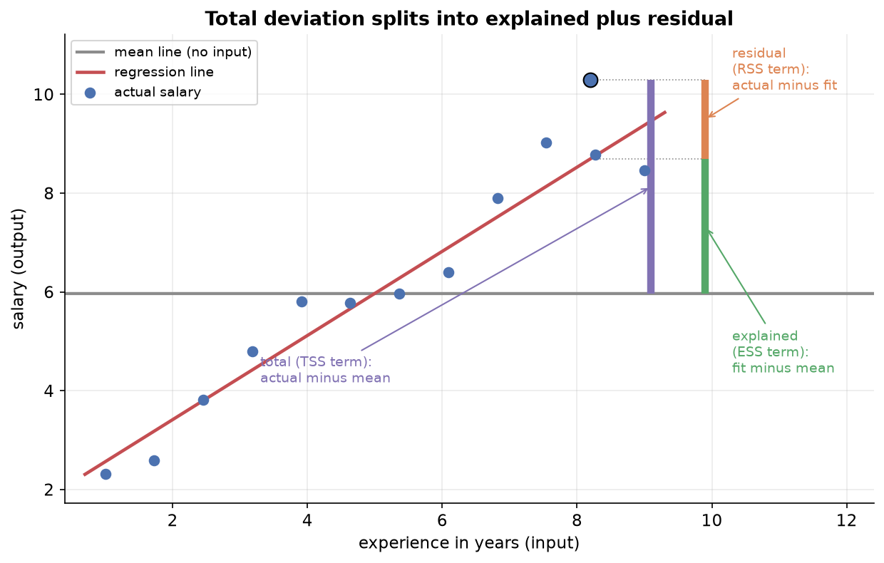
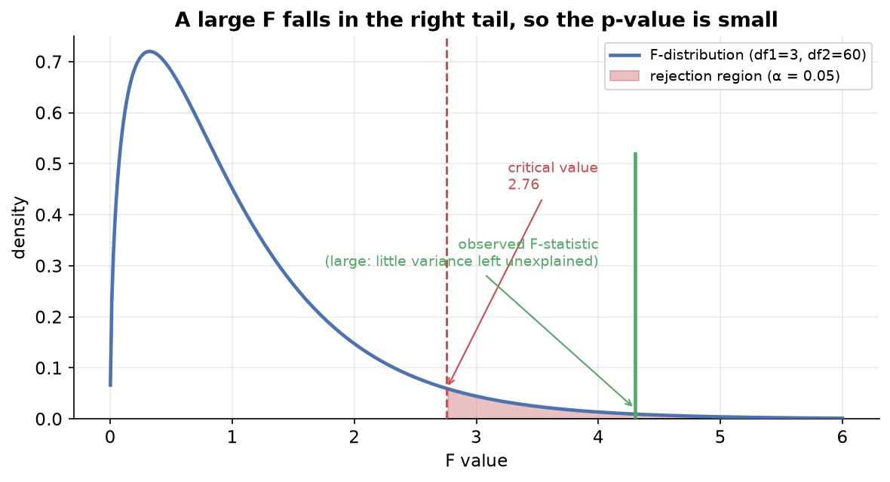

---
tags:
  - regression
  - regression-analysis
  - statistical-inference
  - hypothesis-testing
  - statsmodels
aliases:
  - Regression Analysis
  - F-test for overall significance
  - Statsmodels summary
difficulty: advanced
prerequisites:
  - Multiple Linear Regression
  - Inferential Statistics
created: 2026-10-23
---

> [!info] Where this fits
> You can already fit a model and score it. [[Introduction to Linear Regression|Linear Regression]] finds the coefficients, and [[Regression Metrics]] measures how well the fit predicts. This note adds the inferential layer from [[Inferential Statistics]]: it asks whether the coefficients you fitted on a sample are real signals or noise, using hypothesis tests on the `statsmodels` summary.

Fitting a line gives you a slope and an intercept, but a slope alone does not tell you whether the relationship is real. The same data drawn a second time would give slightly different coefficients, so each one is an estimate, not a fact. Regression analysis treats those coefficients as claims to be tested, and borrows the tools of statistical inference to decide which claims survive. This note walks the `statsmodels` regression summary top to bottom, explaining each number and the test behind it.

---

## What regression analysis is

Finding the coefficients is only half the job. A fitted line through CGPA and salary data hands you a slope and an intercept, but it says nothing about whether those numbers are trustworthy or whether the inputs matter at all.

**Regression analysis is the study of the relationship between inputs and output, using statistics to judge how reliable the fitted coefficients are.** Rather than accept the slope and intercept at face value, you analyze them: is this relationship real, how strong is it, and does each individual input contribute?

Once you learn this, you stop reading a model as "the slope is 2.3, done" and start asking whether 2.3 is a signal you can act on. That shift is what turns a line-fitter into someone who can defend a model.

> [!note] Two jobs a model can do
> A regression model can predict a new output, and it can explain how the inputs relate to the output. Regression analysis serves the second job. It is the difference between a tool that answers "what will this student's package be" and one that answers "how much does CGPA actually move the package".

---

## Inference versus prediction

Machine learning usually chases **prediction**: feed in a new student's CGPA and intelligence quotient (IQ), and read off a predicted package. You fit the coefficients once, then apply them to new rows. The relationship itself is a means to an end.

**Inference** has the opposite priority. Here you do not care about predicting the next package; you want to understand the relationship. How does the package change if CGPA drops by two points? Does IQ matter once CGPA is known? Inference studies the structure, not the forecast.

| Aspect | Prediction | Inference |
| :--- | :--- | :--- |
| Goal | Estimate the output for a new input | Understand how inputs relate to the output |
| Question | What will the package be? | How does CGPA affect the package, and is the effect real? |
| What you report | A predicted value | Coefficients, their significance, and confidence ranges |
| Typical model | Can be a black box | Must be interpretable |

> [!example] An advertising budget
> A company spends on television, radio, and newspaper advertisements and tracks sales. A prediction task asks "if we spend this much next year, what sales should we expect". An inference task asks "which channels actually drive sales, and by how much", so the company can shift budget toward what works. Regression analysis answers the second.

A useful rule of thumb: models that predict best are often the hardest to explain, and models that explain best often predict a little worse. A strong predictor tends to be a black box that gives an answer without reasons, while a strong inferential model hands you reasons but a rougher forecast.

---

## Sample versus population

Every regression sits on a hidden gap. The data you hold is a **sample**, a subset of all the cases you care about, while the thing you want to describe is the **population**, every case the relationship applies to.

Suppose you want the relationship between CGPA, IQ, and package for all graduating students everywhere. You cannot collect all of them, so you take a sample of, say, a hundred students and fit a model on it. The coefficients you get describe the sample, and you use them to **estimate** the unknown coefficients of the full population.

**A statistical inference problem is one where you use a sample to estimate a property of the population you cannot measure directly.** Every regression is such a problem, which is exactly why statistics enters.

> [!example] Playing with a known truth
> Imagine you invent the data yourself from the rule $y = 2x - 5$ plus a dash of randomness, then hand someone fifty points and ask them to recover the rule. Their fitted line might come out as $y = 2.27x - 6.21$, close but not exact. Draw a fresh fifty points and they get yet another line. Only by averaging over many samples would their estimates settle on the true $2$ and $-5$. You have one sample, so your coefficients are estimates that carry uncertainty.

This gap is why you write the relationship with an error term:

$$
y = f(x) + \varepsilon
$$

where $y$ is the output, $f(x)$ is the true relationship between inputs and output, and $\varepsilon$ is the **irreducible error**, the part of $y$ driven by factors you never measured. A candidate's package might dip because they were unwell at the interview, something no column captures. Because $\varepsilon$ can never be modelled away, your fitted $\hat{f}$ only ever approximates the true $f$, and the coefficients only ever estimate the population's.

---

## The statsmodels linear regression summary

The `statsmodels` library fits linear regression and prints a detailed report, far richer than the bare coefficients a plain fit returns. Regression analysis is, in practice, the skill of reading that report. It breaks into three blocks.

```python
import statsmodels.api as sm

X = sm.add_constant(X)        # add the intercept column
model = sm.OLS(y, X).fit()    # ordinary least squares fit
print(model.summary())
```

- **General information.** The dependent variable, the model type, the date, and the number of observations (the row count). Orienting detail, nothing to test.
- **Goodness of fit and overall significance.** Whether a relationship exists between the inputs and the output at all, and how strong it is. This is the F-statistic, its probability, the R2 score, and the adjusted R2 score.
- **Per-coefficient detail.** For each coefficient, its value, standard error, t-statistic, p-value, and confidence interval, so you can judge each input on its own.

This note covers the second and third blocks. The reading order follows three questions: is there a relationship, how strong is it, and which inputs carry it.

> [!note] Assumption checks come later
> The summary also reports diagnostics (condition number, and tests named Omnibus, Durbin-Watson, and Jarque-Bera) that check the assumptions a linear model relies on. Those belong to [[Assumptions & Diagnostics]] and are not covered here.

---

## TSS, RSS, and ESS

Before any test, you need a vocabulary for variation. Start with the plain fact that the output varies: not every employee earns the same salary. Some of that spread the model can account for, and some it cannot.

Picture salary plotted against experience, with a flat line drawn at the mean salary. Each point's distance from that mean line is variation to be explained.

**The total sum of squares (TSS) measures all the variation in the output, before any input is used:**

$$
\text{TSS} = \sum_{i=1}^{n} (y_i - \bar{y})^2
$$

where $y_i$ is each actual output and $\bar{y}$ is the mean output. This is the total spread you are trying to account for. Note that it is not divided by $n - 1$, so it is a sum of squares, not a variance.

Now fit a regression line using the input. The line explains some of that spread and leaves the rest.

**The residual sum of squares (RSS) measures the variation the fitted line fails to explain:**

$$
\text{RSS} = \sum_{i=1}^{n} (y_i - \hat{y}_i)^2
$$

where $\hat{y}_i$ is the prediction for row $i$. Each term is the gap between an actual value and the line, the leftover the model could not capture.

**The explained sum of squares (ESS) is what the line does account for, the rest of the total:**

$$
\text{ESS} = \text{TSS} - \text{RSS} = \sum_{i=1}^{n} (\hat{y}_i - \bar{y})^2
$$

the gap between each prediction and the mean. These three lock together as $\text{TSS} = \text{ESS} + \text{RSS}$: total variation splits cleanly into the part the model explains and the part it leaves behind.



> [!tip] Where each piece comes from
> RSS is left over for two reasons: the irreducible error no model can remove, and a model that fitted the relationship imperfectly. A worse model raises RSS and lowers ESS, because it explains less of the same total spread.

---

## Degrees of freedom

The sums of squares feed two averages, and to average correctly you need the right divisor. That divisor is the degrees of freedom: the number of independent pieces of information available to estimate a quantity.

**The total degrees of freedom in linear regression is $n - 1$**, where $n$ is the number of rows. The familiar $n - 1$ you have seen for a variance is the same idea: estimating one quantity from the data costs one degree of freedom.

This total splits into two parts, mirroring the split of the sums of squares:

$$
df_{\text{total}} = df_{\text{model}} + df_{\text{residual}}
$$

- **Model degrees of freedom** is $k$, the number of independent input columns. One input gives $k = 1$, three inputs give $k = 3$.
- **Residual degrees of freedom** is $n - k - 1$, the information left for estimating the leftover variation after the line is fitted.

> [!example] Why a line needs a third point
> How many points does it take to fit a regression line that could have come out differently? One point gives infinitely many lines, so no constraint. Two points always define exactly one line through both, so there is still no freedom to vary. Only with a third point does the line gain room to move and start explaining variability. In two dimensions you fit a line from $n - 1$ effective points; in three dimensions a plane needs a fourth point before it is free, which is the $n - k - 1$ pattern.

The reason estimation needs only $n - 1$ points, not all $n$, is that a sample estimating a population parameter always spends one piece of information on the estimate itself. The same logic scales: each coefficient you estimate costs one more degree of freedom, leaving $n - k - 1$ for the residuals.

---

## The F-statistic and Prob(F-statistic)

With the sums of squares and their degrees of freedom in hand, you can build the number at the heart of the first test. The idea is to compare explained variation against unexplained variation, each put on a fair footing by dividing by its degrees of freedom.

**The F-statistic is the ratio of mean explained variation to mean unexplained variation:**

$$
F = \frac{\text{MSR}}{\text{MSE}} = \frac{\text{ESS} / k}{\text{RSS} / (n - k - 1)}
$$

where MSR is the mean square regression ($\text{ESS}$ divided by the model degrees of freedom $k$) and MSE is the mean square error ($\text{RSS}$ divided by the residual degrees of freedom $n - k - 1$).

Read the ratio directly. The numerator is the average variation per degree of freedom that the line explains, and the denominator is the average variation per degree of freedom it leaves behind. A large F means the model explains far more than it leaves, so the inputs are doing real work. A small F means the opposite.

**The F-statistic follows an F-distribution**, the distribution you get by taking two chi-square quantities, each divided by its own degrees of freedom, and dividing one by the other. The residual term is a sum of squared errors, and because the errors are assumed to be normally distributed, their squares follow a chi-square distribution. The F-distribution never goes below zero and has two shape parameters, the two degrees of freedom $k$ and $n - k - 1$.

**Prob(F-statistic) is the p-value of that F-statistic**, the area in the right tail of the F-distribution beyond the value you computed. A large F sits far out in the tail, leaving a tiny area, so Prob(F-statistic) is small.

---

## The F-test for overall significance

Now you can ask the first question outright: is there any linear relationship between the inputs and the output, or are you fitting noise? The **F-test for overall significance** answers it, and it is a variant of analysis of variance (ANOVA).

Like every hypothesis test, it starts from a null hypothesis you try to disprove:

- **Null hypothesis:** every coefficient except the intercept is zero. For a single input, $\beta_1 = 0$, which means the output does not depend on the input at all, so there is no linear relationship.
- **Alternative hypothesis:** at least one coefficient is not zero. For a single input, $\beta_1 \neq 0$, so some linear relationship exists.

The test computes the F-statistic, finds its p-value Prob(F-statistic) on the F-distribution, and compares that p-value to a significance level, usually $0.05$.

$$
\begin{aligned}
&\text{if Prob}(F) < 0.05: \text{reject the null} \Rightarrow \text{a linear relationship exists} \\
&\text{if Prob}(F) \geq 0.05: \text{cannot reject} \Rightarrow \text{no linear relationship found}
\end{aligned}
$$



The intuition sits in the F ratio itself. A large F means ESS dominates RSS, so the line explains much more than it leaves, and the relationship is real. A small F means RSS dominates, so the line barely improves on the mean and there may be no linear relationship, or a non-linear one the straight line cannot catch.

> [!example] When experience does nothing
> Suppose you had only employees' salaries and no experience column. Asked to predict a new salary, your best guess is the mean salary. The F-test asks whether adding experience beats that mean. A high F says experience provides a better fit than the mean alone; a low F says experience is as useless as guessing the average every time.

> [!warning] There is no universal "good" F value
> Do not look for a threshold F like "above 5 is significant". The cutoff depends on both degrees of freedom, $k$ and $n - k - 1$, so the same F can be significant for one model and not another. Judge by the p-value against your significance level, never by the raw F alone.

With multiple inputs, rejecting the null tells you that at least one coefficient is nonzero, so some input matters. It does not tell you which one. That needs the per-coefficient test later in this note.

---

## R2, the goodness of fit

The F-test answers whether a relationship exists. The next question is how strong it is, and for that you reach for the R2 score, the central goodness-of-fit measure.

**R2 is the proportion of the total variation in the output that the model explains:**

$$
R^2 = \frac{\text{ESS}}{\text{TSS}} = 1 - \frac{\text{RSS}}{\text{TSS}}
$$

It is a proportion between zero and one. At its maximum the line explains all the variation, so ESS equals TSS and R2 is one. At zero the line explains nothing beyond the mean, so ESS is zero. An R2 of $0.89$ reads as "the model explains 89 percent of the variation in the output", with the rest left to noise and irreducible error.

Because R2 is a standardized proportion rather than a raw error, you can compare two models directly: a model scoring $0.81$ explains more of the output's spread than one scoring $0.61$. That comparability is what makes it the headline goodness-of-fit number.

> [!note] The inferential reading
> In regression analysis R2 answers "how strong is the relationship the F-test confirmed exists". A significant F with a low R2 says the relationship is real but weak; a significant F with a high R2 says it is real and strong. The formula, the baseline-comparison intuition, how R2 reaches zero, and how it can even turn negative are all derived in [[Regression Metrics]]. This note uses the result rather than re-deriving it.

---

## Adjusted R2

R2 has a flaw that bites the moment you work with several inputs: adding any column, even an irrelevant one, can only hold R2 steady or push it up, never down. A model with one useful input and five useless ones can show the same R2 as the model with just the useful input, which is misleading.

**Adjusted R2 corrects this by penalizing the number of input columns, so an irrelevant column makes the score fall:**

$$
R^2_{\text{adj}} = 1 - \frac{(1 - R^2)(n - 1)}{n - k - 1}
$$

where $k$ is the number of input columns. When a new column genuinely helps, R2 rises enough to offset the larger $k$, so adjusted R2 climbs. When a column is useless, R2 barely moves while $k$ grows, so adjusted R2 drops. It rewards columns that earn their place and punishes those that do not.

> [!tip] Watch the gap between R2 and adjusted R2
> Report both scores. If they sit close together, as in $0.897$ against $0.896$, your inputs are mostly pulling their weight. A gap of a few percent is a red flag that some inputs are irrelevant and the model may be overfitting, capturing noise rather than signal. As a rule, use R2 to read a single small model, and adjusted R2 to compare models or screen for useless features. The penalty mechanism and worked behaviour are detailed in [[Regression Metrics]].

---

## The t-statistic and per-coefficient significance

The F-test spoke about the model as a whole. To learn which individual input matters, you test each coefficient on its own with a **t-test**, exactly the hypothesis test you met for a single mean.

For a coefficient $\beta_j$, the test mirrors the F-test's structure:

- **Null hypothesis:** $\beta_j = 0$, so input $j$ has no relationship with the output once it stands alone.
- **Alternative hypothesis:** $\beta_j \neq 0$, so input $j$ does relate to the output. This is two-tailed, since the effect could be positive or negative.

**The t-statistic measures how many standard errors the fitted coefficient sits away from zero:**

$$
t = \frac{b_j - 0}{\text{SE}(b_j)}
$$

where $b_j$ is the fitted estimate of $\beta_j$, zero is its hypothesized value under the null, and $\text{SE}(b_j)$ is the **standard error** of the estimate, a measure of how much $b_j$ would wobble from sample to sample. A coefficient far from zero relative to its wobble gives a large t.

From the t-statistic you read a p-value off the t-distribution, using a two-tailed test with $n - k - 1$ residual degrees of freedom, and compare it to the significance level:

$$
\begin{aligned}
&\text{if } p < 0.05: \text{reject} \Rightarrow \text{this input matters} \\
&\text{if } p \geq 0.05: \text{cannot reject} \Rightarrow \text{drop this input}
\end{aligned}
$$

> [!example] Sorting advertising channels
> Fit sales against television, radio, and newspaper spend. The television coefficient comes out with a p-value near zero, so you reject its null: television spend genuinely drives sales. The newspaper coefficient shows a p-value of $0.8$, so you cannot reject its null: newspaper spend does not help predict sales, and you would drop it and refit. The t-test is how you decide, channel by channel, which inputs to keep.

> [!warning] The t-test uses a standard error, not a known variance
> You use a t-statistic here, not a z-statistic, because you do not know the true variability of the coefficient; you estimate it with the standard error from the sample. That estimation is exactly what the t-distribution accounts for. The formula for the standard error rests on the model's assumptions and is developed in [[Assumptions & Diagnostics]].

---

## Confidence intervals for coefficients

A single fitted number like $b_j = 0.046$ is a point estimate from one sample, not the population's true coefficient. Rather than pretend you know the exact value, you report a range you are confident contains it.

**A confidence interval for a coefficient is a range of values that, with a stated confidence such as 95 percent, contains the true population coefficient:**

$$
b_j \pm t^{*} \times \text{SE}(b_j)
$$

where $b_j$ is the fitted estimate, $\text{SE}(b_j)$ is its standard error, and $t^{*}$ is the critical t-value for your confidence level and the residual degrees of freedom. Widen or narrow the interval by changing the confidence level through $t^{*}$.

> [!example] Reading a television coefficient
> Suppose the television coefficient is $0.046$ with a standard error of $0.001$ and a critical $t^{*}$ of $3.18$. The interval runs $0.046 \pm 3.18 \times 0.001$, roughly $0.043$ to $0.049$. Instead of claiming "television spend moves sales by exactly $0.046$", you say "I am 95 percent confident the true effect lies between $0.043$ and $0.049$". The range is an honest statement of what one sample can support.

The confidence interval and the t-test agree by construction: if the 95 percent interval excludes zero, the coefficient is significant at the $0.05$ level, because zero being outside the plausible range is the same as rejecting the null that the coefficient is zero.

---

## Summary

1. **Regression analysis** studies the input-output relationship and uses statistics to judge whether the fitted coefficients are reliable, not just to produce predictions.
2. **Inference** seeks to understand the relationship, while **prediction** seeks a forecast; strong predictors are often black boxes, and strong inferential models are interpretable.
3. Your data is a **sample** used to estimate the unknown **population** coefficients, which makes every regression a statistical inference problem, with an irreducible error $\varepsilon$ that no model removes.
4. The `statsmodels` summary reports general information, overall goodness of fit, and per-coefficient detail; regression analysis is the skill of reading it.
5. Total variation splits as $\text{TSS} = \text{ESS} + \text{RSS}$, explained plus residual, and the **degrees of freedom** split as $n - 1 = k + (n - k - 1)$ to average each piece correctly.
6. The **F-statistic** is mean explained variation over mean unexplained variation; the **F-test for overall significance** rejects the null of no relationship when Prob(F-statistic) falls below the significance level.
7. **R2** is the proportion of variation the model explains, read here as the strength of the relationship, and **adjusted R2** penalizes useless inputs so a wide gap between the two flags irrelevant features; both are derived in [[Regression Metrics]].
8. The **t-statistic** tests each coefficient against zero to decide which inputs matter, and a **confidence interval** reports the range that plausibly contains each true coefficient, agreeing with the t-test whenever it excludes zero.

---

> [!info] Continues to
> Every test here leaned on assumptions, that the errors are normal and the relationship is linear. The next note makes those assumptions explicit, shows how to check each one, and explains the standard error left undefined here, in [[Assumptions & Diagnostics]].
