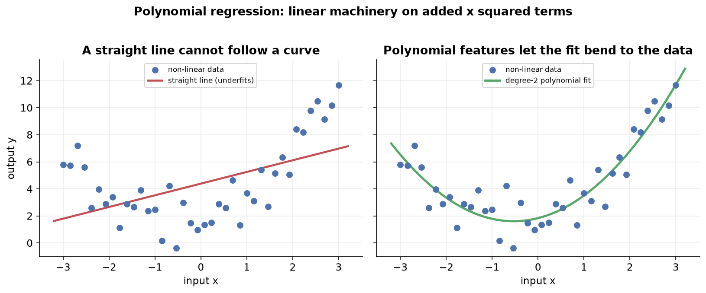
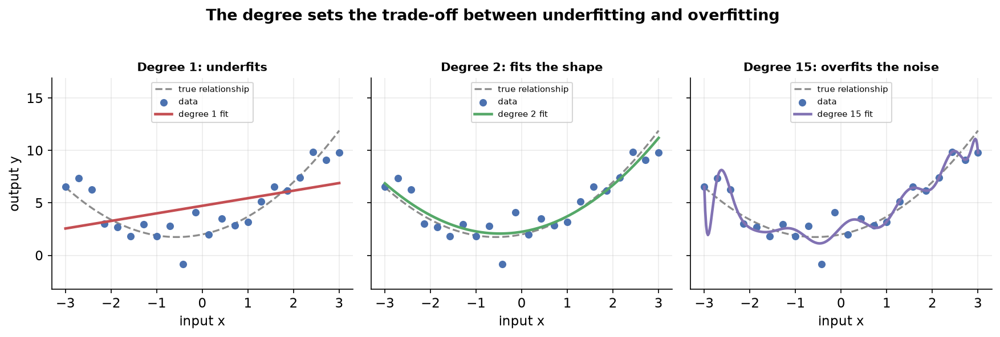
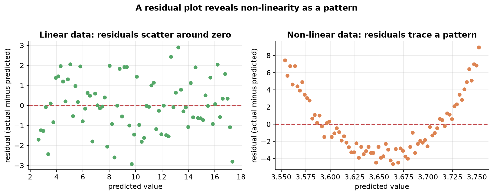
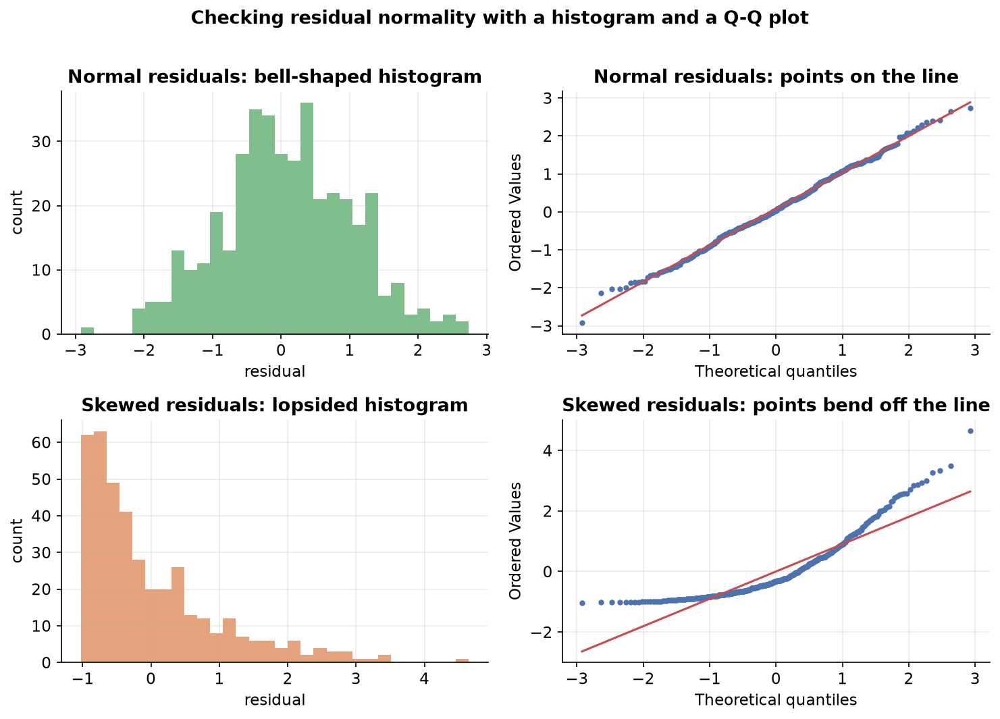
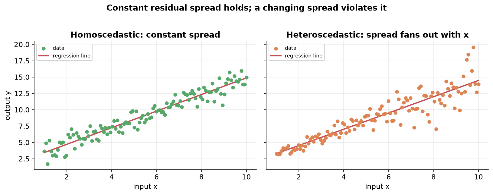

---
tags:
  - regression
  - linear-regression
  - polynomial-regression
  - assumptions
  - diagnostics
  - residuals
aliases:
  - Assumptions & Diagnostics
  - Assumptions of Linear Regression
  - Polynomial Regression
created: 2026-10-23
difficulty: advanced
---

> [!info] Where this fits
> You have fit and scored linear models and read their inferential output in [[Regression Analysis]]. This note covers two things that decide whether a linear model is even the right tool: polynomial regression, which stretches linear machinery to curved data, and the assumptions the model quietly relies on. The last assumption, no strong relationship between inputs, gets its own treatment in [[Multicollinearity]].

Linear regression fits a straight line, a plane, or a hyperplane, which works only when the real relationship is close to straight. This note first shows how polynomial regression bends that same machinery to curved data, then lays out the five assumptions a linear model makes, why each one matters, how to check it, and what to do when it fails.

---

## Why we need polynomial regression

A line, a plane, or a hyperplane is the best a linear model can do, and that is the problem. When the data curves, the best straight fit still misses, because no straight object can trace a curve.

Picture a single input and a single output whose points lie along a parabola. The best-fit line passes through the middle of the cloud but sits above the data at the ends and below it in the middle. Its predictions land far from the actual values, so its R2 score is poor. The failure is structural: the data is not linear, and you are forcing a linear shape on it.

**Polynomial regression is a form of linear regression that fits curved data by adding powers of the input as extra features.** The relationship between the output and the input is curved, but the relationship between the output and the coefficients stays linear, so the same fitting machinery still applies.

> [!note] Why it is still called linear regression
> A model is linear regression when the output is a linear combination of its coefficients, each coefficient appearing to the first power. Raising the input $x$ to a power changes the shape in $x$, not the role of the coefficients. The output stays linear in the coefficients, so polynomial regression is linear regression on transformed inputs.

---

## Formulation of polynomial regression

The trick happens in preprocessing, before any fitting. You take each input value and expand it into a set of powers, then hand the expanded data to ordinary linear regression.

For a single input $x$ and a chosen degree of 2, you replace each row with three features: $x^0$, $x^1$, and $x^2$. The value $x^0$ is always 1, which supplies the intercept term, $x^1$ is the input unchanged, and $x^2$ is its square. A row that was one input value becomes three features.

Fitting linear regression on those features gives the model:

$$
y = \beta_0 + \beta_1 x + \beta_2 x^2
$$

where $\beta_0$ is the intercept, $\beta_1$ is the coefficient on the input, and $\beta_2$ is the coefficient on its square. Compared to a simple line $y = \beta_0 + \beta_1 x$, the single extra term $\beta_2 x^2$ is what lets the fit bend.

Higher degrees add more terms. Degree 3 adds $\beta_3 x^3$, degree 4 adds $\beta_4 x^4$, and so on. The rules extend to several inputs too:

- **Apply the expansion to inputs only.** Transform the input columns, never the output. The output stays as it is.
- **Transform training and test data the same way.** Both sets must pass through the identical feature expansion before fitting or predicting.
- **More inputs multiply the terms.** With two inputs $x_1$ and $x_2$ at degree 2, the features are the constant, $x_1$, $x_1^2$, $x_2$, $x_2^2$, and the cross term $x_1 x_2$. Every combination whose powers sum to at most the degree appears, which is why a cross term shows up but $x_1^2 x_2^2$ (summed power 4) does not.

### Choosing the degree

The degree is a **hyperparameter**, a setting you choose rather than one the fit learns. It controls how much the curve can bend, and it trades one failure for another.

- **Too low a degree underfits.** The curve is too stiff to follow the data, so it misses the true shape, the same failure as a straight line on a parabola.
- **Too high a degree overfits.** The curve becomes flexible enough to pass through individual points, chasing the random noise rather than the underlying pattern. It fits the training data almost perfectly but swings wildly between points and predicts poorly on new data.

You want the degree in between, flexible enough to capture the real shape and no more. For a single input you can read this off a plot. With many inputs you cannot see the fit, so you compare a cross-validated score such as R2 across degrees, or read learning curves, and pick the degree where the score stops improving.

> [!tip]
> A transformation that fits each input with an automatically chosen power, such as the Yeo-Johnson transformation, sidesteps the manual degree search. It figures out a suitable power for each column on its own, which is useful when high-dimensional data hides the right degree from you.

---

## The assumptions of linear regression

Linear regression does not just fit a line; its inferential machinery, the hypothesis tests and confidence intervals from [[Regression Analysis]], rests on a set of assumptions about the data and the errors. When they hold, the coefficients, p-values, and intervals are trustworthy. When they fail, the model may still produce numbers, but those numbers mislead.

There are five main assumptions:

| Assumption | Plain statement |
| :--- | :--- |
| Linearity | The inputs and the output have a linear relationship. |
| Normality of residuals | The errors follow a normal distribution with a mean of zero. |
| Homoscedasticity | The spread of the errors stays constant across the inputs. |
| No autocorrelation | The errors are not correlated with one another. |
| Little or no multicollinearity | The input columns are not strongly related to each other. |

The rest of this note takes the first four in turn, each with what it says, what breaks when it fails, how to check it, and what to do about it. The fifth, multicollinearity, is involved enough to deserve its own note.

> [!note] A residual is the error we study
> Throughout, the **residual** is the gap between an actual output and the model's prediction, $e_i = y_i - \hat{y}_i$. Every assumption below is a statement about these residuals or about the inputs, so most checks start by fitting the model and computing its residuals.

---

## Linearity

**The linearity assumption says the inputs and the output have a linear relationship: as an input changes by some amount, the output changes by a roughly proportional amount.** This is the most basic assumption, since a straight-line model that is handed curved data has nothing to work with.

When linearity fails, three problems follow:

- **Bias creeps in.** The model assumes the data is linear when it is not, so it carries a built-in wrong belief that drags its predictions off.
- **Predictions lose accuracy.** For any given input, the predicted output lands far from reality, because a line cannot track a curve.
- **The inference becomes invalid.** The hypothesis tests and confidence intervals from the regression no longer hold, so you cannot trust the p-values that say which inputs matter or the intervals around the coefficients.

### How to check linearity

- **Scatter plot.** With one input, plot the input against the output and look for a roughly straight trend. This is the quickest first look.
- **Residual plot.** Plot the residuals against the predicted values (or against an input). If linearity holds, the residuals scatter randomly around zero with no shape. If the relationship is curved, the residuals trace a systematic pattern, such as a parabola, which exposes the non-linearity the scatter alone might hide.
- **Polynomial regression.** Fit a polynomial model and compare its R2 to the plain linear fit. A large jump signals that the data was non-linear all along.

With several inputs you cannot draw one scatter plot, so make a separate scatter of each input against the output, or lean on the residual plot, which works at any number of inputs.

### What to do when linearity fails

- **Transform the data.** Apply a mathematical transformation to an input or the output, such as a log or a square root, to straighten the relationship. The Yeo-Johnson transformation picks a suitable power automatically, which helps when you cannot see the data.
- **Use polynomial regression.** Add polynomial features so the linear machinery can fit the curve, as above.
- **Piecewise regression.** Split the input range into segments and fit a separate linear model on each, so each piece covers a stretch that is roughly linear.
- **Switch to a non-parametric model.** Linear regression is a parametric method. If the data is strongly non-linear, a non-parametric model such as a generalized additive model, a spline model, or kernel regression may fit better than any transformed line.

> [!tip] Inference versus prediction
> If a transformed or non-linear model predicts better, why keep linear regression at all? Because linear models are easy to interpret: each coefficient states how the output moves with an input. When your goal is inference, understanding those relationships, you accept weaker prediction for that clarity. When your goal is pure prediction, you are free to reach for a non-parametric model instead.

---

## Normality of residuals

**The normality assumption says the residuals follow a normal distribution with a mean of zero and a constant variance.** Collect every residual the model makes and plot a histogram of them; it should look like a bell curve centered on zero.

The residuals here are the **reducible error**, the part of the error you could shrink by improving the fit, not the irreducible noise. The assumption is about these reducible errors being normally shaped.

This assumption matters because the regression's inferential tests are built on it:

- **The F-test for overall significance needs it.** That test forms a ratio of two quantities that each follow a chi-square distribution, and a quantity is chi-square only when it is the square of a normal. If the residuals are not normal, their squares are not chi-square, the ratio is not an F-statistic, and the test's p-value is meaningless.
- **The t-test for each coefficient needs it.** The t-statistic divides a coefficient by its standard error, and computing that standard error assumes normal residuals. Lose normality and the standard error is unreliable, so the t-statistic, its p-value, and your confidence in which inputs matter all collapse.
- **Confidence intervals need it.** The interval around each coefficient also uses the standard error, so a broken normality assumption makes the interval untrustworthy too.

### How to check normality

- **Histogram or KDE plot of the residuals.** Fit the model, compute the residuals, and plot their distribution. A rough bell shape centered near zero supports the assumption.
- **Q-Q plot.** Plot the residual quantiles against normal quantiles. Points hugging the diagonal line mean the residuals are close to normal; points that bend away at the ends signal a departure.
- **Statistical tests of normality.** Tests such as the Shapiro-Wilk test, the Omnibus test, and the Jarque-Bera test put a number on it. Each takes a null hypothesis that the residuals are normal and returns a p-value; a p-value below your threshold rejects normality.

> [!example] How the Omnibus test works
> The Omnibus test computes the **skewness** (how lopsided the residuals are) and the **kurtosis** (how heavy their tails are) and combines them into a statistic $K^2 = n \left( \dfrac{\text{skew}^2}{6} + \dfrac{\text{kurt}^2}{24} \right)$, where $n$ is the number of observations. Under the null of normality this statistic follows a chi-square distribution with 2 degrees of freedom, so a small p-value means the residuals deviate too far from normal to be chance.

### What to do when normality fails

- **Feature selection.** Fit on a subset of the inputs; a smaller model sometimes yields normal residuals.
- **Transform the data.** The same transformations that straighten a non-linear relationship can also pull skewed residuals toward normal.
- **Robust regression.** Some regression techniques do not depend on the residual distribution at all, so they sidestep the assumption.
- **Switch to a non-parametric model**, as with linearity, when a line is the wrong tool.
- **Bootstrapping.** Resample the data to estimate the quantities the tests need, rather than leaning on the normality assumption.

> [!tip] You often do not have to worry about this one
> When the number of observations is greater than roughly 30, which holds for most machine learning data, the central limit theorem makes the sampling distribution normal regardless of the residual shape. So with a decent sample size, a failed normality check is rarely a serious problem.

---

## Homoscedasticity

**Homoscedasticity says the spread of the residuals stays constant across all values of the inputs.** The points should sit in a band of even width around the regression line from one end to the other. When the spread changes, often widening into a funnel as an input grows, the data is **heteroscedastic** and the assumption is violated.

Heteroscedasticity causes a single but serious problem: **the standard errors of the coefficients become unreliable.** Because the standard error feeds the t-test and the confidence interval, both of those break with it:

- **The t-test fails.** With an unreliable standard error, the t-statistic and its p-value cannot be trusted, so you cannot say which coefficients are significant.
- **The confidence intervals fail.** The interval around each coefficient also uses the standard error, so its bounds are no longer reliable and you cannot claim the true value lies within them.

### Why the standard error breaks

To see why, recall what the standard error of a coefficient measures. Imagine fitting the model on many different samples drawn from the same population; each sample gives a slightly different slope estimate. The **standard error of the slope is the standard deviation of those slope estimates**, a measure of how much the fitted line could wiggle from sample to sample.

> [!note] Standard error is a standard deviation of estimates
> In general, the **standard error** is the standard deviation of a statistic across repeated samples. For a sample mean it is the population standard deviation divided by $\sqrt{n}$, which the central limit theorem explains. For a regression coefficient it is the standard deviation of that coefficient across the many lines you would fit on many samples, which is why a reliable standard error is the precision of the estimate.

The formula for that standard error assumes the residual spread is uniform across the inputs. Under heteroscedasticity the line has more freedom to wiggle at the high-spread end than at the low-spread end, so a single uniform number no longer describes how much it can move. The standard-error formula no longer applies, and everything built on it falls with it.

> [!note] Why the t-statistic uses the standard error
> The t-statistic is $t = \dfrac{\hat{\beta}_1 - 0}{\text{SE}(\hat{\beta}_1)}$, the estimated coefficient minus the null value of zero, divided by its standard error. Dividing by the standard error expresses the coefficient as a number of standard errors away from zero, the same way a z-score counts standard deviations. A value far from zero, three or more standard errors out, is unlikely under the null, so its p-value is small and you reject the hypothesis that the coefficient is zero. A broken standard error breaks this whole chain.

### How to check and fix homoscedasticity

- **Check with a residual plot.** Plot the residuals against the predicted values and look at their spread. An even band is homoscedastic; a funnel or any systematic change in width is heteroscedastic.
- **Fix by transforming the output.** A transformation such as a log on the output often stabilizes a spread that grows with the output's size.

Stated compactly, let $\text{Var}(e_i)$ be the variance of the residuals. If it is a constant that does not depend on the inputs, the data is homoscedastic. If it is instead a function of an input $x$, so the variance changes as $x$ changes, the data is heteroscedastic.

---

## No autocorrelation

**The no-autocorrelation assumption says the residuals are not correlated with one another.** Each error should be independent of the others, so knowing one residual tells you nothing about the next. This is part of the standard requirement that the errors be independent and identically distributed.

Autocorrelation mostly surfaces with **time-series data**, where consecutive observations are measured over time and an error at one step can carry into the next. For the cross-sectional data typical of a basic regression, it is usually not a concern, which is why it is the least worrisome of the five assumptions unless you are explicitly working over time.

---

## Little or no multicollinearity

**The multicollinearity assumption says no input column should be strongly related to another input column.** When two inputs are themselves linearly related, for example a student's IQ and their exam score moving together, the model struggles to tell which one drives the output, and the coefficient estimates become unstable.

This assumption is involved enough, and asked about often enough in practice, to warrant its own treatment: how to state it mathematically, how to detect it with the variance inflation factor and the condition number, and how to remove it. That is the subject of [[Multicollinearity]].

---

## Summary

1. **Polynomial regression** fits curved data by adding powers of the input, $x^0, x^1, x^2, \dots$, as features in preprocessing, then running ordinary linear regression; it stays linear regression because the output is still linear in the coefficients.
2. The polynomial **degree is a hyperparameter**: too low underfits, too high overfits by chasing noise, and you choose it by plotting (one input) or comparing a cross-validated score across degrees (many inputs).
3. **Linearity** requires a straight-line relationship between inputs and output; check it with scatter and residual plots, and fix a failure with transformations, polynomial features, piecewise regression, or a non-parametric model.
4. **Normality of residuals** keeps the F-test, the t-tests, and the confidence intervals valid; check it with a histogram, a Q-Q plot, or tests such as Shapiro-Wilk and Omnibus, though a sample larger than about 30 makes it rarely a problem.
5. **Homoscedasticity** requires a constant residual spread across the inputs; a funnel shape (heteroscedasticity) makes the coefficient standard errors unreliable, which breaks the t-tests and confidence intervals.
6. **Standard error** of a coefficient is the standard deviation of that estimate across repeated samples, the engine behind the t-statistic and the confidence interval, which is why assumptions that corrupt it corrupt the whole inference.
7. **No autocorrelation** requires independent residuals and mostly matters for time-series data, while **little or no multicollinearity** requires unrelated input columns and is covered on its own.

---

> [!info] Continues to
> The fifth assumption, that input columns should not be strongly related, is the subject of [[Multicollinearity]], including how to measure it and how to remove it.
