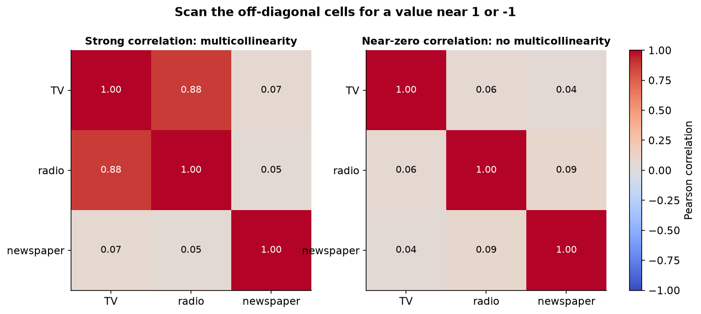
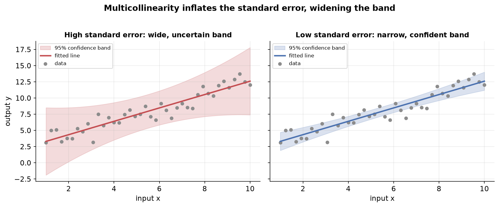

---
tags:
  - regression
  - multicollinearity
  - vif
  - condition-number
  - linear-algebra
aliases:
  - Multicollinearity
  - VIF
  - Variance Inflation Factor
difficulty: intermediate
prerequisites:
  - Regression Analysis
created: 2026-10-24
---

> [!info] Where this fits
> [[Regression Analysis]] gave you the inferential view of a fitted model, where each coefficient reports how one input moves the output. This note covers the condition that breaks that reading: multicollinearity, when the input columns carry overlapping information. You will learn what it is, when it actually hurts, the linear algebra behind it, and how to detect and remove it.

When two or more input columns of a multiple regression move together, the model can no longer separate their individual effects, and its coefficients stop meaning what you think they mean. This note builds that idea from a plain definition, shows with vectors and matrices why it happens, and ends with the three standard detection tools and four ways to fix it.

---

## What multicollinearity is

Picture a model that predicts a student's salary package from two inputs, cumulative grade point average (CGPA) and intelligence quotient (IQ). You collect this data for a hundred students and fit a plane through it. The trouble starts when the inputs are not independent of one another.

**Multicollinearity is a statistical phenomenon that occurs when two or more independent variables in a multiple regression model are highly correlated.** The input columns carry a strong linear relationship, so one can be largely predicted from the others.

In the running example, CGPA and IQ tend to rise together: a student with a high IQ usually earns a high CGPA. Those two inputs are correlated, so the model has multicollinearity. By contrast, CGPA and date of birth carry no relationship at all, so a model built on them does not.

> [!note] How strong is "highly correlated"?
> By convention, the Pearson correlation coefficient has to reach roughly 0.8 or 0.9 in magnitude before the correlation is called strong enough to worry about. A mild correlation around 0.3 rarely causes real trouble.

> [!example] Correlated versus uncorrelated inputs
> IQ and the number of backlogs are correlated: a sharper student usually clears papers, so more IQ means fewer backlogs. CGPA and date of birth are not: a teacher does not read a horoscope before grading, so knowing one tells you nothing about the other. The first pair introduces multicollinearity, the second does not.

---

## When multicollinearity is bad

Multicollinearity is not always a problem. Whether it hurts depends entirely on what you are using the model for, so you first need two uses of a model clear in your head.

- **Prediction** focuses on using a model to make accurate forecasts for new, unseen data. You feed in a new student's CGPA and IQ, and the model returns a predicted package. Spam filters, stock forecasts, and price estimators are all predictive.
- **Inference** focuses on understanding the relationship between the variables in a model. You are not chasing a forecast; you want to know how much CGPA and how much IQ each contribute to the package. A bank studying which factors drive a loan decision wants inference, not a forecast.

The rule that follows is the heart of the topic:

| Use of the model | Does multicollinearity hurt? |
| :--- | :--- |
| Prediction | No. Predictions stay as accurate as they would be without it. |
| Inference | Yes. The individual coefficients become unreliable, so you cannot read each input's effect. |

> [!tip] Ask what the model is for
> If someone asks whether multicollinearity in their system is a problem, answer with a question: are you predicting or inferring? For prediction, tell them not to worry. For inference, tell them to deal with it.

### Why inference breaks

Recall how a coefficient is read. In the model for the package,

$$
\text{LPA} = \beta_0 + \beta_1 \cdot \text{CGPA} + \beta_2 \cdot \text{IQ}
$$

the coefficient $\beta_2$ means: hold CGPA constant, raise IQ by one unit, and the package rises by $\beta_2$. That reading assumes you can move IQ while CGPA stays put. Under multicollinearity you cannot, because raising IQ drags CGPA along with it. The "hold the others constant" story collapses, so $\beta_1$ and $\beta_2$ become **unreliable** and the inference fails.

### Why prediction survives

Suppose $x_1$ and $x_2$ are so strongly related that one is a linear function of the other, $x_1 = a_0 + a_1 x_2 + \text{error}$. Substitute that into the regression $y = \beta_0 + \beta_1 x_1 + \beta_2 x_2 + \text{error}$ and collect terms:

$$
\begin{aligned}
y &= \beta_0 + \beta_1 (a_0 + a_1 x_2) + \beta_2 x_2 + \text{error} \\
  &= (\beta_0 + \beta_1 a_0) + (\beta_1 a_1 + \beta_2) x_2 + \text{error} \\
  &= c + c_1 x_2 + \gamma
\end{aligned}
$$

The two inputs fold into a single-variable regression on $x_2$. The coefficients lose their original meaning, but the model still fits the data and still predicts well. Its predictive power is intact; only its inferential power is gone.

---

## Multicollinearity mathematically

To see why the coefficients turn unreliable, step into the linear algebra. Everything that happens with multicollinearity happens inside the matrices that produce the coefficients.

A multiple regression stacks the input rows into a **design matrix** $X$, with a column of ones for the intercept, and solves for the coefficient vector $\beta$ by ordinary least squares (OLS):

$$
\beta = (X^T X)^{-1} X^T y
$$

where $X$ is the design matrix, $X^T$ is its transpose, $y$ is the output column, and $\beta$ holds the coefficients. The whole method hinges on being able to invert the square matrix $X^T X$. Multicollinearity attacks exactly that inverse.

The damage shows up as three linked problems, which are really one problem in three forms:

1. **Difficulty identifying the most important predictors.** If $\beta_1$ and $\beta_2$ are unreliable, you cannot tell whether CGPA or IQ has the larger effect on the package.
2. **Inflated standard errors.** The uncertainty attached to each coefficient balloons.
3. **Unstable and unreliable estimates.** The coefficients swing wildly when the data changes even slightly.

The next sections unpack the algebra behind the inflated standard errors and the instability, starting with the clean extreme case.

---

## Perfect versus non-perfect multicollinearity

The algebra is easiest to see in an idealized case, so meet the extreme first and then back off to the realistic one.

- **Perfect multicollinearity** occurs when one input is an exact linear combination of the others, with no error at all: $x_1 = a_0 + a_1 x_2$ holds exactly. There is a formula that reproduces one column from another on every single row.
- **Non-perfect (near) multicollinearity** is the realistic version: the linear relationship is strong but carries some error, so $x_1 = a_0 + a_1 x_2 + \text{error}$. You can approximate one column from the others but never reproduce it exactly.

> [!example] Perfect versus near
> If a column holds CGPA and another holds percentage as exactly ten times CGPA, that is perfect multicollinearity: percentage equals $10 \times \text{CGPA} + 0$, no error. If percentage instead reflects CGPA plus an unknown discipline bonus that nudges marks up or down, the relationship is strong but carries error, so it is near multicollinearity. Real datasets almost always show the near version, because an exactly reproducible column would be dropped as redundant.

### The worked proof: why the inverse fails

Take a tiny, perfectly multicollinear dataset where percentage is exactly ten times CGPA, with two students:

$$
X = \begin{bmatrix} 8 & 80 & 1 \\ 6 & 60 & 1 \end{bmatrix}
$$

Form $X^T X$ and compute its determinant. Because the second column is exactly ten times the first, the columns are linearly dependent, and the determinant of $X^T X$ comes out to **zero**. A matrix with a zero determinant is **singular**, which means it has no inverse.

The chain is short and decisive:

$$
\det(X^T X) = 0 \;\Rightarrow\; (X^T X)^{-1} \text{ does not exist} \;\Rightarrow\; \beta \text{ cannot be computed.}
$$

So under perfect multicollinearity the coefficients cannot be calculated at all. This is the clean limit that explains the messier near case: as the relationship approaches perfect, the determinant approaches zero, and the inverse starts to misbehave long before it fully breaks.

---

## Types of multicollinearity

Multicollinearity arrives through two routes, and naming them helps you decide what to do about it.

| Type | Where it comes from | Example |
| :--- | :--- | :--- |
| Structural | The analyst creates it through feature engineering | One-hot encoding or polynomial terms |
| Data-driven | It exists naturally in the collected data | Flat size and number of bathrooms |

- **Structural multicollinearity** arises from how the variables are defined. You introduce it yourself. One-hot encoding a three-city column into delhi, mumbai, and kolkata columns makes any one an exact combination of the others ($\text{kolkata} = 1 - \text{delhi} - \text{mumbai}$), which is perfect multicollinearity; dropping one dummy column removes it. Polynomial regression, which adds squared and higher terms of an input, is another structural source.
- **Data-driven multicollinearity** occurs naturally because two real quantities move together. In housing data, a larger flat tends to have more bathrooms, so flat size and bathroom count correlate without anyone engineering it.

---

## Detecting with correlation

The first and simplest detector reads the pairwise correlations of the input columns. Correlation measures how strongly two variables move together linearly, which is exactly the relationship multicollinearity is built on.

Compute the correlation matrix of the numeric inputs (in pandas, `df.corr()`) and read it as a heatmap. Scan the off-diagonal cells, since the diagonal is always one and the matrix is symmetric, so the lower and upper triangles mirror each other. Any pair whose correlation sits near 1 or near -1, by convention above about 0.8 in magnitude, is a red flag for multicollinearity.

> [!warning] Correlation checks pairs, not groups
> A correlation matrix only sees two columns at a time. Multicollinearity can involve three or more inputs that are jointly dependent while no single pair looks alarming, and the correlation heatmap will miss that. For that reason it is the quickest check, not the most reliable one.

---

## Variance inflation factor (VIF)

The variance inflation factor is a more reliable detector because it tests each input against all the others at once, catching the group dependence that correlation misses.

The idea is to turn the question into a regression. For each input column, make it the output and regress it on all the remaining input columns, then read how well the others explain it:

1. Pick an input column, say radio, and treat it as the target.
2. Regress it on the other inputs (TV and newspaper) and record the $R^2$ score.
3. Convert that score into a VIF.

The VIF formula turns the fit quality into an inflation factor:

$$
\text{VIF} = \frac{1}{1 - R^2}
$$

where $R^2$ is the score from regressing that one input on all the others. Read it as follows:

- A high $R^2$ (the other inputs explain this column well) makes $1 - R^2$ small, so the VIF is **large**, signalling multicollinearity.
- A low $R^2$ (the other inputs barely explain this column) keeps $1 - R^2$ near one, so the VIF stays **close to 1**, signalling no multicollinearity.

> [!example] Reading a VIF value
> Regress radio on TV and newspaper and get $R^2 = 0.9$. Then $\text{VIF} = \frac{1}{1 - 0.9} = 10$, a strong sign that radio is largely explained by the other inputs. Regress it instead and get $R^2 = 0.1$, and $\text{VIF} = \frac{1}{1 - 0.1} \approx 1.1$, which signals no multicollinearity.

By convention a VIF above 5 or 10 flags a problematic column, though the exact threshold depends on the context and the data. The cutoff is a rule of thumb from experimentation, not a physical constant, so treat it as a guide rather than a law.

---

## Condition number

The third detector works directly on the matrix the coefficients depend on, so it captures the same instability from the linear algebra side.

**The condition number is the ratio of the largest eigenvalue to the smallest eigenvalue of the matrix $X^T X$.** It measures the **ill-conditioning** of the matrix, which is how close its determinant sits to zero and therefore how hard its inverse is to compute reliably.

$$
\text{condition number} = \frac{\lambda_{\max}}{\lambda_{\min}}
$$

where $\lambda_{\max}$ and $\lambda_{\min}$ are the largest and smallest eigenvalues of $X^T X$. A large value means the matrix is nearly singular, which is the matrix-level fingerprint of strong multicollinearity.

By convention a condition number above about 30 is a warning sign of potential multicollinearity, and a value well beyond that points to a strong case. The statsmodels regression summary reports this number automatically, so often you only need to read it off the output and interpret it.

> [!note] Eigenvalues come later
> The condition number rests on eigenvalues and eigenvectors, a linear algebra topic you may not have met yet. For now it is enough to treat the condition number as a single dial: the higher it climbs past 30, the more ill-conditioned the matrix and the stronger the multicollinearity.

---

## Why the standard errors inflate and the estimates destabilize

With the detectors in hand, return to the two mathematical symptoms and see why they follow from a near-zero determinant. Both come from one formula for the uncertainty of the coefficients.

The standard error of the coefficients is the square root of the diagonal of the **variance-covariance matrix**:

$$
\text{SE}(\beta) = \sqrt{\text{diagonal of } \; \sigma^2 (X^T X)^{-1}}
$$

where $\sigma^2$ is the variance of the residuals and $(X^T X)^{-1}$ is the inverse of the design-matrix product. The standard error of a coefficient is the standard deviation you would see in that coefficient if you refit the model on many different samples: a large standard error means the coefficient would swing a lot from sample to sample.

Now trace what multicollinearity does to this formula. Strong multicollinearity drives the determinant of $X^T X$ close to zero. Computing the inverse divides the matrix by that determinant, so every entry of $(X^T X)^{-1}$ **inflates**. Multiplying by $\sigma^2$ and taking the square root leaves the standard errors large. That is symptom two, **inflated standard errors**.

The same inflation produces symptom three, **unstable estimates**. Because the inverse is so sensitive, a tiny change in one input value, say nudging a single student's CGPA from 8.1 to 8.2, swings the coefficients substantially. The coefficients are extremely sensitive to the data, which is what "unstable" or "unreliable" means in practice.

> [!tip] The geometric picture
> A large standard error is a wide confidence band around the fitted line. The band is the region where the true population line could plausibly lie, so a wide band means you are unsure where the real line sits. That uncertainty is precisely why inference fails: you cannot pin down each input's effect when the line itself could sit almost anywhere.

---

## How to remove multicollinearity

If the model is for inference and a detector has flagged trouble, four remedies are available, from the simplest to the most involved.

- **Collect more data.** A limited sample can show multicollinearity by chance. More rows can push the determinant away from zero and relax the problem.
- **Drop one of the correlated variables.** Remove the column with the highest VIF. Dropping it breaks the linear equation tying the inputs together, so the determinant moves away from zero and the coefficients become reliable. After dropping one, recompute VIF and repeat if a column is still flagged.
- **Combine the correlated variables.** Merge the tangled columns into one through a sensible operation, such as averaging or summing them. Folding flat size and bathroom count into a single size feature removes the overlap while keeping the information.
- **Apply partial least squares (PLS) regression.** PLS first transforms the inputs with principal component analysis (PCA), which rebuilds them into new uncorrelated features, then fits a regression on those. This reduces multicollinearity at the cost of inputs that no longer map directly to the originals.

> [!example] Dropping the worst offender works
> With three inputs whose VIFs read 2.4, 3.2, and 18, the third column is heavily explained by the others and adds little, so drop it. Refitting without it leaves the $R^2$ and the predictions almost unchanged, because predictive power was never the issue, while the standard errors shrink and the condition number drops. The inference is now trustworthy.

---

## Summary

1. **Multicollinearity** is a strong linear relationship among the input columns of a multiple regression, so one input can be largely predicted from the others.
2. It **hurts inference but not prediction**: coefficients become unreliable, yet the model still forecasts well because the inputs fold into an equivalent regression.
3. A coefficient means "hold the other inputs constant and move this one", and multicollinearity makes that impossible, which is why the individual effects can no longer be read.
4. OLS solves $\beta = (X^T X)^{-1} X^T y$, so everything hinges on inverting $X^T X$, and multicollinearity attacks that inverse.
5. **Perfect multicollinearity** (an exact linear combination) makes $\det(X^T X) = 0$, so the matrix is singular and the coefficients cannot be computed at all; the realistic **near** version pushes the determinant close to zero.
6. The two mathematical symptoms are **inflated standard errors** and **unstable estimates**, both flowing from the near-zero determinant inflating the entries of $(X^T X)^{-1}$ in the standard-error formula $\sqrt{\text{diag}(\sigma^2 (X^T X)^{-1})}$.
7. Multicollinearity is **structural** (created by feature engineering, such as one-hot encoding or polynomial terms) or **data-driven** (present naturally, such as flat size and bathroom count).
8. Three detectors: the **correlation** matrix (quick, pairwise only), the **VIF** $\frac{1}{1 - R^2}$ with a threshold around 5 to 10, and the **condition number** $\frac{\lambda_{\max}}{\lambda_{\min}}$ with a threshold around 30.
9. Four fixes: collect more data, drop the highest-VIF column, combine the correlated columns, or apply PLS regression built on PCA.

---

> [!info] Continues to
> Managing the trade-off between a model that is too simple and one that overfits its data is the next step, taken up in [[Bias-Variance Tradeoff]].
